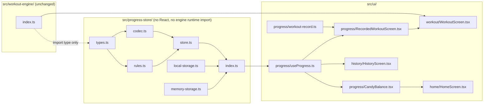

# Design Document: Candy and History

## Overview

This design covers ticket `08-candy-and-history`. It adds the Progress_Store (`src/progress-store/`), a small module with pure rules, a JSON codec, a store with an injected Storage_Adapter, an in-memory adapter and a `localStorage` adapter. On top of it sit a client hook that shares one store per page, a Recording_Bridge that records a Workout when it reaches the summary, a Candy_Balance line on the Home_Screen, a balance line on the Summary_Panel and the History_Screen. The Workout_Engine is not changed and stays pure.

**ADR check.** No conflict with ADR 0001 (website), 0002 (this is the browser-storage design it asks for: one `localStorage` key, no server), 0003 or 0004 (no asset is touched). The tech steering says the Progress store owns "Candy balance, Welcome gift flag, Unlocks, equipped Coach color and Accessories, Coach name, Workout history, resume checkpoint, settings". This ticket builds the first three of the persisted groups it needs (balance, gift flag, history). The rest belongs to tickets 09 to 12 and is added by Schema_Version migration. That is a deferral, not a contradiction.

No requirement needed a change. Readings made while designing, all consistent with `requirements.md`:

1. **Pure rules, thin store.** `rules.ts` holds pure functions over `ProgressData` (`grantWelcomeGift`, `recordWorkout`, `snapshotOf`). `codec.ts` turns text into `ProgressData` and back. `store.ts` only sequences "read, apply a rule, write, notify". Properties are written against the pure layer and the store, with no DOM.
2. **Read-modify-write on every change.** Two tabs share one `localStorage`. A store that kept only an in-memory copy would overwrite the other tab's Candy. Each change therefore re-reads the stored text, applies the rule and writes the whole value in one `setItem` (Requirements 2.4). Live sync of an open second tab is out of scope; the other tab shows the new value after its next change or reload.
3. **Candy and history are written together.** One `setItem` holds both, so a crash between two writes cannot leave a balance without its history entry (Requirement 4.1).
4. **The UI never reads storage during render.** `useProgress` uses `useSyncExternalStore` with a server snapshot of `null`. The server HTML and the first client render show the loading text. The store is created on first use in the browser, which reads storage after hydration (Requirements 14.2 to 14.4).
5. **The Workout code stays storage-free through a bridge.** `WorkoutScreen` gets an optional `onFinished(view)` callback and an optional `recordedBalance` number. The Recording_Bridge (`src/ui/progress/RecordedWorkoutScreen.tsx`) owns the Progress_Store call and the wall-clock read. `src/ui/workout/`, `src/workout-engine/` and `src/app/routines/` keep passing the existing isolation scan with no rule change, because they import `@/ui/progress/…` (not `@/progress-store`) and name no storage API.
6. **Browsing screens never import the store.** The Welcome gift is granted by the three Candy screens only (Home, History, Workout). The existing `viewing-earns-nothing` scan and spec stay true.

### Design decisions at a glance

| Decision | Choice | Main reason |
|---|---|---|
| Storage shape | One key `spooky-coach:progress`, one JSON object | Atomic write of Candy and history (Requirement 4.1) |
| Schema | `schemaVersion: 1`, `candy`, `welcomeGiftGranted`, `history` (oldest first) | Requirement 2.1; later tickets add fields by migration |
| Storage_Adapter | `{ getItem(key), setItem(key, value) }` | Same shape as `Storage`, so the browser adapter is a pass-through and the memory adapter is a `Map` |
| Store API | `snapshot()`, `grantWelcomeGift()`, `recordWorkout(record)`, `subscribe(listener)` | Requirement 1.1; what `useSyncExternalStore` needs |
| History storage order | Append (oldest first); the snapshot reverses it | Append is the only write; newest first is a read concern (Requirement 5.1) |
| Record identity | `id = routineId:finishedAt` | Idempotent recording under Strict Mode (Requirement 4.4) |
| Total Candy earned | Derived: sum over history | One source of truth; the balance and the total cannot disagree (Requirement 5.3) |
| Unreadable data | Treated as no data | A visitor with damaged data can keep using the app (Requirement 2.5) |
| Newer schema | Memory only, never written | Never destroys data a newer app wrote (Requirement 2.6) |
| Storage failure | Memory only, `persistent: false`, Home says so | Private mode and quota errors must not break a Workout (Requirement 2.7, 8.5) |
| Shared store in the browser | Module-level singleton created on first use | One instance per page, so all screens see one state and one listener list |
| Recording point | `onFinished` effect on reaching the summary, guarded by a ref and by the id | Exactly once (Requirement 6.1) |
| Wall-clock date | `Date.now()` in the Recording_Bridge handler | The engine and the store read no clock (Requirements 1.4, 6.9) |
| History date text | `formatWorkoutDate(ms, timeZone?)` using `Intl.DateTimeFormat('en', …)` | Testable with a fixed time zone (Requirement 9.8) |
| History section | `history` joins the list-style Sections in `sections.ts` | Placeholder remains for the Crypt only (Requirement 9.9) |

### Research findings

No external research was needed beyond the code read for this spec:

- `src/workout-engine/index.ts` exports `workoutView`, the commands and the types. `SummaryView` carries `outcome`, `candyEarned`, `setsConfirmed`, `setsSkipped`, `setsNotReached`, `activeMs`, `bonusIncluded` and `results`. `candyFor` is the Candy rule; this ticket reads `view.candyEarned` and never recomputes it.
- `RoutineEntry` has an `id` (the Routine's stable identifier), a `slug`, a `nameId` and the steps. The History_Screen resolves a stored `routineId` with `routines.find((routine) => routine.id === id)` and falls back when it finds nothing. No Catalog change is needed.
- `WorkoutScreen.tsx` is a client island that renders the panels from `useWorkoutRun`. `SummaryPanel` takes `view`, `routine`, `slots` and `headingRef`. `src/app/routines/[slug]/workout/page.tsx` renders `<WorkoutScreen routine={routine} />`.
- `tests/unit/workout-isolation.test.ts` scans `src/ui/routines`, `src/ui/workout`, `src/app/routines` and `src/workout-engine` for storage names and imports of `src/progress-store`. `tests/unit/viewing-earns-nothing.test.ts` scans `src/catalog`, `src/viewer`, `src/ui/exercises`, `src/app/exercises` and `src/app/stretches` for the same. Neither covers `src/ui/home`, `src/ui/history`, `src/ui/progress`, `src/app/history` or `src/app/page.tsx`, so the new code fits without a rule change.
- `src/ui/sections.ts` defines `ListSectionId = 'exercises' | 'stretches' | 'routines'` and derives `placeholderSectionIds` by exclusion. `tests/e2e/support/screens.ts` builds its screen lists from `sectionIds` and `placeholderSectionIds`, so moving `history` out of the placeholders reaches the shared E2E checks without a spec edit. `tests/e2e/navigation.spec.ts` lists History with a `message`, and `tests/unit/strings.test.ts` lists `['crypt', 'history']` as placeholder Sections; both need the change of Requirement 13.4.
- `tests/unit/strings.test.ts` has a test that no `workout.`, `summary.`, `routine.` or `safety.` string matches `saved|kept|stored|balance|added to`. The new `summary.balance` string needs one narrow exception (Requirement 11.6).
- `tests/e2e/workout.spec.ts` (end of the happy path) and `tests/e2e/workout-controls.spec.ts` (`afterEach`) expect all browser stores empty after a Workout. Both change to "only the Storage_Key" (Requirement 13.4).
- `tests/e2e/support/workout.ts` has `openPreparing`, `startWorkout`, `completeWorkout(page, routine, skippedPositions)`, `quitWorkout`, `skipCurrentSet`. They are reused unchanged.
- Playwright's `page.clock.install({ time })` fakes `Date` and `performance.now()` together, so one clock controls both the Workout timers and the recorded `finishedAt`. A context option `timezoneId: 'UTC'` makes the shown date text stable.

Not verified: how `useSyncExternalStore` behaves during hydration when `getServerSnapshot` returns `null` and the client snapshot is non-null. React documents that the server snapshot is used for hydration and the client snapshot right after, so no mismatch is expected. The E2E spec checks the console for hydration warnings (Requirement 14.4).

## Architecture

### Module view



Rules that hold unchanged: `src/workout-engine/` imports no UI, no Viewer and no storage; the Viewer and the engine import each other nowhere; `src/ui/workout/` imports no `src/progress-store/`. New: `src/progress-store/` imports no runtime code outside itself and only `import type` from `@/workout-engine`; only `src/ui/progress/` imports `@/progress-store`, and `src/ui/history/` and `src/ui/home/` use it through `@/ui/progress/useProgress`.

### Files after this ticket

```
src/progress-store/
  types.ts          # ProgressData, WorkoutRecord, ProgressSnapshot, StorageAdapter, RecordResult
  rules.ts          # pure: emptyProgress, grantWelcomeGift, recordWorkout, validateRecord, snapshotOf
  codec.ts          # serialiseProgress, parseProgress
  store.ts          # createProgressStore(storage)
  memory-storage.ts # createMemoryStorage()
  local-storage.ts  # createLocalStorageAdapter(): the only file that names localStorage
  index.ts
src/ui/progress/
  useProgress.ts            # NEW: singleton store + useSyncExternalStore
  CandyBalance.tsx (+ .module.css)  # NEW: Home_Screen island
  RecordedWorkoutScreen.tsx # NEW: Recording_Bridge
  workout-record.ts         # NEW: workoutRecordOf(view, routineId, finishedAt)
src/ui/history/
  HistoryScreen.tsx (+ .module.css)  # NEW
  date.ts                   # NEW: formatWorkoutDate
src/ui/home/HomeScreen.tsx  # + <CandyBalance />
src/ui/workout/WorkoutScreen.tsx   # + onFinished, recordedBalance
src/ui/workout/SummaryPanel.tsx    # + balance line
src/ui/sections.ts          # history becomes a list-style Section
src/ui/strings.ts           # additions and one removal
src/app/history/page.tsx    # renders HistoryScreen
src/app/routines/[slug]/workout/page.tsx  # renders RecordedWorkoutScreen
```

### Recording sequence

```mermaid
sequenceDiagram
  participant E as Workout_Engine
  participant W as WorkoutScreen
  participant B as RecordedWorkoutScreen
  participant H as useProgress
  participant S as Progress_Store
  participant A as Storage_Adapter
  E-->>W: view.phase = summary (outcome, candyEarned)
  W->>B: onFinished(view) once
  B->>B: finishedAt = Date.now(); build Workout_Record
  B->>H: ensureWelcomeGift(); recordWorkout(record)
  H->>S: grantWelcomeGift(); recordWorkout(record)
  S->>A: getItem(key)
  S->>S: parse, apply rule
  S->>A: setItem(key, one JSON text)
  S-->>H: { recorded: true, candyBalance }
  H-->>B: result
  B->>W: recordedBalance = candyBalance
  W-->>W: Summary_Panel shows the balance line
```

## Components and Interfaces

### Types (`src/progress-store/types.ts`)

```ts
import type { WorkoutOutcome } from '@/workout-engine';

export const schemaVersion = 1;
export const welcomeGiftCandy = 15;
export const storageKey = 'spooky-coach:progress';

/** One finished Workout, as the Recording_Bridge hands it over and as it is stored. */
export interface WorkoutRecord {
  /** `${routineId}:${finishedAt}`; unique per Workout. */
  readonly id: string;
  readonly routineId: string;
  /** Milliseconds since the Unix epoch. Display only; never used for order. */
  readonly finishedAt: number;
  readonly outcome: WorkoutOutcome;
  readonly candyEarned: number;
}

/** The JSON value under `storageKey`. Plain, JSON-safe data. */
export interface ProgressData {
  readonly schemaVersion: 1;
  readonly candy: number;
  readonly welcomeGiftGranted: boolean;
  /** Oldest first. */
  readonly history: readonly WorkoutRecord[];
}

export interface ProgressSnapshot {
  readonly schemaVersion: number;
  readonly candyBalance: number;
  readonly welcomeGiftGranted: boolean;
  /** Newest first. */
  readonly history: readonly WorkoutRecord[];
  readonly totalCandyEarned: number;
  /** False when the store works in memory only. */
  readonly persistent: boolean;
}

export type RecordResult =
  | { readonly recorded: true; readonly candyBalance: number }
  | { readonly recorded: false; readonly reason: 'invalid' | 'duplicate' };

export interface StorageAdapter {
  getItem(key: string): string | null;
  setItem(key: string, value: string): void;
}

export interface ProgressStore {
  snapshot(): ProgressSnapshot;
  /** True if this call granted the gift. */
  grantWelcomeGift(): boolean;
  recordWorkout(record: WorkoutRecord): RecordResult;
  /** Returns the unsubscribe function. */
  subscribe(listener: () => void): () => void;
}
```

`WorkoutOutcome` is a type-only import. The valid-outcome list in `rules.ts` is `const outcomes = ['completed', 'partial', 'abandoned'] as const satisfies readonly WorkoutOutcome[]`, plus a compile-time check that `WorkoutOutcome` is assignable to `(typeof outcomes)[number]`, so a new outcome in the engine fails the Type_Check here.

### Pure rules (`rules.ts`)

```ts
export const emptyProgress: ProgressData;   // { schemaVersion: 1, candy: 0, welcomeGiftGranted: false, history: [] }
export function validateRecord(value: unknown): value is WorkoutRecord;
export function grantWelcomeGift(data: ProgressData): ProgressData | null;   // null: already granted
export function recordWorkout(data: ProgressData, record: WorkoutRecord): ProgressData | 'invalid' | 'duplicate';
export function totalCandyEarned(data: ProgressData): number;               // sum over history
export function snapshotOf(data: ProgressData, persistent: boolean): ProgressSnapshot;
```

- `grantWelcomeGift` returns a new `ProgressData` with `candy + 15` and the flag true, or `null` when the flag is already true.
- `recordWorkout` runs `validateRecord` first (`'invalid'`), then checks the id against `history` (`'duplicate'`), then returns `{ ...data, candy: data.candy + record.candyEarned, history: [...data.history, record] }`.
- `validateRecord`: non-empty `id` and `routineId`; `finishedAt` an integer from 0 to 8,640,000,000,000,000 and `candyEarned` a safe integer ≥ 0 (`Number.isSafeInteger`); `outcome` in the list. It checks shape too, because the codec uses it for stored entries.
- `snapshotOf` copies and reverses `history` and sums `candyEarned`. The balance is `data.candy`; the invariant of Requirement 5.3 is a property of the rules, not a recomputation, so a stored value that breaks it is exposed, not hidden (see Error Handling).
- Every function returns new objects and mutates nothing.

### Codec (`codec.ts`)

```ts
export function serialiseProgress(data: ProgressData): string;      // JSON.stringify
export type ParsedProgress =
  | { readonly kind: 'data'; readonly data: ProgressData }
  | { readonly kind: 'none' }                  // no text, not JSON, or the wrong shape
  | { readonly kind: 'newer'; readonly version: number };
export function parseProgress(text: string | null): ParsedProgress;
```

`parseProgress` never throws. `null` gives `none`. Text that is not JSON, is not an object, has a missing or non-integer `schemaVersion`, or fails the v1 shape check (`candy` a non-negative safe integer, `welcomeGiftGranted` a boolean, `history` an array of valid records with unique ids) gives `none`. A `schemaVersion` above 1 gives `newer` before the shape check, so a future shape is never judged by the v1 rules. A `schemaVersion` of 1 with the v1 shape gives `data`. Versions below 1 give `none`. There is no migration code yet; the file header says where a version table goes when version 2 exists.

### Store (`store.ts`)

```ts
export function createProgressStore(storage: StorageAdapter): ProgressStore;
```

Internal state: `memory: ProgressData` (the last known data), `persistent: boolean`, `newer: boolean`, `cached: ProgressSnapshot`, `listeners: Set<() => void>`.

- **Creation:** `load()` once. No write.
- **`load()`:** try `storage.getItem(storageKey)`; on a throw set `persistent = false` and return `memory`. Parse. `data` gives `memory = data`. `none` gives `memory = emptyProgress`. `newer` sets `newer = true`, `persistent = false` and keeps `memory` (empty on the first load).
- **A change** (`grantWelcomeGift`, `recordWorkout`): `const current = load()`, apply the rule to `current`, and if the result is a change, `memory = next`, then write unless `newer`. A write is `storage.setItem(storageKey, serialiseProgress(next))` in a try. A throw sets `persistent = false`; the in-memory change stays. Then rebuild `cached` with `snapshotOf(memory, persistent && !newer)` and call each listener once.
- **No change** (already granted, invalid, duplicate): return without writing and without a new snapshot, so `snapshot()` returns the same object (Requirement 5.6). `load()` may still refresh `memory` from another tab; the cached snapshot is rebuilt only when `snapshotOf` would differ, compared by `candy`, `welcomeGiftGranted`, `history.length` and `persistent`. Same-length histories from different tabs cannot differ in content without a change by this tab, because ids are unique and append-only. (A second tab's write bumps `history.length` or `candy`; any of those rebuilds the snapshot.)
- **`snapshot()`:** returns `cached` as is. It does not read storage.
- **`subscribe(listener)`:** adds to the set; the returned function removes it.

`createProgressStore` has no import of React and no browser global.

### Adapters

`memory-storage.ts`: `createMemoryStorage(initial?: Record<string, string>): StorageAdapter & { dump(): Record<string, string> }`. Backed by a `Map`; `dump` helps tests read the stored text.

`local-storage.ts`: `createLocalStorageAdapter(): StorageAdapter` returning `{ getItem: (k) => window.localStorage.getItem(k), setItem: (k, v) => window.localStorage.setItem(k, v) }`. This is the only file in `src/progress-store/` that names `localStorage`. Reading `window.localStorage` itself can throw in some privacy modes, so the property access sits inside the methods, where the store's `try` catches it.

### Client hook (`src/ui/progress/useProgress.ts`)

```ts
'use client';
export interface ProgressApi {
  /** null until the browser has read storage. */
  readonly snapshot: ProgressSnapshot | null;
  /** True during the visit in which this screen's mount granted the gift. */
  readonly welcomeJustGranted: boolean;
  readonly recordWorkout: (record: WorkoutRecord) => RecordResult;
  readonly ensureWelcomeGift: () => void;
}
export function useProgress(): ProgressApi;
```

- A module-level `let store: ProgressStore | null`. `getStore()` creates it with `createLocalStorageAdapter()` on first call in the browser.
- `useSyncExternalStore(subscribe, () => getStore().snapshot(), () => null)`. `subscribe` calls `getStore().subscribe`.
- One mount effect calls `getStore().grantWelcomeGift()`; if it returns true it sets `welcomeJustGranted` true (never back to false in that mount). Strict Mode's second effect run returns false and does not reset it.
- `recordWorkout` and `ensureWelcomeGift` delegate to the store.
- The file is the only place besides `src/progress-store/` that imports `@/progress-store`, together with `RecordedWorkoutScreen` and `workout-record.ts` (type import).

### Recording_Bridge (`src/ui/progress/RecordedWorkoutScreen.tsx`)

```tsx
'use client';
export function RecordedWorkoutScreen({ routine }: { routine: RoutineEntry }) {
  const progress = useProgress();      // also grants the gift on mount
  const [balance, setBalance] = useState<number | null>(null);
  const onFinished = useCallback((view: SummaryView) => {
    const record = workoutRecordOf(view, routine.id, Date.now());
    progress.ensureWelcomeGift();
    const result = progress.recordWorkout(record);
    if (result.recorded) setBalance(result.candyBalance);
  }, [progress, routine.id]);
  return <WorkoutScreen routine={routine} onFinished={onFinished} recordedBalance={balance} />;
}
```

`workout-record.ts`: `workoutRecordOf(view: SummaryView, routineId: string, finishedAt: number): WorkoutRecord` returns `{ id: `${routineId}:${finishedAt}`, routineId, finishedAt, outcome: view.outcome, candyEarned: view.candyEarned }`. It is pure and takes the time as an argument. `progress` must be stable across renders (memoised in the hook) so `onFinished` does not change identity every render.

If `recordWorkout` returns `recorded: false` (a duplicate under Strict Mode), `balance` stays as the first call set it. If it fails as `invalid`, nothing shows and the summary is complete otherwise (Requirement 6.8).

### `WorkoutScreen` and `SummaryPanel` changes

`WorkoutScreenProps` gains `readonly onFinished?: (view: SummaryView) => void` and `readonly recordedBalance?: number | null`.

```ts
const reported = useRef(false);
useEffect(() => {
  if (view?.phase === 'summary' && !reported.current) {
    reported.current = true;
    onFinished?.(view);
  }
}, [view, onFinished]);
```

`SummaryPanel` gains `balance?: number | null`. When it is a number, the Summary_Panel renders `<p className={styles.text}>{format('summary.balance', { balance: String(balance) })}</p>` after the bonus or no-bonus line. Nothing else changes. `WorkoutScreen` passes `recordedBalance` to it. The live region is unchanged: it announces `workout.announce.summary` or `.ended` once per panel, and the late arrival of the balance does not change it.

### Home_Screen (`src/ui/progress/CandyBalance.tsx`)

```tsx
'use client';
export function CandyBalance(): JSX.Element
```

Uses `useProgress()`. Renders one `<div>` (a reserved block):

- `snapshot === null`: `<p>{t('home.candy.loading')}</p>`.
- Otherwise `<p>{format('home.candy.balance', { candy: String(snapshot.candyBalance) })}</p>`; when `welcomeJustGranted`, a second `<p>` with `format('home.candy.welcome', { candy: String(welcomeGiftCandy) })`; when `!snapshot.persistent`, a `<p>` with `t('progress.unavailable')`.

`HomeScreen` renders `<CandyBalance />` between the tagline and the `<nav>`. It stays a server component; only the island is client code. No live region, no role. Styles in `CandyBalance.module.css` use tokens only, with a `min-height` so the loading text and the value occupy the same space (no layout jump).

### History_Screen (`src/ui/history/HistoryScreen.tsx`, `date.ts`)

`HistoryScreen` is a client component:

- `<h1>` `sectionName('history')`.
- `snapshot === null`: `<p>{t('history.loading')}</p>`.
- Otherwise `<p>{format('history.total', { candy })}</p>` (the Total_Candy_Earned), then either the empty state (`t('history.empty')` and a `Link` to `/routines` with `t('history.empty.link')`) or `<ol aria-label={t('history.list.label')}>` with one `<li>` per `snapshot.history` entry:
  - `<time dateTime={new Date(finishedAt).toISOString()}>{formatWorkoutDate(finishedAt)}</time>`
  - the Routine's Spooky_Name (`routineName(routine)`) or `t('history.entry.unknownRoutine')` when `routines.find((r) => r.id === routineId)` is undefined
  - `format('summary.outcome', { outcome: t(`summary.outcome.${entry.outcome}`) })`
  - `format('summary.candy', { candy })`
- A `Link` back to `/` with `t('common.backHome')`, as on the other screens.

`date.ts`: `export function formatWorkoutDate(ms: number, timeZone?: string): string` returns `new Intl.DateTimeFormat('en', { dateStyle: 'medium', timeStyle: 'short', timeZone }).format(ms)`. It runs only in the browser after hydration (the list is not rendered before the snapshot exists), so no server/client date mismatch can occur. `toISOString()` throws for a time outside the `Date` range, so `validateRecord` bounds `finishedAt` to 0 through 8,640,000,000,000,000 and no stored entry can throw there.

`src/app/history/page.tsx` keeps `export const metadata = sectionMetadata('history')` and renders `<HistoryScreen />`.

### `sections.ts` and strings

`ListSectionId` becomes `'exercises' | 'stretches' | 'routines' | 'history'`, and `placeholderSectionIds` becomes `['crypt']` (derived by the same exclusion). `sectionMessage` stays for the Crypt. The string `section.history.message` is removed; `section.history.name` and `.title` stay.

Strings_Module additions (English first draft; wording may change as long as the string tests pass):

| Identifier | English text |
|---|---|
| `home.candy.loading` | Counting your Candy… |
| `home.candy.balance` | `Candy balance: {candy}` |
| `home.candy.welcome` | `Welcome gift: {candy} Candy from the Coach.` |
| `progress.unavailable` | This browser cannot keep your Candy. It will be forgotten when you leave this page. |
| `summary.balance` | `Your Candy balance is now {balance}.` |
| `history.loading` | Opening the book of past Workouts… |
| `history.total` | `Total Candy earned: {candy}` |
| `history.list.label` | Past Workouts, newest first |
| `history.empty` | No Workouts yet. Start a Routine and your Workouts will be written here. |
| `history.empty.link` | Choose a Routine |
| `history.entry.unknownRoutine` | A Routine that has left the crypt |

The History_Screen reuses `summary.outcome` (`Workout outcome: {outcome}`), `summary.outcome.${outcome}`, `summary.candy` and `common.backHome`. The new templates join `TemplateId`; `tests/unit/strings-format.test.ts` lists them by hand: `home.candy.balance` (`candy`), `home.candy.welcome` (`candy`), `summary.balance` (`balance`), `history.total` (`candy`).

## Data Models

Types are in Components and Interfaces. The persisted value, as stored under `spooky-coach:progress`:

```json
{
  "schemaVersion": 1,
  "candy": 29,
  "welcomeGiftGranted": true,
  "history": [
    { "id": "graveyard-shift:1795000000000", "routineId": "graveyard-shift", "finishedAt": 1795000000000, "outcome": "completed", "candyEarned": 14 }
  ]
}
```

- `schemaVersion`: 1. A later ticket adds fields (Unlocks, equipped look, Coach name, checkpoint, settings) and a migration from 1.
- `candy`: the Candy_Balance. A non-negative safe integer.
- `history`: oldest first, ids unique.
- The value contains no name, email, device id or location. It is plain JSON; clearing site data removes it (ADR 0002).
- Rough size: about 110 bytes per entry. `localStorage` holds roughly 5 MB, so a history of tens of thousands of Workouts fits. No cap is imposed (YAGNI).

Runtime state: the store's `memory`, `persistent`, `newer`, `cached` and `listeners` (React-free), the hook's `welcomeJustGranted`, and the Recording_Bridge's `balance`. Nothing else is persisted.


## Correctness Properties

*A property is a characteristic or behavior that should hold true across all valid executions of a system-essentially, a formal statement about what the system should do. Properties serve as the bridge between human-readable specifications and machine-verifiable correctness guarantees.*

Consolidated during prework reflection: the Welcome gift clauses (3.2, 3.3, 3.5) are one property; the balance, total and order clauses (3.4, 5.1 to 5.4) are one invariant; the duplicate, invalid and idempotence clauses (4.3, 4.4, 4.6, 4.7) are one property about rejected records, with the validity definition (4.2) as its oracle; the newer-version and throwing-adapter clauses (2.6, 2.7) are one property about memory-only modes. Requirements about screens, wording, focus, layout, static scans and the build are examples, scans or Playwright checks, not properties. PBT applies to the Progress_Store because it is pure logic with a large input space (sequences of operations, records and stored texts). It does not apply to the hook, the screens or the Recording_Bridge wiring.

Generators: a valid Workout_Record (non-empty ids, `finishedAt` in range, any of the three outcomes, `candyEarned` from 0 to 60); a list of records with distinct ids; an operation `grant`, `record(record)` or `reload` (a new store over the same adapter); a sequence of operations; a stored text (valid Progress_Data, mutated Progress_Data, arbitrary text). A model keeps the expected gift flag, balance and recorded list for each sequence.

### Property 1: Serialisation round trip

*For any* valid Progress_Data, parsing the text that `serialiseProgress` produced gives `{ kind: 'data' }` with Progress_Data deep-equal to the original, and the text has the Schema_Version 1.

**Validates: Requirements 2.1, 2.8**

### Property 2: A new store over the same storage reports the same state

*For any* sequence of operations, a new Progress_Store created over the same Storage_Adapter after the sequence reports a Progress_Snapshot deep-equal to the snapshot of the store that ran the sequence, including the Candy_Balance, the Welcome gift flag, the History_Entries and their order.

**Validates: Requirements 2.2, 2.9, 3.3**

### Property 3: The Welcome gift is granted at most once

*For any* sequence of grant, record and reload operations, the number of grant calls that return true is at most 1, it is exactly 1 if the sequence contains a grant, and the Candy_Balance includes the 15 Candy of the Welcome gift if and only if a grant returned true.

**Validates: Requirements 3.1, 3.2, 3.5**

### Property 4: Balance, total and order agree

*For any* sequence of operations (including reloads), after every step the snapshot satisfies all of: the History_Entries are exactly the recorded records in reverse recording order; the Total_Candy_Earned equals the sum of their `candyEarned`; the Candy_Balance equals 15 when the gift was granted and 0 otherwise, plus the Total_Candy_Earned; and the history holds no id twice.

**Validates: Requirements 3.4, 5.1, 5.2, 5.3, 5.4**

### Property 5: Recording a valid record adds its Candy once

*For any* store state and any valid Workout_Record whose id is not in the history, recording it reports `recorded: true` with a Candy_Balance equal to the previous Candy_Balance plus `candyEarned`, appends it as the newest History_Entry, and writes the Progress_Data with exactly one `setItem` call that holds both the new balance and the new entry. This holds for `candyEarned` 0 and for each of the three Workout outcomes.

**Validates: Requirements 4.1, 4.5**

### Property 6: Rejected records change nothing

*For any* store state and any Workout_Record that is not valid, or whose id is already in the history, recording it reports `recorded: false` with the reason `invalid` or `duplicate`, leaves the Progress_Snapshot deep-equal and the stored text byte-identical, and makes no `setItem` call. *For any* record, `validateRecord` accepts it if and only if every condition of Requirement 4.2 holds. Recording a valid record twice leaves the same Progress_Data as recording it once.

**Validates: Requirements 4.2, 4.3, 4.4, 4.6, 4.7**

### Property 7: Unreadable stored text is treated as no data

*For any* text, `parseProgress` does not throw. *For any* text that is not valid JSON, is not an object, has a `schemaVersion` that is not an integer of at least 1, or has `schemaVersion` 1 and fails the version 1 shape, it returns `{ kind: 'none' }`, and a store created over an adapter holding that text reports the empty Progress_Snapshot with `persistent` true.

**Validates: Requirements 2.3, 2.5**

### Property 8: Memory-only modes keep the rules and write nothing they must not

*For any* stored text whose `schemaVersion` is an integer above 1, and *for any* sequence of grant and record operations, the store reports `persistent: false`, the stored text is byte-identical afterwards, and the snapshots satisfy Property 3 and Property 4 for the operations run in this page. *For any* adapter that throws on read, on write or on both, and any sequence of operations, the operations return the same results as over a working adapter that starts empty, the snapshots satisfy Property 3 and Property 4, and `persistent` is false after the first throw.

**Validates: Requirements 2.6, 2.7**

### Property 9: Two stores over one storage lose no update

*For any* interleaving of grant and record operations across two Progress_Stores created over the same Storage_Adapter, the Progress_Data that a third new store reads equals the result of applying all accepted operations in interleaving order to the empty Progress_Data (so a change in one store never erases a change made by the other).

**Validates: Requirements 2.4**

### Property 10: Listeners hear each change once

*For any* sequence of operations on a store with a registered listener, the listener is called exactly once for each operation that changed the Progress_Data and not at all for an operation that did not, the snapshot object is replaced exactly when the listener was called, and the same snapshot object is returned by repeated `snapshot()` calls in between.

**Validates: Requirements 5.6**

### Property 11: A summary view maps to a valid record with the same Candy

*For any* valid Routine_Entry and any command script of the Workout_Engine that ends in `summary` (confirms, skips, pauses and a quit among them), `workoutRecordOf(view, routineId, finishedAt)` returns a Workout_Record that `validateRecord` accepts, whose `outcome` and `candyEarned` equal the view's, whose `routineId` equals the argument, and whose `id` equals `routineId`, a colon and `finishedAt`. When the script ends in a quit, `candyEarned` equals the number of confirmed Sets and the record's outcome is `abandoned`.

**Validates: Requirements 6.2, 6.4, 6.5**

## Error Handling

- **Invalid or duplicate record:** `recordWorkout` returns `recorded: false` with a reason and changes and writes nothing. The Recording_Bridge shows no balance line and the Summary_Panel is otherwise complete (Requirement 6.8).
- **Unreadable stored text:** treated as no data. The next change overwrites it with valid Progress_Data. A visitor with damaged data thus gets a new Welcome gift. This is accepted: the alternative, refusing to start, leaves the user with no Candy at all.
- **Stored data that breaks the invariant** (for example a hand-edited `candy` that differs from gift + history): the store reports the stored `candy`, not a recomputed value, and the History_Screen reports the Total_Candy_Earned from the history. Nothing repairs it. The codec only checks shape, not the invariant, because a future ticket that spends Candy will make `candy` smaller than gift + total.
- **Newer Schema_Version:** the store works in memory, `persistent` is false, Home shows the not-persistent text, and the stored text is never touched.
- **Adapter throws** (private mode, quota, disabled storage): the failing read or write is caught; the in-memory change stays; `persistent` is false; Home shows the not-persistent text. A Workout still runs and its summary is complete.
- **Two tabs:** each change re-reads storage first, so changes made by the other tab are not erased. An open second tab does not update until its next change or reload (accepted, out of scope).
- **Strict Mode and double effects:** the `reported` ref in `WorkoutScreen` and the record id make a second `onFinished` or a second record harmless. In development the first `grantWelcomeGift` call returns true and the second false, so `welcomeJustGranted` stays true.
- **Clock changes:** `finishedAt` is display text only. A device clock set backwards cannot reorder the history or break uniqueness except in the same millisecond of the same Routine, which a person cannot do.
- **Unknown Routine id in the history:** the History_Screen shows the fallback text for that item and keeps listing the rest.
- **Hydration:** the server snapshot is `null`, so the server HTML and the first client render match. A storage read never happens during render on the server.
- **Closing the page mid-Workout:** nothing is recorded. The per-Set Candy of that Workout is not kept until ticket 09 adds Resume. This is a known gap and is stated in `requirements.md`.
- **Back button from a summary:** the Workout is already recorded; a second visit to the Workout route starts a new Workout with a new id.

## Testing Strategy

Dual approach: example tests and `fast-check` properties (`fast-check` 4.10.2, `numRuns: 200`, each property test tagged `// Feature: candy-and-history, Property N: …`). Tests use the public interfaces and are named after the rule in glossary terms, for example "a Welcome gift is granted once". PBT applies to the Progress_Store and to `workoutRecordOf`; the screens, the hook and the Recording_Bridge wiring use examples and Playwright. No Progress_Store test uses fake timers or a real clock.

### New and changed unit tests

| File | Content |
|---|---|
| `tests/unit/support/progress.ts` | NEW. Arbitraries for Workout_Records, operations and operation sequences; a model of the expected state; a spy adapter (counts `getItem` and `setItem`, can throw on demand); a `runOperations(store, operations)` driver that handles `reload` by creating a new store over the same adapter |
| `tests/unit/progress-codec.test.ts` | NEW. Property 1 and Property 7; examples: "the stored text carries the schema version 1", "text from a newer schema version parses as newer", "a missing history list parses as no data", "a record with a negative Candy parses as no data" |
| `tests/unit/progress-store.test.ts` | NEW. Property 2, 3, 4; examples: "a fresh store has no Candy and writes nothing", "a Welcome gift is granted once and 15 Candy are added", "the Welcome gift is not granted again after a reload", "the Candy balance persists across a new store over the same storage", "a completed Workout adds 14 Candy", "a partial Workout adds its Candy", "an abandoned Workout adds the Candy for the confirmed Sets", "a Workout with 0 Candy is recorded", "the history lists Workouts newest first", "the total Candy earned excludes the Welcome gift" |
| `tests/unit/progress-modes.test.ts` | NEW. Property 8, 9, 10; examples: "an adapter that throws on write keeps the Candy in memory and reports not persistent", "an adapter that throws on read starts empty and reports not persistent", "data from a newer schema version is never overwritten", "a snapshot that the caller changes does not change the store", "the store reads only through the adapter" |
| `tests/unit/progress-rules.test.ts` | NEW. Property 5 and Property 6 on the pure rules and the store; examples for each invalid field (empty id, negative Candy, a fraction, an unknown outcome, `finishedAt` out of range) |
| `tests/unit/progress-record.test.ts` | NEW. Property 11 using the command-script arbitrary and player of `tests/unit/support/workout.ts` (no new engine support needed); examples: "a completed Graveyard Shift records 14 Candy", "one skipped Set records 8 Candy and outcome partial", "a quit after 3 confirmed Sets records 3 Candy and outcome abandoned", "the record id is the Routine id, a colon and the finish time" |
| `tests/unit/history-date.test.ts` | NEW. `formatWorkoutDate` examples in UTC: a fixed time gives a fixed English text; a time just after midnight shows the next day in a zone ahead of UTC |
| `tests/unit/progress-boundaries.test.ts` | NEW. Scan of `src/progress-store/`: no import of React, Three.js, `@/viewer`, `@/ui`, `@/app`, `@/catalog`, nor runtime import of `@/workout-engine` (only `import type`); no `Date`, `performance`, `window` or `document`; `localStorage`, `sessionStorage`, `indexedDB` named only in `local-storage.ts`, and only `localStorage` there; plus a flagged and a passing fixture. Scan of the whole `src/` for imports of `@/progress-store`: allowed only in `src/ui/progress/` |
| `tests/unit/sections.test.ts` or the existing section test | `placeholderSectionIds` equals `['crypt']` and `history` is a list-style Section. Update the Placeholder list in `tests/unit/strings.test.ts` to `['crypt']` |
| `tests/unit/strings.test.ts` | Update the "saved or added to a balance" test: the same rule over the same prefixes, with the single exception of the id `summary.balance`. Extend the shaming-word test to the `home.`, `history.`, `progress.` and `summary.` prefixes. New examples: every new identifier is non-blank; `history.empty` and `home.candy.loading` contain no digit |
| `tests/unit/strings-format.test.ts` | Add `home.candy.balance`, `home.candy.welcome`, `summary.balance`, `history.total` with their placeholders, by hand |
| `tests/unit/workout-isolation.test.ts`, `viewing-earns-nothing.test.ts` | No rule change. They must pass: nothing under the scanned folders imports the store or names a storage API |
| `tests/unit/repository-rules.test.ts` | Must pass after `.kiro/steering/structure.md` lists `progress-store/` as present and mentions this ticket |

### E2E tests

Run policy as for earlier specs: production build, software WebGL, one spec file and one project at a time with `--workers=1` while developing, the whole suite at the final checkpoint.

1. **`tests/e2e/candy-and-history.spec.ts`** (both projects; `page.clock.install({ time: new Date('2026-11-20T10:00:00Z') })` before `goto`; `test.use({ timezoneId: 'UTC', reducedMotion: 'reduce' })`):
   - a new visitor sees "Candy balance: 15" and the Welcome gift text on the Home_Screen; a reload shows "Candy balance: 15" and no Welcome gift text; localStorage holds exactly the Storage_Key whose JSON has `schemaVersion` 1 and `welcomeGiftGranted` true.
   - the server HTML (`request.get('/')` text, and `javaScriptEnabled: false` page) shows the loading text and no balance; no console message matches `/hydrat/i` on Home and on History.
   - a completed Workout of "Graveyard Shift" (`openPreparing`, `startWorkout`, `completeWorkout`) shows "Candy earned: 14" and "Your Candy balance is now 29" on the summary; Home then shows "Candy balance: 29", also after a reload; the Welcome gift was not granted twice.
   - History after that Workout lists one entry: the date text for the faked time in UTC, "Graveyard Shift", "Workout outcome: Completed", "Candy earned: 14", and shows "Total Candy earned: 14".
   - a second Workout with one skipped Set (`completeWorkout(page, routine, [3])`) and a third that quits after 3 confirmed Sets (`quitWorkout`) add 8 and 3 Candy: Home shows 40; History lists three entries newest first (Abandoned, Partial, Completed) with Candy 3, 8, 14 and total 25. The clock is moved forward between Workouts so the dates differ.
   - a Workout quit before any Set records an entry with Candy 0.
   - a refresh mid-Workout records nothing: History is still empty on a fresh visitor.
   - the empty History_Screen shows the empty text and a link to Routines; it has one `h1`, an ordered list when not empty, a `time` element with `dateTime`, and a link home.
   - seeding `localStorage` (via `addInitScript`) with an entry whose Routine id is unknown shows the fallback text and keeps listing the others; seeding text that is not JSON shows balance 15 and the Welcome gift text (fresh start); seeding a `schemaVersion` of 2 leaves the stored text untouched after a Workout and shows the not-persistent text.
   - an init script that makes `Storage.prototype.setItem` throw shows the not-persistent text on Home, and a Workout still reaches its summary.
   - after all runs `sessionStorage` is empty, `indexedDB.databases()` is empty and cookies are empty.
   - layout and theme: no horizontal scroll and no clipped text at 320 CSS pixels and at 200% text size on Home and History; History buttons and links at least `3rem` tall; computed `animation-name` and `transition-duration` none.
2. **`tests/e2e/workout.spec.ts`** and **`tests/e2e/workout-controls.spec.ts`**: the "browser stores are empty" assertions change to "`localStorage` holds only the Storage_Key; `sessionStorage`, IndexedDB and cookies are empty" (Requirement 13.4). Nothing else changes.
3. **`tests/e2e/navigation.spec.ts`**: History is a list-style Section: its `message` entry and the Placeholder check are replaced by a check of the History_Screen's `h1`, total line and empty text. **`tests/e2e/support/screens.ts`** needs no edit: `history` moves from `placeholderScreens` to `sectionScreens` through `sections.ts`.
4. **`tests/e2e/viewing-earns-nothing.spec.ts`** and **`no-backend.spec.ts`**: unchanged and must pass.

### Human eye checks (not automated)

On a real phone: read the Home_Screen balance and the Welcome gift text at 200% text size; finish one Workout and one quit and check the History list reads well one-handed; clear site data and check the Welcome gift returns; open the Site in a private tab and read the not-persistent text for tone.
