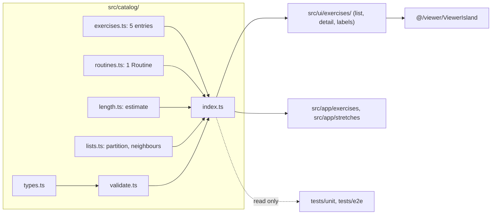

# Design Document: Catalog, Stretches and the Graveyard Shift Routine

## Overview

This design covers ticket `05-catalog-and-stretches`. It grows the Catalog (`src/catalog/`) from one Exercise_Entry to five (three Exercises, two Stretches) plus one Routine_Entry, "Graveyard Shift". It adds a Kind to every entry, Routine types, the Routine length estimate and a validation function over all Catalog_Content. On the Site, the Stretches Placeholder_Screen becomes the Stretch_List_Screen, `/stretches/<slug>` serves the existing Exercise_Detail_Screen for Stretches, and the detail screen gains a target fact and a Previous/Next landmark. No GLB or Still_Image is created (ADR 0004); all ten asset kinds already exist.

Everything stays static (ADR 0002): no storage, no route rendered on demand. The Routines Section stays a Placeholder_Screen; the Routine_Entry is read only by the validation function, the length estimate and tests (ticket 06 consumes it later).

The user decided every open decision with Option A on 2026-11-13 (`requirements.md`). Nothing below is open. One User task remains: add *Rest*, *Routine step*, *Difficulty*, *Muscle group*, *Instruction step*, *Cue*, *Safety note* and *Safety message* to `CONTEXT.md`. No app task touches it.

### Design decisions at a glance

| Decision | Choice | Main reason |
|---|---|---|
| Record types | One `ExerciseEntry` union discriminated by `kind` | "Stretch" is an Exercise in CONTEXT.md; a `stretch` with a reps target fails the Type_Check (Req 1.8) |
| Catalog exports | `catalogContent` plus separate lists and finders | One value for the shipped-content test (Req 4.15); separate lists so no screen filters by hand (Req 1.3, 1.4) |
| `exercises` meaning | Now Kind `exercise` only | Lists and routes use it directly; asset tests switch to `entries` (Req 11) |
| Violation subject | `subjectId` (was `exerciseId`) | A Violation can now name an entry, a Routine_Entry or a Routine_Step |
| Routine shape | `steps` and `coolDown`, an explicit target per step | "Ends with a Cool-down" holds by structure |
| Length estimate | Computed, `secondsPerRep = 3` | Cannot drift from Sets and Rest |
| Stretch_List_Screen | `ExerciseListScreen` takes a `kind` prop | Same markup and CSS; one component to test |
| Stretch detail route | Thin `src/app/stretches/[slug]/page.tsx` | URL matches the Section; `/exercises/<stretch-slug>` is 404 |
| Reset on switch | `key={exercise.id}` on `ViewerIsland` | Reset does not depend on how the framework reuses components |
| Viewing earns no Candy | Static scan plus an E2E storage check | No Progress store yet; ticket 08 adds the behavioural test |

### Research findings

Nothing external was needed. The design rests on the code read for this spec on `main`:

- `src/catalog/index.ts` exports `exercises`, `findExercise`, `exerciseSlugs` and `validateCatalog`; `validate.ts` returns `{ exerciseId, rule }`.
- `src/ui/exercises/ExerciseListScreen.tsx` and `ExerciseDetailScreen.tsx` read `exercises` and the hard-coded `/exercises` back link. `labels.ts` has `exercisePath`.
- `src/ui/sections.ts` defines `PlaceholderSectionId = Exclude<SectionId, 'exercises'>`. `src/app/stretches/page.tsx` renders the Placeholder_Screen.
- `ViewerIsland` takes the `ExerciseEntry`, and `useMemo` creates one controller per load attempt; the page has no `key`, so a client-side switch between two detail pages relies on the framework remounting. The `key` removes that dependency.
- Delivered files under `public/assets/coach/` (checked with the file tools): `coach_grave_rise.glb`, `coach_skeleton_jacks.glb`, `coach_coffin_push.glb`, `coach_stretch_side_reach.glb`, `coach_stretch_forward_fold.glb`, and `stills/{grave_rise,skeleton_jacks,coffin_push,stretch_side_reach,stretch_forward_fold}_{front,side,back}.png`.

Not verified: the clip name `demo_loop` inside the three new GLBs (binary). `tests/unit/coach-assets.test.ts` reads it once the Catalog references the files.

## Architecture

### Module view



The rules of the earlier specs hold unchanged: the Catalog imports only the type `StringId` from `@/ui/strings`, nothing from React, Three.js, the Viewer or browser storage, and never resolves text. `src/ui/` and `src/app/` reach the Viewer only through `@/viewer/ViewerIsland`. The Stretch_List_Screen requests no Coach_Asset, Still_Image or 3D code because it imports no Viewer code.

### Files after this ticket

```
src/catalog/
  types.ts        # + Kind, RoutineStep, RoutineEntry, CatalogContent, drafts, rules
  exercises.ts    # 5 entries (name kept: a Stretch is an Exercise)
  routines.ts     # NEW: Graveyard Shift
  lists.ts        # NEW: partitionByKind, neighbours (pure)
  length.ts       # NEW: secondsPerRep, routineSeconds, routineMinutes
  validate.ts     # new signature, Routine rules
  index.ts        # new exports
src/app/stretches/page.tsx            # now renders the Stretch_List_Screen
src/app/stretches/[slug]/page.tsx     # NEW: thin route, same screen as exercises/[slug]
src/ui/exercises/ExerciseListScreen.tsx   # kind prop
src/ui/exercises/ExerciseDetailScreen.tsx # back link by Kind, target fact, pager, key
src/ui/exercises/labels.ts            # exercisePath by Kind, targetLabel helpers
```

### Switching sequence

```mermaid
sequenceDiagram
  participant V as Visitor
  participant A as Detail screen A
  participant B as Detail screen B
  V->>A: orbit, zoom, change speed
  V->>A: tap Next, list link or browser Back
  A-->>A: unmount ViewerIsland, release WebGL context
  B-->>B: mount ViewerIsland key=B.id, new controller
  B-->>V: Front preset, 1x, clip at first frame
  Note over B: Reduced motion: paused; otherwise playing
```

## Components and Interfaces

### Catalog (`src/catalog/`)

```ts
// types.ts
export const kinds = ['exercise', 'stretch'] as const;
export type Kind = (typeof kinds)[number];
export const muscleGroups = [
  'quads', 'glutes', 'core', 'shoulders', 'calves',
  'chest', 'triceps', 'obliques', 'hamstrings', 'back',
] as const;

export type StretchTarget = { readonly seconds: number; readonly reps?: never };

interface EntryFields { /* every field of today's ExerciseEntry except `target`; all readonly */ }

export type ExerciseEntry =
  | (EntryFields & { readonly kind: 'exercise'; readonly target: ExerciseTarget })
  | (EntryFields & { readonly kind: 'stretch'; readonly target: StretchTarget });
export type EntryOfKind<K extends Kind> = Extract<ExerciseEntry, { readonly kind: K }>;

export interface RoutineStep {
  /** Identifier of the Exercise_Entry. */
  readonly entryId: string;
  readonly sets: number;
  readonly target: ExerciseTarget;
  /** Rest after every Set of this step, in whole seconds. */
  readonly restSeconds: number;
}
export interface RoutineEntry {
  readonly id: string;
  readonly slug: string;
  readonly nameId: StringId;
  readonly steps: readonly RoutineStep[];
  readonly coolDown: readonly RoutineStep[];
}
export interface CatalogContent {
  readonly entries: readonly ExerciseEntry[];
  readonly routines: readonly RoutineEntry[];
}

// Loose shapes: every field optional, strings not narrowed, so tests describe broken content without casts.
export interface ExerciseDraft { /* today's fields */ readonly kind?: string }
export interface RoutineStepDraft {
  readonly entryId?: string; readonly sets?: number;
  readonly target?: { readonly reps?: number; readonly seconds?: number };
  readonly restSeconds?: number;
}
export interface RoutineDraft {
  readonly id?: string; readonly slug?: string; readonly nameId?: string;
  readonly steps?: readonly RoutineStepDraft[]; readonly coolDown?: readonly RoutineStepDraft[];
}
export interface CatalogDraft {
  readonly entries: readonly ExerciseDraft[];
  readonly routines: readonly RoutineDraft[];
}
```

The `kind` and `target` pair makes a `stretch` with `{ reps: n }` a compile error (Req 1.8). `CatalogContent` is assignable to `CatalogDraft`.

**Public interface (`index.ts`)**

```ts
export const catalogContent: CatalogContent;                    // the one value the shipped-content test validates
export const entries: readonly ExerciseEntry[];                 // all, Catalog order
export const exercises: readonly EntryOfKind<'exercise'>[];     // Grave Rise, Skeleton Jacks, Coffin Push
export const stretches: readonly EntryOfKind<'stretch'>[];      // Gravestone Lean, Bat Hang
export const routines: readonly RoutineEntry[];                 // Graveyard Shift

export function entriesOfKind<K extends Kind>(kind: K): readonly EntryOfKind<K>[];
export function findEntry<K extends Kind>(kind: K, slug: string): EntryOfKind<K> | undefined;
export function findExercise(slug: string): EntryOfKind<'exercise'> | undefined;   // = findEntry('exercise', slug)
export function findStretch(slug: string): EntryOfKind<'stretch'> | undefined;
export function exerciseSlugs(): readonly string[];             // Kind exercise only
export function stretchSlugs(): readonly string[];
export function findRoutine(slug: string): RoutineEntry | undefined;

export function partitionByKind<E extends { readonly kind: Kind }>(list: readonly E[]):
  { readonly exercises: readonly E[]; readonly stretches: readonly E[] };   // pure, order kept
export function neighbours<E>(list: readonly E[], entry: E):
  { readonly previous?: E; readonly next?: E };                              // pure, by position

export const secondsPerRep = 3;
export function routineSeconds(routine: RoutineEntry): number;
export function routineMinutes(routine: RoutineEntry): number;               // Math.round(seconds / 60)

export function validateCatalog(content: CatalogDraft): readonly CatalogViolation[];
```

`exercises` and `stretches` are `partitionByKind(entries)`, narrowed by a type guard. Every entry is in exactly one list (Req 1.3). `findEntry(kind, slug)` finds only entries of that Kind, which is what makes `/exercises/<stretch-slug>` a 404.

**Length estimate (Req 5).** `routineSeconds = Σ over [...steps, ...coolDown] of sets × (work + restSeconds)`, with `work = target.reps × secondsPerRep` or `target.seconds`. `routineMinutes = Math.round(routineSeconds / 60)`. Graveyard Shift: `2×(60+30) + 3×(30+30) + 2×(24+45) + 1×(30+10) + 1×(30+10) = 180+180+138+40+40 = 578 s`, which rounds to 10 min.

**Validation (Req 4).** One pass over `entries`, one over `routines`. The step rules look the entry up by `entryId` among entries with a non-blank identifier (first match). Violations come in Catalog order: entries, then each Routine_Entry followed by its steps (`steps`, then `coolDown`), each rule at most once per subject.

`CatalogViolation` is `{ subjectId: string; rule: CatalogRule }`. The `subjectId` is:

| Subject | `subjectId` |
|---|---|
| Exercise_Entry | its `id`, or `#<index>` when blank |
| Routine_Entry | its `id`, or `routine#<index>` when blank |
| Routine_Step | `<routine subjectId>/steps#<i>` or `<routine subjectId>/coolDown#<i>` |

### Catalog rules

The 16 rules of `exercise-page-3d-coach` are unchanged and apply to both Kinds. New rules:

| Rule | Violation when | Requirement |
|---|---|---|
| `kind-unknown` | `kind` is missing or not `exercise` / `stretch` | 4.3 |
| `stretch-reps` | `kind` is `stretch` and `target.reps` is defined | 4.4 |
| `routine-id-missing` / `routine-id-duplicate` | Routine id blank / shared with an earlier Routine_Entry | 4.5 |
| `routine-slug-duplicate` / `routine-slug-format` | slug shared with an earlier Routine_Entry / not `^[a-z0-9-]+$` | 4.5 |
| `routine-name-missing` | `nameId` blank | 3.2 |
| `routine-steps-empty` / `routine-cool-down-empty` | `steps` / `coolDown` missing or empty | 4.6 |
| `step-entry-unknown` | `entryId` matches no entry | 4.7 |
| `step-entry-kind` | in `steps` the entry is a `stretch`; in `coolDown` it is an `exercise` | 4.8 |
| `step-sets` | `sets` is not an integer 1–10 | 4.9 |
| `step-target-kind` | both `reps` and `seconds`, or neither | 4.10 |
| `step-target-value` | the one target value is not an integer > 0 (only when `step-target-kind` passes) | 4.11 |
| `step-target-unit` | step and entry each have exactly one unit and the units differ | 4.12 |
| `step-rest` | `restSeconds` is not an integer 0–600 | 4.13 |

`step-entry-kind` is not reported for an entry whose Kind is unknown (that entry already has `kind-unknown`). `step-target-unit` is not reported when the entry is unknown or either target has no single unit.

### Content

**Entries (`exercises.ts`)** use the values of the requirements table. Asset names:

| Slug | `coach.asset` | Stills (`/assets/coach/stills/…_{front,side,back}.png`) |
|---|---|---|
| `grave-rise` | `coach_grave_rise.glb` | `grave_rise` |
| `skeleton-jacks` | `coach_skeleton_jacks.glb` | `skeleton_jacks` |
| `coffin-push` | `coach_coffin_push.glb` | `coffin_push` |
| `gravestone-lean` | `coach_stretch_side_reach.glb` | `stretch_side_reach` |
| `bat-hang` | `coach_stretch_forward_fold.glb` | `stretch_forward_fold` |

All use `demoClip: 'demo_loop'`. Grave Rise keeps every field and gains `kind: 'exercise'`. The array stays `as const satisfies readonly ExerciseEntry[]`. Each entry has 4 Instruction_Steps, 3 Cues and 2 Safety_Notes.

**Routine (`routines.ts`)**: `id` and `slug` `graveyard-shift`, `nameId: 'routine.graveyardShift.name'`.

| List | `entryId` | `sets` | `target` | `restSeconds` |
|---|---|---|---|---|
| `steps` | `skeleton-jacks` | 2 | `{ reps: 20 }` | 30 |
| `steps` | `grave-rise` | 3 | `{ reps: 10 }` | 30 |
| `steps` | `coffin-push` | 2 | `{ reps: 8 }` | 45 |
| `coolDown` | `gravestone-lean` | 1 | `{ seconds: 30 }` | 10 |
| `coolDown` | `bat-hang` | 1 | `{ seconds: 30 }` | 10 |

### Strings_Module additions (`src/ui/strings.ts`)

Removed: `section.stretches.message`. Kept: `section.stretches.name` and `.title`. Added:

| Identifier | English text (first draft) |
|---|---|
| `exercise.backToStretches` | Back to Stretches |
| `exercise.facts.targetReps` / `exercise.facts.targetSeconds` | Target reps / Target seconds |
| `pager.label` | Previous and next |
| `pager.previous` / `pager.next` (templates, `{exercise}`) | Previous: {exercise} / Next: {exercise} |
| `muscleGroup.{shoulders,calves,chest,triceps,obliques,hamstrings,back}.name` | Shoulders, Calves, Chest, Triceps, Obliques, Hamstrings, Back |
| `routine.graveyardShift.name` | Graveyard Shift |
| `exercise.skeletonJacks.*`, `exercise.coffinPush.*`, `exercise.gravestoneLean.*`, `exercise.batHang.*` | name, realName, step1–4, cue1–3, safety1–2 (below) |

First-draft entry copy (wording may change as long as the string tests pass; none uses an Avoid word, none says or implies correct form, none mentions Candy):

- **Skeleton Jacks / Jumping jacks.** Steps: "Stand tall with your feet together and your arms by your sides." / "Jump your feet out wide while you swing your arms up overhead." / "Jump your feet back together and bring your arms down." / "Repeat at a steady, easy rhythm." Cues: "Land softly on the balls of your feet." / "Keep a small bend in your knees." / "Breathe steadily." Safety: "Stop if your ankles, knees or shoulders hurt." / "March on the spot instead if jumping is too much."
- **Coffin Push / Push-up.** Steps: "Start on your hands and toes with your hands just wider than your shoulders." / "Keep your body in one long line from head to heels." / "Bend your elbows to lower your chest toward the floor." / "Push the floor away to straighten your arms." Cues: "Elbows angle back, not straight out." / "Squeeze your belly and glutes." / "Look at a spot just ahead of your hands." Safety: "Stop if your wrists, shoulders or lower back hurt." / "Rest your knees on the floor if a full push-up is too hard."
- **Gravestone Lean / Standing side reach.** Steps: "Stand with your feet hip-width apart and your arms by your sides." / "Raise one arm overhead." / "Lean gently to the other side until you feel a mild pull along your side." / "Hold for the full time, then come back to standing." Cues: "Breathe slowly." / "Keep both feet flat on the ground." / "Keep your chest facing forward." Safety: "Stretch only to a gentle pull and stop if you feel pain." / "Skip this stretch if your shoulder or back is injured."
- **Bat Hang / Standing forward fold.** Steps: "Stand with your feet hip-width apart." / "Bend your knees a little and fold forward from your hips." / "Let your head and arms hang loose toward the floor." / "Hold for the full time, then roll up slowly." Cues: "Keep a soft bend in your knees." / "Let your neck relax." / "Breathe slowly." Safety: "Stretch only to a gentle pull and stop if you feel pain." / "Roll up slowly so you do not feel dizzy."

`pager.previous` and `pager.next` join `TemplateId` automatically. `tests/unit/strings-format.test.ts` lists its templates by hand, so it gains those two ids (each holds exactly one `{exercise}`).

### UI changes (`src/ui/`)

**`sections.ts`.** `ListSectionId = 'exercises' | 'stretches'`; `PlaceholderSectionId = Exclude<SectionId, ListSectionId>`; `placeholderSectionIds` filters both out. `sectionMessage` then accepts only Routines, Crypt and History, so deleting `section.stretches.message` is safe for the Type_Check. `sectionIds` and their order do not change.

**`metadata.ts`.** `exerciseMetadata(entry)` is unchanged (it takes any `ExerciseEntry`; the title is the Spooky_Name for both Kinds). `sectionMetadata('stretches')` now serves the list screen. No new function.

**`labels.ts`.**
```ts
export function exercisePath(entry: ExerciseEntry): `/exercises/${string}` | `/stretches/${string}`; // by Kind
export function listPath(kind: Kind): '/exercises' | '/stretches';
export function listSection(kind: Kind): 'exercises' | 'stretches';
export function backToListLabel(kind: Kind): string;   // exercise.backToList | exercise.backToStretches
export function targetFact(entry: ExerciseEntry): { readonly label: string; readonly value: string };
```
`exercisePath` keeps its name: a Stretch is an Exercise, and three E2E specs already import it.

**`ExerciseListScreen`** takes `{ kind: Kind }`, reads `entriesOfKind(kind)`, takes its `h1` from `sectionName(listSection(kind))`, and links with `exercisePath`. The CSS module is unchanged. `src/app/exercises/page.tsx` passes `kind="exercise"`; `src/app/stretches/page.tsx` passes `kind="stretch"` and `sectionMetadata('stretches')`. The Stretch_List_Screen is this component with `kind="stretch"`.

**`ExerciseDetailScreen`** (still a Server Component):

1. Back link: `href={listPath(entry.kind)}`, text `backToListLabel(entry.kind)`.
2. `<ViewerIsland key={exercise.id} exercise={exercise} />`.
3. One more `dl` fact after Muscle groups: `targetFact(entry)` (label `exercise.facts.targetReps` or `…targetSeconds`, value the number).
4. A final `<nav aria-label={t('pager.label')}>` with two links built from `neighbours(entriesOfKind(entry.kind), entry)`. Each link text is `format('pager.previous' | 'pager.next', { exercise })`, so its accessible name contains the Spooky_Name. The previous link is omitted on the first entry, the next on the last. The `nav` is omitted if both are absent. CSS goes in `ExerciseDetailScreen.module.css` with tokens only, and touch targets as large as the back link.

**Routes.** `src/app/stretches/[slug]/page.tsx` copies the exercises route file with `stretchSlugs()` and `findStretch`, `dynamicParams = false`, and renders `ExerciseDetailScreen`. `src/app/exercises/[slug]/page.tsx` switches to `findExercise` (already Kind `exercise` only), so a Stretch slug under `/exercises/` returns 404 by the existing `notFound()` path. Both keep `generateMetadata` through `exerciseMetadata`.

## Data Models

Types are in Components and Interfaces. The runtime state added by this ticket is none: the Viewer's state is in memory per mounted island, and nothing is written to `localStorage`, `sessionStorage`, IndexedDB or cookies (ADR 0002).

## Correctness Properties

*A property is a characteristic or behavior that should hold true across all valid executions of a system-essentially, a formal statement about what the system should do. Properties serve as the bridge between human-readable specifications and machine-verifiable correctness guarantees.*

Consolidated during prework: the Kind partition clauses (1.3, 1.4, 6.1, 6.2, 7.3) are one property; all 4.x rules plus 1.8's runtime counterpart are one extension of Property 1 of `exercise-page-3d-coach`.

### Property 1: Catalog validation reports exactly the broken rules

*For any* Catalog_Content of valid Exercise_Entries of both Kinds and valid Routine_Entries, and *for any* set of breakages (at most one per field of each subject) that break known rules, `validateCatalog` returns exactly the violations `subjectId:rule` that the breakages inject, each once, and returns an empty list before they are applied.

**Validates: Requirements 1.2, 4.1, 4.2, 4.3, 4.4, 4.5, 4.6, 4.7, 4.8, 4.9, 4.10, 4.11, 4.12, 4.13**

### Property 2: The Estimated_Length is the sum of Sets × (work + Rest), rounded to the nearest minute

*For any* valid Routine_Entry, `routineSeconds` equals the independent sum over `steps` and `coolDown` of `sets × (work + restSeconds)` with work being `reps × secondsPerRep` or `seconds`, and `routineMinutes` is a whole number within 30 seconds of that sum.

**Validates: Requirements 5.1, 5.2, 5.3**

### Property 3: Previous and Next walk the list in order

*For any* non-empty list of distinct entries, the first entry has no previous and the last no next; for every other entry `previous` and `next` are the adjacent entries; and following `next` from the first entry visits every entry exactly once, in list order.

**Validates: Requirements 8.6**

### Property 4: Kind partition keeps every entry once, in order

*For any* list of entries with Kinds, `partitionByKind` returns two lists whose union is the whole list, whose intersection is empty, that each hold only their own Kind, and that each keep the order of the input.

**Validates: Requirements 1.3, 1.4, 6.1, 6.2, 7.3**

## Error Handling

- Bad Catalog content is caught by the validation test (Req 4.14), not at runtime. The Catalog never throws.
- An unknown or wrong-Kind slug under `/exercises/` or `/stretches/` returns the static 404 (`dynamicParams = false` plus `notFound()`).
- A neighbour that does not exist is omitted, not rendered as a dead link.
- Viewer failure states are unchanged (Still_Fallback with the entry's own Still_Images, which exist for all five).
- A reps or seconds target is shown from the entry's own `target`; a `stretch` cannot have reps by type and by rule.

## Testing Strategy

Dual approach: required example tests plus the four fast-check properties above (`fast-check` 4.10.2 is installed; `numRuns: 200`; each test carries the tag `// Feature: catalog-and-stretches, Property N: …`). Per the steering, tests use the public interface and are named after the rule in glossary terms. PBT does not apply to the screens, routes or the Viewer (rendering and browser behaviour): those use examples, the static scans and E2E.

### Unit tests that change (Requirement 12)

| File | Change |
|---|---|
| `tests/unit/catalog.test.ts` | `validateCatalog(catalogContent)` replaces `{ exercises }`; `exerciseId` becomes `subjectId`; fixtures and Property 1 generators gain `kind` and Routines; the "one Exercise" test becomes "the Catalog holds three Exercises and two Stretches"; slug tests cover both Kinds; one failing example per new rule; `everyRule` stays a mapped type over `CatalogRule` |
| `tests/unit/catalog.type-check.ts` | add `@ts-expect-error` for a `stretch` with `{ reps: 1 }` and for assigning a Routine_Entry field or pushing to `steps` |
| `tests/unit/coach-assets.test.ts` | read `entries`, not `exercises`; budgets apply to all five Coach_Assets and fifteen Still_Images |
| `tests/unit/module-boundaries.test.ts` | `catalogAssetNames()` reads `entries`; its scanners also cover `src/app/stretches/` |
| `tests/unit/strings.test.ts` | `placeholderSectionIds` is `['routines', 'crypt', 'history']`; new "no Exercise, Stretch, Viewer or Safety_Message string mentions Candy or a reward" (Req 10.4); the existing Avoid-word and form-claim tests cover the new strings unchanged |
| `tests/unit/strings-format.test.ts` | add `pager.previous` and `pager.next` to `templateIds` |
| `tests/unit/repository-rules.test.ts` | no edit; it fails until `structure.md` lists `src/app/stretches/[slug]/` (Req 12.7) |
| `tests/unit/source-rules.test.ts` | no edit; its scans already cover `src/ui/exercises/` and `src/catalog/` and must still pass |

### New unit tests

- `tests/unit/catalog-lists.test.ts`: Properties 3 and 4, plus examples ("the Exercises are Grave Rise, Skeleton Jacks, Coffin Push in order", "the Stretches are Gravestone Lean, Bat Hang in order", "a Stretch slug finds nothing as an Exercise").
- `tests/unit/routine-length.test.ts`: Property 2, "Graveyard Shift is between 540 and 660 seconds and rounds to 10 minutes", "Graveyard Shift ends with a Cool-down of Stretches" (every `coolDown` entry resolves to Kind `stretch`).
- `tests/unit/viewing-earns-nothing.test.ts` (Req 10.1, 10.2): reads the files of `src/catalog/`, `src/viewer/`, `src/ui/exercises/`, `src/app/exercises/` and `src/app/stretches/` and fails on an import path containing `progress-store` or `workout-engine`, and on `localStorage`, `sessionStorage`, `indexedDB` or `document.cookie`. It reuses the comment-stripping scanner helpers of `module-boundaries.test.ts` and has its own fixture self-tests, as that file does. Ticket 08 adds the behavioural test (balance unchanged after viewing).

### E2E tests that change

| File | Change |
|---|---|
| `tests/e2e/support/screens.ts` | `sectionScreens` now includes `/stretches`; add `stretchListScreen`; `exerciseDetailScreens` is built from `entries` with `exercisePath`; `placeholderScreens` shrinks to three |
| `tests/e2e/support/webgl.ts` | `exerciseOnPage` accepts `/exercises/<slug>` and `/stretches/<slug>` and resolves with `findEntry` by the Kind of the path |
| `tests/e2e/navigation.spec.ts` | Stretches is a `list` screen, not a placeholder; checks by Home navigation, direct request and reload |
| `tests/e2e/static-build.spec.ts` | `exerciseDetailRoutes` built from `entries`; `srcRoute` is `/exercises/[slug]` for Exercises and `/stretches/[slug]` for Stretches |
| `tests/e2e/not-found.spec.ts` | add `/exercises/<stretch-slug>`, `/stretches/<exercise-slug>` and unknown slugs under `/stretches/`, all HTTP 404 |
| `tests/e2e/exercise-detail.spec.ts` | loops over `entries` with `exercisePath`; back link name and `href` by Kind; target fact; Pager links and the omitted ends |
| `tests/e2e/exercise-list.spec.ts` | runs its checks for `kind` `exercise` and `stretch`; a Stretch never appears in the Exercises list and the reverse |
| `tests/e2e/no-backend.spec.ts`, `layout.spec.ts`, `theme.spec.ts`, `decorations.spec.ts` | no edit; they read `screens` and pick up the new screens (Req 12.4) |
| `tests/e2e/viewer.spec.ts` | add "the Coach loads for every Exercise_Entry": for each of the five entries, `waitForCoach` then the image named after its Spooky_Name (Req 11.4) |

### New E2E tests

**Switching resets the Viewer** (`tests/e2e/switching.spec.ts`, `test.use({ reducedMotion: 'reduce' })`, both projects). Under reduced motion the Coach starts paused at the first frame and the camera never moves by itself, so a canvas picture is deterministic (`settledPicture` of `viewer.spec.ts`, moved into a shared support file).

1. Load B fresh, take `fresh = settledPicture`.
2. Load A, then change the camera (Side preset, Zoom in), the speed (0.5×) and press Play, then pause. Assert the picture differs from A fresh (non-vacuous guard).
3. Switch to B by (a) the Next link, (b) a list link, (c) the browser Back button, one test each.
4. Assert `settledPicture` equals `fresh` byte for byte, the 1× button has `aria-pressed="true"`, and the Play button is shown (paused).

Pairs cover same-Kind (Grave Rise → Skeleton Jacks) and cross-Kind (Skeleton Jacks → list → Gravestone Lean) switches. A fourth test checks that the first screen's WebGL context is lost after leaving, using the context-capture technique of the existing "releases the WebGL context" test in `viewer.spec.ts` (Req 9.5). Without reduced motion, one test asserts the new entry's Play/Pause button reads Pause (playing) and no camera preset button keeps the old selection (Req 9.2).

**Viewing earns no Candy** (`tests/e2e/viewing-earns-nothing.spec.ts`). Open both list screens and every detail screen, play, pause and change the speed on one. Then assert `localStorage.length === 0`, `sessionStorage.length === 0`, `await indexedDB.databases()` is empty, `document.cookie === ''` and `context.cookies()` is empty.

### Human eye checks (not automated)

On a real phone, after the tasks pass:

1. Open Coffin Push (the push-up clip) at the Front, Side and Back presets. Check the whole body stays inside the Viewer_Area during the lowest and highest frames, and the Side preset reads as a push-up.
2. Open Gravestone Lean and Bat Hang the same way. Check the reach stays in frame at Front and Side, the fold is not cut off at the Side preset, and the loop looks like a held stretch.
3. Check the target fact, the Pager and the Stretches list at 200 % text size.
4. Check Skeleton Jacks at the Front preset (arms and legs both in frame).

Findings are fixed in the Asset_Pipeline (ADR 0004) or, if the camera framing is at fault, in a follow-up ticket; they are not app tasks here.
