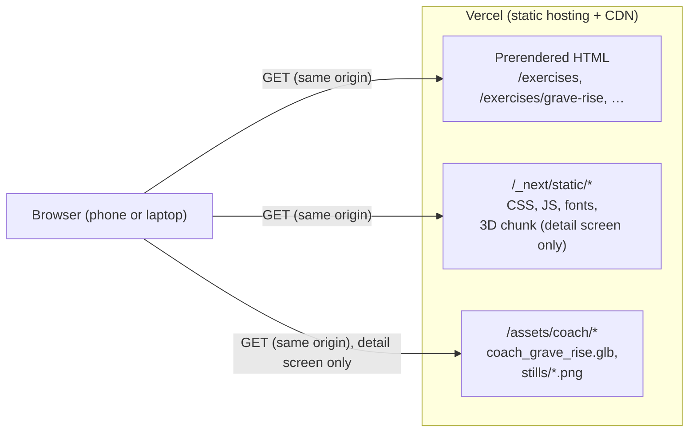
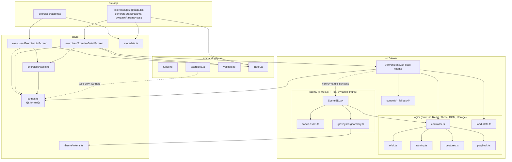
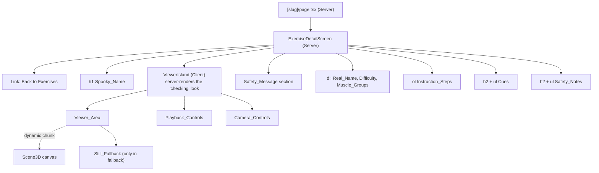
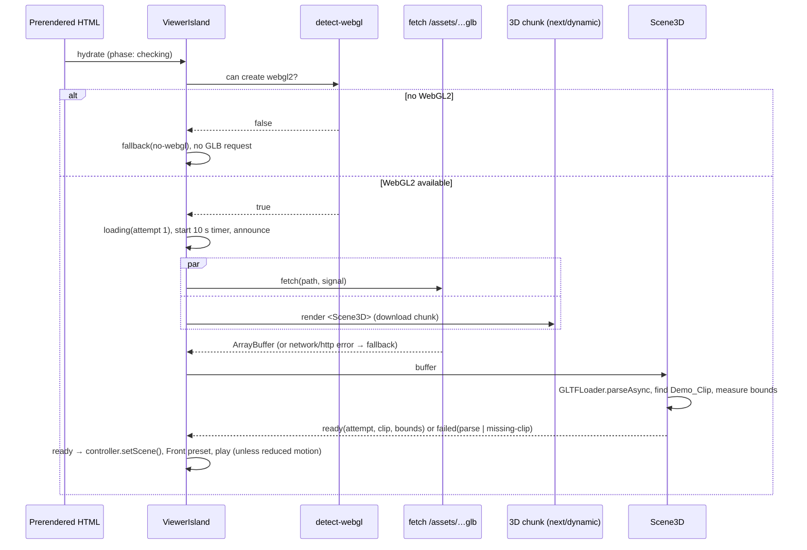
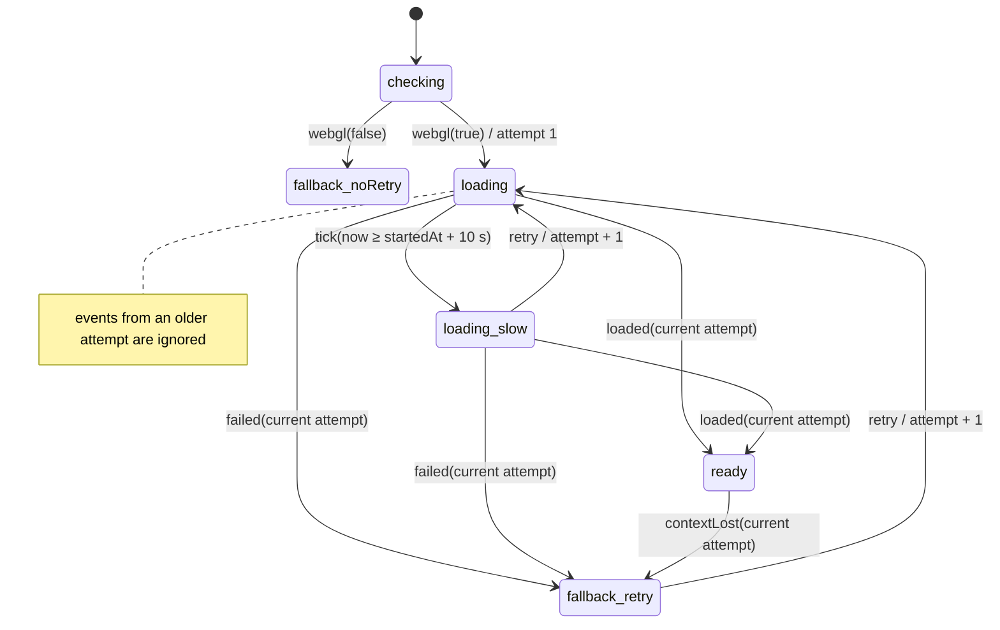

# Design Document: Exercise Page with the 3D Coach

## Overview

This design covers ticket `03-exercise-page-3d-coach`. It replaces the `/exercises` Placeholder_Screen with the Exercise_List_Screen, adds a statically prerendered Exercise_Detail_Screen at `/exercises/grave-rise`, and creates the first two modules from the steering's proposed layout: the **Catalog** (`src/catalog/`) and the **Viewer** (`src/viewer/`).

The Exercise_Detail_Screen is a Server Component. Its Written_Content and the Safety_Message are in the prerendered HTML. The Viewer is one client island on that screen. The island is light: it holds the loading state machine, the live region, the buttons and the Still_Fallback, and it imports no 3D code. The 3D part (Three.js, React Three Fiber, the GLTF loader and the Graveyard_Scene) is a separate chunk that the island loads with `next/dynamic` only after it has confirmed that the browser can create a WebGL2 context. No other screen imports the island, so no other screen downloads 3D code.

All decisions the Viewer makes (camera limits, preset framing, gesture maths, playback time, what to draw and when to stop drawing, loading, slow loading and fallback) live in plain TypeScript modules under `src/viewer/logic/` with no React, Three.js, DOM or storage imports. They take time as an argument (`now` in milliseconds), so the Unit_Suite drives them with an injected clock. The React and Three.js layers only translate events into calls on these modules and apply the results.

### Design decisions at a glance

| Decision | Choice | Main reason |
|---|---|---|
| 3D stack | `three` 0.187.0 + `@react-three/fiber` 9.8.2, **no drei** | Steering names R3F. drei's `useGLTF` sets a Draco decoder path on Google's CDN by default and its controls cannot express the bounding-box limit, button parity or the demand-driven loop without wrapping. The few pieces needed are small to write and easier to test (see Research findings) |
| Camera controls | Hand-rolled orbit rig driven by `src/viewer/logic/orbit.ts` | One pure module owns Azimuth, Elevation and Camera_Distance for gestures, buttons and presets, so the limits of Requirement 6 hold for every input path and are property-tested |
| GLB loading | `fetch` in the island, then `GLTFLoader.parseAsync` from `three/addons` in the 3D chunk | `fetch` reports network errors and HTTP status separately (Requirement 9.7), supports `AbortController` for Retry, and runs in parallel with the 3D chunk download |
| Animation | Three.js `AnimationMixer`, with clip time owned by `logic/playback.ts` | The pure playback model decides clip time from drawn-frame time only (Requirement 10.6); the mixer only poses the skeleton at that time |
| Render loop | R3F `frameloop="demand"`; the frame callback calls `invalidate()` only while the Viewer controller says another frame is needed | No frame is drawn while paused and still, Page_Hidden or scrolled away (Requirement 10). Explained under "Render_Loop" |
| Detail route | `src/app/exercises/[slug]/page.tsx` with `generateStaticParams` from the Catalog and `dynamicParams = false` | New Exercises (ticket 05) and a CC0_Fallback need no route file. Unknown slugs return the static 404. The static-build guard test changes as described under "Static build" |
| 3D code only on the detail screen | `next/dynamic(() => import('./scene/Scene3D'), { ssr: false })` inside the client island, plus a module-boundary unit test and an E2E chunk test | Requirement 13.6 |
| Strings with an Exercise name | New `format(id, values)` in the Strings_Module with type-checked `{placeholder}` names | One template per sentence instead of one string per Exercise; stays Thai-ready. Ticket 01 deferred parameters "until a string first needs one"; this ticket is that point |
| Component tests | None (no jsdom, no Testing Library) | Every rule with logic is in a pure module tested in the `node` environment; DOM behaviour is checked by Playwright against the production build. Avoids two dependencies |
| GLB budget check | Small GLB reader in `tests/unit/support/glb.ts` | No new dependency; reads the JSON chunk, counts triangles, materials and texture sizes, lists animations and decoder-requiring extensions (Requirement 13.3) |
| Graveyard_Scene | Built in app code from Three.js primitives (Open decision 4, Option A) | No new asset before the Nov 13 check |

### Open decisions (still for the user)

The design follows the recommended Option A of each open decision in `requirements.md`, as the requirements do. Nothing below silently decides them; each row says what changes under the other option.

| Open decision | What the design assumes (Option A) | What changes under the other option |
|---|---|---|
| 1. How assets reach `public/assets/` | The Asset_Pipeline copies `assets/coach/coach_grave_rise.glb` to `public/assets/coach/coach_grave_rise.glb` and renders `grave_rise_front.png`, `grave_rise_side.png` and `grave_rise_back.png` into `public/assets/coach/stills/`; both are committed. App tasks only reference the paths through the Catalog. | **B:** add one `prebuild` copy script and point the asset tests at the copied files after the copy step; Catalog paths stay the same. **C:** no code change, but `assets/coach/*.blend` and `*.py` become public downloads; the design advises against it. |
| 2. Catalog validation scope | `validateCatalog` with the Exercise-level rules and one test over shipped content. | **B:** delete `src/catalog/validate.ts`, its tests and Property 1. The types alone still enforce most rules at compile time. |
| 3. Tilt buttons | Six-button camera pad (Rotate left/right, Tilt up/down, Zoom in/out) plus Front/Side/Back. | **B:** drop the two Tilt buttons from `CameraControls` and their strings; Camera_Presets already reset Elevation to 5°. No logic change. |
| 4. Scenery source | `graveyard-geometry.ts` builds the scene from primitives. | **B:** `Graveyard.tsx` loads a second GLB from `/assets/scene/…` through the same `fetch` + parse path, and the triangle-budget test reads it like the Coach_Asset. |
| 5. Glossary gaps | The spec's glossary terms (Difficulty, Muscle_Group, Instruction_Step, Cue, Safety_Note, Safety_Message) are used as defined in `requirements.md`, with three Difficulty levels. | If the user adds them to `CONTEXT.md` with other names, only identifiers and string ids are renamed. |

Housekeeping that belongs to the user or the Asset_Pipeline, not to app tasks: commit `assets/coach/` (ticket 02), gitignore `*.blend1`, and delete the stray `[render_dir]/` folder after the Still_Images are delivered. The 360 × 480 preview PNGs in that folder (about 190 KB each) already meet the 300 KB limit of Requirement 13.4, so the Asset_Pipeline can deliver the Still_Images from a re-render at the same size.

### Research findings

Versions were checked with `npm view` on the build machine on the day of writing.

| Package | Pin | Licence | Notes |
|---|---|---|---|
| `three` | 0.187.0 | MIT | Published 2026-10-30. WebGL2 only since r163, so the WebGL check asks for `webgl2`. `GLTFLoader` is imported from `three/addons/loaders/GLTFLoader.js`. Colour management is on by default: hex colours are treated as sRGB and converted, so token colours render as written on unlit materials when tone mapping is off |
| `@react-three/fiber` | 9.8.2 | MIT | Peer range `react >=19 <19.4`, `react-dom >=19 <19.4`, `three >=0.156`; Expo and React Native peers are optional. React 19.3.1 and three 0.187.0 satisfy it. Its `scheduler ^0.28.0` dependency matches `react-dom@19.3.1`. **Upgrading React to 19.4 later needs an R3F release that widens the peer range.** Runtime deps (zustand, its-fine, suspend-react, react-use-measure, use-sync-external-store, buffer, base64-js, @babel/runtime) are MIT |
| `@types/three` | 0.187.0 (dev) | MIT | Matches three. Pulls type-only transitive deps (fflate, meshoptimizer, @tweenjs/tween.js, @dimforge/rapier3d-compat under Apache-2.0); all allowed by Requirement 13.8 |
| `@react-three/drei` | not installed | MIT | 10.7.9 would be compatible (`@react-three/fiber ^9`). Not used: see below |

drei trade-off. `OrbitControls`, `useGLTF` and `useAnimations` would save perhaps 150 lines. Against that: `useGLTF` configures a `DRACOLoader` whose default decoder path is on `www.gstatic.com`, so a Draco-compressed CC0_Fallback asset would send a cross-origin request and break Requirement 13.5; `OrbitControls` clamps distance and polar angle but cannot express "outside the enlarged bounding box" or step the camera from buttons and presets with the same clamping, and its damping keeps moving after a gesture ends, which Requirement 11.3 forbids under reduced motion. Hand-rolling keeps every camera rule in one tested module and keeps the 3D chunk to three core, `GLTFLoader` and R3F. Rough gzip sizes: three core with `WebGLRenderer` 160–180 KB, `GLTFLoader` about 15 KB, R3F with its bundled reconciler about 50 KB. The real numbers are read from the `next build` output during implementation; none of it is downloaded outside the Exercise_Detail_Screen.

R3F render loop ([R3F `loop.ts`](https://github.com/pmndrs/react-three-fiber/blob/master/packages/fiber/src/core/loop.ts), [scaling-performance docs](https://github.com/pmndrs/react-three-fiber/blob/master/docs/advanced/scaling-performance.mdx)): with `frameloop="demand"` a frame is drawn only after `invalidate()`; several calls before the next animation frame draw one frame. The frame callback's `delta` comes from `THREE.Clock.getDelta()`, so after an idle gap it includes the whole gap. The design therefore ignores R3F's `delta` and lets `logic/playback.ts` compute clip time from timestamps it resets on every pause, hide and resume.

R3F disposal ([objects docs](https://github.com/pmndrs/react-three-fiber/blob/master/docs/API/objects.mdx), `renderer.ts`): on unmount R3F disposes the objects it created, then calls `WebGLRenderer.dispose()` and `forceContextLoss()`. It never disposes `<primitive object>` contents. The parsed GLTF scene is mounted as a primitive, so the design disposes its geometries, materials and textures itself (Requirement 5.8). `forceContextLoss()` fires a `webglcontextlost` event during an intended unmount; the load state machine ignores context loss from a stale attempt, so this does not trigger the Still_Fallback.

Next.js ([dynamicParams](https://nextjs.org/docs/app/api-reference/file-conventions/route-segment-config/dynamicParams), [generateStaticParams](https://nextjs.org/docs/app/api-reference/functions/generate-static-params), [generateMetadata](https://nextjs.org/docs/app/api-reference/functions/generate-metadata)): with `dynamicParams = false`, only the params returned by `generateStaticParams` are served and any other segment returns 404. `params` is a `Promise` in pages and in `generateMetadata`. `dynamicParams` is unavailable with Cache Components, which this project does not enable. `next/dynamic` with `ssr: false` is allowed only inside Client Components.

Headless WebGL: Chromium no longer falls back to SwiftShader for WebGL without `--enable-unsafe-swiftshader` ([blink-dev announcement](https://groups.google.com/a/chromium.org/g/blink-dev/c/yhFguWS_3pM/m/YUEOoPeUAAAJ)). On a machine without a usable GPU, headless Chromium would then report no WebGL and every 3D test would see the Still_Fallback. The Playwright config therefore launches Chromium with software WebGL (see "Playwright config").

Content was rephrased for compliance with licensing restrictions.

## Architecture

### Runtime view



Everything stays static (ADR 0002). The Coach_Asset is fetched only after the WebGL2 check passes; the Still_Images only when the Still_Fallback is shown.

### Module view



Dependency rules, each enforced by `tests/unit/module-boundaries.test.ts`:

- `src/catalog/` imports only from `src/catalog/` and, type-only, `StringId` from `@/ui/strings` (Requirement 1.7).
- `src/viewer/logic/` imports only from `src/viewer/logic/` (no `react`, `three`, `@react-three/*`, `next/*`, no `window`, `document`, `localStorage` or `sessionStorage` identifiers).
- Only files under `src/viewer/scene/` import `three`, `three/addons/*` or `@react-three/*`.
- Nothing outside `src/viewer/scene/` imports a file under `src/viewer/scene/` statically. The single `import('./scene/Scene3D')` call in `ViewerIsland.tsx` is the only reference.
- `src/ui/` and `src/app/` import the Viewer only through `@/viewer/ViewerIsland`.

### Directory layout after this ticket

```
src/
├── app/
│   └── exercises/
│       ├── page.tsx                 # Exercise_List_Screen route (replaces the Placeholder_Screen)
│       └── [slug]/page.tsx          # Exercise_Detail_Screen route, static params from the Catalog
├── catalog/
│   ├── types.ts                     # ExerciseEntry, ExerciseDraft, CatalogViolation, …
│   ├── exercises.ts                 # Grave Rise content
│   ├── validate.ts                  # validateCatalog()
│   └── index.ts                     # exercises, findExercise(), exerciseSlugs(), validateCatalog
├── viewer/
│   ├── ViewerIsland.tsx             # 'use client' shell
│   ├── ViewerIsland.module.css
│   ├── controls/                    # PlaybackControls.tsx, CameraControls.tsx, icons.tsx, controls.module.css
│   ├── fallback/                    # LoadingArt.tsx, StillFallback.tsx, fallback.module.css
│   ├── browser/                     # useViewerEnvironment.ts (visibility, IntersectionObserver, reduced motion), detect-webgl.ts, fetch-coach-asset.ts
│   ├── logic/                       # orbit.ts, framing.ts, gestures.ts, playback.ts, controller.ts, load-state.ts, geometry-types.ts
│   └── scene/                       # Scene3D.tsx, CameraRig.tsx, CoachActor.tsx, Graveyard.tsx, coach-asset.ts, graveyard-geometry.ts, dispose.ts
└── ui/
    └── exercises/                   # ExerciseListScreen.tsx, ExerciseDetailScreen.tsx, labels.ts, *.module.css
public/
└── assets/coach/                    # delivered by the Asset_Pipeline (Open decision 1, Option A)
    ├── coach_grave_rise.glb
    └── stills/grave_rise_{front,side,back}.png
tests/
├── unit/
│   ├── catalog.test.ts, catalog.type-check.ts
│   ├── coach-assets.test.ts         # files exist, GLB budget, still sizes, whole-scene triangles
│   ├── module-boundaries.test.ts
│   ├── viewer-orbit.test.ts, viewer-framing.test.ts, viewer-playback.test.ts,
│   ├── viewer-controller.test.ts, viewer-load-state.test.ts, viewer-gestures.test.ts
│   ├── strings-format.test.ts, strings.type-check.ts (extended)
│   └── support/glb.ts, support/glb.test.ts
└── e2e/
    ├── exercise-list.spec.ts, exercise-detail.spec.ts,
    ├── viewer.spec.ts, viewer-fallback.spec.ts, viewer-render-loop.spec.ts
    └── support/screens.ts, support/webgl.ts
```

`src/viewer/browser/` holds the small DOM adapters (visibility, intersection, media query, WebGL probe, fetch). They are the only Viewer files outside `scene/` that touch browser APIs, and they hold no decisions.

### Exercise_Detail_Screen composition



DOM order equals visual order (no CSS reordering), so Tab order follows reading order (Requirement 12.4). The back link sits at the top because phone visitors land deep in the Viewer; the Exercise_List_Screen keeps the bottom position of the Placeholder_Screen's back-home link for consistency with ticket 01.

Phone height budget at the default text size (Requirement 12.6, Phone_Viewport 360 × 640): Decoration band 72 px + back link 48 px + gap 8 px + `h1` about 45 px + Viewer_Area 320 px (`min(50svh, 30rem)`) + gap 8 px + Playback_Controls row 48 px ≈ 549 px, which leaves about 90 px of slack. The Viewer_Area is 50 % of the viewport height, inside the 60 % limit of Requirement 6.9.

### Loading sequence



### Render_Loop

R3F runs with `frameloop="demand"`. The rule that decides whether the next frame is drawn sits in `logic/controller.ts`:

```
keepDrawing = visible && (playing || cameraTweenActive || gestureActive)
visible     = !pageHidden && viewerAreaIntersectsViewport
```

- The R3F frame callback calls `controller.frame(now)`, applies the returned clip time and camera pose, and calls `invalidate()` only when `keepDrawing` is true.
- Commands that change the picture (play, a Camera_Control, a pointer move, a new Playback_Speed while playing, becoming visible again) make the controller call its `requestFrame` hook, which Scene3D wires to `invalidate()`.
- Pausing, hiding the page (`visibilitychange`) or scrolling the Viewer_Area fully out of view (`IntersectionObserver`, threshold 0) makes `keepDrawing` false, so the loop ends after the current frame. They also suspend the playback clock, so the next drawn frame advances the clip by 0 (Requirements 10.3–10.6).
- `frameloop="never"` was considered. It would need a hand-written `requestAnimationFrame` loop calling `advance()`; `"demand"` gives the same "no frames" result with less code, because nothing calls `invalidate()` while idle.
- A Viewer_Area resize makes R3F draw one frame so the canvas is not stretched. This is the only frame drawn while paused and still, as Requirement 10.1 allows.

Viewer speed and Workout time: the Viewer owns no shared clock and exports nothing time-related. Playback_Speed only scales the clip-time increment inside `logic/playback.ts`. The Workout engine (ticket 06) will have its own injected clock and never reads the Viewer, so a Viewer speed change cannot affect Workout time.

## Components and Interfaces

### Strings_Module additions (`src/ui/strings.ts`)

New entries are listed under Data Models. One new function:

```ts
/** `{name}` placeholders in a string type, e.g. 'A {x} b {y}' → 'x' | 'y'. */
type Placeholders<S extends string> =
  S extends `${string}{${infer Name}}${infer Rest}` ? Name | Placeholders<Rest> : never;

/** Identifiers whose English text has at least one placeholder. */
export type TemplateId = { [K in StringId]: Placeholders<(typeof en)[K]> extends never ? never : K }[StringId];

/**
 * Returns the active Locale's text for a template identifier with every
 * `{name}` replaced by values[name]. A missing or extra value fails the Type_Check.
 */
export function format<I extends TemplateId>(
  id: I,
  values: { readonly [P in Placeholders<(typeof en)[I]>]: string },
): string;
```

`format` replaces with a single regular expression (`/\{([a-z][a-zA-Z]*)\}/g`) and leaves unknown placeholders untouched. `t()` stays as it is. A later Thai Locale must keep the same placeholders per identifier; a runtime test checks this for every registered Locale.

### Catalog (`src/catalog/`)

```ts
// index.ts — the public interface
export type { ExerciseEntry, ExerciseDraft, CatalogDraft, CatalogViolation, CatalogRule,
              Difficulty, MuscleGroup, ExerciseTarget, StillView } from './types';
export { difficulties, muscleGroups, stillViews } from './types';
export const exercises: readonly ExerciseEntry[];               // Catalog order
export function findExercise(slug: string): ExerciseEntry | undefined;
export function exerciseSlugs(): readonly string[];
export function validateCatalog(content: CatalogDraft): readonly CatalogViolation[];
```

- `exercises.ts` declares the content `as const satisfies readonly ExerciseEntry[]`; every field and array in `ExerciseEntry` is `readonly`, so an assignment fails the Type_Check (Requirement 1.6), checked by `tests/unit/catalog.type-check.ts` with `@ts-expect-error`.
- Text fields are `StringId`s (Requirement 1.4). The Catalog never calls `t()`; `src/ui/exercises/labels.ts` resolves labels.
- `validateCatalog` takes the loose `CatalogDraft` shape so tests can pass broken content without casts; the real `exercises` array is assignable to it. It returns violations in Catalog order, each rule at most once per Exercise_Entry.

### UI screens (`src/ui/exercises/`)

**`labels.ts`** (no JSX):

```ts
export function difficultyLabel(d: Difficulty): string;      // t(`difficulty.${d}.name`)
export function muscleGroupLabel(m: MuscleGroup): string;    // t(`muscleGroup.${m}.name`)
export function exerciseName(e: ExerciseEntry): string;      // t(e.nameId)
export function exerciseTitle(e: ExerciseEntry): string;     // format('exercise.title', { exercise: exerciseName(e) })
export function exercisePath(e: ExerciseEntry): `/exercises/${string}`;
```

The template-literal ids make a missing Difficulty or Muscle_Group label a Type_Check error, like `sections.ts`.

**`ExerciseListScreen()`** (Server Component):

```tsx
<>
  <h1>{sectionName('exercises')}</h1>
  <ul className={styles.list}>
    {exercises.map((e) => (
      <li key={e.id}>
        <Link className={styles.entry} href={exercisePath(e)}>
          <span className={styles.name}>{exerciseName(e)}</span>{' '}
          <span className={styles.realName}>{t(e.realNameId)}</span>{' '}
          <span className={styles.difficulty}>{difficultyLabel(e.difficulty)}</span>{' '}
          <span className={styles.muscles}>{e.muscleGroups.map(muscleGroupLabel).join(' · ')}</span>
        </Link>
      </li>
    ))}
  </ul>
  <Link className={styles.backHome} href="/">{t('common.backHome')}</Link>
</>
```

- One link per Exercise_List_Entry; its accessible name starts with the Spooky_Name because that span comes first (Requirement 3.6). The `{' '}` separators keep words apart in the accessible name; the source-rule scanner allows them (no letter or digit). The `·` joiner is punctuation, not a translatable word.
- The entry reuses the Home_Screen Navigation_Entry look: `min-block-size: 3rem`, full width, `0.75rem` gaps, wrapping text.
- Imports only the Catalog, labels, sections and strings; no Viewer import, so no 3D code, Coach_Asset or Still_Image is requested (Requirement 3.8).

**`ExerciseDetailScreen({ exercise })`** (Server Component):

```tsx
<>
  <Link className={styles.back} href="/exercises">{t('exercise.backToList')}</Link>
  <h1>{exerciseName(exercise)}</h1>
  <ViewerIsland exercise={exercise} />
  <section className={styles.safety} aria-labelledby="safety-heading">
    <h2 id="safety-heading">{t('safety.heading')}</h2>
    <p>{t('safety.coachMessage')}</p>
  </section>
  <dl className={styles.facts}>
    <dt>{t('exercise.facts.realName')}</dt><dd>{t(exercise.realNameId)}</dd>
    <dt>{t('exercise.facts.difficulty')}</dt><dd>{difficultyLabel(exercise.difficulty)}</dd>
    <dt>{t('exercise.facts.muscleGroups')}</dt>
    <dd><ul>{exercise.muscleGroups.map((m) => <li key={m}>{muscleGroupLabel(m)}</li>)}</ul></dd>
  </dl>
  <h2>{t('exercise.steps.heading')}</h2>
  <ol>{exercise.stepIds.map((id) => <li key={id}>{t(id)}</li>)}</ol>
  <h2>{t('exercise.cues.heading')}</h2>
  <ul>{exercise.cueIds.map((id) => <li key={id}>{t(id)}</li>)}</ul>
  <h2>{t('exercise.safetyNotes.heading')}</h2>
  <ul>{exercise.safetyNoteIds.map((id) => <li key={id}>{t(id)}</li>)}</ul>
</>
```

Everything except the island's inner state is static HTML, so it is in the prerendered page and stays visible in every Viewer state (Requirements 4.5, 4.6). The `ViewerIsland` prop is the Exercise_Entry, which is plain serialisable data, as a Server-to-Client boundary requires. The island resolves its own texts with `t()` and `format()`; the English Locale is a few kilobytes in the client bundle.

### Route files

| File | Exports |
|---|---|
| `src/app/exercises/page.tsx` | `metadata = sectionMetadata('exercises')`; renders `<ExerciseListScreen />` |
| `src/app/exercises/[slug]/page.tsx` | `dynamicParams = false`; `generateStaticParams()` → `exerciseSlugs().map((slug) => ({ slug }))`; `generateMetadata({ params })` → `exerciseMetadata(entry)`; default page awaits `params`, calls `notFound()` if `findExercise` returns `undefined`, else renders `<ExerciseDetailScreen exercise={entry} />` |

`src/ui/metadata.ts` gains `exerciseMetadata(e)` → `{ title: exerciseTitle(e) }` (Requirement 4.9). `sections.ts` narrows `sectionMessage` to `PlaceholderSectionId = Exclude<SectionId, 'exercises'>`, and `PlaceholderScreen` takes that type, so the Exercises Section can no longer render a Placeholder_Screen and `section.exercises.message` is deleted.

### ViewerIsland (`src/viewer/ViewerIsland.tsx`, `'use client'`)

```ts
export interface ViewerIslandProps { readonly exercise: ExerciseEntry }
export function ViewerIsland(props: ViewerIslandProps): JSX.Element;
```

Responsibilities, in order:

1. Holds `useReducer(loadReducer, initialLoadState)` from `logic/load-state.ts`. The first render (server and hydration) is `checking`, which shows the Loading art with an empty live region.
2. In an effect: `detectWebGL2()` → dispatch `webgl`. If available, starts attempt 1: an `AbortController`, `fetchCoachAsset(exercise.coach.asset, signal)` and a `setTimeout` for `msUntilSlow(state, now)`. The 10 seconds are wall-clock time from the attempt start, including time while Page_Hidden (Requirement 9.3). Browsers throttle timers in hidden tabs, so the island also dispatches `tick(now)` when the page becomes visible again; a visitor who returns after 10 s sees the Slow_Load_Notice at once.
3. Renders `<Scene3D key={attempt} …/>` (dynamic) as soon as the phase is `loading`, hidden under the Loading art, so the chunk downloads while the GLB downloads.
4. Owns one `ViewerController` per attempt (`useMemo` on `attempt`), created with `reducedMotion` from `useViewerEnvironment()`; feeds it visibility and intersection changes.
5. Renders the Viewer_Area, the live region, the Retry button, the Still_Fallback, the `<noscript>` Still_Fallback (Requirement 9.12) and the two control groups. Control labels and pressed states come from `useSyncExternalStore(controller.subscribe, controller.getSnapshot)`.
6. Wraps `<Scene3D>` in `SceneErrorBoundary`, which dispatches `failed('code')` if the chunk fails to load or rendering throws.

Viewer_Area DOM, per phase:

```html
<section class="viewer" aria-label="{viewer.region.label}">
  <div class="area" data-viewer-phase="checking|loading|ready|fallback">
    <div class="stage" role="img" aria-label="{viewer.coachLabel}">  <!-- role and label only when ready -->
      <canvas aria-hidden="true"></canvas>                            <!-- from Scene3D -->
    </div>
    <div class="loadingArt" aria-hidden="true">…</div>                <!-- checking, loading -->
    <ul class="stills">…</ul>                                         <!-- fallback only -->
    <noscript>…message and stills…</noscript>                         <!-- server HTML only, see Still_Fallback -->
    <p role="status" class="message">{announcement}</p>             <!-- always present -->
    <button type="button">{viewer.retry}</button>                     <!-- slow notice, retryable fallback -->
  </div>
  <div class="playback">…</div>   <!-- disabled while loading, absent in fallback -->
  <div class="camera">…</div>     <!-- disabled while loading, absent in fallback -->
</section>
```

- The `<p role="status">` (implicitly `aria-live="polite"`) is in the DOM from the first render, so each text change is announced once (Requirement 9.2). Its text is `t(announcementId(phase))` or empty.
- `role="img"` and its name are set only in the `ready` phase (Requirement 5.7). In the Still_Fallback each Still_Image carries its own alternative text instead (Requirement 9.9), and in the Loading_State the Retry button stays reachable.
- In `ready`, the stage has `touch-action: none`, so drags and pinches inside the Viewer_Area never scroll or zoom the page, and drags outside it scroll normally (Requirements 6.7, 6.8). In other phases the area has no gesture handling and default `touch-action`.
- Sizing: the area is `block-size: min(50svh, 30rem)` in `ready` (fixed, so the canvas has a stable size) and `min-block-size: min(50svh, 30rem)` with automatic height in the other phases, so long messages at 200 % text grow the area instead of clipping (Requirement 12.5). The 60 % height limit of Requirement 6.9 applies only while the 3D scene is shown. `50vh` is declared first as a fallback for browsers without `svh`.

### Playback_Controls and Camera_Controls (`src/viewer/controls/`)

```ts
interface PlaybackControlsProps {
  readonly snapshot: ViewerSnapshot; readonly disabled: boolean;
  readonly onTogglePlay: () => void; readonly onSpeed: (s: PlaybackSpeed) => void;
}
interface CameraControlsProps {
  readonly disabled: boolean;
  readonly onPreset: (p: CameraPreset) => void;
  readonly onRotate: (d: 'left' | 'right') => void;
  readonly onTilt: (d: 'up' | 'down') => void;   // Open decision 3: removed under Option B
  readonly onZoom: (d: 'in' | 'out') => void;
}
```

- Play/Pause is one native `<button>` whose visible text is its accessible name: `t('viewer.play')` while paused, `t('viewer.pause')` while playing (Requirement 8.4). No `aria-pressed`, because the label itself changes.
- Speeds are three `<button aria-pressed>` in `<div role="group" aria-label={t('viewer.speed.label')}>`. The selected one shows a filled background **and** a check-mark SVG and bold text, so selection is not shown by colour alone (Requirement 8.7).
- Camera presets are three text buttons (Front, Side, Back) in a labelled group. The pad has six icon buttons with `aria-label`s from the Strings_Module; icons are inline SVG with `aria-hidden="true"` and `fill="currentColor"`.
- Every button: `min-inline-size: 2.75rem; min-block-size: 2.75rem` (44 px at the default size), rows use `display: flex; flex-wrap: wrap; gap: 0.5rem` (8 px), labels wrap (Requirements 12.3, 12.5). `globals.css` gains `button:focus-visible` with the same outline as links (Requirement 12.4).
- While the phase is `loading` or `checking`, both groups render with `disabled` so the layout does not jump when the scene appears. In `fallback` they are not rendered, and with JavaScript disabled they are hidden by `@media (scripting: none)` (Requirements 7.7, 8.9).

| Button | Controller call | Effect | Requirement |
|---|---|---|---|
| Front / Side / Back | `goToPreset(p, now)` | Azimuth 0° / 90° / 180°, Elevation 5°, that preset's fitted distance | 7.1 |
| Rotate left | `rotate(+45, now)` | Azimuth +45°: the camera moves towards the Side preset (+X, the Coach's left), so from the Front view the Coach's front turns towards the left edge of the Viewer_Area | 7.5, 7.8 |
| Rotate right | `rotate(-45, now)` | Azimuth −45°; same direction as dragging right | 7.5, 7.8 |
| Tilt up | `tilt(+15, now)` | Raises the camera: Elevation +15°, clamped at 75°; same direction as dragging down | 7.5, 7.9 |
| Tilt down | `tilt(-15, now)` | Lowers the camera: Elevation −15°, clamped at 0° | 7.5, 7.9 |
| Zoom in | `zoom('in', now)` | Camera_Distance × 0.8, clamped at the minimum | 7.5, 7.6 |
| Zoom out | `zoom('out', now)` | Camera_Distance ÷ 0.8 (× 1.25), clamped at the maximum | 7.5, 7.6 |

### Still_Fallback (`src/viewer/fallback/StillFallback.tsx`)

```tsx
<ul className={styles.stills}>
  {stillViews.map((view) => (
    <li key={view}><figure>
      <StillImage src={exercise.stills[view]} alt={format(`viewer.still.${view}.alt`, { exercise: name })} />
      <figcaption>{t(`viewer.view.${view}`)}</figcaption>
    </figure></li>
  ))}
</ul>
```

`StillImage` renders a plain ``, not `next/image`, because Next's image optimiser runs as a server function on Vercel (ADR 0002). On `error` it replaces itself with a bordered `<p>` showing the alternative text; the other images and the Written_Content are unaffected (Requirement 9.11). Because the component is rendered only in the `fallback` phase, the browser requests Still_Images only then (Requirement 9.10).

**Without JavaScript (Requirement 9.12).** The island's server-rendered `checking` look also contains a `<noscript>` block with the same list of figures and a `<p>` with `t('viewer.fallback.message')`, using plain `` elements with no error handler (no new strings). A browser with scripting enabled parses `<noscript>` content as text, so it requests no Still_Image (Requirement 9.10 still holds), and React does not hydrate `<noscript>` children. `ViewerIsland.module.css` hides the Loading art and both control groups inside `@media (scripting: none)`, so with JavaScript disabled the Viewer_Area shows only the Still_Fallback. A browser without the `scripting` media feature shows the Loading art above the Still_Images; the Written_Content and the Safety_Message are unaffected (Requirement 4.6).

### Browser adapters (`src/viewer/browser/`)

```ts
export function detectWebGL2(create?: () => HTMLCanvasElement): boolean;
// Creates a detached canvas, asks for 'webgl2', releases it with WEBGL_lose_context. False on null or exception.

export async function fetchCoachAsset(path: SameOriginAssetPath, signal: AbortSignal): Promise<ArrayBuffer>;
// fetch(path, { signal, credentials: 'same-origin' }); throws CoachAssetError('network') on rejection,
// CoachAssetError('http', status) when !response.ok. Aborts are rethrown as AbortError and ignored by the caller.

export function useViewerEnvironment(target: RefObject<Element>): {
  readonly pageHidden: boolean;       // document.visibilityState === 'hidden', updated on visibilitychange
  readonly inView: boolean;           // IntersectionObserver, threshold 0
  readonly reducedMotion: boolean;    // matchMedia('(prefers-reduced-motion: reduce)'), updated on change
};
```

### Pure logic (`src/viewer/logic/`)

Shared value types (`geometry-types.ts`):

```ts
export interface Vec3 { readonly x: number; readonly y: number; readonly z: number }
export interface Box3Value { readonly min: Vec3; readonly max: Vec3 }
```

**`orbit.ts`** — camera state and limits.

```ts
export type CameraPreset = 'front' | 'side' | 'back';
export interface Orbit { readonly azimuthDeg: number; readonly elevationDeg: number; readonly distance: number }
export interface OrbitLimits {
  readonly minElevationDeg: 0; readonly maxElevationDeg: 75;
  readonly minDistance: number; readonly maxDistance: number;   // minDistance <= maxDistance
}
export const presetAzimuthDeg: { readonly [P in CameraPreset]: number };  // front 0, side 90, back 180
export const presetElevationDeg = 5;

export function normalizeAzimuth(deg: number): number;                  // into [0, 360)
export function clampOrbit(o: Orbit, limits: OrbitLimits): Orbit;      // normalise azimuth, clamp elevation and distance
export function rotateBy(o: Orbit, deltaDeg: number, l: OrbitLimits): Orbit;
export function tiltBy(o: Orbit, deltaDeg: number, l: OrbitLimits): Orbit;
export function zoomBy(o: Orbit, factor: number, l: OrbitLimits): Orbit;
export function cameraPosition(o: Orbit, target: Vec3): Vec3;
//   x = target.x + d·cos(el)·sin(az),  y = target.y + d·sin(el),  z = target.z + d·cos(el)·cos(az)
//   Azimuth 0 puts the camera on +Z, in front of a Coach facing glTF forward (+Z); 90 puts it on +X, the Coach's left.

export interface CameraTween { readonly from: Orbit; readonly to: Orbit; readonly startAt: number; readonly durationMs: number }
export function startTween(from: Orbit, to: Orbit, now: number, durationMs: number): CameraTween;
export function sampleTween(tw: CameraTween, now: number): { readonly orbit: Orbit; readonly done: boolean };
//   ease-in-out cubic; azimuth takes the shorter way round (|Δ| ≤ 180°); durationMs 0 → `to` at once.
```

**`framing.ts`** — derives the Orbit_Target, limits and preset distances from the Coach_Asset's bounds, so a CC0_Fallback asset of another size frames correctly with no code change (Requirement 15.5).

```ts
export interface FramingInput {
  readonly standingBounds: Box3Value;  // bind (rest) pose: standing height
  readonly motionBounds: Box3Value;    // union over sampled frames of the Demo_Clip
  readonly aspect: number;             // Viewer_Area width / height
  readonly fovDeg: number;             // vertical field of view (40)
  readonly near: number;               // camera near plane (0.05 m)
}
export interface Framing {
  readonly target: Vec3;               // Orbit_Target
  readonly limits: OrbitLimits;
  readonly presetDistance: { readonly [P in CameraPreset]: number };
}
export const clearanceM = 0.1;          // Requirement 6.5
export const presetMarginShare = 0.05;  // Requirement 7.2
export const minHeightShare = 0.4;      // design value, stricter than the 35 % floor of Requirement 6.6
export const sceneMaxDistanceM = 7;     // keeps the camera inside the gravestone ring

export function computeFraming(input: FramingInput): Framing;
export function projectToNdc(point: Vec3, o: Orbit, target: Vec3, fovDeg: number, aspect: number): { x: number; y: number; depth: number };
```

Rules inside `computeFraming`:

- **Orbit_Target**: centre of `standingBounds` in x and z; `minY + standingHeight / 2` in y.
- **Minimum distance**: enlarge `motionBounds` by `clearanceM` on every side; `minDistance = max over its 8 corners of |corner − target| + near`. Any camera farther than the farthest corner is outside the box for every direction, and the near plane cannot clip into it.
- **Maximum distance** (Requirement 6.6, measured at Elevation 0°): at Elevation 0 a vertical segment of height `H` centred on the target spans `H / (2·d·tan(fov/2))` of the view height, so `maxDistance = min(H / (2·minHeightShare·tan(fov/2)), sceneMaxDistanceM)`. If that is below `minDistance`, `maxDistance = minDistance`.
- **Preset distance** per preset: the smallest `d` in `[minDistance, maxDistance]` at which all 8 corners of `motionBounds` project to `|ndc.y| ≤ 1 − 2·presetMarginShare` and `|ndc.x| ≤ 1 − 2·presetMarginShare` with positive depth, found by bisection (40 steps), then clamped into `[minDistance, maxDistance]`.

Worked numbers for the delivered Coach (standing height ≈ 1.78 m, fov 40°, aspect ≈ 1): target y ≈ 0.89 m, minimum ≈ 1.3 m, Front preset ≈ 2.7 m, maximum ≈ 6.1 m.

**`gestures.ts`** — pointer and wheel maths.

```ts
export interface PointerSample { readonly id: number; readonly x: number; readonly y: number }
export type GestureState =
  | { readonly kind: 'idle' }
  | { readonly kind: 'orbit'; readonly pointer: PointerSample }
  | { readonly kind: 'pinch'; readonly a: PointerSample; readonly b: PointerSample; readonly startGap: number; readonly startDistance: number };
export const degreesPerPixel = { azimuth: 0.4, elevation: 0.3 };
export function gestureDown(s: GestureState, p: PointerSample, o: Orbit): GestureState;
export function gestureMove(s: GestureState, p: PointerSample, o: Orbit, l: OrbitLimits): { state: GestureState; orbit: Orbit };
//   orbit: Δaz = −dx·0.4 (drag right = Rotate right, Requirement 7.8), Δel = +dy·0.3 (drag down = Tilt up, Requirement 7.9)
//   pinch: distance = startDistance · startGap / currentGap
export function gestureUp(s: GestureState, pointerId: number): GestureState;    // 2 → 1 pointer re-anchors an orbit
export function wheelZoom(o: Orbit, deltaY: number, deltaMode: 0 | 1 | 2, areaHeightPx: number, l: OrbitLimits): Orbit;
//   lines ×16 px, pages ×areaHeightPx; distance × exp(Δ·0.002); ctrl+wheel (trackpad pinch) uses the same path
```

**`playback.ts`** — Demo_Clip time.

```ts
export type PlaybackSpeed = 0.5 | 0.75 | 1;
export const playbackSpeeds: readonly PlaybackSpeed[] = [0.5, 0.75, 1];
export const maxFrameGapMs = 100;
export interface PlaybackState {
  readonly playing: boolean; readonly speed: PlaybackSpeed;
  readonly clipTime: number;          // seconds, 0 <= clipTime < duration
  readonly duration: number;          // seconds, > 0
  readonly lastTickAt: number | null; // ms; null right after create, pause, suspend or resume
}
export function createPlayback(duration: number, reducedMotion: boolean): PlaybackState; // playing = !reducedMotion, speed 1, clipTime 0
export function tick(s: PlaybackState, now: number): PlaybackState;
//   paused → lastTickAt null, clip unchanged
//   lastTickAt null → lastTickAt = now, clip unchanged
//   else clipTime = (clipTime + min(now − lastTickAt, maxFrameGapMs) / 1000 · speed) mod duration
export function togglePlay(s: PlaybackState): PlaybackState;          // flips playing, lastTickAt null
export function setSpeed(s: PlaybackState, speed: PlaybackSpeed): PlaybackState; // keeps clipTime and playing
export function suspend(s: PlaybackState): PlaybackState;             // lastTickAt null (hidden, out of view)
```

The `maxFrameGapMs` clamp protects against a long gap between two drawn frames that no event reported (for example a throttled tab).

**`controller.ts`** — the Viewer's deep module. Scene3D and the island talk only to this.

```ts
export interface SceneInfo { readonly clipDuration: number; readonly standingBounds: Box3Value; readonly motionBounds: Box3Value }
export interface ViewerSnapshot {
  readonly ready: boolean; readonly playing: boolean; readonly speed: PlaybackSpeed;
  readonly activePreset: CameraPreset | null;
}
export interface FrameOutput {
  readonly clipTime: number; readonly cameraPosition: Vec3; readonly target: Vec3;
  readonly keepDrawing: boolean;
}
export interface ViewerController {
  getSnapshot(): ViewerSnapshot;
  subscribe(listener: () => void): () => void;
  setRequestFrame(hook: () => void): void;                 // Scene3D passes invalidate
  setScene(info: SceneInfo, aspect: number, now: number): void;    // camera at Front preset, playback created
  setAspect(aspect: number): void;                          // recompute Framing, re-clamp, re-fit if at a preset
  setVisibility(v: { readonly pageHidden: boolean; readonly inView: boolean }): void;
  togglePlay(): void;
  setSpeed(speed: PlaybackSpeed): void;
  goToPreset(p: CameraPreset, now: number): void;
  rotate(deltaDeg: number, now: number): void;
  tilt(deltaDeg: number, now: number): void;
  zoom(direction: 'in' | 'out', now: number): void;
  pointerDown(p: PointerSample): void; pointerMove(p: PointerSample): void; pointerUp(id: number): void;
  wheel(deltaY: number, deltaMode: 0 | 1 | 2, areaHeightPx: number): void;
  frame(now: number): FrameOutput;
}
export function createViewerController(options: { readonly reducedMotion: boolean; readonly fovDeg: number; readonly near: number }): ViewerController;
export const presetTweenMs = 450;   // ≤ 600 ms (Requirement 7.4)
export const buttonTweenMs = 250;
```

Behaviour:

- Tween duration is 0 under reduced motion, so a button lands on the new view in one frame (Requirement 11.2). Gestures never tween, and the controller has no inertia or auto-rotate at all (Requirements 11.3, 11.4).
- A button pressed during a tween starts from the current sampled pose and computes its target from the tween's end pose, so two quick Rotate left presses end 90° away.
- A gesture cancels any tween at its current pose.
- `activePreset` is set by `goToPreset` and cleared by any other camera change; `setAspect` re-fits the distance only while a preset is active.
- `frame(now)` samples the tween, ticks playback only while visible, and returns `keepDrawing` as defined under Render_Loop. When `setVisibility` reports hidden or out of view, playback is suspended; when it reports visible again, the controller calls `requestFrame` once.

**`load-state.ts`** — Loading_State, Slow_Load_Notice and Still_Fallback.

```ts
export const slowLoadMs = 10_000;
export type FallbackReason = 'no-webgl' | 'network' | 'http' | 'parse' | 'missing-clip' | 'context-lost' | 'code';
export type LoadPhase =
  | { readonly kind: 'checking' }
  | { readonly kind: 'loading'; readonly attempt: number; readonly startedAt: number; readonly slow: boolean }
  | { readonly kind: 'ready'; readonly attempt: number }
  | { readonly kind: 'fallback'; readonly attempt: number; readonly reason: FallbackReason; readonly canRetry: boolean };
export type LoadEvent =
  | { readonly type: 'webgl'; readonly available: boolean; readonly now: number }
  | { readonly type: 'tick'; readonly now: number }
  | { readonly type: 'loaded'; readonly attempt: number }
  | { readonly type: 'failed'; readonly attempt: number; readonly reason: Exclude<FallbackReason, 'no-webgl' | 'context-lost'> }
  | { readonly type: 'contextLost'; readonly attempt: number }
  | { readonly type: 'retry'; readonly now: number };
export const initialLoadState: LoadPhase;   // checking
export function loadReducer(state: LoadPhase, event: LoadEvent): LoadPhase;
export function msUntilSlow(state: LoadPhase, now: number): number | null;   // null unless loading and not slow
export function announcementId(state: LoadPhase): 'viewer.loading' | 'viewer.slowLoad' | 'viewer.fallback.message' | null;
export function showsRetry(state: LoadPhase): boolean;   // loading+slow, or fallback with canRetry
export function wantsCoachAsset(state: LoadPhase): boolean; // true only while loading
```



`fallback_noRetry` is `{ kind: 'fallback', reason: 'no-webgl', canRetry: false }`; `retry` there is ignored, because nothing would change. `retry` is also ignored in `checking`, `ready` and in `loading` before the Slow_Load_Notice (no Retry button is shown then).

### 3D layer (`src/viewer/scene/`, dynamic chunk only)

**`Scene3D.tsx`**

```ts
export interface Scene3DProps {
  readonly attempt: number;
  readonly buffer: ArrayBuffer | null;          // null until the fetch finishes
  readonly demoClip: string;
  readonly controller: ViewerController;
  readonly onReady: (attempt: number) => void;
  readonly onFailed: (attempt: number, reason: 'parse' | 'missing-clip') => void;
  readonly onContextLost: (attempt: number) => void;
}
```

```tsx
<Canvas
  frameloop="demand" flat dpr={[1, 2]} shadows={false}
  gl={{ antialias: true, alpha: false, powerPreference: 'low-power' }}
  camera={{ fov: 40, near: 0.05, far: 60 }}
  onCreated={({ gl }) => watchContextLoss(gl.domElement)}
  aria-hidden
>
  <color attach="background" args={[colors.sceneSky]} />
  <fog attach="fog" args={[colors.sceneSky, 8, 22]} />
  <hemisphereLight args={[colors.sceneAmbientSky, colors.sceneAmbientGround, 0.9]} />
  <directionalLight position={[-3, 6, -8]} color={colors.sceneMoonlight} intensity={1.2} />
  <Graveyard />
  {parsed && <CoachActor coach={parsed} controller={controller} />}
  <CameraRig controller={controller} />
</Canvas>
```

- `flat` turns tone mapping off, so token colours render as written. `shadows={false}` and no light sets `castShadow`; there is no `EffectComposer` or any post-processing pass (Requirement 5.3).
- Pointer and wheel listeners are attached to the stage element (not via R3F's raycasting events) by `CameraRig`; the wheel listener is registered with `{ passive: false }` and calls `preventDefault()`, so the page neither scrolls nor zooms while the pointer is over the Viewer_Area (Requirement 6.7). Pointer capture keeps a drag that leaves the area going until release.
- `CameraRig` runs one `useFrame` callback: `const out = controller.frame(performance.now())`, sets `camera.position` and `camera.lookAt(out.target)`, lets `CoachActor` pose the clip at `out.clipTime`, and calls `invalidate()` if `out.keepDrawing`. It reports Viewer_Area aspect changes to `controller.setAspect`.
- `watchContextLoss` adds a `webglcontextlost` listener that calls `onContextLost(attempt)` and removes it in the effect cleanup.

**`coach-asset.ts`**

```ts
export interface ParsedCoach {
  readonly root: THREE.Object3D; readonly clip: THREE.AnimationClip; readonly info: SceneInfo;
}
export async function parseCoachAsset(buffer: ArrayBuffer, demoClip: string, resourcePath: string): Promise<ParsedCoach>;
// GLTFLoader.parseAsync(buffer, resourcePath) — resourcePath is the asset's own folder, so any external file is same-origin.
// Throws CoachAssetError('parse') on a loader error, CoachAssetError('missing-clip') if no clip has the Demo_Clip name.
// standingBounds: Box3.setFromObject(root, true) before any animation is applied (bind pose).
// motionBounds: union of Box3.setFromObject(root, true) at 30 evenly spaced clip times (precise mode applies skinning).
export function disposeObject3D(root: THREE.Object3D): void;  // geometries, materials, textures
```

No `DRACOLoader`, `MeshoptDecoder` or `KTX2Loader` is configured, so the Viewer never requests a decoder; a Coach_Asset that needs one fails to parse and shows the Still_Fallback. The asset budget test rejects such files before they ship (Requirement 13.3).

**`CoachActor.tsx`** mounts `<primitive object={root} />`, creates one `AnimationMixer` and one `AnimationAction` (`LoopRepeat`, playing, weight 1), and in its frame callback sets `action.time = clipTime; mixer.update(0)`. It applies no Coach color or Accessory (Requirement 5.6). On unmount it stops the mixer, uncaches the clip and root, and calls `disposeObject3D(root)` (Requirement 5.8).

**`graveyard-geometry.ts`** (Three.js only, no React, importable by Vitest in the `node` environment):

```ts
export interface GraveyardPiece {
  readonly geometry: THREE.BufferGeometry;
  readonly color: string;                       // a token value from colors
  readonly position: readonly [number, number, number];
  readonly rotationY: number;
  readonly fog: boolean;                        // the moon ignores fog so it stays visible
  readonly lit: boolean;                        // MeshLambertMaterial if true, else MeshBasicMaterial
}
export function buildGraveyard(): readonly GraveyardPiece[];
```

- Ground: `CircleGeometry(25, 48)` rotated flat at y = 0, `colors.sceneGround`, fades into the fog colour at the horizon.
- Gravestones: six pieces (a `BoxGeometry` slab plus a half-`CylinderGeometry` top each) on a ring of radius 8.5–12 m, outside `sceneMaxDistanceM`, so the camera never passes through one and none sits between the camera and the Coach. Three are on the −Z half so they are visible behind the Coach in the Front view.
- Moon: `CircleGeometry(1.6, 40)` at about (2.5, 4.5, −20) facing the origin, `colors.sceneMoon`, unlit and unfogged, plus a larger transparent glow disc in `colors.sceneMoonGlow`. From the Front preset it sits about 13° above and 6° right of the view centre, inside the 20° half field of view and clear of the Coach's head (Requirement 5.2).
- Fog: `Fog(colors.sceneSky, 8, 22)`, starting beyond `sceneMaxDistanceM` so the Coach is never fogged.
- Graveyard triangles: 48 (ground) + 6 × 76 (stones: 12 for the slab, 64 for a 16-segment half cylinder) + 2 × 40 (moon and glow) = 584. With the 2,864-triangle Coach the whole scene is about 3,450 triangles, a tenth of the 35,000 budget. No textures (Requirement 5.4).

**`Graveyard.tsx`** renders `buildGraveyard()` as `<mesh>` elements with the matching material, and disposes them on unmount through R3F's normal disposal.

## Data Models

### Catalog types (`src/catalog/types.ts`)

```ts
import type { StringId } from '@/ui/strings';

export const difficulties = ['beginner', 'intermediate', 'advanced'] as const;
export type Difficulty = (typeof difficulties)[number];

export const muscleGroups = ['quads', 'glutes', 'core'] as const;   // ticket 05 extends the list
export type MuscleGroup = (typeof muscleGroups)[number];

export const stillViews = ['front', 'side', 'back'] as const;
export type StillView = (typeof stillViews)[number];

/** A same-origin path under /assets/ (Requirement 1.5). */
export type SameOriginAssetPath = `/assets/${string}`;

/** Reps or seconds, never both (CONTEXT.md). */
export type ExerciseTarget =
  | { readonly reps: number; readonly seconds?: never }
  | { readonly seconds: number; readonly reps?: never };

export interface ExerciseEntry {
  readonly id: string;                       // stable identifier, e.g. 'grave-rise'
  readonly slug: string;                     // URL segment, e.g. 'grave-rise'
  readonly nameId: StringId;                 // Spooky_Name
  readonly realNameId: StringId;             // Real_Name
  readonly difficulty: Difficulty;
  readonly muscleGroups: readonly MuscleGroup[];
  readonly target: ExerciseTarget;
  readonly stepIds: readonly StringId[];     // Instruction_Steps, 3 to 5
  readonly cueIds: readonly StringId[];
  readonly safetyNoteIds: readonly StringId[];
  readonly coach: { readonly asset: SameOriginAssetPath; readonly demoClip: string };
  readonly stills: { readonly [V in StillView]: SameOriginAssetPath };
}

/** Loose shape accepted by validateCatalog, so tests can describe broken content. */
export interface ExerciseDraft {
  readonly id?: string; readonly slug?: string;
  readonly nameId?: string; readonly realNameId?: string;
  readonly difficulty?: string;
  readonly muscleGroups?: readonly string[];
  readonly target?: { readonly reps?: number; readonly seconds?: number };
  readonly stepIds?: readonly string[]; readonly cueIds?: readonly string[]; readonly safetyNoteIds?: readonly string[];
  readonly coach?: { readonly asset?: string; readonly demoClip?: string };
  readonly stills?: { readonly front?: string; readonly side?: string; readonly back?: string };
}
export interface CatalogDraft { readonly exercises: readonly ExerciseDraft[] }

export type CatalogRule =
  | 'id-missing' | 'id-duplicate' | 'slug-duplicate' | 'slug-format'
  | 'target-kind' | 'target-value' | 'difficulty-unknown'
  | 'step-count' | 'muscle-group-missing' | 'cue-missing' | 'safety-note-missing'
  | 'coach-asset-missing' | 'coach-asset-path' | 'demo-clip-missing'
  | 'still-image-missing' | 'still-image-path';

export interface CatalogViolation { readonly exerciseId: string; readonly rule: CatalogRule }
```

### Catalog rules

| Rule | Violation when | Requirement |
|---|---|---|
| `id-missing` | `id` is absent or empty (the violation's `exerciseId` is then `#<index>`) | 2.1 |
| `id-duplicate` | an earlier entry has the same `id` | 2.5 |
| `slug-duplicate` | an earlier entry has the same `slug` | 2.5 |
| `slug-format` | `slug` is absent, empty, or not `^[a-z0-9-]+$` | 2.5 |
| `target-kind` | `target` has both `reps` and `seconds`, or neither | 2.2 |
| `target-value` | exactly one of them is present and it is not an integer > 0 | 2.3 |
| `difficulty-unknown` | `difficulty` is not one of `difficulties` | 1.2 |
| `step-count` | fewer than 3 or more than 5 `stepIds` | 2.4 |
| `muscle-group-missing` / `cue-missing` / `safety-note-missing` | the list is absent or empty | 2.4 |
| `coach-asset-missing` / `demo-clip-missing` | the value is absent or empty | 2.6 |
| `still-image-missing` | `front`, `side` or `back` is absent or empty | 2.6 |
| `coach-asset-path` / `still-image-path` | a non-empty path does not match `^/assets/[A-Za-z0-9._/-]+$` or contains `..` or `//` | 2.8, 1.5 |

### Grave Rise content (`src/catalog/exercises.ts`)

| Field | Value |
|---|---|
| `id`, `slug` | `grave-rise` |
| `nameId`, `realNameId` | `exercise.graveRise.name`, `exercise.graveRise.realName` |
| `difficulty` | `beginner` |
| `muscleGroups` | `quads`, `glutes`, `core` |
| `target` | `{ reps: 10 }` (tunable) |
| `stepIds` | `exercise.graveRise.step1` … `step4` |
| `cueIds` | `exercise.graveRise.cue1` … `cue3` |
| `safetyNoteIds` | `exercise.graveRise.safety1`, `safety2` |
| `coach` | `{ asset: '/assets/coach/coach_grave_rise.glb', demoClip: 'demo_loop' }` |
| `stills` | `/assets/coach/stills/grave_rise_front.png`, `…_side.png`, `…_back.png` |

### New English Locale entries

First-draft copy; wording may change as long as the unit tests pass. None uses a glossary "Avoid" word (checked by the existing test, which now also covers these entries). Text with `{exercise}` is a template for `format()`.

| String identifier | English text |
|---|---|
| `exercise.title` | {exercise} · Spooky Coach |
| `exercise.backToList` | Back to Exercises |
| `exercise.facts.realName` | Everyday name |
| `exercise.facts.difficulty` | Difficulty |
| `exercise.facts.muscleGroups` | Muscle groups |
| `exercise.steps.heading` | How to do it |
| `exercise.cues.heading` | Focus on |
| `exercise.safetyNotes.heading` | Stay safe |
| `safety.heading` | A word from your Coach |
| `safety.coachMessage` | I demonstrate every Exercise, but I can't see you and I can't check your form. Listen to your body and stop if anything hurts. |
| `difficulty.beginner.name` / `.intermediate.name` / `.advanced.name` | Beginner / Intermediate / Advanced |
| `muscleGroup.quads.name` / `.glutes.name` / `.core.name` | Quads / Glutes / Core |
| `exercise.graveRise.name` | Grave Rise |
| `exercise.graveRise.realName` | Air squat |
| `exercise.graveRise.step1` | Stand with your feet about shoulder-width apart and your toes turned out a little. |
| `exercise.graveRise.step2` | Push your hips back and bend your knees to lower yourself, keeping your chest up. |
| `exercise.graveRise.step3` | Go down until your thighs are about level with the floor, or as low as feels comfortable. |
| `exercise.graveRise.step4` | Push through your whole foot to rise back up to standing. |
| `exercise.graveRise.cue1` | Knees track over your toes. |
| `exercise.graveRise.cue2` | Keep your heels on the ground. |
| `exercise.graveRise.cue3` | Chest up, back long. |
| `exercise.graveRise.safety1` | Stop if your knees, hips or back hurt. |
| `exercise.graveRise.safety2` | Only go as low as you can with your heels down. |
| `viewer.region.label` | Coach demonstration |
| `viewer.coachLabel` | The skeleton Coach demonstrating {exercise} |
| `viewer.loading` | Summoning the Coach from the crypt… |
| `viewer.slowLoad` | Still loading. The Coach is taking the long way through the fog. |
| `viewer.retry` | Try again |
| `viewer.fallback.message` | The 3D Coach could not load. Here are still pictures of the Coach instead. |
| `viewer.view.front` / `.side` / `.back` | Front / Side / Back |
| `viewer.still.front.alt` | The Coach demonstrating {exercise}, seen from the front |
| `viewer.still.side.alt` | The Coach demonstrating {exercise}, seen from the side |
| `viewer.still.back.alt` | The Coach demonstrating {exercise}, seen from the back |
| `viewer.play` / `viewer.pause` | Play / Pause |
| `viewer.speed.label` | Playback speed |
| `viewer.speed.half` / `.threeQuarters` / `.normal` | 0.5× / 0.75× / 1× |
| `viewer.views.label` | Camera views |
| `viewer.camera.label` | Camera controls |
| `viewer.rotateLeft` / `viewer.rotateRight` | Rotate left / Rotate right |
| `viewer.tiltUp` / `viewer.tiltDown` | Tilt up / Tilt down |
| `viewer.zoomIn` / `viewer.zoomOut` | Zoom in / Zoom out |

Removed: `section.exercises.message` (the Exercises Placeholder_Screen no longer exists). Kept: `section.exercises.name` and `section.exercises.title` for the Exercise_List_Screen heading and title (Requirement 3.2).

### New colour tokens (`src/ui/theme/tokens.ts`)

| Token | Starting value | Role | Check |
|---|---|---|---|
| `sceneSky` | `#120b1f` | scene background and fog colour (one token, so the horizon is seamless) | luminance ≤ 0.05 |
| `sceneGround` | `#231a2e` | ground disc | none |
| `sceneGravestone` | `#6d6478` | gravestones | none |
| `sceneMoon` | `#f4ecd0` | moon disc | contrast ≥ 3:1 against `sceneSky`, so the moon reads clearly |
| `sceneMoonGlow` | `#3a2f55` | glow disc behind the moon | none |
| `sceneAmbientSky` / `sceneAmbientGround` | `#8f86b8` / `#1a1224` | hemisphere light | none |
| `sceneMoonlight` | `#d9d4ff` | directional light | none |
| `onAccent` | equals `bg` | label on the selected Playback_Speed (orange fill) | contrast ≥ 4.5:1 on `orange` |

All new tokens are emitted as CSS variables by `themeCss()` as well; CSS uses `var(--color-…)` and the scene passes the hex values to Three.js materials. Values are starting points, judged by eye.

### Viewer runtime state

Kept only in memory for the current visit (Requirement 8.8): `LoadPhase` in the island's reducer, and `PlaybackState`, `Orbit`, `CameraTween`, `GestureState` and `Framing` inside the `ViewerController`. Nothing is written to `localStorage`, cookies or the URL.

### Persistent data

None. This ticket stores nothing in browser storage.

## Correctness Properties

*A property is a characteristic or behavior that should hold true across all valid executions of a system-essentially, a formal statement about what the system should do. Properties serve as the bridge between human-readable specifications and machine-verifiable correctness guarantees.*

PBT applies to the pure modules of this ticket: Catalog validation, the camera maths, preset framing, the playback clock, the Viewer controller's render-loop rule, the load state machine, the GLB reader used by the asset budget test, and `format()`. It does not apply to layout, theming, routing, the R3F scene or the look of the Coach; those are covered by example E2E tests, static guard tests and checks by eye (see Testing Strategy).

The properties below were consolidated during prework. Criteria such as 6.1–6.3, 7.5, 7.6, 7.8 and 7.9 are clauses of one orbit property; 8.2–8.6 and 10.6 are one playback model; 10.1–10.5, 11.3 and 11.4 are one render-loop property.

### Property 1: Catalog validation reports exactly the broken rules

*For any* Catalog of valid Exercise drafts (unique ids and slugs, slugs of `[a-z0-9-]`, exactly one integer target > 0, a known Difficulty, 3–5 Instruction_Steps, at least one Muscle_Group, Cue and Safety_Note, non-empty Coach_Asset path and Demo_Clip name, and front, side and back Still_Image paths under `/assets/`), and *for any* set of injected breakages where each breakage violates exactly one Catalog rule for one chosen entry (for example both targets, a target of 0, −3, 2.5 or `NaN`, 2 or 6 steps, an empty Cue list, an uppercase or spaced slug, a duplicated id or slug, an empty Coach_Asset path, a missing side Still_Image, a path outside `/assets/` or containing `..`, `//` or a space), `validateCatalog` SHALL return exactly the set of (Exercise identifier, rule) pairs that were injected, and SHALL return an empty list when no breakage was injected.

**Validates: Requirements 2.1, 2.2, 2.3, 2.4, 2.5, 2.6, 2.8, 1.2, 1.5**

### Property 2: Every camera input keeps the orbit within limits

*For any* valid `OrbitLimits` and *for any* sequence of camera inputs (rotate, tilt and zoom steps of any finite size, orbit drags, pinches and wheel deltas of any finite size, and preset jumps), applied from any starting orbit, the resulting orbit SHALL have an Elevation in [0°, 75°], a Camera_Distance in [minDistance, maxDistance] and an Azimuth in [0°, 360°); horizontal drags SHALL change the Azimuth by exactly −0.4° per pixel modulo 360° with no clamping (the sign of Rotate right for a drag to the right); vertical drags SHALL change the Elevation by +0.3° per pixel of downward movement before clamping (the sign of Tilt up for a drag downwards); and `clampOrbit` applied to an already clamped orbit SHALL return it unchanged.

**Validates: Requirements 6.1, 6.2, 6.3, 7.6, 7.8, 7.9**

### Property 3: Button steps are exact and reversible inside the limits

*For any* orbit within limits, Rotate left SHALL add 45° to the Azimuth and Rotate right SHALL subtract 45° (modulo 360°), so that Rotate left followed by Rotate right returns the same Azimuth; Tilt up SHALL add and Tilt down SHALL subtract exactly 15° of Elevation unless that would pass 0° or 75°, in which case the step SHALL stop at that limit; and Zoom in SHALL multiply the Camera_Distance by 0.8 and Zoom out SHALL divide it by 0.8 unless that would pass a distance limit, in which case the step SHALL stop at that limit, so that Zoom in followed by Zoom out returns the same distance whenever neither step was clamped.

**Validates: Requirements 7.5, 7.6, 7.8, 7.9**

### Property 4: The camera never enters the Coach's enlarged bounding box

*For any* Coach bounds (a standing box of height 0.5–3 m and a motion box that contains it and extends up to 1 m further on any side) and *for any* aspect ratio between 0.4 and 3, and *for any* orbit with Azimuth in [0°, 360°), Elevation in [0°, 75°] and distance in [minDistance, maxDistance] of the resulting Framing, the camera position SHALL lie outside the motion box enlarged by 0.1 m on every side.

**Validates: Requirements 6.5**

### Property 5: Camera_Presets frame the full body with margins

*For any* Coach bounds and aspect ratio as in Property 4, and *for each* Camera_Preset, whenever the preset's fitted distance did not have to be clamped to maxDistance, every corner of the motion box SHALL project inside the view with at least 5 % of the view height free at the top and bottom and at least 5 % of the view width free at each side, as computed by an independent Three.js `PerspectiveCamera` placed at the preset's Azimuth, Elevation and distance and looking at the Orbit_Target.

**Validates: Requirements 7.1, 7.2**

### Property 6: Framing limits are ordered, centred and keep the Coach large enough

*For any* Coach bounds and aspect ratio as in Property 4, `computeFraming` SHALL return `minDistance ≤ presetDistance[p] ≤ maxDistance` for every preset `p`; the Orbit_Target SHALL project to the centre of the view at every allowed orbit; and, whenever `maxDistance` was not raised to `minDistance`, the standing height SHALL span at least 35 % of the view height at `maxDistance` and Elevation 0°.

**Validates: Requirements 6.4, 6.6**

### Property 7: Demo_Clip time follows drawn-frame time only

*For any* clip duration and *for any* sequence of timestamped operations (frame ticks, play/pause toggles, Playback_Speed changes and suspensions for Page_Hidden or out-of-view), the playback clip time SHALL equal that of a reference model in which the clip advances, modulo the duration, only by `min(gap, 100 ms) × speed` for each gap between two consecutive ticks with no pause, toggle or suspension between them; in particular a Playback_Speed change SHALL leave the clip time and the play state unchanged, ticks while paused SHALL leave the clip time unchanged, and the first tick after a resume SHALL advance the clip by 0.

**Validates: Requirements 8.2, 8.3, 8.5, 8.6, 10.3, 10.4, 10.5, 10.6**

### Property 8: The Render_Loop runs only while something visible changes

*For any* ready Viewer controller and *for any* sequence of commands, gestures, visibility changes and frame calls with increasing timestamps, each `frame(now)` SHALL report `keepDrawing` true exactly when the Viewer is visible (not Page_Hidden and in view) and the Demo_Clip is playing, a camera tween is still running, or a gesture is in progress; the camera pose SHALL be the same in two consecutive frames unless a camera command or gesture happened at most one tween duration before the later frame; and `requestFrame` SHALL never be called while the Viewer is not visible. (The one frame after a Viewer_Area resize that Requirement 10.1 allows is drawn by R3F, not requested by the controller, and is checked by an E2E test.)

**Validates: Requirements 10.1, 10.2, 10.3, 10.4, 10.5, 11.3, 11.4**

### Property 9: Presets and buttons land on time, instantly under reduced motion

*For any* ready Viewer controller with either Reduced_Motion_Preference value, *for any* starting orbit and *for any* camera button (Front, Side, Back, Rotate, Tilt, Zoom) pressed at time `t`, the first frame at or after `t + 600 ms` SHALL show the button's target orbit, with `keepDrawing` false if the clip is paused; and, when the Reduced_Motion_Preference is set, the first frame at any time after `t` SHALL already show the target orbit.

**Validates: Requirements 7.1, 7.4, 11.2**

### Property 10: Loading follows the attempt and the 10-second rule

*For any* sequence of load events with non-decreasing wall-clock timestamps (gaps of any length, standing for time while Page_Hidden as well as visible time), the load state SHALL satisfy: (a) the Slow_Load_Notice is shown exactly when the phase is loading and some processed tick had `now − startedAt ≥ 10 000 ms` for the current attempt; (b) any `loaded`, `failed` or `contextLost` event whose attempt differs from the current attempt leaves the state unchanged; (c) a `retry` from the Slow_Load_Notice or a retryable Still_Fallback yields loading with attempt + 1, no Slow_Load_Notice and `startedAt` equal to the retry time, and a `retry` from any other state leaves the state unchanged; and (d) the Coach_Asset is wanted only while loading, so after `webgl(false)` it is never wanted.

**Validates: Requirements 9.3, 9.4, 9.5, 9.6, 9.7, 9.8**

### Property 11: GLB reader round trip

*For any* glTF JSON document (with meshes, primitives of modes 0–6, accessors, materials, images in PNG or JPEG with arbitrary dimensions up to 4096, animations with arbitrary names, and arbitrary `extensionsUsed` and `extensionsRequired` lists) and *for any* binary chunk, writing a GLB container with the test writer and reading it back with `readGlb` SHALL return an equal JSON document and binary chunk, and the budget summary SHALL report the triangle count, material count, largest texture size, animation names and decoder-requiring extensions (`KHR_draco_mesh_compression`, `EXT_meshopt_compression`, `KHR_texture_basisu` found in either list) that a direct calculation over the generated document gives.

**Validates: Requirements 13.3, 5.4**

### Property 12: format() fills every placeholder

*For any* template text made of literal pieces and `{name}` placeholders, and *for any* replacement values that contain no `{` character, `format` SHALL return the template with every placeholder replaced by its value and every literal piece unchanged, in order.

**Validates: Requirements 5.7, 9.9, 4.9, 12.7**

## Error Handling

### Runtime (in the browser)

| Situation | Behaviour | Requirement |
|---|---|---|
| No WebGL2 (probe returns `null` or throws) | `fallback(no-webgl)`: Still_Fallback and its message, no Retry, no Coach_Asset request, no 3D chunk | 9.6 |
| Coach_Asset `fetch` rejects (offline, DNS, aborted by the network) | `failed('network')` → Still_Fallback with Retry | 9.7 |
| Coach_Asset answers with a non-2xx status (404 before delivery, 500) | `failed('http')` → Still_Fallback with Retry | 9.7 |
| Body is not a GLB the loader can parse, or it needs a decoder (Draco, meshopt, KTX2) | `GLTFLoader.parseAsync` rejects → `failed('parse')` → Still_Fallback with Retry. No decoder is ever requested; such an asset is also rejected at test time | 9.7, 13.3, 13.5 |
| No clip named as the Exercise_Entry's Demo_Clip | `failed('missing-clip')` → Still_Fallback with Retry | 9.7 |
| Coach_Asset still loading after 10 s of wall-clock time, including time while Page_Hidden | Slow_Load_Notice and Retry added; loading continues. A `tick` on return to the page shows the notice at once if 10 s have passed | 9.3 |
| Retry | Aborts the old `fetch`, remounts Scene3D with a new `key` (new canvas and context), new controller, restarts the 10 s count | 9.4 |
| Late answer from an aborted attempt | Ignored by the attempt check in `loadReducer` | 9.4 |
| The 3D chunk fails to download, or Scene3D throws while rendering | `SceneErrorBoundary` → `failed('code')` → Still_Fallback with Retry | 9.7 |
| `webglcontextlost` while the 3D scene is shown | `contextLost(attempt)` → Still_Fallback with Retry; Retry creates a new context | 9.8 |
| Context loss caused by R3F's own `forceContextLoss()` during an intended unmount (Retry, leaving the page) | The listener is removed in cleanup, and a loss reported for an old attempt is ignored | 5.8, 9.8 |
| One Still_Image fails | That `StillImage` shows its alternative text in a bordered box; the rest stays | 9.11 |
| Page_Hidden or Viewer_Area scrolled away | Playback suspended, no frames, clip held; on return one frame is requested and play or pause continues as before | 10.3–10.5 |
| Viewer_Area resized (rotation, window resize, text-size change) | R3F resizes the canvas and draws one frame, also while paused; the controller recomputes Framing, re-clamps the orbit and re-fits the distance if a Camera_Preset is active | 7.2, 10.1 |
| JavaScript disabled | Written_Content and Safety_Message are in the HTML; the `<noscript>` Still_Fallback shows the message and the three Still_Images, and `@media (scripting: none)` hides the Loading art and the control groups | 4.6, 9.12 |
| Unknown slug, e.g. `/exercises/no-such-exercise` | `dynamicParams = false` → the prerendered root not-found screen with HTTP 404 | 4.11 |
| Leaving the Exercise_Detail_Screen | R3F disposes its objects, the renderer and the context; `CoachActor` disposes the primitive's geometries, materials and textures | 5.8 |

### Build, type-check and test time

| Situation | Behaviour | Requirement |
|---|---|---|
| A Catalog text id that is not a `StringId` | Type_Check fails | 1.4 |
| An assignment to Catalog data | Type_Check fails (`@ts-expect-error` fixture) | 1.6 |
| A Difficulty or Muscle_Group without its label string | Type_Check fails (template-literal id in `labels.ts`) | 1.4 |
| `format` called with a missing or extra placeholder value | Type_Check fails (`@ts-expect-error` fixture) | 12.7 |
| Shipped Catalog content breaks a rule | "shipped Catalog content passes validation" fails and prints the violations | 2.7 |
| A Catalog asset path names no file under `public/` (for example before the Asset_Pipeline delivers) | `coach-assets.test.ts` fails and names the missing path and Open decision 1 | 13.2 |
| Coach_Asset over budget, wrong clip name, or using `KHR_draco_mesh_compression`, `EXT_meshopt_compression` or `KHR_texture_basisu` | `coach-assets.test.ts` fails with the measured numbers | 13.3, 13.5 |
| A Still_Image over 300 KB | `coach-assets.test.ts` fails with the size | 13.4 |
| A file outside `src/viewer/scene/` imports `three` or `@react-three/*` | `module-boundaries.test.ts` fails with the file and import | 13.6 |
| `/assets/` literal or a Demo_Clip name outside `src/catalog/` | `module-boundaries.test.ts` fails | 13.7 |
| A new dependency without an exact version or with a disallowed licence | repository rule fails | 13.8 |
| A route stops being prerendered, or the dynamic route allows on-demand params | `static-build.spec.ts` fails | 14.1 |
| Headless Chromium cannot create WebGL2 | The first test in `viewer.spec.ts` fails with "the test browser has no WebGL2" instead of every 3D test failing on the Still_Fallback | 14.5 |

### Before the Asset_Pipeline delivers the files

App tasks never author or edit GLB files or Still_Images (ADR 0004). Until the files exist under `public/assets/coach/`:

- **The Site works.** The Coach_Asset request returns 404, so the Viewer shows the Still_Fallback with Retry; each missing Still_Image shows its alternative text. Written_Content and the Safety_Message are unaffected.
- **The asset tests fail on purpose.** `coach-assets.test.ts` (Requirements 13.1–13.4) and the E2E tests that need the 3D scene or real Still_Images fail with a message naming the missing file. They are never skipped when a file is absent, because a skipped check would let a deployment without the Coach pass. Requirement 14.10 applies only after the Asset_Pipeline has delivered the files of Requirement 13.1, so the task list makes that delivery an explicit step before the final checkpoint.
- **Tests that do not need the files pass already:** all pure-logic unit and property tests, the Catalog tests, the module-boundary and repository rules, the list and detail screen E2E tests, the WebGL-unavailable test, and the fallback tests that abort the request or return a corrupt body. Their assertions on Still_Images check the `img` elements, their `src` and alternative text, not that pixels loaded.

Fixture policy:

- No `.glb`, `.gltf`, `.blend` or other 3D binary is committed outside `assets/` and `public/assets/`. A repository rule checks this.
- The GLB reader's own tests (`tests/unit/support/glb.test.ts`) build synthetic glTF JSON and binary chunks **in memory** with a 30-line test writer. These are test data for the reader, never written to disk and never loaded by the Site.
- E2E tests provoke failures without a fake asset: `route.abort()` (network), `route.fulfill({ status: 500 })` (HTTP), `route.fulfill({ body: 'not a glb' })` (parse), or a delay. The missing-Demo_Clip path is tested in the unit tests of the clip lookup, not by editing the GLB.

## Testing Strategy

### Approach

Tests check behaviour through public interfaces and are named after the rule they protect, in glossary terms. The work splits into six layers.

| Layer | Tool | What it covers |
|---|---|---|
| Type-level checks | `npx tsc --noEmit` | Catalog read-only data, string ids, `format` placeholders |
| Property-based tests | Vitest + fast-check (`node`) | Properties 1–12 |
| Unit tests | Vitest (`node`) | Examples and edge cases of the pure modules; shipped Catalog content; asset budget; Strings_Module content |
| Static guard tests | Vitest | Module boundaries, repository rules, source rules (existing scanners now cover `src/catalog/` and `src/viewer/`) |
| End-to-end tests | Playwright, Chromium, phone and laptop projects, production build | Screens, content, Viewer controls, Loading_State, Slow_Load_Notice, Still_Fallback, render-loop stop, network origin, 3D code only on the detail screen |
| Human checks | Real phone and laptop | The Coach looks right, the scene feels spooky, the Real_Phone_Check (Requirement 15) |

No component tests are added. Every rule with logic sits in a pure module that runs in the `node` environment, and the React components are thin enough that the E2E tests against the production build are the cheaper and more faithful check. This keeps `jsdom` and Testing Library out of the dependencies.

### Property-based tests

- Library: `fast-check` 4.10.2 inside Vitest, `fc.assert(fc.property(...), { numRuns: 200 })`. Every property runs at least 100 iterations.
- One property-based test per correctness property, tagged with a comment in this format:
  `// Feature: exercise-page-3d-coach, Property 4: The camera never enters the Coach's enlarged bounding box`
- Generators:
  - **Property 1:** `validDraft(index)` builds an entry with id and slug `e-${index}`, a random rep or second target in 1–200, 3–5 step ids, 1–3 Muscle_Groups, Cues and Safety_Notes, and `/assets/x/${index}.glb` paths. `breakage` is `fc.constantFrom(...)` over one mutation per rule, each paired with the rule it must trigger; the test applies a random subset to random entries (at most one mutation per rule per entry) and compares sets of `${id}:${rule}` strings.
  - **Properties 2–3:** orbits from `fc.record` with finite doubles (azimuth −1e4–1e4, elevation −200–200, distance −10–100); limits with `minDistance` 0.2–5 and `maxDistance` = min + 0–10; input sequences from `fc.array(fc.oneof(rotate, tilt, zoom, drag, pinch, wheel, preset))`.
  - **Properties 4–6:** standing box with height 0.5–3 m and width and depth 0.1–1.5 m centred near the origin with feet at y = 0; motion box = standing box expanded by 0–1 m per side; aspect 0.4–3; fov 40; orbits sampled inside the returned limits. Property 5 uses Three.js `PerspectiveCamera`, `Vector3.project` in the `node` environment as the oracle, so it does not reuse `projectToNdc`.
  - **Property 7:** duration 0.1–10 s; operations from `fc.array(fc.oneof(tick(dt 0–500 ms), toggle, speed(0.5|0.75|1), suspend))` with accumulated timestamps; a 15-line reference model in the test.
  - **Properties 8–9:** a controller with fixed bounds; command sequences mixing presets, steps, pointer down/move/up, wheel, visibility changes, `togglePlay` and frame calls with increasing timestamps; `reducedMotion` from `fc.boolean()`. `requestFrame` is a counting spy.
  - **Property 10:** events from `fc.oneof` over all `LoadEvent` kinds with attempts in 0–4 and non-decreasing timestamps, starting from `checking` after `webgl(true)` or `webgl(false)`.
  - **Property 11:** glTF documents from `fc.record` over meshes, primitives (mode 0–6, with or without indices), accessors with counts 0–10 000, materials 0–6, images with PNG or JPEG headers of random size, animation names from `fc.string()`, `extensionsRequired` subsets; binary chunk from `fc.uint8Array`.
  - **Property 12:** templates from `fc.array(fc.oneof(literal without braces, placeholder name))`, values from `fc.string()` without `{`.

### Unit tests (`tests/unit/`)

**`catalog.test.ts`** (through `@/catalog`):
- "shipped Catalog content passes validation" (2.7, 1.2)
- "the Catalog holds one Exercise, Grave Rise, for Beginners" (1.1, 1.3)
- "every Exercise_Entry has Instruction_Steps, Cues and Safety_Notes from the Strings_Module" (1.4 runtime complement: every id resolves to non-blank text)
- "an Exercise_Entry is found by its slug and an unknown slug finds nothing" (3.5, 4.11)
- Property 1, plus examples for each rule (one failing example per rule, so a rule cannot be dropped without a visible failure)

**`catalog.type-check.ts`** (checked by `tsc` only):

```ts
import { exercises } from '@/catalog';
const first = exercises[0]!;
// @ts-expect-error Catalog content is read-only
first.slug = 'other';
// @ts-expect-error Catalog lists are read-only
first.stepIds.push('exercise.graveRise.step1');
// @ts-expect-error a target has reps or seconds, never both
const both: import('@/catalog').ExerciseTarget = { reps: 1, seconds: 1 };
```

**`strings.type-check.ts`** gains:

```ts
// @ts-expect-error format needs a value for every placeholder
format('viewer.coachLabel', {});
// @ts-expect-error format rejects a placeholder the template does not have
format('viewer.coachLabel', { exercise: 'Grave Rise', extra: 'x' });
// @ts-expect-error format accepts only templates
format('app.name', {});
```

**`strings.test.ts`** changes:
- "every Placeholder_Screen message is at most 160 characters" now iterates the four Placeholder Sections (Stretches, Routines, Crypt, History).
- New: "no string claims or implies that the user's form is correct" (4.8): no English entry matches `/\b(perfect|flawless|correct form|good form|right form|proper form)\b/i`.
- New: "the Safety_Message says the Coach demonstrates but cannot see the user or check their form" (4.4, 4.7): `safety.coachMessage` contains "I demonstrate", "can't see you" and "check your form".
- New: "every registered Locale keeps the English placeholders" (runtime complement of `format`).
- The existing blank and Avoid-word tests cover every new entry automatically (12.7).

**`strings-format.test.ts`**: Property 12; "format leaves text without placeholders unchanged".

**`viewer-orbit.test.ts`**: Properties 2 and 3; examples "the Side preset looks at the Coach's left side" (azimuth 90 → camera on +X, 7.1), "Rotate left from the Front view moves the camera towards the Side view" (7.8), "Tilt up raises the camera" (7.9), "Zoom out undoes Zoom in" (7.5), "Azimuth 360° is the Front view again", "a tween takes the shorter way round from 350° to 10°".

**`viewer-framing.test.ts`**: Properties 4, 5 and 6; example with the delivered Coach's approximate bounds (1.78 m) giving a Front distance between 2 and 4 m; example "a Coach wider than its height-based limit gets maxDistance = minDistance".

**`viewer-gestures.test.ts`**: examples "dragging right turns the camera the same way as Rotate right" (6.1, 7.8), "dragging down raises the camera like Tilt up" (6.2, 7.9), "pinching apart zooms in" (6.3), "lifting one of two fingers continues as a drag", "wheel lines and pages are normalised".

**`viewer-playback.test.ts`**: Property 7; examples "the Demo_Clip starts at its first frame at 1×", "with reduced motion the Demo_Clip starts paused", "a long gap between two frames advances the clip by at most 100 ms".

**`viewer-controller.test.ts`**: Properties 8 and 9; examples "the first 3D view is the Front Camera_Preset" (7.3), "pausing stops the Render_Loop after one frame" (10.1), "a Camera_Control while paused draws until the camera stops" (10.2), "returning to the page continues from the frame it stopped on" (10.5), "two quick Rotate left presses end 90° away".

**`viewer-load-state.test.ts`**: Property 10; examples "the Slow_Load_Notice appears at 10 seconds, not at 9.999" (9.3), "time while the page is hidden counts towards the 10 seconds" (one `tick` 12 s after the start, 9.3), "Retry clears the Slow_Load_Notice" (9.4), "no WebGL2 shows the Still_Fallback without a Retry" (9.6), "each failure reason shows the Still_Fallback with a Retry" (9.7), "context loss shows the Still_Fallback with a Retry" (9.8), "the live region text for each phase" (9.2), and for the clip lookup used by `parseCoachAsset`: "an asset without the Demo_Clip is reported as missing-clip".

**`coach-assets.test.ts`** (reads `public/` from disk):
- "every Coach_Asset and Still_Image in the Catalog is a file under public/" (13.2)
- "the delivered assets are tracked in git" (13.1): each path is listed by `git ls-files`, or is untracked and not ignored (so the check passes before the first commit, as the secrets rule does)
- "every Coach_Asset is a glTF 2.0 binary within the Viewer budget" (13.3): at most 6 MB, 35 000 triangles, 4 materials, textures ≤ 1024 × 1024, an animation named as the Demo_Clip, and none of `KHR_draco_mesh_compression`, `EXT_meshopt_compression` or `KHR_texture_basisu` in `extensionsUsed` or `extensionsRequired`
- "every Still_Image is at most 300 KB" (13.4)
- "the whole Graveyard_Scene with the Coach stays within 35,000 triangles" (5.4): GLB triangles plus `buildGraveyard()` triangles, imported in the `node` environment
- "the Graveyard_Scene has a ground, at least two gravestones and a moon visible from the Front view" (5.2): counts pieces by role and projects the moon's centre with `projectToNdc` at the delivered Coach's Front preset
- "every Graveyard_Scene colour is a Halloween_Theme token" (5.5): each piece's `color` is a value of `colors`

**`support/glb.test.ts`**: Property 11; examples "a file with the wrong magic is not a GLB", "a version-1 container is rejected", "a declared length that disagrees with the file is rejected".

**`module-boundaries.test.ts`** (static, TypeScript compiler API, same import scanner style as the repository rules):
- "the Catalog imports nothing from React, Three.js, the Viewer or browser storage" (1.7)
- "Viewer logic imports nothing from React, Three.js or the DOM" (design rule behind Properties 2–10)
- "only the Viewer scene imports Three.js" and "the Viewer scene is reached only through one dynamic import" (13.6)
- "the Viewer reads asset paths and clip names only from the Catalog" (13.7): no `'/assets/'` literal and no Demo_Clip name literal outside `src/catalog/`
- "the Viewer turns on no shadows and no post-processing" (5.3): no `castShadow`, `receiveShadow`, `shadowMap`, `shadows` set to true, `postprocessing` or `EffectComposer` under `src/viewer/`

**`repository-rules.test.ts`** changes:
- "components and the Strings_Module live under src/ui" becomes "source files live under src/app, src/ui, src/catalog and src/viewer": the allowed prefixes gain `src/catalog/` and `src/viewer/` (14.8).
- New: "app code adds no 3D asset files": tracked and untracked-unignored `*.glb`, `*.gltf`, `*.blend`, `*.fbx`, `*.obj` exist only under `assets/` and `public/assets/` (ADR 0004).
- New: "every dependency is pinned exactly under an allowed licence" (13.8): each direct dependency in `package.json` is `^\d+\.\d+\.\d+$`, matches the lockfile, and its installed `package.json` `license` is MIT, ISC, BSD-2-Clause, BSD-3-Clause or Apache-2.0.
- New: "the structure steering lists only paths that exist" (14.9): parses the tree in the "Current state" code block of `.kiro/steering/structure.md` and checks every listed path exists, and that `src/catalog/`, `src/viewer/` and `public/assets/` are listed once they exist.

**`theme.test.ts`** additions: "the scene sky is dark" (`sceneSky` luminance ≤ 0.05), "the moon stands out against the sky" (≥ 3:1), "the selected Playback_Speed label is readable on its fill" (`onAccent` on `orange` ≥ 4.5:1).

### Changes to the Playwright config

Both projects gain software WebGL so 3D tests do not depend on the machine's GPU:

```ts
use: {
  browserName: 'chromium',
  launchOptions: { args: ['--use-angle=swiftshader', '--enable-unsafe-swiftshader'] },
  // … existing viewport settings
}
```

`viewer.spec.ts` starts with "the test browser can create a WebGL2 context". If the flags stop working with a future Chromium, that test fails first and names the cause (14.5). Software rendering is slow but the scene is about 3,500 triangles.

The JavaScript-disabled tests (4.6, 9.12) use `test.use({ javaScriptEnabled: false })` in their own `describe` block, and the reduced-motion tests (11.1, 11.5) use `test.use({ reducedMotion: 'reduce' })`; the config itself adds nothing for them. The Slow_Load_Notice test (9.3, 14.7) raises its own timeout with `test.setTimeout(60_000)` instead of raising the global one.

### End-to-end tests (`tests/e2e/`)

Shared helpers in `tests/e2e/support/`:
- `screens.ts`: one list of every screen path (`/`, `/exercises`, `/exercises/grave-rise`, the four Placeholder_Screens, `/no-such-page`), built from `sectionIds`, `PlaceholderSectionId` and `exerciseSlugs()`, so the existing specs pick up the new screens from one place.
- `webgl.ts`: `countDrawCalls(page)` (an init script that wraps `drawArrays`, `drawElements` and their instanced variants on `WebGL2RenderingContext.prototype` and counts calls), `disableWebGL(page)` (an init script that makes `HTMLCanvasElement.prototype.getContext` return `null` for `webgl2` and `webgl`), `simulatePageHidden(page, hidden)` (redefines `document.visibilityState` and `document.hidden` and dispatches `visibilitychange`), and `waitForCoach(page)` (waits until the image named `viewer.coachLabel` is visible and the Pause or Play button is enabled).

The draw-call counter observes the browser's WebGL API, not the app's internals, so it checks the external behaviour "no frames are drawn".

| Spec | Tests | Requirements |
|---|---|---|
| `exercise-list.spec.ts` | "the Exercises Navigation_Entry opens the Exercise_List_Screen"; "/exercises serves the Exercise_List_Screen directly and on reload"; "the Exercise_List_Screen lists every Exercise in Catalog order with Spooky_Name, Real_Name, Difficulty and Muscle_Groups"; "an Exercise_List_Entry is one link whose name starts with the Spooky_Name and opens its Exercise_Detail_Screen"; "the Exercise_List_Screen links back to the Home_Screen"; "the Exercise_List_Screen requests no Coach_Asset, Still_Image or 3D code" | 3.1–3.8 |
| `exercise-detail.spec.ts` | "Home_Screen → Exercises → Grave Rise shows the Written_Content and the Safety_Message" (both projects, 14.4); "the Exercise_Detail_Screen serves directly and on reload with the Spooky_Name in its title"; "the Written_Content and the Safety_Message are in the prerendered HTML" (`request.get`, and `javaScriptEnabled: false`); "Instruction_Steps are one ordered list; Cues and Safety_Notes sit under their own headings"; "the Exercise_Detail_Screen links back to the Exercise_List_Screen"; "the Written_Content and the Safety_Message stay visible while loading, while slow, in 3D and in the Still_Fallback"; "the speed and play state are not stored" (storage empty and URL unchanged after interaction; reload restores 1× playing) | 4.1–4.6, 4.9, 4.10, 8.8, 14.4 |
| `viewer.spec.ts` | "the test browser can create a WebGL2 context"; "the Coach appears as one labelled image once loaded" (5.7); "every Camera_Control and Playback_Control has its name from the Strings_Module" (14.5); "Play/Pause names its next action and switches" (8.4); "the selected Playback_Speed is pressed and shows a check mark" (8.7); "a speed change while paused keeps the Coach paused" (8.6); "dragging, pinching and wheel turning inside the Viewer_Area do not scroll the page" (`touch-action: none` on the stage, wheel over the area leaves `scrollY` unchanged) and "dragging or scrolling outside the Viewer_Area scrolls the page" (6.7, 6.8); "the camera buttons change the picture" (canvas screenshot differs after Rotate, Tilt, Zoom and each preset); "Camera_Controls and Playback_Controls are disabled while loading and absent in the Still_Fallback" (7.7, 8.9); "while the 3D scene is shown, the Viewer_Area takes at most 60 % of the phone screen and the Play/Pause button is visible without scrolling" (phone, 6.9, 12.6); "every Viewer button is at least 44 × 44 px and 8 px from its neighbours" (12.3); "Tab reaches every Viewer button in reading order with the focus indicator" (12.4); "200 % text neither clips nor overlaps the Viewer buttons" (phone, 12.5); "leaving the Exercise_Detail_Screen releases the WebGL context" (5.8: keeps a reference to the context, clicks the back link, waits for `isContextLost()`); "with reduced motion the Coach starts paused and the Loading_State does not animate" (`reducedMotion: 'reduce'`, 11.1, 11.5) | 5.1, 5.7, 5.8, 6.7–6.9, 7.7, 8.1, 8.4, 8.6, 8.7, 8.9, 11.1, 11.5, 12.3–12.6, 14.5 |
| `viewer-render-loop.spec.ts` | "a paused Coach draws no frames" (draw-call count unchanged over 1.5 s after the frame that follows Pause); "a camera button while paused draws until the camera stops"; "a hidden page draws no frames and resumes when shown" (`simulatePageHidden`); "a Viewer_Area scrolled out of view draws no frames" (phone: scroll to the Safety_Notes, then back); "resizing a paused Viewer redraws once and then stops" (`page.setViewportSize` while paused: the draw-call count grows by at most one frame's worth, measured on the frame after Pause, then stays unchanged over 1.5 s); "a playing Coach keeps drawing" (non-vacuous guard) | 10.1–10.5 |
| `viewer-fallback.spec.ts` | "a failed Coach_Asset request shows the Still_Fallback with the Written_Content and the Safety_Message" (`route.abort()`, 14.6); "an HTTP error and an unreadable Coach_Asset show the Still_Fallback with a Retry" (500, `'not a glb'`); "without WebGL the Still_Fallback appears and the Coach_Asset is never requested" (9.6); "Still_Images are requested only in the Still_Fallback" (9.10); "a Still_Image that fails shows its alternative text" (9.11); "a lost WebGL context shows the Still_Fallback with a Retry" (9.8); "a Coach_Asset slower than 10 seconds adds the Slow_Load_Notice with a Retry" (11 s delay, `test.setTimeout(60_000)`, 14.7, 9.3); "Retry restarts loading without the Slow_Load_Notice" (9.4); "the Coach appears when a slow Coach_Asset finally arrives" (9.5); "the live region announces loading, slow loading and the Still_Fallback" (9.2, and the live region is empty in the prerendered HTML); "without JavaScript the Viewer_Area shows the Still_Fallback and no Loading art or controls" (`javaScriptEnabled: false`, 9.12) | 9.1–9.12, 14.6, 14.7 |
| `not-found.spec.ts` (extended) | adds `/exercises/no-such-exercise` | 4.11 |

Changes to existing specs (Requirements 14.2, 14.3):

- `navigation.spec.ts`: the `sections` table drops Exercises from the Placeholder_Screen checks; "each Navigation_Entry opens its screen" expects the Exercise_List_Screen for Exercises; "every link leads to a served screen" adds the two new screens to its start list.
- `layout.spec.ts`, `theme.spec.ts`, `decorations.spec.ts`, `no-backend.spec.ts`: take their screen list from `support/screens.ts`, so the Exercise_List_Screen and Exercise_Detail_Screen get the background, font, 768 px column, 44 px link, horizontal-scroll, viewport-meta, Decoration-overlap and same-origin checks. `no-backend.spec.ts` on the detail screen also covers the Coach_Asset and the 3D chunk (13.5). The not-found body-text rule (`main p, main a` at least 16 px) also holds for the new screens.
- `no-backend.spec.ts` gains "3D code loads only on the Exercise_Detail_Screen" (13.6): records every script response on each screen and searches its body for `skinning_pars_vertex`, the name of a Three.js shader chunk that survives minification. It must appear on the Exercise_Detail_Screen (so the check is not vacuous) and nowhere else.
- `static-build.spec.ts` (14.1, which counts a dynamic route as static when its known parameters are all prerendered and its unknown parameters return 404):
  - `screenRoutes` adds `/exercises/grave-rise` (from `exerciseSlugs()`), which must be listed in `prerender.routes` with `initialRevalidateSeconds: false`.
  - "the Build lists no route that is server-rendered on demand" changes from "`dynamicRoutes` is empty" to: every key of `dynamicRoutes` has `fallback: false` (unknown params return 404 and are never rendered on demand), and every prerendered route whose `srcRoute` is that key is a Catalog slug path. An App Router route that is neither prerendered nor such a dynamic route still fails.
  - The exact manifest field names are read from the first Build during implementation. If Next.js 16.4 records `dynamicParams = false` differently, the spec is adjusted to that shape, and the `●  (SSG)` marker in the `next build` output is the manual fallback check, as for ticket 01.

### One-off verification steps (agent, PowerShell)

1. `npm install --save-exact three@0.187.0 @react-three/fiber@9.8.2` and `npm install --save-exact --save-dev @types/three@0.187.0`, then confirm `npm ls react three` shows one copy of each.
2. `npx tsc --noEmit`, `npx vitest --run`, `npx playwright test` each exit 0 after the Asset_Pipeline delivery (14.10).
3. Read the `next build` route table: `/exercises` is `○ (Static)`, `/exercises/grave-rise` is `● (SSG)`, and the detail route's first-load JS is the only one that grows by the size of the 3D chunk. Record the chunk size in the ticket comment.
4. `git status --short` after the E2E run is clean.

### Human checks

- On a real phone and on a laptop: the Coach looks right from Front, Side and Back, the squat loops with no visible jump, the graveyard, moon and fog read as spooky, the moon is visible in the Front view, and no gravestone hides the Coach (5.1, 5.2, 7.2).
- The Real_Phone_Check and its record, by Fri 2026-11-13 (Requirement 15). The agent lists it in its final report and does not perform it.
- With VoiceOver or TalkBack, a quick listen that the Loading_State and Still_Fallback messages are announced once (9.2). The full pass is ticket 13.

### Steering update

After the new directories exist, `.kiro/steering/structure.md` "Current state" lists `src/catalog/`, `src/viewer/` and `public/assets/` and the new route `src/app/exercises/[slug]/`, and the sentence about which modules "arrive with the tickets that need them" drops the two that now exist (14.9).

### Requirements coverage summary

| Requirement | Main mechanism | Verified by |
|---|---|---|
| 1 Catalog | `src/catalog/` typed read-only data | `catalog.test.ts`, `catalog.type-check.ts`, module boundaries |
| 2 Catalog validation | `validateCatalog`, including the `*-path` rules (2.8) | Property 1, `catalog.test.ts` |
| 3 Exercise_List_Screen | `ExerciseListScreen`, `/exercises` route | `exercise-list.spec.ts`, extended shared specs |
| 4 Written content and Safety_Message | `ExerciseDetailScreen`, `[slug]` route, Strings_Module | `exercise-detail.spec.ts`, `strings.test.ts`, `not-found.spec.ts` |
| 5 Graveyard_Scene | `Scene3D`, `graveyard-geometry.ts`, tokens, disposal | `coach-assets.test.ts`, module boundaries, `viewer.spec.ts`, by eye |
| 6 Camera limits | `orbit.ts`, `framing.ts` (35 % at Elevation 0°), `gestures.ts`, `touch-action`, fixed Viewer_Area height only in the 3D scene | Properties 2, 4, 6, `viewer.spec.ts` |
| 7 Presets and buttons | `controller.ts`, `CameraControls`, button directions (7.8, 7.9) | Properties 2, 3, 5, 9, `viewer-orbit.test.ts`, `viewer-gestures.test.ts`, `viewer.spec.ts` |
| 8 Playback | `playback.ts`, `PlaybackControls`, controls hidden or disabled outside the 3D scene (8.9) | Property 7, `viewer.spec.ts`, `exercise-detail.spec.ts` |
| 9 Loading and fallback | `load-state.ts` (wall-clock 10 s), `ViewerIsland`, `StillFallback`, `<noscript>` Still_Fallback (9.12) | Property 10, `viewer-load-state.test.ts`, `viewer-fallback.spec.ts` |
| 10 Render_Loop | `frameloop="demand"`, controller `keepDrawing`, one R3F frame per resize (10.1) | Properties 7, 8, `viewer-render-loop.spec.ts` |
| 11 Reduced motion | controller options, CSS media query | Properties 8, 9, `viewer.spec.ts` |
| 12 Accessibility and layout | native buttons, Strings_Module, CSS sizing | `viewer.spec.ts`, shared layout and theme specs, source rules |
| 13 Asset delivery | Catalog paths, GLB reader (budget and decoder-requiring extensions), dynamic import | `coach-assets.test.ts`, Property 11, `no-backend.spec.ts`, module boundaries, repository rules |
| 14 Static build and existing tests | `generateStaticParams` with `dynamicParams = false` (static under 14.1), updated guards | `static-build.spec.ts`, repository rules, verification steps after asset delivery (14.10) |
| 15 Real_Phone_Check | human step | ticket 03 comment |

## Requirement gaps resolved

The gaps found while writing this design are now folded into `requirements.md`, and the references above cite the new criteria:

- **6.6**: the 35 % is measured at an Elevation of 0°.
- **5.7**: the Viewer_Area is one labelled image only while the 3D scene is shown; Still_Images keep their own alternative text (9.9) and the Retry button stays reachable.
- **7.5**: Zoom in multiplies the Camera_Distance by 0.8 and Zoom out divides it by 0.8.
- **7.8, 7.9 (new)**: Rotate left increases the Azimuth (towards the Side preset), Rotate right matches a drag to the right, Tilt up raises the camera and matches a drag downwards. This replaces the earlier "counter-clockwise as seen from above" wording, which had the sign reversed for the orbit maths in `orbit.ts`.
- **13.3**: a Coach_Asset may not list `KHR_draco_mesh_compression`, `EXT_meshopt_compression` or `KHR_texture_basisu`.
- **2.8 (new)**: the Catalog validation function rejects Coach_Asset and Still_Image paths outside `/assets/`, with `..` or `//`, or with other characters.
- **10.1**: one frame after each Viewer_Area size change is allowed while paused.
- **8.9 (new)**: Playback_Controls are hidden or disabled outside the 3D scene, like the Camera_Controls (7.7). As a consequence, **12.6** applies while the 3D scene is shown.
- **6.9**: the 60 % height limit applies only while the 3D scene is shown, which removes the conflict with 12.5 at 200 % text.
- **14.1**: a dynamic route whose known parameters are all prerendered and whose unknown parameters return 404 counts as static.
- **14.10**: applies after the Asset_Pipeline has delivered the files of 13.1. The task list must make that delivery an explicit step before the final checkpoint.
- **9.12 (new)**: with JavaScript disabled the Viewer shows the Still_Fallback, built with `<noscript>` (see Still_Fallback).
- **9.3**: the 10 seconds are wall-clock time, including time while Page_Hidden.
- **9.2**: no change. The live region is empty in the prerendered HTML and filled after hydration; ticket 13 checks the announcement on a real screen reader.
