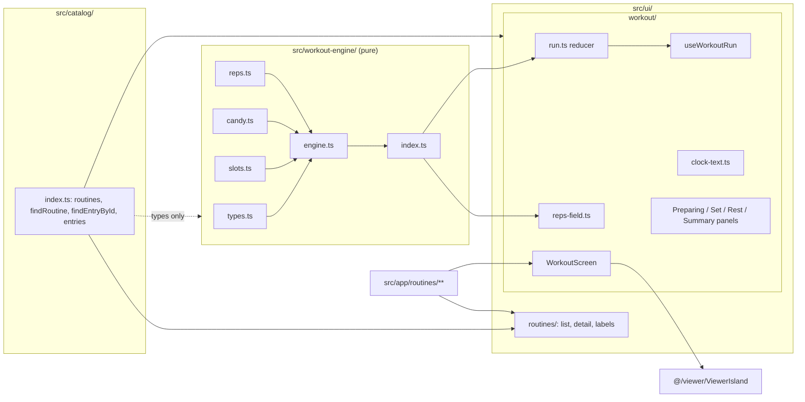
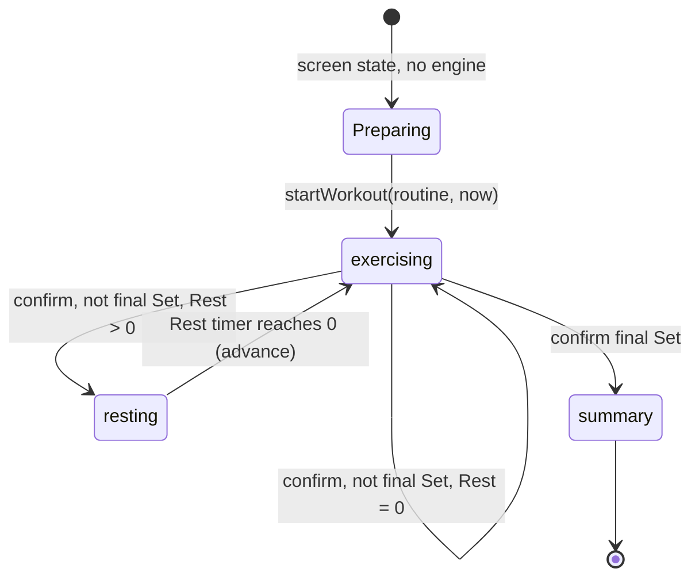
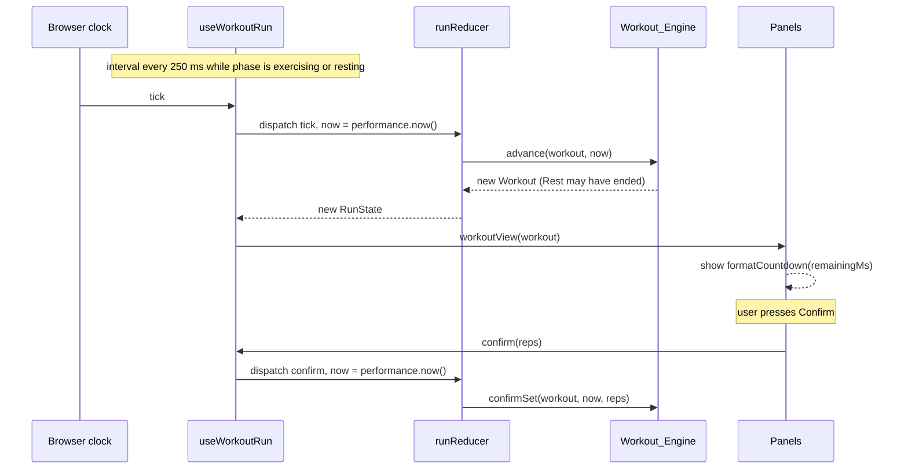

# Design Document: Happy-Path Workout

## Overview

This design covers ticket `06-happy-path-workout`. It adds the pure Workout_Engine (`src/workout-engine/`), the Routine_List_Screen, the Routine_Detail_Screen and the Workout_Screen with its Preparing, Set, Rest and Summary panels. The Routines Placeholder_Screen goes away. A user can read "Graveyard Shift", see the Coach's safety message, start the Workout, confirm all nine Sets with the Coach demonstrating, rest between Sets, and end on a summary with the Workout outcome **completed** and 14 Candy computed.

Everything stays static and stores nothing (ADR 0002). The engine is pure and driven by a Workout_Clock value that the caller passes in. A small client island feeds it `performance.now()` from a 250 ms tick. The Viewer is reused unchanged through `@/viewer/ViewerIsland`.

**ADR check.** No conflict with ADR 0001 (website), 0002 (no backend; this ticket writes nothing to browser storage), 0003 (no asset is touched) or 0004 (app code only). The structure steering lists checkpoint saves, auto-pause and paused phase for the Workout. Those belong to tickets 07 and 09 and are deliberately absent here (`requirements.md`, Scope). That is a deferral, not a contradiction.

No requirement needed a change. Three readings made while designing, all consistent with `requirements.md`:

1. **Confirm acts on the Workout as of its own clock value.** `confirmSet(workout, at)` first advances the Workout to `at`. A confirm that arrives after a Rest has ended therefore applies to the next Set, which is already the current Set at that instant. Requirement 3.8 ("while the phase is resting") is read at the command's own time. The UI never offers a confirm button during Rest.
2. **The Viewer is hosted by the Workout_Screen, not by each panel.** Requirements 11.2, 11.12, 12.3 and 13.5 say what the user sees (a Coach in the Set and Rest panels, the same Viewer across Sets of one Exercise, none in the summary). One Viewer placed above the panels, keyed by Exercise id, gives exactly that. A Viewer inside each panel would remount at every Set to Rest change.
3. **Engine slot data uses string identifiers.** A Set_Slot holds `entryId`, not an Exercise_Entry, so the engine imports Catalog types only (Requirement 1.2). The UI resolves entries with a new Catalog finder `findEntryById`.

### Design decisions at a glance

| Decision | Choice | Main reason |
|---|---|---|
| Engine shape | Plain readonly data plus pure functions (`startWorkout`, `advance`, `confirmSet`, `workoutView`) | Immutable (Req 1.4); JSON-safe so ticket 09 can checkpoint it unchanged |
| Time | Every command takes `at` (ms). The Workout stores the latest value seen | No real time in the engine (Req 1.3); a late tick loses nothing (Req 4.4) |
| Rest end | `advance` moves the next Set's start to the Rest end instant | Split advances equal one long advance (Req 4.3, 4.4) |
| Candy | `candyFor(confirmedSets, totalSets)` is the only place the rule lives | Req 5.5; ticket 07 adds skipping without touching it |
| Outcome type | `WorkoutOutcome = 'completed'` for now | Ticket 07 adds `partial` and `abandoned`; strings are `summary.outcome.${outcome}` (Req 16.3) |
| Real time | `useWorkoutRun` reads `performance.now()` at start, confirm and every tick | Engine stays pure; Playwright `page.clock` controls it in tests |
| Viewer | One `CoachViewer` (memo around `ViewerIsland`) in `WorkoutScreen`, `key` = Exercise id | Reset on Exercise change, no remount inside one Exercise (Req 11.11, 11.12) |
| Preparing panel | Screen state `run.workout === null`, no engine yet | Refresh returns to Preparing with nothing recorded (Req 10.1, 14.4) |
| Routes | `/routines`, `/routines/[slug]`, `/routines/[slug]/workout`, `dynamicParams = false` | Static prerender, unknown slugs 404 (Req 9.2, 9.3) |
| Screen logic | Clock text, rep field text and the run reducer are pure files under `src/ui/workout/` | Property tests need no DOM |
| Isolation | New static scan test over the engine, the Workout screens and their routes | Req 1.7, 7.2, 14.1, 14.3 |

### Research findings

No external research was needed beyond one check. The design rests on the code read for this spec:

- `src/catalog/index.ts` exports `entries`, `findEntry(kind, slug)`, `findRoutine`, `routineMinutes`, `routineSeconds`. `routines.ts` holds Graveyard Shift: Skeleton Jacks 2 × 20 reps (Rest 30 s), Grave Rise 3 × 10 reps (30 s), Coffin Push 2 × 8 reps (45 s), then Gravestone Lean 1 × 30 s and Bat Hang 1 × 30 s (Rest 10 s each). That is 9 Sets. `findEntry` needs a Kind and a slug; `RoutineStep.entryId` equals the entry's id, which is why a finder by id is added.
- `ViewerIsland` takes one `ExerciseEntry`, creates one controller per load attempt, owns Playback_Speed and the play state, and keeps its own live region. It reads `performance.now()` for its own timers only. The Viewer has no shared clock with anything else.
- `ExerciseDetailScreen` already renders `<ViewerIsland key={exercise.id} … />`, the `safety.*` strings and the target fact. `labels.ts` has `exercisePath(entry)` and `targetFact`.
- `src/ui/sections.ts` types `ListSectionId` as `'exercises' | 'stretches'`; `PlaceholderSectionId` is the rest. `strings.ts` has `section.routines.message`, which this ticket deletes.
- `tests/unit/strings.test.ts` bans reward words under `exercise.`, `viewer.`, `safety.`, `pager.` and `routine.`. `routine.` does not match `routines.`, so the Candy strings use `workout.` and `summary.` as Requirement 16.5 says.
- `tests/unit/repository-rules.test.ts` allows source files only under `src/app/`, `src/ui/`, `src/catalog/` and `src/viewer/`. It must also allow `src/workout-engine/`.
- `tests/e2e/support/screens.ts` builds the shared screen list from the Catalog and `sections.ts`. `no-backend.spec.ts` expects 3D code only on Exercise_Detail_Screens, so the Preparing_Panel (Requirement 10.5) falls under "does not load it" once it joins that list.
- Playwright 1.65 `page.clock` ([Clock docs](https://playwright.dev/docs/clock)): `install` before `goto` fakes `Date`, `performance`, timers and animation frames while time still flows; `pauseAt` jumps to a time and freezes it; `fastForward` jumps and fires each due timer once. That is enough to drive the engine's 250 ms tick across a 30 s Rest without waiting.

Not verified: how fast software WebGL renders the Coach while the clock is faked. The E2E design avoids long `runFor` calls for that reason.

## Architecture

### Module view



Rules that hold unchanged: `src/ui/` and `src/app/` reach the Viewer only through `@/viewer/ViewerIsland`; only `src/viewer/scene/` imports Three.js; the Catalog never resolves text. New rules: the engine imports only `import type` from `@/catalog` and its own files; the Viewer and the engine never import each other; no file of the Routine or Workout screens touches browser storage or imports Progress_Code.

### Files after this ticket

```
src/workout-engine/
  types.ts          # SetSlot, Workout, WorkoutView, WorkoutOutcome, Phase
  candy.ts          # candyPerSet, completionBonus, candyFor
  reps.ts           # minActualReps, maxActualReps, isValidActualReps
  slots.ts          # buildSetSlots(routine)
  engine.ts         # startWorkout, advance, confirmSet, workoutView
  index.ts          # public interface
src/catalog/index.ts            # + findEntryById
src/ui/routines/
  labels.ts                     # names, lengths, counts, step lines, paths
  RoutineListScreen.tsx (+ .module.css)
  RoutineDetailScreen.tsx (+ .module.css)
src/ui/workout/
  clock-text.ts                 # formatCountdown, formatElapsed
  reps-field.ts                 # parseActualReps, stepReps
  run.ts                        # RunState, RunAction, runReducer (pure)
  useWorkoutRun.ts              # client hook: reducer plus the tick
  CoachViewer.tsx               # memo(ViewerIsland)
  PreparingPanel.tsx, SetPanel.tsx, RestPanel.tsx, SummaryPanel.tsx
  WorkoutScreen.tsx (+ .module.css)   # 'use client'
src/app/routines/page.tsx                    # now the Routine_List_Screen
src/app/routines/[slug]/page.tsx             # NEW
src/app/routines/[slug]/workout/page.tsx     # NEW
src/ui/metadata.ts, src/ui/sections.ts, src/ui/strings.ts   # changed
```

### Phase flow



### Tick sequence



## Components and Interfaces

### Catalog addition

```ts
/** The entry with this id, of either Kind, or undefined. */
export function findEntryById(id: string): ExerciseEntry | undefined;
```

Nothing else in the Catalog changes. The engine does not call it.

### Workout_Engine (`src/workout-engine/`)

```ts
// types.ts
import type { ExerciseTarget } from '@/catalog';        // type-only

export type Phase = 'exercising' | 'resting' | 'summary';
export type WorkoutOutcome = 'completed';                 // ticket 07 adds 'partial' | 'abandoned'

export interface SetSlot {
  readonly entryId: string;
  readonly setNumber: number;       // 1-based within its Routine_Step
  readonly setCount: number;        // Sets of its Routine_Step
  readonly target: ExerciseTarget;  // { reps } or { seconds }
  readonly restSeconds: number;     // Rest after this Set (its step's Rest)
}

export interface ConfirmedSet {
  readonly slotIndex: number;
  readonly actualReps: number | null;   // null for a seconds target
}

/** Plain, JSON-safe, readonly. Opaque to callers; read it through workoutView. */
export interface Workout {
  readonly routineId: string;
  readonly slots: readonly SetSlot[];
  readonly startedAt: number;
  readonly clock: number;              // latest Workout_Clock value seen
  readonly phase: Phase;
  readonly index: number;              // current slot; while resting, the slot just confirmed
  readonly phaseStartedAt: number;     // start of this Set, or of this Rest
  readonly confirmed: readonly ConfirmedSet[];
  readonly finishedAt: number | null;  // clock of the final confirm
}
```

```ts
// views (types.ts)
interface ViewBase { readonly totalSets: number; readonly candyEarned: number }

export interface ExercisingView extends ViewBase {
  readonly phase: 'exercising';
  readonly slot: SetSlot;
  readonly position: number;           // 1-based index in the Workout, "Set 4 of 9"
  readonly timer:
    | { readonly kind: 'reps'; readonly targetReps: number; readonly defaultReps: number }
    | { readonly kind: 'seconds'; readonly targetSeconds: number; readonly remainingMs: number };
}
export interface RestingView extends ViewBase {
  readonly phase: 'resting';
  readonly restRemainingMs: number;
  readonly next: SetSlot;
  readonly nextPosition: number;
}
export interface SummaryView extends ViewBase {
  readonly phase: 'summary';
  readonly outcome: WorkoutOutcome;
  readonly setsConfirmed: number;
  readonly setsSkipped: number;        // totalSets - setsConfirmed; 0 until ticket 07
  readonly activeMs: number;           // finishedAt - startedAt
  readonly bonusIncluded: boolean;
}
export type WorkoutView = ExercisingView | RestingView | SummaryView;
```

**Public interface (`index.ts`)**

```ts
export function startWorkout(routine: RoutineEntry, at: number): Workout;
export function advance(workout: Workout, at: number): Workout;
export function confirmSet(workout: Workout, at: number, actualReps?: number): Workout;
export function workoutView(workout: Workout): WorkoutView;

export const candyPerSet = 1;
export const completionBonus = 5;
export function candyFor(confirmedSets: number, totalSets: number): number;

export const minActualReps = 0;
export const maxActualReps = 200;
export function isValidActualReps(value: number): boolean;   // integer, 0..200

export function buildSetSlots(routine: RoutineEntry): readonly SetSlot[];
export type { ExercisingView, Phase, RestingView, SetSlot, SummaryView, Workout, WorkoutOutcome, WorkoutView };
```

There is no parameter for Viewer speed, camera or play state anywhere (Req 1.5).

**Rules**

- `buildSetSlots`: for each step of `steps`, then each of `coolDown`, in order, push `sets` slots with `setNumber` 1..sets, `setCount` = sets, the step's `entryId`, `target` and `restSeconds` (Req 2.1, 2.2).
- `startWorkout(routine, at)`: slots from `buildSetSlots`; `startedAt = clock = phaseStartedAt = at`; `phase = 'exercising'`; `index = 0`; `confirmed = []` (Req 2.3).
- `advance(w, at)`: `t = max(at, w.clock)` (Req 1.6). In `summary` return `w` unchanged. Otherwise set `clock = t`. If `phase = 'resting'` and `t >= phaseStartedAt + rest × 1000`, where `rest` is the Rest of `slots[index]`: `phase = 'exercising'`, `index += 1`, `phaseStartedAt = phaseStartedAt + rest × 1000` (the Rest end instant, Req 4.3). One step is enough: a Set never ends by itself.
- `confirmSet(w, at, actualReps?)`: let `a = advance(w, at)`. If `a.phase` is not `exercising`, return `w` (Req 3.8). Let `slot = a.slots[a.index]`.
  - Reps target: `reps = actualReps ?? slot.target.reps`; if `!isValidActualReps(reps)` return `w` (Req 3.2 to 3.4). A non-integer or NaN fails the same test.
  - Seconds target: if `remainingMs(a) > 0` return `w` (Req 3.7). `actualReps` is ignored and stored as `null`.
  - Add `{ slotIndex: a.index, actualReps }` to `confirmed`. If this is the last slot: `phase = 'summary'`, `finishedAt = a.clock` (Req 3.11). Else if `slot.restSeconds > 0`: `phase = 'resting'`, `phaseStartedAt = a.clock` (Req 3.9). Else `index += 1`, `phaseStartedAt = a.clock` (Req 3.10).
  - Returning `w` (not `a`) on rejection keeps "leave the Workout unchanged" literal: same object, same clock.
- `remainingMs` for a seconds Set: `max(0, seconds × 1000 − (clock − phaseStartedAt))` (Req 3.5). For a Rest: `max(0, rest × 1000 − (clock − phaseStartedAt))` (Req 4.1). At 0 the Set stays current (Req 3.6).
- `candyFor(confirmed, total)`: `confirmed × candyPerSet + (total > 0 && confirmed === total ? completionBonus : 0)` (Req 5.1 to 5.5). The `total > 0` guard keeps an empty Workout at 0.
- `workoutView`: `candyEarned = candyFor(confirmed.length, slots.length)`. `exercising` timer is `reps` with `defaultReps = targetReps` or `seconds` with `remainingMs`. `resting` carries `next = slots[index + 1]`, `nextPosition = index + 2`. `summary` gives `outcome: 'completed'`, `setsConfirmed`, `setsSkipped = total − confirmed`, `activeMs = finishedAt − startedAt`, `bonusIncluded = confirmed === total` (Req 6.1 to 6.4).
- Every command builds new objects and arrays; nothing is mutated (Req 1.4).

Workout_Clock values are numbers in milliseconds from any origin. The engine never creates one.

### Screen logic (`src/ui/workout/`, pure files)

```ts
// clock-text.ts
export function formatCountdown(ms: number): string;  // ceil(ms/1000) s as "m:ss"; ms < 0 → "0:00"
export function formatElapsed(ms: number): string;    // floor(ms/1000) s as "m:ss"
// Both use the Strings_Module template 'workout.timer.format' ('{minutes}:{seconds}').

// reps-field.ts
export function parseActualReps(text: string): number | null;
//   trimmed text matching /^\d{1,3}$/ whose value passes isValidActualReps, else null
export function stepReps(value: number, delta: -1 | 1): number;  // clamped to 0..200

// run.ts
export interface RunState { readonly workout: Workout | null }       // null = Preparing_Panel
export type RunAction =
  | { readonly type: 'start'; readonly routine: RoutineEntry; readonly now: number }
  | { readonly type: 'tick'; readonly now: number }
  | { readonly type: 'confirm'; readonly now: number; readonly actualReps?: number };
export const initialRunState: RunState;
export function runReducer(state: RunState, action: RunAction): RunState;
//   start: only from null; tick and confirm: ignored while null; otherwise advance / confirmSet
```

`parseActualReps` rejects the empty string, signs, decimals and exponents (`"1e2"`), because the text field is what the user typed. `stepReps(0, -1)` is 0 and `stepReps(200, 1)` is 200 (Req 11.4).

### Client island (`useWorkoutRun.ts`, `WorkoutScreen.tsx`)

`useWorkoutRun(routine)` returns `{ view: WorkoutView | null; start(): void; confirm(actualReps?: number): void }`.

- State: `useReducer(runReducer, initialRunState)`.
- `start` and `confirm` dispatch with `now = performance.now()` read inside the handler.
- One effect runs `setInterval` every `tickMs = 250` while `view?.phase` is `exercising` or `resting`, dispatching `{ type: 'tick', now: performance.now() }`, and clears it on cleanup and in `summary`. `performance.now()` is the only real-time read in the whole Workout path, and it sits in this hook, never in the engine.
- The hook imports nothing from browser storage. A hidden tab keeps counting and a refresh loses the Workout (known gaps, tickets 07 and 09).

`WorkoutScreen` (client) renders, in DOM order:

1. `h1` with the Routine name.
2. A visually hidden polite live region (`role="status"`). Its text changes only when the panel heading changes: `workout.announce.set` (`Set 2 of 9: Skeleton Jacks`), `workout.announce.rest`, `workout.announce.summary`. It never carries a timer (Req 12.6).
3. While `exercising` or `resting`: `<CoachViewer key={entry.id} exercise={entry} />`. `entry` is the current slot's entry while exercising and the next slot's entry while resting, resolved with `findEntryById`. A Set followed by a Rest followed by a Set of the same Exercise keeps the same key, so the Viewer, its camera, speed and the downloaded GLB stay (Req 11.12). A new Exercise gets a new key, so camera, speed and clip reset (Req 11.11). `summary` renders none, which unmounts it and releases its WebGL context (Req 13.5).
4. The active panel: `PreparingPanel` (run state `null`), `SetPanel`, `RestPanel` or `SummaryPanel`.

`CoachViewer` is `memo(({ exercise }) => <ViewerIsland exercise={exercise} />)`, so the 250 ms re-render of the panels does not re-render the Viewer. The `exercise` prop is the Catalog object, whose reference never changes.

After a panel change the new panel's `h2` takes focus (`tabIndex={-1}`, `preventScroll`), so keyboard and screen reader users land on it. The Set panel is keyed by `view.position`, so its rep field resets to the target at every Set.

| Panel | Content |
|---|---|
| Preparing | Routine name's length (`routine.length.*`), `safety.heading` and `safety.coachMessage`, a start button (`workout.start`), a link `workout.preparing.back` to `/routines/<slug>` |
| Set | `h2` Spooky_Name; "Set 2 of 3" (`workout.set.of`); "Set 4 of 9 in this Workout" (`workout.set.position`); target text; for reps a group `workout.reps.label` with a "−" button (`workout.reps.fewer`), a number input (`type="number"`, `inputMode="numeric"`, `min` 0, `max` 200, `step` 1) and a "+" button (`workout.reps.more`), and the invalid message `workout.reps.invalid` in a polite status when the text fails `parseActualReps`; for seconds a `role="timer"` named `workout.timer.set` showing `formatCountdown`, and `workout.set.finished` at 0; the confirm button `workout.confirm`; the `safety.*` message |
| Rest | `h2` `workout.rest.heading`; `role="timer"` named `workout.timer.rest` with `formatCountdown`; the Next line `workout.rest.next` (Spooky_Name, Set number, count, target). No skip button. |
| Summary | `h2` `summary.heading`; outcome line `summary.outcome` with the word `summary.outcome.${outcome}`; Sets confirmed; Sets skipped; Active time (`formatElapsed`); Candy earned; the bonus line `summary.bonus` when `bonusIncluded`; links `summary.backToRoutine` and `common.backHome`. No Viewer. Nothing says the Candy was saved. |

Buttons and the input are at least `3rem` tall. The rep buttons are disabled at 0 and 200 and while the text is invalid; the confirm button is disabled while the text is invalid, or for a seconds Set while `remainingMs > 0`. All colours come from the theme tokens. No animation or transition is added (Req 11.10).

### Routine screens (`src/ui/routines/`, Server Components)

```ts
// labels.ts
export function routineName(routine: RoutineEntry): string;
export function routinePath(routine: RoutineEntry): `/routines/${string}`;
export function workoutPath(routine: RoutineEntry): `/routines/${string}/workout`;
export function lengthLabel(routine: RoutineEntry): string;      // routine.length.one | .other, {minutes}
export function countLabel(kind: Kind, count: number): string;  // routine.count.exercises|stretches .one | .other
export function setsLabel(count: number): string;
export function stepTargetLabel(step: RoutineStep): string;      // routine.target.reps | .seconds
export function stepLine(step: RoutineStep): string;             // "3 Sets · 10 reps · Rest 30 seconds"
export function entryOfStep(step: RoutineStep): ExerciseEntry;   // findEntryById, throws if absent (the Catalog test makes that unreachable)
```

- `RoutineListScreen`: `h1` from `sectionName('routines')`; a `ul` with one `li` per Routine_Entry, each one `Link` to `routinePath` whose first span is the Routine name, then length and the two counts; a back-home link. It imports no Viewer code (Req 8.6). It reuses the layout classes of the Exercise list for a consistent look.
- `RoutineDetailScreen`: back link `routine.detail.back` to `/routines`; `h1` Routine name; length; `h2` `routine.detail.steps.heading` and an `ol` of `steps`; `h2` `routine.detail.coolDown.heading` and an `ol` of `coolDown`. Each `li` holds a `Link` to `exercisePath(entry)` named by the Spooky_Name and the `stepLine`. A final link `routine.detail.start` to `workoutPath` (Req 9.4 to 9.9). No Viewer.
- `sections.ts`: `ListSectionId = 'exercises' | 'stretches' | 'routines'`; `PlaceholderSectionId = Exclude<SectionId, ListSectionId>`, so `sectionMessage` accepts only Crypt and History. `section.routines.message` is deleted.
- `metadata.ts`: `routineMetadata(routine)` (`routine.title`) and `workoutMetadata(routine)` (`workout.title`).

**Routes.** `src/app/routines/page.tsx` renders `RoutineListScreen` with `sectionMetadata('routines')`. `src/app/routines/[slug]/page.tsx` and `…/workout/page.tsx` each export `dynamicParams = false`, `generateStaticParams` from `routines.map(r => ({ slug: r.slug }))`, `generateMetadata` and a page that calls `findRoutine(slug)` and `notFound()` when absent. The workout page renders `<WorkoutScreen routine={routine} />`, a client component given a plain readonly object.

### Strings_Module additions (`src/ui/strings.ts`)

Removed: `section.routines.message`. Added (English first draft; wording may change as long as the string tests pass; none uses an Avoid word, none implies correct form). Candy appears only under `workout.` and `summary.`.

| Identifier | English text |
|---|---|
| `routine.title` | `{routine} · Spooky Coach` |
| `routine.length.one` / `routine.length.other` | `About {minutes} minute` / `About {minutes} minutes` |
| `routine.count.exercises.one` / `.other` | `{count} Exercise` / `{count} Exercises` |
| `routine.count.stretches.one` / `.other` | `{count} Stretch` / `{count} Stretches` |
| `routine.sets.one` / `routine.sets.other` | `{count} Set` / `{count} Sets` |
| `routine.target.reps` / `routine.target.seconds` | `{reps} reps` / `{seconds} seconds` |
| `routine.rest` | `Rest {seconds} seconds` |
| `routine.detail.back`, `.steps.heading`, `.coolDown.heading`, `.start` | Back to Routines, Exercises, Cool-down, Start this Workout |
| `workout.title` | `Workout: {routine} · Spooky Coach` |
| `workout.start`, `workout.preparing.back` | Start the Workout, Back to the Routine |
| `workout.set.of` / `workout.set.position` | `Set {number} of {count}` / `Set {position} of {total} in this Workout` |
| `workout.set.targetReps` / `.targetSeconds` | `Target: {reps} reps` / `Target: {seconds} seconds` |
| `workout.reps.label`, `.fewer`, `.more`, `.invalid` | Reps you did, One fewer rep, One more rep, Enter a whole number from 0 to 200. |
| `workout.timer.set`, `.rest`, `.format` | Time left, Rest time left, `{minutes}:{seconds}` |
| `workout.set.finished` | This Set is finished. Confirm it when you are ready. |
| `workout.confirm` | Confirm this Set |
| `workout.rest.heading`, `workout.rest.next` | Rest, `Next: {exercise}, Set {number} of {count}, {target}` |
| `workout.announce.set`, `.rest`, `.summary` | `Set {number} of {count}: {exercise}`, `Rest. Next: {exercise}`, Workout finished |
| `summary.heading` | Workout finished |
| `summary.outcome` / `summary.outcome.completed` | `Workout outcome: {outcome}` / Completed |
| `summary.setsConfirmed`, `.setsSkipped`, `.activeTime`, `.candy` | `Sets confirmed: {count}`, `Sets skipped: {count}`, `Active time: {time}`, `Candy earned: {candy}` |
| `summary.bonus` | `That includes {bonus} Candy for finishing every Set.` |
| `summary.backToRoutine` | Back to the Routine |

`summary.outcome.${WorkoutOutcome}` is built as a template literal, so a new outcome without its string fails the Type_Check (Req 16.3). The new templates join `TemplateId` automatically; `tests/unit/strings-format.test.ts` lists them by hand.

## Data Models

Types are in Components and Interfaces. Runtime state added by this ticket:

- `RunState` in React memory, per Workout_Screen mount. Nothing is written to `localStorage`, `sessionStorage`, IndexedDB or cookies (Req 14).
- `Workout` is plain data (numbers, strings, arrays, objects; no classes, functions or Maps). It can be copied with `structuredClone` and serialised with `JSON.stringify` without loss. Ticket 09 can checkpoint it as is. This design does not serialise it.

Candy, Active_Time and counts are derived from `Workout` on demand by `workoutView`; none is stored separately.

## Correctness Properties

*A property is a characteristic or behavior that should hold true across all valid executions of a system-essentially, a formal statement about what the system should do. Properties serve as the bridge between human-readable specifications and machine-verifiable correctness guarantees.*

Consolidated during prework reflection: the Candy clauses (5.1 to 5.5) are one property; the slot clauses (2.1, 2.2, 2.3, 2.5) are one; the Rest timing and clock regression clauses (1.6, 4.1, 4.3, 4.4) are one; the Set confirm, Rest, Candy and summary clauses of a full run (3.9 to 3.11, 4.2, 4.5, 4.6, 5.2, 6.1 to 6.4, 7.1) are one model-based property.

### Property 1: The Candy rule

*For any* number of Set_Slots `total ≥ 1` and any number of confirmed Sets `confirmed` from 0 to `total`, `candyFor(confirmed, total)` equals `confirmed` plus 5 when `confirmed` equals `total`, and equals `confirmed` otherwise.

**Validates: Requirements 5.1, 5.2, 5.3, 5.4, 5.5**

### Property 2: Set_Slots follow the Routine

*For any* valid Routine_Entry, `buildSetSlots` returns the slots of `steps` and then of `coolDown`, each step in its listed order repeated `sets` times with Set_Number 1 to `sets`, each slot carrying its step's entry id, set count, target and Rest; the count equals the sum of `sets`; and the view right after `startWorkout` is `exercising` on slot 0 with `totalSets` equal to that count.

**Validates: Requirements 2.1, 2.2, 2.3, 2.5**

### Property 3: Advancing in parts equals advancing at once

*For any* Workout reachable by a list of commands and any clock values `a ≤ b`, the view of `advance(advance(w, a), b)` equals the view of `advance(w, b)`. *For any* `a` earlier than the Workout's latest clock value, the view of `advance(w, a)` equals the view of `w`. While resting, the Rest remaining equals the Rest seconds minus the elapsed time, never below 0, and once the Rest end has passed the view is `exercising` on the next slot with its timer counting from the Rest end.

**Validates: Requirements 1.6, 4.1, 4.3, 4.4**

### Property 4: Actual_Reps are accepted exactly in 0 to 200

*For any* number `n` (integers across and beyond the bounds, fractions, negatives, NaN and infinities) and any Workout on a reps Set, `confirmSet(w, at, n)` confirms the Set with `n` and raises Candy by 1 when `n` is an integer from 0 to 200, and otherwise returns the same Workout object.

**Validates: Requirements 3.2, 3.4**

### Property 5: A timed Set waits for its countdown

*For any* Workout on a seconds Set and any elapsed time `e` since the Set started, the Set_Timer remaining equals `max(0, target × 1000 − e)`; the phase stays `exercising` on the same slot at any `e`; `confirmSet` at `e` below the target returns the same Workout object; and at `e` at or above the target it confirms the Set.

**Validates: Requirements 3.5, 3.6, 3.7**

### Property 6: Commands leave their argument unchanged

*For any* reachable Workout and any command (`advance` or `confirmSet` with any time and reps), the Workout passed in is deep-equal to a clone taken before the call.

**Validates: Requirements 1.4**

### Property 7: A driven Workout reports what its commands did

*For any* valid Routine_Entry and any player that, at each step, waits a generated time and confirms the current Set (for a seconds Set only after waiting at least its target; with reps from 0 to 200), the Workout: stays `exercising` on slots in order; enters `resting` after a confirm exactly when the Set is not final and its step's Rest is above 0, with `next` the following slot; never rests after the final Set; raises `candyEarned` by exactly 1 per confirm; ends in `summary` only after confirming every slot, with outcome `completed`, `setsConfirmed` equal to the slot count, `setsSkipped` 0, `candyEarned` equal to `candyFor(total, total)` and `activeMs` equal to the player's clock at the final confirm minus its clock at the start; and any later `advance` or `confirmSet` returns a view equal to that summary.

**Validates: Requirements 3.1, 3.9, 3.10, 3.11, 4.2, 4.5, 4.6, 5.2, 6.1, 6.2, 6.3, 6.4, 7.1**

### Property 8: Clock text matches whole seconds

*For any* non-negative number of milliseconds `ms`, parsing `formatCountdown(ms)` as `minutes:seconds` gives `ceil(ms / 1000)` seconds, parsing `formatElapsed(ms)` gives `floor(ms / 1000)` seconds, and the seconds part is two digits from 00 to 59.

**Validates: Requirements 11.7, 12.1, 13.1**

### Property 9: Rep field text is accepted exactly when it names 0 to 200

*For any* text, `parseActualReps(text)` returns a number when the text, after trimming, is the decimal digits of an integer from 0 to 200, and returns `null` for every other text; and *for any* value `v` from 0 to 200 and delta ±1, `stepReps(v, delta)` stays from 0 to 200 and equals `v + delta` unless that leaves the range.

**Validates: Requirements 11.4, 11.5**

## Error Handling

- An unknown Routine slug under `/routines/` or `/routines/<slug>/workout` returns the static 404 (`dynamicParams = false` plus `notFound()`).
- A rejected confirm (bad reps, timed Set not finished, wrong phase) returns the same Workout. The UI disables the button in those cases, so the engine's rejection is the second line of defence.
- The engine never throws on a clock value that goes backwards; it treats it as the latest value (Req 1.6). A non-finite clock value is a programming error and is not handled.
- `entryOfStep` and the screen's entry lookup throw if a Routine_Step names an unknown entry. The shipped-content test (`validateCatalog(catalogContent)`) makes that unreachable.
- A failed Viewer (no WebGL, load error) shows the existing Still_Fallback inside the same Viewer. The Workout keeps working: its timers and buttons do not depend on the Coach.
- Browser Back from a running Workout leaves it without a prompt, a refresh shows the Preparing_Panel again, and a hidden tab keeps counting. These are the documented gaps for tickets 07 and 09.

## Testing Strategy

Dual approach: example tests and fast-check properties (`fast-check` 4.10.2, `numRuns: 200`, each property test tagged `// Feature: happy-path-workout, Property N: …`). Tests use the public interfaces and are named after the rule in glossary terms. Engine tests pass the Workout_Clock as an argument: no fake timers, no real time (Req 15.6). PBT does not apply to the screens, routes, CSS or the Viewer. Those use examples, static scans and Playwright.

### New unit tests

| File | Content |
|---|---|
| `tests/unit/workout-candy.test.ts` | Property 1; examples "a skipped-nothing Workout of 9 Sets earns 14 Candy", "the Completion_Bonus needs every Cool-down Set confirmed" (8 of 9 gives 8) |
| `tests/unit/workout-slots.test.ts` | Property 2; example "Graveyard Shift has 9 Set_Slots in order" (Skeleton Jacks ×2, Grave Rise ×3, Coffin Push ×2, Gravestone Lean, Bat Hang) |
| `tests/unit/workout-engine.test.ts` | Examples: confirm without reps records the target; confirm during Rest changes nothing; Rest 0 goes straight to the next Set; a Rest ends by itself and the next Set's timer starts at the Rest end (late advance); the final Set gives no Rest; a full Graveyard Shift run gives 14 Candy and a summary of 9 confirmed |
| `tests/unit/workout-advance.test.ts` | Property 3 |
| `tests/unit/workout-reps.test.ts` | Property 4 |
| `tests/unit/workout-timed.test.ts` | Property 5 |
| `tests/unit/workout-immutable.test.ts` | Property 6 |
| `tests/unit/workout-drive.test.ts` | Property 7 |
| `tests/unit/workout-screen-logic.test.ts` | Properties 8 and 9; `runReducer` examples: tick and confirm are ignored before start; start only works once; a start then confirm records the reps; the reducer imports nothing from React |
| `tests/unit/routine-labels.test.ts` | Examples: length text for 1 and for other minutes; count labels for 1 and 2; `stepLine` of a Graveyard Shift step; Graveyard Shift's `lengthLabel` is "About 10 minutes" |
| `tests/unit/workout-isolation.test.ts` | Static scan (TypeScript compiler API, comments and strings ignored; fixtures that must be flagged and must pass): (a) every file of `src/workout-engine/` imports only its own files and `import type` from `@/catalog`, and references none of `Date`, `performance`, `setTimeout`, `setInterval`, `requestAnimationFrame`, `window`, `document`, `localStorage`, `sessionStorage`, `indexedDB`; (b) no file of `src/viewer/` imports the engine and the engine imports nothing from the Viewer; (c) files of `src/ui/routines/`, `src/ui/workout/`, `src/app/routines/` and `src/workout-engine/` reference no browser storage API and import no `progress-store`; (d) each folder yields at least one file |
| `tests/unit/support/workout.ts` | Shared fast-check arbitraries: valid Routine_Entry, reachable Workout (a random command list applied to `startWorkout`), the Property 7 player |

### Unit tests that change

| File | Change |
|---|---|
| `tests/unit/strings.test.ts` | `placeholderSectionIds` is `['crypt', 'history']`; new "no Workout, Summary, Routine or Safety_Message string says the Candy was saved or added to a balance" (words such as saved, kept, stored, balance, banked, wallet); existing Avoid-word, form-claim and no-reward tests cover the new strings unchanged |
| `tests/unit/strings-format.test.ts` | add the new template identifiers |
| `tests/unit/repository-rules.test.ts` | `allowedPrefixes` gains `src/workout-engine/`; the comment names it |
| `tests/unit/source-rules.test.ts` | the coverage lists gain `['src/workout-engine/', '.ts']` and `['src/ui/workout/', '.tsx']` so the new folders cannot escape the text and colour scans |
| `tests/unit/catalog-partition.test.ts` | one example for `findEntryById` (finds Grave Rise and Bat Hang, nothing for an unknown id) |
| `tests/unit/viewing-earns-nothing.test.ts`, `module-boundaries.test.ts`, `coach-assets.test.ts`, `catalog.test.ts` | no edit; they must still pass |

### E2E tests that change

| File | Change |
|---|---|
| `tests/e2e/support/screens.ts` | add `routineListScreen`, `routineDetailScreens`, `workoutScreens`; `sectionScreens` now includes `/routines` through the existing filter; `placeholderScreens` shrinks to Crypt and History; `screens` includes the new lists. The shared theme, layout, Decorations and no-backend checks then cover them (Req 15.3), and the no-backend 3D check expects no 3D code on the Preparing_Panel |
| `tests/e2e/navigation.spec.ts` | Routines becomes a list screen (heading, title, one link per Routine starting with its name, `href` `/routines/<slug>`, link home), by Home navigation, direct request and reload; only Crypt and History expect a Placeholder_Screen; the "every link leads to a served screen" walk includes the Routine detail and Workout screens |
| `tests/e2e/static-build.spec.ts` | `screenRoutes` gains `/routines`, `/routines/<slug>` and `/routines/<slug>/workout` per Routine; the dynamic-route check accepts pages from `/routines/[slug]` and `/routines/[slug]/workout` as well, with `fallback: false` |
| `tests/e2e/not-found.spec.ts` | add `/routines/unknown`, `/routines/no-such-routine/workout` and `/routines/<slug>/no-such-page`, all HTTP 404 |

### New E2E tests

Helper file `tests/e2e/support/workout.ts`: `openPreparing(page)`, `startWorkout(page)`, `confirmCurrentSet(page)`, `timerSeconds(page, name)` (parses the `role="timer"` text), and `completeWorkout(page)` which, for each Set, confirms it and, when a Rest or a timed Set follows, calls `page.clock.fastForward` by the Catalog's Rest or target. Rests and targets come from the Catalog, not literals.

1. **`routines.spec.ts`** (both projects): list entries and links; detail page heading, "About 10 minutes", the ordered steps with name link, Sets, target and Rest, the Cool-down heading and its two Stretches, links to Exercise and Stretch detail screens by Kind, the Start link; the list and detail screens request no Coach_Asset, Still_Image or 3D code.
2. **`workout.spec.ts`** (both projects, `page.clock.install()` before `goto`): Preparing shows the Routine name, length, safety heading and message and the back link, and no Viewer; after pressing start the Set panel shows "Skeleton Jacks", "Set 1 of 2", "Set 1 of 9 in this Workout", Target 20 reps and the rep field at 20; the rep buttons change it, typing `250` or an empty field shows the range message and disables confirm, `0` is accepted; confirming moves to Rest with a timer and a "Next:" line and no skip control; `fastForward` past the Rest shows the next Set; the full run through all nine Sets (two timed Cool-down Sets show a disabled confirm until `fastForward` by 30 s and then "This Set is finished") ends in a summary with Completed, 9 confirmed, 0 skipped, an Active time, "Candy earned: 14", the bonus line, both links, no Viewer and no canvas; a heading change is announced in the status region; a second visit shows the safety message again; refreshing mid-Workout shows the Preparing_Panel; after the run `localStorage`, `sessionStorage`, `indexedDB.databases()` and cookies are empty (Req 14.2); no text of the page matches "perfect form". Reduced motion variant: computed `animation-name` and `transition-duration` of the new panels are none.
3. **`workout-clock.spec.ts`** (both projects, `test.use({ reducedMotion: 'reduce' })` so the Coach starts paused and draws nothing while the clock jumps): install the clock at a fixed time; start; `waitForCoach` for Skeleton Jacks; press 0.5× (`aria-pressed="true"`); confirm Set 1; in the Rest, `pauseAt(now + 1 s)`, read the Rest timer, `fastForward('00:10')`, expect the timer 10 s lower. A second test presses Pause on the Coach and repeats. A third checks Set, Set_Number, target and Rest text are the same before and after a speed change (Req 7.5, 7.6).
4. **`workout-viewer.spec.ts`** (laptop, software WebGL): Set 1 and the following Rest and Set 2 of Skeleton Jacks request the GLB once; moving to Grave Rise shows the Coach labelled for Grave Rise, with speed back at 1× (Req 11.11); the Coach label during Rest names the next Exercise (Req 12.3); at the summary there is no Viewer region and the WebGL context captured earlier is lost (Req 13.5).

### Human eye checks (not automated)

On a real phone: read the Preparing, Set, Rest and Summary panels at 200 % text size; check that the rep buttons are easy to hit with a thumb; run Graveyard Shift once end to end and check the Rest "Next:" line is clear and the Coach loads before each new Exercise.
