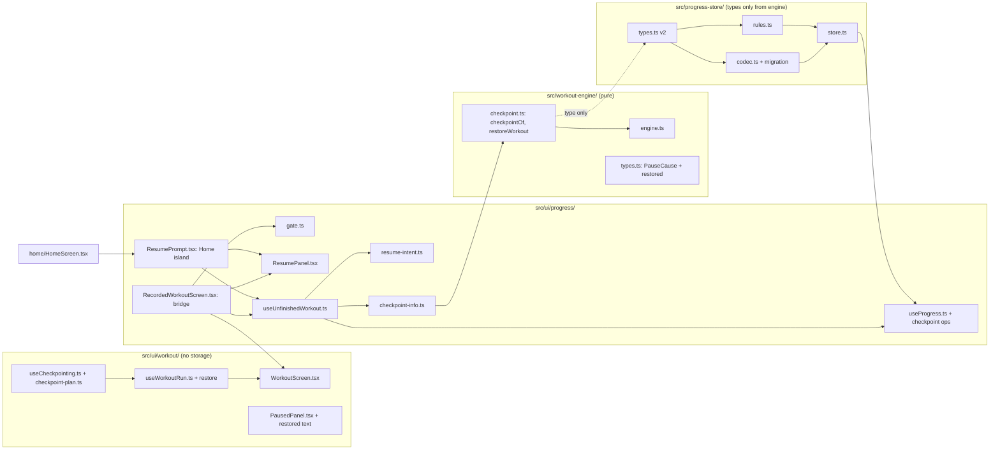

# Design Document: Resume After Refresh

## Overview

This design covers ticket `09-resume-after-refresh`. It adds the Workout_Checkpoint end to end:

1. **Workout_Engine** (pure): `checkpointOf` turns a Workout into a JSON-safe checkpoint; `restoreWorkout` validates a checkpoint and rebases it onto a new Workout_Clock, paused, with the new Pause_Cause `restored`.
2. **Progress_Store**: Schema_Version 2 with a `checkpoint` member, a migration from version 1 that keeps every Candy and every History_Entry, and three operations: `saveCheckpoint`, `clearCheckpoint` and the atomic `finishWorkout`.
3. **Workout_Screen**: calls an `onCheckpoint` callback on every Checkpoint_Moment, every 5 s while a Set or Rest runs, and on a Checkpoint_Flush when the page hides. It takes an optional `resume` checkpoint and restores it on mount.
4. **Resume_Prompt**: a panel shown on the Home_Screen and on the Workout_Route, with Resume and Discard. The Recording_Bridge wires saving, finishing, Resume and Discard to the Progress_Store.

**ADR check.** No conflict with ADR 0001 (website), 0002 (the checkpoint joins the one existing `localStorage` key; no server), 0003 or 0004 (no asset is touched). The tech steering already asks for exactly this: "Save the Workout engine checkpoint to the Progress store on every state change and at least every 5 s while active", "Time while the page was closed never counts", and "Serialises to a checkpoint and restores from one". The steering says the Workout engine "must not import React, Three.js or storage" and the Progress store "owns ... resume checkpoint"; this design keeps both. `src/workout-engine/types.ts` says "Ticket 09 adds nothing here" about `Phase`; that stays true. The Pause_Cause grows by one value instead.

No requirement needed a change. Readings made while designing, all consistent with `requirements.md`:

1. **The engine owns the shape of a checkpoint; the store owns only the envelope.** The store must not import engine runtime code (it imports types only). So the codec checks a shallow envelope (`version` 1, a `workout` object with a non-empty `routineId`) and the engine's `restoreWorkout` does the deep validation. A checkpoint that passes the envelope but fails `restoreWorkout` is cleared by the UI with no record (Requirement 9.7).
2. **Rebasing, not storing a clock offset.** `Workout` holds absolute Workout_Clock values (`startedAt`, `clock`, `phaseStartedAt`, `pause.at`). `performance.now()` restarts near 0 on every page load. `restoreWorkout` computes `delta = at - freezeInstant` and shifts `startedAt` and `phaseStartedAt` by `delta`, sets `clock` and `pause.at` to `at`, and leaves `pausedMs` alone. Every timer reads a difference of two values that were shifted together, so every remaining time stays exactly as it was, and the closed time (between the freeze instant and `at`) drops out. A rebased `startedAt` may be negative (a ten-minute Workout restored 300 ms after page load), so validation requires finite numbers, not non-negative ones.
3. **Restore always pauses, with its own cause.** The restored Workout is `paused` with `pause = { cause: 'restored', from, at }`. `resumeWorkout` then needs no change. `autoPause` and `pauseWorkout` already refuse to replace an existing pause, so a hidden page on the Resume_Prompt cannot change anything.
4. **The consistency check is strong on purpose.** In a valid Workout, the Sets before the current one are each confirmed or skipped, and no others are. `restoreWorkout` checks that the confirmed and skipped indices together are exactly `0..index-1` (exercising) or `0..index` with `index` confirmed (resting). That one rule makes `workoutView` safe on any accepted checkpoint (Requirement 4.6) without a second validator.
5. **Finishing is one write.** `finishWorkout(record)` records the Workout, adds its Candy and clears the checkpoint in one `setItem`. Ticket 08 called `recordWorkout`; the Recording_Bridge now calls `finishWorkout`. `recordWorkout` stays for its tests and leaves the checkpoint alone.
6. **Saving lives in a UI hook; the bridge owns the store.** `src/ui/workout/` may not import the Progress_Store or name storage (existing scan). `useWorkoutRun` and a new `useCheckpointing` hook only call an `onCheckpoint(checkpoint)` callback. `RecordedWorkoutScreen` (in `src/ui/progress/`) passes a callback that calls `saveCheckpoint`.
7. **A checkpoint never survives a finished Workout.** The hook never calls `onCheckpoint` in the summary (`checkpointOf` returns null there), the bridge ignores late saves once `onFinished` ran, and `finishWorkout` clears the checkpoint in the same write as the record. Three guards, so a late timer or a flush cannot resurrect a checkpoint.

### Where the Resume_Prompt shows

| Option | Verdict |
|---|---|
| Home_Screen only | Rejected. A refresh mid-Workout reloads `/routines/<slug>/workout`, not Home. The Preparing_Panel would show and Start would overwrite the checkpoint. |
| Workout_Route only | Rejected. A visitor who reopens the Site at `/` would see nothing, but the ticket says "reopening the site offers Resume or Discard". |
| Every screen (a global banner) | Rejected. It would make the browsing screens read the Progress_Store and break "viewing earns nothing and stores nothing" (existing scan and E2E spec). |
| **Home_Screen and Workout_Route** | **Chosen.** Both already are Candy screens that touch the Progress_Store. The Workout_Route is where a refresh lands. Home is where reopening the Site lands. Browsing stays storage-free. |

Resume on Home navigates to the Routine's Workout_Route with a Resume_Intent (a module variable in page memory, not storage), so the user answers once. A reload clears the intent, so the question is asked again.

### Design decisions at a glance

| Decision | Choice | Main reason |
|---|---|---|
| Checkpoint content | `{ version: 1, workout }`, the whole `Workout` value | `Workout` is already plain, JSON-safe data; no second model to keep in sync |
| Clock handling | Rebase on restore (`delta = at - freeze`) | Remaining times and Active_Time stay exact; closed time drops out (Requirement 3) |
| Freeze instant | `pause.at` when paused, else `clock` | The last moment the Workout counted |
| Restore result | Always `paused`, cause `restored` | The ticket says "paused"; `auto` would claim the page was hidden |
| Where validation lives | Engine `restoreWorkout` (deep), store codec (envelope only) | Store imports engine types only |
| Schema | `schemaVersion: 2`, `checkpoint: WorkoutCheckpoint \| null` | Requirement 5.1; v1 data migrates in memory, written as v2 on the next change |
| Damaged checkpoint | Drop the checkpoint, keep Candy and history | A bad checkpoint must never cost Candy (Requirement 5.7) |
| Finish | `finishWorkout`: record + clear in one write | No double record after a crash (Requirement 6.6, 8.1) |
| Save triggers | Checkpoint_Moment (key change), 5 s interval, flush on `visibilitychange` hidden and `pagehide` | Requirement 7; the flush covers a close between two saves |
| Save key | `checkpointKey(workout)`: phase, index, confirmed count, skipped count, pause cause and held phase | Ticks change the clock only, so they never save |
| Prompt screens | Home_Screen and Workout_Route | See the table above |
| Resume from Home | `setResumeIntent(routineId)` then `router.push` | One question, not two; intent is page memory only |
| Discard | Restore at clock 0, quit, `workoutRecordOf(view, routineId, Date.now())`, `finishWorkout` | Reuses the engine's quit rule, so Discard equals "quit at the pause" |
| Workout_Route first render | Loading text (no Preparing_Panel) until the snapshot is read | Start must never run before the store is read |

### Research findings

- `src/workout-engine/engine.ts`: `advance`, `confirmSet`, `skipSet`, `skipRest`, `pauseWorkout`, `autoPause`, `resumeWorkout`, `quitWorkout` and `workoutView`. `resumeWorkout` moves `phaseStartedAt` and `pausedMs` forward by the paused duration, so a restored pause with `at === clock` resumes with `pausedMs += (resumeAt - at)`. `quitWorkout` from a pause ends at `pause.at`, so Discard's `activeMs` is irrelevant to the record (the record holds outcome and Candy only). `timeOf(w)` returns `pause.at` while paused, so every held timer reads `pause.at - phaseStartedAt` (Set) or `restSeconds*1000 - (pause.at - phaseStartedAt)` (Rest). Both are unchanged when `pause.at` and `phaseStartedAt` shift by the same `delta`.
- `src/workout-engine/slots.ts` exports `buildSetSlots(routine)`; `restoreWorkout` compares the checkpoint's slots with it, so a changed Catalog turns an old checkpoint into null.
- `src/workout-engine/reps.ts` exports `isValidActualReps` (0 to 200), reused to validate `actualReps`.
- `src/progress-store/codec.ts` returns `none` for `version < schemaVersion`. The migration table the file header promises is added here; without it, bumping the version would erase all stored progress.
- `src/progress-store/store.ts` re-reads storage on every change and compares `candy`, `welcomeGiftGranted`, `history.length` and `persistent` to decide if the cached snapshot changed. A checkpoint changes none of these, so the comparison gains a checkpoint term (compare the JSON text of both checkpoints; they are small, about 2 KB for a 25-Set Routine).
- `src/ui/workout/useWorkoutRun.ts`: `runReducer` is pure and the hook reads `performance.now()` only in handlers and the 250 ms tick. A `tick` creates a new Workout object each time (`advance` spreads), so identity cannot be the save trigger; the key function is.
- `src/ui/workout/WorkoutScreen.tsx` moves focus to the panel heading when the panel key changes but not on first render, reports `onFinished` once, and picks the Paused_Panel text by `view.cause === 'auto'`.
- `src/ui/progress/RecordedWorkoutScreen.tsx` is the only reader of the wall clock for a Workout_Record. `src/app/routines/[slug]/workout/page.tsx` renders it for every prerendered slug.
- `tests/unit/workout-isolation.test.ts` scans `src/workout-engine`, `src/ui/workout`, `src/ui/routines` and `src/app/routines` for storage names and `@/progress-store` imports. `tests/unit/progress-boundaries.test.ts` scans `src/progress-store` and lets only `src/ui/progress` import it. Neither needs a rule change for this design.
- Earlier tests that this ticket changes (Requirement 15.4): `tests/unit/progress-codec.test.ts` ("the stored text carries the schema version 1", "text from a newer schema version"), `tests/e2e/candy-and-history.spec.ts` (stored `schemaVersion` 1, a seeded `schemaVersion` 2 as "newer"), and E2E specs that open a Workout_Route and expect the Preparing_Panel before the Progress_Snapshot is read (`tests/e2e/support/workout.ts` `openPreparing`). `tests/e2e/candy-and-history.spec.ts` "a refresh mid-Workout recording nothing" stays true: a refresh records nothing until the user presses Discard.
- Page Visibility: [MDN says](https://developer.mozilla.org/en-US/docs/Web/API/Document/visibilitychange_event) `visibilitychange` fires when the user switches tabs, navigates away, closes or minimises the browser, or on mobile switches app. [MDN's `unload` page](https://developer.mozilla.org/en-US/docs/Web/API/Window/unload_event) says `unload` is not reliably fired on mobile. So the Checkpoint_Flush listens to `visibilitychange` (hidden) and to `pagehide` as the fallback. Content was rephrased for compliance with licensing restrictions.

Not verified: whether a synchronous `localStorage.setItem` inside a `pagehide` handler always completes on every mobile browser. The 5 s interval and the Checkpoint_Moment saves are the safety net, and the E2E spec reloads with `page.reload()`, which fires `pagehide`. Real-phone eye checks are listed at the end of this document.

## Architecture

### Module view



Rules that hold unchanged: the engine imports no UI, Viewer, storage or Progress_Store; `src/ui/workout/` imports no Progress_Store and names no storage API; only `src/ui/progress/` and `src/progress-store/` import `@/progress-store`. New: `src/ui/progress/` names no browser storage (the Resume_Intent is a plain module variable).

### Files after this ticket

```
src/workout-engine/
  checkpoint.ts      # NEW: WorkoutCheckpoint, checkpointVersion, checkpointOf, restoreWorkout
  types.ts           # PauseCause gains 'restored'
  index.ts           # exports the above
src/progress-store/
  types.ts           # schemaVersion 2; ProgressData.checkpoint; Snapshot.checkpoint; SaveResult; store ops
  rules.ts           # + isCheckpointEnvelope, withCheckpoint, withoutCheckpoint, finishWorkout; snapshotOf copies
  codec.ts           # version table: 1 -> 2 migration; v2 shape; envelope rule
  store.ts           # + saveCheckpoint, clearCheckpoint, finishWorkout
src/ui/workout/
  checkpoint-plan.ts   # NEW: checkpointKey, checkpointIntervalMs (pure)
  useCheckpointing.ts  # NEW: saves on key change, every 5 s, on hide/pagehide
  run.ts               # + restore action, restoreTried flag
  useWorkoutRun.ts     # + resume option, onCheckpoint wiring
  WorkoutScreen.tsx    # + resume, onCheckpoint props; restored texts; focus on restored mount
  PausedPanel.tsx      # + restored text
src/ui/progress/
  useProgress.ts            # + saveCheckpoint, clearCheckpoint, finishWorkout (replaces recordWorkout)
  resume-intent.ts          # NEW: setResumeIntent, peekResumeIntent, clearResumeIntent
  checkpoint-info.ts        # NEW: describeCheckpoint, discardRecordOf (pure)
  gate.ts                   # NEW: decideGate (pure)
  useUnfinishedWorkout.ts   # NEW: reads snapshot, exposes prompt state, resume(), discard()
  ResumePanel.tsx (+ .module.css)  # NEW: presentational panel
  ResumePrompt.tsx          # NEW: Home_Screen island
  RecordedWorkoutScreen.tsx # the bridge: gate, prompt, saving, finishing
src/ui/home/HomeScreen.tsx  # + <ResumePrompt />
src/ui/strings.ts           # additions
```

### Saving, resuming and discarding

```mermaid
sequenceDiagram
  participant W as Workout_Screen / useCheckpointing
  participant B as RecordedWorkoutScreen
  participant S as Progress_Store
  W->>B: onCheckpoint(checkpointOf(workout)) on each Checkpoint_Moment, every 5 s, on hide
  B->>S: saveCheckpoint(checkpoint) (ignored after onFinished)
  Note over W,S: page is refreshed or closed
  B->>S: first render in the browser reads the snapshot
  S-->>B: snapshot.checkpoint
  B->>B: decideGate: prompt, resumed or fresh
  alt Resume
    B->>W: mount Workout_Screen with resume = checkpoint
    W->>W: dispatch restore at performance.now(): paused, cause restored
  else Discard
    B->>B: record = discardRecordOf(checkpoint, routine, Date.now())
    B->>S: grantWelcomeGift(); finishWorkout(record)
    S-->>B: recorded with new Candy_Balance; checkpoint cleared in the same write
  end
  W->>B: onFinished(summary) at the end
  B->>S: grantWelcomeGift(); finishWorkout(record)
```

## Components and Interfaces

### Workout_Engine

`src/workout-engine/types.ts`: `export type PauseCause = 'user' | 'auto' | 'restored';` The doc comment becomes "Who paused the Workout: the user, the page becoming hidden, or a restore after the page was closed." `Phase` is unchanged.

`src/workout-engine/checkpoint.ts`:

```ts
import type { RoutineEntry } from '@/catalog';
import type { Workout } from './types';

export const checkpointVersion = 1;

/** Plain, JSON-safe data. Carries no wall-clock time. */
export interface WorkoutCheckpoint {
  readonly version: 1;
  readonly workout: Workout;
}

/** null in the summary: a finished Workout has no checkpoint. */
export function checkpointOf(w: Workout): WorkoutCheckpoint | null;

/**
 * Validate `value` for `routine` and return the Workout rebased onto the clock
 * value `at`, paused with the cause 'restored'; null for any unusable value.
 * Never throws.
 */
export function restoreWorkout(value: unknown, routine: RoutineEntry, at: number): Workout | null;
```

`checkpointOf` returns `{ version: 1, workout: w }` for `exercising`, `resting` and `paused`, and null for `summary`. The Workout is not copied: it is readonly plain data, and the callers (the store and `JSON.stringify`) copy it.

`restoreWorkout` steps (any failed check returns null; no step throws, every read is guarded by `typeof` and `Array.isArray`):

1. `value` is an object with `version === 1` and an object `workout`.
2. Read the Workout field by field into a new object (never keep the input object). Required: `routineId` text equal to `routine.id`; `slots` an array equal, Set by Set (`entryId`, `setNumber`, `setCount`, `target.reps` or `target.seconds`, `restSeconds`), to `buildSetSlots(routine)`; `startedAt`, `clock`, `phaseStartedAt`, `pausedMs` finite numbers; `index` an integer; `phase` one of `exercising`, `resting`, `paused`; `confirmed` an array of `{ slotIndex, actualReps }`; `skipped` an array of integers; `finishedAt === null`; `outcome === null`; `pause` null or `{ cause, from, at }` with `cause` one of `user`, `auto`, `restored`, `from` one of `exercising`, `resting`, and `at` a finite number.
3. Held phase `held` = `pause.from` when paused, else `phase`. `pause` is non-null exactly when `phase === 'paused'`.
4. Index range: `0 <= index <= n-1`; when `held === 'resting'`, `index <= n-2` and `slots[index].restSeconds > 0`.
5. Resolved Sets: `confirmed` indices are unique integers in range, `skipped` indices likewise, the two sets are disjoint, `actualReps` is `null` for a seconds target and `isValidActualReps` for a reps target. Their union equals `{0..index-1}` when `held === 'exercising'` and `{0..index}` with `index` confirmed when `held === 'resting'`.
6. Times: `startedAt <= phaseStartedAt <= freeze`, where `freeze = pause.at` when paused (and `pause.at <= clock`) and `freeze = clock` otherwise; `0 <= pausedMs <= freeze - startedAt`. `at` must be a finite number, else null.
7. Build the result: `delta = at - freeze`; `{ ...fields, startedAt: startedAt + delta, phaseStartedAt: phaseStartedAt + delta, clock: at, phase: 'paused', pause: { cause: 'restored', from: held, at }, slots: expected slots, finishedAt: null, outcome: null }`.

Why the checks hold the invariants `workoutView` and the commands rely on: every `slotAt(w, index)` and `slotAt(w, index + 1)` read in `activeView` is in range (step 4); `candyFor(confirmed.length, n)` counts unique confirmed Sets (step 5); results mark each slot at most once (step 5).

The rebasing never reads a clock. `at` is the only time input.

`src/workout-engine/index.ts` exports `checkpointOf`, `restoreWorkout`, `checkpointVersion` and the type `WorkoutCheckpoint`.

### Progress_Store

`types.ts`:

```ts
import type { WorkoutCheckpoint, WorkoutOutcome } from '@/workout-engine';

export const schemaVersion = 2;

export interface ProgressData {
  readonly schemaVersion: 2;
  readonly candy: number;
  readonly welcomeGiftGranted: boolean;
  readonly history: readonly WorkoutRecord[];
  /** The unfinished Workout, or null. Shape beyond the envelope is the engine's to judge. */
  readonly checkpoint: WorkoutCheckpoint | null;
}

export interface ProgressSnapshot {
  /* existing members unchanged, plus: */
  /** A copy of the Stored_Checkpoint. */
  readonly checkpoint: WorkoutCheckpoint | null;
}

export type SaveCheckpointResult =
  | { readonly saved: true }
  | { readonly saved: false; readonly reason: 'invalid' };

export interface ProgressStore {
  /* existing members unchanged, plus: */
  saveCheckpoint(checkpoint: WorkoutCheckpoint): SaveCheckpointResult;
  /** True if a checkpoint was cleared by this call. */
  clearCheckpoint(): boolean;
  /** Records the Workout and clears the checkpoint in one write. Same result type as recordWorkout. */
  finishWorkout(record: WorkoutRecord): RecordResult;
}
```

`saveCheckpoint` takes a `WorkoutCheckpoint` by type but re-checks the envelope at runtime, because the UI hands over whatever `checkpointOf` returned and the store must not trust it blindly.

`rules.ts` additions (pure; return new objects):

```ts
export const emptyProgress: ProgressData; // schemaVersion 2, checkpoint null
export function isCheckpointEnvelope(value: unknown): value is WorkoutCheckpoint;
//   object, version === 1, workout an object (not array) whose routineId is a non-empty text
export function withCheckpoint(data: ProgressData, checkpoint: WorkoutCheckpoint): ProgressData | 'invalid';
export function withoutCheckpoint(data: ProgressData): ProgressData | null; // null: none to clear
export type FinishOutcome =
  | { readonly kind: 'recorded'; readonly data: ProgressData }
  | { readonly kind: 'duplicate'; readonly data: ProgressData | null } // null: nothing to change
  | { readonly kind: 'invalid' };
export function finishWorkout(data: ProgressData, record: WorkoutRecord): FinishOutcome;
```

- `finishWorkout` runs `validateRecord` (`invalid`), then checks the id: a duplicate returns `withoutCheckpoint(data)` as `data` (null when there is no checkpoint, so the store writes nothing); a new id returns `recordWorkout(data, record)` with `checkpoint: null`.
- `recordWorkout` (ticket 08) spreads `...data`, so it keeps the checkpoint; `grantWelcomeGift` does the same. No change to either except the new field being carried.
- `snapshotOf` copies the checkpoint with `JSON.parse(JSON.stringify(...))` (plain data), so a caller cannot change the store through the snapshot.

`codec.ts`:

```ts
export type ParsedProgress =
  | { kind: 'data'; data: ProgressData }
  | { kind: 'none' }
  | { kind: 'newer'; version: number };
export function serialiseProgress(data: ProgressData): string;
export function parseProgress(text: string | null): ParsedProgress; // never throws
```

`parseProgress`:

1. As today: `null`, not JSON, not an object, or a missing or non-integer `schemaVersion` gives `none`. `version > 2` gives `newer` before any shape check. `version < 1` gives `none`.
2. A private `parseCore(object)` checks `candy`, `welcomeGiftGranted` and `history` exactly as ticket 08's version 1 shape check does and returns `{ candy, welcomeGiftGranted, history }` or null (null gives `none`).
3. A small version table: `1` → `migrate1to2(core)` = `{ schemaVersion: 2, ...core, checkpoint: null }`; `2` → read `object.checkpoint`: `undefined` gives `none` (Requirement 5.8); `null` gives `checkpoint: null`; `isCheckpointEnvelope(value)` gives the checkpoint; anything else gives `checkpoint: null` and keeps the core (Requirement 5.7).
4. The file header's note ("when schema version 2 exists, add a version table") is replaced by the table. The next ticket adds `2 → 3` the same way.

`serialiseProgress` stays `JSON.stringify`.

`store.ts` changes:

- `load()` is unchanged in shape; `parseProgress` now returns v2 data for v1 text, so `memory` is always v2. **No write on load**, so a v1 text stays v1 on disk until the first change (Requirement 5.3).
- `sameView` compares `JSON.stringify(snapshot.checkpoint)` with `JSON.stringify(data.checkpoint)` as well.
- `saveCheckpoint(cp)`: `current = load()`; `withCheckpoint(current, cp)`; `'invalid'` gives `{ saved: false, reason: 'invalid' }` with no write (refresh the view if another tab changed it, as the other operations do); otherwise `commit(next)` and `{ saved: true }`.
- `clearCheckpoint()`: `withoutCheckpoint(load())`; null returns false (refresh view if needed); else `commit(next)` and true.
- `finishWorkout(record)`: `finishWorkout(load(), record)`; `recorded` commits and returns `{ recorded: true, candyBalance }`; `duplicate` with data commits it (clears the checkpoint) and returns `{ recorded: false, reason: 'duplicate' }`; `duplicate` with null data or `invalid` writes nothing.
- When `newer` is true, `commit` still skips the write (existing rule), so every new operation is memory only for a newer version (Requirement 6.15). A throwing adapter sets `storageWorks = false` as today.

### Workout_Screen

`src/ui/workout/checkpoint-plan.ts` (pure, no React):

```ts
export const checkpointIntervalMs = 5000;
/** Changes exactly when a Checkpoint_Moment happens; unchanged by a tick that moves only the clock. */
export function checkpointKey(w: Workout): string;
// `${phase}|${index}|${confirmed.length}|${skipped.length}|${pause === null ? '-' : pause.cause + ':' + pause.from}`
```

Phase, index, confirmed count, skipped count and the pause identity cover every accepted command (confirm and skip move `index` or `phase`; skip Rest and the end of a Rest change `phase`; pause, Auto_Pause and resume change `phase` and `pause`) and a Rest ending by time (`phase` and `index` change). A tick changes none of them.

`src/ui/workout/useCheckpointing.ts`:

```ts
export function useCheckpointing(
  workout: Workout | null,
  onCheckpoint: ((checkpoint: WorkoutCheckpoint) => void) | undefined,
): void;
```

- Holds the latest `workout` in a ref.
- Effect on `checkpointKey(workout)` (when `workout !== null`): `save()` where `save` calls `checkpointOf(ref.current)` and, when non-null, `onCheckpoint(cp)`. In the summary `checkpointOf` is null, so nothing is saved (Requirement 7.6).
- Effect while `phase` is `exercising` or `resting`: `setInterval(save, checkpointIntervalMs)`; cleared on cleanup. A paused Workout starts no interval (Requirement 7.5).
- Effect while `phase` is `exercising`, `resting` or `paused`: listeners for `visibilitychange` (when `document.visibilityState === 'hidden'`) and `pagehide` that call `save()` (the Checkpoint_Flush).
- Reads no clock and names no storage. `onCheckpoint` is read through a ref so a changing callback does not restart the effects.

`run.ts`: `RunState` gains `restoreTried: boolean` (initially false). `RunAction` gains `{ type: 'restore'; checkpoint: unknown; routine: RoutineEntry; now: number }`. The reducer: when `workout !== null`, ignore (Strict Mode runs the effect twice); otherwise `restoreWorkout(checkpoint, routine, now)`; the result (a Workout or null) is stored as `workout` and `restoreTried` becomes true, with `notice: null`.

`useWorkoutRun(routine, options?)`: `options = { resume?: WorkoutCheckpoint; onCheckpoint? }`. A mount effect dispatches `restore` with `performance.now()` when `resume` is defined (the one new clock read, inside the hook, Requirement 10.10). The hook returns `restoring: boolean` = `resume !== undefined && !state.restoreTried`, and calls `useCheckpointing(state.workout, options.onCheckpoint)`.

`WorkoutScreen` props gain `resume?: WorkoutCheckpoint` and `onCheckpoint?: (checkpoint: WorkoutCheckpoint) => void`. While `restoring` it renders the h1 and no panel, so no Preparing_Panel frame shows (Requirement 10.8). A null restore result falls back to the Preparing_Panel (defensive; the bridge validated the checkpoint before). On the first panel after a restore, focus moves to the panel heading (the existing "not on first render" rule gets one exception when `resume` is defined). The live region and Paused_Panel choose their text by cause:

- `restored`: `workout.paused.restored` and `workout.announce.paused.restored`.
- `auto` and `user`: as today.

`PausedPanel` gets a three-way text choice. No other panel changes. The Coach_Hold already follows `view.phase === 'paused'`, so a restored Workout starts with the Coach paused with no change to the Viewer.

### Resume_Prompt and Recording_Bridge (`src/ui/progress/`)

`useProgress.ts`: `ProgressApi` gains `saveCheckpoint(cp)`, `clearCheckpoint()` and `finishWorkout(record)` (all delegate to the singleton store); `recordWorkout` is dropped from the hook because the bridge now uses `finishWorkout` (the store still has it).

`resume-intent.ts`:

```ts
let intent: string | null = null; // page memory only; not browser storage
export function setResumeIntent(routineId: string): void;
export function peekResumeIntent(): string | null;
export function clearResumeIntent(): void;
```

`checkpoint-info.ts` (pure):

```ts
export interface CheckpointInfo {
  readonly routine: RoutineEntry;
  readonly entry: ExerciseEntry;   // the Exercise the Workout is on, or the next one when held in a Rest
  readonly setNumber: number;
  readonly setCount: number;
  readonly resting: boolean;
  readonly candyEarned: number;
}
export function describeCheckpoint(checkpoint: unknown): CheckpointInfo | null;
export function discardRecordOf(checkpoint: unknown, finishedAt: number): WorkoutRecord | null;
```

- Both find the Routine with `routines.find((r) => r.id === workout.routineId)` after reading `routineId` safely from the unknown value; no Routine gives null.
- `describeCheckpoint` calls `restoreWorkout(checkpoint, routine, 0)` (the clock value does not change the held view), then `workoutView`; a paused view gives `held`, from which the slot, `candyEarned` and `resting` come.
- `discardRecordOf` restores at 0, calls `quitWorkout(restored, 0)` and `workoutRecordOf(workoutView(quit) as SummaryView, routine.id, finishedAt)` from ticket 08. The quit rule gives the outcome `abandoned` and `candyFor(confirmedSets, totalSets)` without the bonus, so Discard equals "quit at the pause" with no second Candy rule.

`gate.ts` (pure):

```ts
export type Gate =
  | { readonly kind: 'loading' }
  | { readonly kind: 'prompt'; readonly info: CheckpointInfo }
  | { readonly kind: 'resumed'; readonly checkpoint: WorkoutCheckpoint }
  | { readonly kind: 'fresh' };
export function decideGate(input: {
  readonly snapshot: ProgressSnapshot | null;
  readonly routineId: string;
  readonly intent: string | null;
  readonly locked: 'fresh' | { readonly resumed: WorkoutCheckpoint } | null;
}): Gate;
```

Rules: `locked` first (a locked `fresh` gives `fresh`; a locked `resumed` gives `resumed`), because the Workout saves its own checkpoint every 5 s and the snapshot changes under it. Otherwise `snapshot === null` gives `loading`. A `null` checkpoint gives `fresh`. A checkpoint that `describeCheckpoint` rejects gives `fresh` (the bridge clears it in an effect). A restorable checkpoint with `intent === routineId` and `info.routine.id === routineId` gives `resumed`. Any other restorable checkpoint gives `prompt`.

`useUnfinishedWorkout()` (used by the Home island): returns `{ status: 'loading' | 'none' | 'prompt', info, resume, discard }`. `resume` calls `setResumeIntent(info.routine.id)` and `router.push(workoutPath(info.routine))`. `discard` is `discardWorkout` below. An effect clears a non-null checkpoint that `describeCheckpoint` rejects.

`discardWorkout(progress, checkpoint)` (shared helper in `useProgress`'s neighbour file or the hook): `record = discardRecordOf(checkpoint, Date.now())`; when null, `clearCheckpoint()`; otherwise `ensureWelcomeGift()` then `finishWorkout(record)`. Returns the discarded Candy (`record.candyEarned`) or 0. `Date.now()` is read here and in `onFinished` only.

`ResumePanel.tsx` is presentational: props `heading`, the description text, `resumeLabel`, `discardLabel`, `onResume`, `onDiscard`, `headingRef`. It renders a `section` labelled by its heading, the question line `resume.question`, the description, the time-away note and two buttons (at least `3rem` tall). No live region, tokens only, no animation. `ResumePrompt.tsx` (Home island) renders nothing for `loading` and `none`, and the panel for `prompt`. After Discard it shows nothing and the Candy_Balance updates in place (the island and `CandyBalance` share the store).

`RecordedWorkoutScreen` (the bridge) keeps its ticket 08 job and gains the gate:

```tsx
export function RecordedWorkoutScreen({ routine }: { routine: RoutineEntry }) {
  const progress = useProgress();
  const [locked, setLocked] = useState<GateLock | null>(null);
  const [discardedCandy, setDiscardedCandy] = useState<number | null>(null);
  const finished = useRef(false);
  const gate = decideGate({ snapshot: progress.snapshot, routineId: routine.id, intent: peekResumeIntent(), locked });
  // lock 'fresh' or 'resumed' as soon as the gate says so, so later snapshot changes cannot flip the screen
  // clear an unrestorable checkpoint once; clearResumeIntent() after the restored Workout_Screen mounted
  const onCheckpoint = useCallback((cp) => { if (!finished.current) progress.saveCheckpoint(cp); }, [progress]);
  const onFinished = useCallback((view) => { finished.current = true; /* ticket 08 steps */ progress.finishWorkout(record); }, …);
  // loading: h1 + resume.loading; prompt: h1 + ResumePanel; fresh: WorkoutScreen with onCheckpoint; resumed: WorkoutScreen with resume and onCheckpoint
}
```

Prompt buttons on the Workout_Route: Resume for the same Routine locks `resumed`; for another Routine it calls `setResumeIntent(info.routine.id)` and `router.push` to that Routine's route. Discard calls `discardWorkout`, sets `discardedCandy`, and locks `fresh`; the `fresh` screen shows `resume.discarded` above the Preparing_Panel while `discardedCandy !== null`. The lock is set in the effect that sees a non-`loading`, non-`prompt` gate, which runs before the user can press Start. The `h1` (Routine name) shows in the loading and prompt states, so every state of the route has one `h1` and the page keeps its landmarks.

`HomeScreen` renders `<ResumePrompt />` after `<CandyBalance />` and before the `<nav>`.

### Strings_Module additions

English first draft; wording may change as long as the string tests pass.

| Identifier | English text |
|---|---|
| `resume.loading` | Looking for an unfinished Workout… |
| `resume.heading` | An unfinished Workout is waiting |
| `resume.text` | `{routine}: {exercise}, Set {number} of {count}. Candy earned so far: {candy}.` |
| `resume.text.rest` | `{routine}: resting before {exercise}, Set {number} of {count}. Candy earned so far: {candy}.` |
| `resume.awayNote` | The time you were away does not count. |
| `resume.question` | Resume or Discard? |
| `resume.resume` | Resume the Workout |
| `resume.discard` | Discard the Workout |
| `resume.discard.hint` | Discard ends the Workout as abandoned. The Candy for the Sets you confirmed still counts. |
| `resume.discarded` | `The Workout was recorded as abandoned. Candy for the confirmed Sets: {candy}.` |
| `workout.paused.restored` | Welcome back. The Workout is paused where you left it. The time you were away does not count. |
| `workout.announce.paused.restored` | Workout restored and paused. |

New templates join `TemplateId` and `tests/unit/strings-format.test.ts`: `resume.text` (`routine`, `exercise`, `number`, `count`, `candy`), `resume.text.rest` (same), `resume.discarded` (`candy`). The Exercise name comes from `exerciseName(entry)`, the Routine name from `routineName(routine)`.

## Data Models

The persisted value under `spooky-coach:progress`, Schema_Version 2:

```json
{
  "schemaVersion": 2,
  "candy": 29,
  "welcomeGiftGranted": true,
  "history": [
    { "id": "graveyard-shift:1795000000000", "routineId": "graveyard-shift", "finishedAt": 1795000000000, "outcome": "completed", "candyEarned": 14 }
  ],
  "checkpoint": {
    "version": 1,
    "workout": {
      "routineId": "graveyard-shift",
      "slots": [ { "entryId": "grave-rise", "setNumber": 1, "setCount": 3, "target": { "reps": 10 }, "restSeconds": 30 } ],
      "startedAt": 1204.5, "clock": 61204.5, "phase": "resting", "index": 0, "phaseStartedAt": 59000,
      "confirmed": [ { "slotIndex": 0, "actualReps": 10 } ],
      "finishedAt": null, "pause": null, "pausedMs": 0, "skipped": [], "outcome": null
    }
  }
}
```

- `checkpoint` is `null` when no Workout is unfinished. The example shows one slot for brevity; a real checkpoint holds every Set_Slot of the Routine.
- The Workout times are Workout_Clock values of the page that saved them. They mean nothing to another page and are never shown; `restoreWorkout` rebases them.
- The value holds no name, email, device id, location or wall-clock time. Clearing site data removes it (ADR 0002).
- Size: a 25-Set Routine adds about 2 KB. Each save rewrites the whole value (one `setItem`), every 5 s at most while active.
- Version 1 text (`{ "schemaVersion": 1, "candy", "welcomeGiftGranted", "history" }`) is read as version 2 with `checkpoint: null` and stays on disk unchanged until the first change.

Runtime state, none persisted: the bridge's `locked`, `discardedCandy` and `finished` ref; `RunState.restoreTried`; the module-level Resume_Intent.

## Correctness Properties

*A property is a characteristic or behavior that should hold true across all valid executions of a system-essentially, a formal statement about what the system should do. Properties serve as the bridge between human-readable specifications and machine-verifiable correctness guarantees.*

PBT applies to the engine's `checkpointOf` and `restoreWorkout`, to the codec and migration, to the Progress_Store operations and to the pure functions `checkpointKey` and `discardRecordOf`. These are pure logic over large input spaces (Workouts reached by command scripts, operation sequences, stored texts). PBT does not apply to the hooks, the panels, the gate wiring, the timers and the page events; those are example tests, Playwright checks and eye checks (see Testing Strategy).

Consolidated during prework reflection: the clauses that say the held view, the confirmed and skipped Sets and the paused time survive a restore (2.1 to 2.4, 2.7) are one invariant. The clauses on closed time (2.5, 3.1 to 3.3, 3.5, 3.6) are one metamorphic property. The two migration clauses (5.2, 5.9) are one. The two round-trip clauses (5.1, 5.10) are one. The clauses on `finishWorkout` and on a double Discard (6.6 to 6.8, 11.4) are one property about atomic, idempotent finishing. The two Discard clauses (11.1, 11.8) are one. Static rules (imports, storage names, clock reads), wording, layout and the timer and event wiring are examples, scans or Playwright checks.

Generators: a reachable Workout (a command script from `tests/unit/support/workout.ts` applied to a generated Routine_Entry, stopped before the summary); a clock value `at` (0 to 10^7 ms); delays `r` and `d` (0 to 10^6 ms); a valid Workout_Record (as in ticket 08); a stored text (valid version 1 data, valid version 2 data with and without an engine-made checkpoint, junk); an operation `grant`, `record`, `saveCheckpoint(c)`, `clearCheckpoint`, `finish(record)` or `reload`; a corruption of a valid checkpoint (one of: wrong routine id, changed slot, index out of range, repeated or out-of-range confirmed or skipped index, index both confirmed and skipped, Actual_Reps of the wrong kind or out of range, non-finite time, `pause` that does not match the phase, phase `summary`, an outcome or finish time set).

### Property 1: Checkpoint round trip

*For any* reachable Workout whose phase is `exercising`, `resting` or `paused`, `checkpointOf` returns a checkpoint with version 1, and `restoreWorkout` returns a Workout (not null) for the value that `JSON.parse` gives for `JSON.stringify` of that checkpoint, for any Routine_Entry the Workout was built from and any clock value `at`.

**Validates: Requirements 1.1, 1.5**

### Property 2: Restore returns the same Workout, paused

*For any* reachable Workout whose phase is not `summary` and *for any* clock value `at`, the restored Workout has the phase `paused`, the clock `at`, and a pause with the cause `restored`, the held phase of the original and the pause instant `at`; its confirmed Sets, skipped Sets, Set_Slots and `pausedMs` equal the original's; and its held Workout_View equals the Workout_View of the original at its Freeze_Instant (same Set_Slot and position or next Set, same results, same Candy earned, same Set_Timer or Rest_Timer remaining time).

**Validates: Requirements 2.1, 2.2, 2.3, 2.4, 2.7**

### Property 3: Closed time never counts

*For any* reachable Workout whose phase is not `summary`, *for any* two restore clock values `at1` and `at2`, the held Workout_Views of the two restored Workouts are equal; advancing a restored Workout by any amount leaves its Workout_View unchanged; and *for any* resume delay `r` and run time `d`, resuming at `at + r` and quitting at `at + r + d` gives an Active_Time equal to the original's Active_Time at its Freeze_Instant plus `d`, whatever `at` and `r` are.

**Validates: Requirements 2.5, 3.1, 3.2, 3.3, 3.5, 3.6**

### Property 4: Corrupted checkpoints are rejected

*For any* reachable Workout whose phase is not `summary` and *for any* corruption from the list above applied to its checkpoint, `restoreWorkout` returns null.

**Validates: Requirements 4.2, 4.4**

### Property 5: Restore is total and its results are safe

*For any* JSON value (arbitrary, or a valid checkpoint with random fields replaced by random JSON), `restoreWorkout` does not throw, and when it returns a Workout, `workoutView` and each of `advance`, `confirmSet`, `skipSet`, `skipRest`, `pauseWorkout`, `autoPause`, `resumeWorkout`, `quitWorkout` and `checkpointOf` accept it at later clock values without throwing.

**Validates: Requirements 4.5, 4.6**

### Property 6: Migration from version 1 keeps Candy and history

*For any* valid Schema_Version 1 Progress_Data, parsing its serialised text gives Schema_Version 2 data with the same `candy`, `welcomeGiftGranted` and `history` (same order) and a `checkpoint` of null; and a Progress_Store created over that text reports the same Candy_Balance, Welcome gift flag and History_Entries and a Stored_Checkpoint of null.

**Validates: Requirements 5.2, 5.9**

### Property 7: Version 2 serialisation round trip

*For any* valid Schema_Version 2 Progress_Data, with a checkpoint that is null or made by `checkpointOf` from a reachable Workout, parsing the text that `serialiseProgress` produced gives data deep-equal to the original, and the text carries the Schema_Version 2.

**Validates: Requirements 5.1, 5.10**

### Property 8: A damaged checkpoint never costs Candy

*For any* valid Schema_Version 2 core (`candy`, `welcomeGiftGranted`, `history`) and *for any* JSON value that is not null and not a checkpoint envelope in the `checkpoint` member, parsing gives data with that core unchanged and a `checkpoint` of null.

**Validates: Requirements 5.7**

### Property 9: Only envelopes are saved

*For any* value, `isCheckpointEnvelope` is true if and only if the value is an object whose `version` is 1 and whose `workout` is an object with a non-empty text `routineId`; and *for any* value that is not an envelope, `saveCheckpoint` reports that it was not saved because it is invalid, leaves the Progress_Data unchanged and makes no `setItem` call.

**Validates: Requirements 6.3, 6.4**

### Property 10: Checkpoint operations persist and keep the Candy invariants

*For any* sequence of `grant`, `record`, `saveCheckpoint`, `clearCheckpoint`, `finish` and `reload` operations, after every step the Progress_Snapshot agrees with a model (the checkpoint is the last saved one unless a clear or a valid finish followed; Candy and history follow ticket 08's model; `record` leaves the checkpoint alone); a new Progress_Store over the same Storage_Adapter reports the same Progress_Snapshot; the Welcome gift is granted at most once; the Candy_Balance equals 15 (when granted) plus the Total_Candy_Earned; each record id appears at most once in the history; each changing operation makes exactly one `setItem` call and each unchanged operation makes none.

**Validates: Requirements 6.2, 6.5, 6.9, 6.16, 6.17**

### Property 11: Finishing is atomic and idempotent

*For any* Progress_Data with any checkpoint and *for any* valid Workout_Record, `finishWorkout` makes one `setItem` call, adds the record's Candy once, appends the record, leaves a Stored_Checkpoint of null and reports the new Candy_Balance; calling it a second time with the same record leaves the Candy_Balance and the history unchanged, makes no `setItem` call (the checkpoint is already null) and reports a duplicate; and *for any* Workout_Record that is not valid, `finishWorkout` changes and writes nothing. A duplicate finish while a checkpoint exists clears the checkpoint with one write and adds no Candy.

**Validates: Requirements 6.6, 6.7, 6.8, 11.4**

### Property 12: Memory-only modes keep working

*For any* sequence of the operations of Property 10, with a Storage_Adapter that throws on write, the Progress_Snapshot still agrees with the model and the Persistent_Flag is false; and with stored text of a Schema_Version greater than 2, the stored text is unchanged after the sequence, the snapshot still agrees with the model, and the Persistent_Flag is false.

**Validates: Requirements 6.14, 6.15**

### Property 13: Checkpoint moments follow commands, not ticks

*For any* command script applied to a reachable Workout, `checkpointKey` differs between the Workout before and after each accepted command (confirm, skip Set, skip Rest, pause, Auto_Pause, resume, quit) and after each end of a Rest by time, and is equal between a Workout and `advance` of that Workout to a later clock value that ends no Rest; and a rejected command leaves the key unchanged.

**Validates: Requirements 7.1, 7.4, 7.10**

### Property 14: Discard records abandoned with the confirmed Candy

*For any* reachable Workout whose phase is not `summary` and *for any* time `finishedAt` in the valid range, `discardRecordOf` of its checkpoint is a valid Workout_Record with the outcome `abandoned`, the Routine id, the id `routineId:finishedAt`, and a `candyEarned` equal to `candyFor(confirmed Sets, total Sets)` with no Completion_Bonus (the same Candy that `quitWorkout` reports); and applying it twice with `finishWorkout` to one store records it once.

**Validates: Requirements 11.1, 11.4, 11.8**

## Error Handling

| Situation | Behaviour |
|---|---|
| Stored text is not JSON, or version 1 or 2 shape fails (outside the checkpoint) | Treated as no data, as in ticket 08 |
| Stored `checkpoint` is junk (not null, not an envelope) | Checkpoint dropped, Candy, gift flag and history kept (Requirement 5.7) |
| Stored `checkpoint` is an envelope but `restoreWorkout` returns null (Catalog changed, old format, tampering) | The UI clears it with `clearCheckpoint`, records nothing, shows no prompt (Requirement 9.7). The Workout_Route then shows the Preparing_Panel. |
| Stored `schemaVersion` greater than 2 | Memory only, nothing written, Persistent_Flag false (all checkpoint operations too) |
| Storage throws on read or write | Memory only for the rest of the page; the Workout still runs and `onCheckpoint` failures are swallowed by the store (Requirement 7.9). A Resume after a reload then finds nothing, which is the accepted loss. |
| `restoreWorkout` returns null at Resume time (should not happen after the bridge's check) | The reducer marks `restoreTried`; the Workout_Screen shows the Preparing_Panel. No crash, no blank screen. |
| Save after the summary (late interval, flush) | `checkpointOf` is null in the summary and the bridge ignores saves once `onFinished` ran; `finishWorkout` also cleared the checkpoint (Requirement 7.6) |
| Resume or Discard pressed twice, or from two tabs | `finishWorkout` is idempotent by record id; the second Discard finds no checkpoint (Requirement 11.4). A second Resume mounts the same restored Workout; the last save wins. |
| Page closed between two saves | The time since the last save is lost (at most 5 s plus a tick). The engine invents no time. |
| User ignores the prompt | The checkpoint stays until Resume, Discard or a finished Workout; nothing expires |
| Resume_Intent for a Routine whose checkpoint is gone | `decideGate` gives `fresh`; the stale intent is cleared on mount and has no effect |
| Hidden page while the Resume_Prompt shows | No effect; no Workout runs. A restored Workout is paused, and `autoPause` never replaces a pause |
| Two tabs run Workouts at once | Last write wins; documented as out of scope (ADR 0002) |
| Back button or in-app navigation away from a running Workout | No prompt (as in ticket 07). The last checkpoint is offered on the next visit. |

## Testing Strategy

**Dual approach.** Property tests for the fourteen properties, example tests for the rest, Playwright for the browser behaviour, eye checks for real phones. The agent never runs the dev server.

**Property tests** use `fast-check` with `numRuns: 200` (a stored-text or Workout generator may lower it only if a run exceeds a few seconds, with a comment), one `fc.assert` per property, and the tag comment `// Feature: resume-after-refresh, Property N: …` plus `**Validates: Requirements …**`. Engine properties pass every clock as an argument (no fake timers, no real time). Store properties use the in-memory adapter with the spy and throwing variants of `tests/unit/support/progress.ts`, extended with checkpoint operations and an engine-made checkpoint arbitrary.

| File | Covers |
|---|---|
| `tests/unit/workout-checkpoint.test.ts` (new) | Properties 1 to 5; examples: `checkpointOf` of a summary is null; a Rest with `m` ms left restores with `m` ms and resumes with `m` ms; a user-paused Workout restores with cause `restored`; envelope rejections (not an object, version 2, no `workout`); a seconds Set that had run to its target restores ready to confirm |
| `tests/unit/progress-codec.test.ts` (changed) | Properties 6 to 8; examples: version 1 text parses as version 2 with `checkpoint: null`; a missing `checkpoint` member in version 2 is no data; version 3 is newer; version 0 is no data; the stored text carries version 2 (replaces the version 1 assertions) |
| `tests/unit/progress-store.test.ts`, `progress-rules.test.ts`, `progress-modes.test.ts` (changed) | Properties 9 to 12; examples: a version 1 store writes nothing on load and writes version 2 on the first change; `saveCheckpoint` leaves Candy alone; `recordWorkout` leaves the checkpoint alone; a snapshot's checkpoint is a copy; listeners hear each checkpoint change once and a no-op not at all |
| `tests/unit/workout-screen-logic.test.ts` (changed), `tests/unit/checkpoint-plan.test.ts` (new) | Property 13; examples: the `restore` reducer action restores once and ignores a second; a null restore sets `restoreTried` and leaves `workout` null; the key ignores a clock-only tick |
| `tests/unit/resume-gate.test.ts` (new) | `decideGate` table: loading; fresh with no checkpoint; prompt for a restorable checkpoint; resumed when the intent matches; prompt when the intent names another Routine; locked results win over later snapshots; an unrestorable checkpoint gives fresh |
| `tests/unit/checkpoint-info.test.ts` (new) | Property 14; `describeCheckpoint` examples for an exercising, a resting and a paused Workout and for a Routine the Catalog does not hold; `discardRecordOf` of a Workout with 3 confirmed Sets gives 3 Candy |
| `tests/unit/strings.test.ts`, `strings-format.test.ts` (changed) | New strings are non-blank, free of Avoid words, form claims and shaming words; the new `workout.` strings pass the "saved, kept, stored, balance" rule with no exception; new templates and placeholders |
| `tests/unit/progress-boundaries.test.ts`, `workout-isolation.test.ts` (changed) | Scans unchanged for the engine, `src/ui/workout/` and `src/progress-store/`; new scan: `src/ui/progress/` names no browser storage; fixtures that must be flagged and must pass |

**Playwright** (new `tests/e2e/resume-after-refresh.spec.ts`, both projects, production build, `page.clock.install` before `goto`, `reducedMotion: 'reduce'`): the acceptance path of Requirement 15.3, with the Candy and positions computed from the Catalog and the Candy rule. Reload mid-Rest and mid-Set (a seconds Set from the Cool-down) to check the remaining time after Resume equals the time before the reload, and that moving the clock by minutes before pressing Resume changes nothing. Home prompt with Resume navigating once. Discard on Home and on the Workout_Route. A stored version 1 text (seeded with `addInitScript`) migrates and keeps its Candy and history. A seeded junk checkpoint is dropped and the Candy stays. A blocked `setItem` keeps the Workout running. The server HTML of the Workout_Route holds the loading text and no Preparing_Panel or prompt; no console message matches `/hydrat/i`. The region, button size, 320 px and 200% text reflow, and no-animation checks of Requirement 14. Earlier specs change only as Requirement 15.4 says (`tests/e2e/candy-and-history.spec.ts` stored version and the "newer" seed; `tests/e2e/support/workout.ts` `openPreparing` waits for the Preparing_Panel after the snapshot is read).

**User tasks (eye checks on real devices, not automated):** on a real phone, close the tab mid-Rest, reopen the Site and check Home offers Resume or Discard and that Resume shows the same Set paused with the same Rest time; lock the phone mid-Set and reopen; check the prompt reads well at large text size; check the Paused_Panel text for the restored cause.
