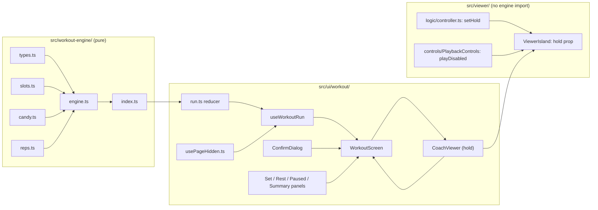
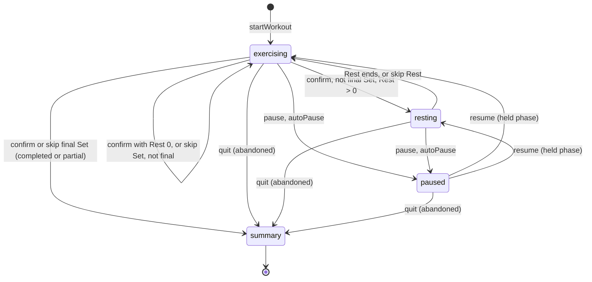

# Design Document: Skip, Pause and Quit

## Overview

This design covers ticket `07-skip-pause-quit`. It extends the pure Workout_Engine (`src/workout-engine/`) with six commands (skip Set, skip Rest, pause, Auto_Pause, resume, quit), a `paused` phase and the outcomes **partial** and **abandoned**. It adds a Coach_Hold input to the Viewer, a page-visibility hook, a Confirm_Dialog, a Paused_Panel and Summary_Panel changes. A user can now skip a Set after a confirmation, skip a Rest, pause and resume, be paused automatically when the page is hidden, and quit after a confirmation. Pausing stops the timers and the Coach together.

Everything stays static and stores nothing (ADR 0002). The engine stays pure and is driven by a Workout_Clock value that the caller passes in. `useWorkoutRun` is still the only place that reads `performance.now()`. The Viewer and the engine still never import each other.

**ADR check.** No conflict with ADR 0001 (website), 0002 (nothing is written to browser storage), 0003 or 0004 (no asset is touched). The tech steering lists "auto-pauses when the page is hidden" and the `paused` phase for the Workout engine, and says "Time while the page was closed never counts". The first two land in this ticket. The third belongs to ticket 09 (checkpoint and resume) and is deliberately absent. That is a deferral, not a contradiction.

No requirement needed a change. Readings made while designing, all consistent with `requirements.md`:

1. **Every command first advances to its own clock value.** Like `confirmSet`, each new command calls `advance(workout, at)` and then applies its rule to the phase that holds at `at`. A skip Set or pause that arrives after a Rest was already due therefore lands on the next Set (Requirements 2.7, 4.8). A rejected command returns the original Workout object, not the advanced copy.
2. **A paused Workout freezes by moving its start times, not by storing remaining time.** The Workout keeps `phaseStartedAt` and the engine's rule "remaining = target − (clock − phaseStartedAt)". While paused the view reads time at the pause instant. On resume, `phaseStartedAt` moves forward by the paused duration. Every timer rule of the happy-path engine stays valid, and the round trip of Requirement 4.5 follows from one subtraction.
3. **The Paused_Panel shows the held panel's data.** The `paused` view carries the `exercising` or `resting` view it froze (`held`). The Paused_Panel and the Viewer host take the Spooky_Name, Set_Number and timer from it. The Viewer entry is the same as during the Set or Rest, so the same Viewer stays mounted from the pause to the resume (Requirement 9.8).
4. **The rep field text survives a pause.** The Set_Panel unmounts while the Paused_Panel shows (Requirement 11.8: no rep field). To keep what the user typed, the Workout_Screen holds the text in its own state, keyed by Set position, and passes it to the Set_Panel. Requirements 4.4 and 4.5 say a pause loses no part of a Set. This is a small addition to the happy-path panel API.
5. **The Confirm_Dialog is a native `<dialog>` opened with `showModal()`.** The browser then supplies the dialog role, focus containment, the inert background and the Escape key. The screen supplies initial focus on cancel, backdrop activation and focus return (Requirement 10.6).
6. **Announcements are composed.** A skip or resume prefixes the normal panel announcement ("Set skipped. Now: Set 3 of 9: …"). The reducer records a one-shot `notice` for that. The live region still changes only when the panel changes (Requirement 13.1).

### Design decisions at a glance

| Decision | Choice | Main reason |
|---|---|---|
| New commands | `skipSet`, `skipRest`, `pauseWorkout`, `autoPause`, `resumeWorkout`, `quitWorkout`, all `(workout, at)` | Same shape as `confirmSet`; Requirement 1.1 |
| Rejection | Return the same Workout object | Requirement 1.4; the UI and tests detect "accepted" by identity |
| Pause state | `phase: 'paused'` plus `pause: { cause, from, at }`, and `pausedMs` total | Cause, held phase and pause instant in one place; JSON-safe |
| Freeze method | View reads time at `pause.at`; resume shifts `phaseStartedAt` by the paused duration | Existing timer rules stay as they are (Requirements 4.3 to 4.5) |
| Resolution record | `confirmed` (existing) and `skipped` (new slot indices); `outcome` field fixed at the end | A Set is at most one of the two (Requirement 2.6); outcome is read, not recomputed |
| Not reached Sets | Derived: total − confirmed − skipped, only after a quit | Requirement 6.5 without a third list |
| Active_Time | `finishedAt − startedAt − pausedMs`; a quit from `paused` ends at `pause.at` | Requirements 6.4, 7.6 |
| Candy | `candyFor(confirmed, total)` unchanged | Requirement 7.3 |
| Set results | `results: readonly SetResult[]` on every view | Requirement 7.4; the Summary_Panel lists them |
| Coach_Hold | One boolean prop on `ViewerIsland`; `setHold` on the Viewer controller | Requirement 9.1; no engine import |
| Hold effect | The controller stops ticking the Demo_Clip while held, so the first frame after release advances by 0 | Requirements 9.2, 9.6 |
| Play control while held | `PlaybackControls` gets `playDisabled`; speed and camera buttons stay enabled | Requirement 9.4 |
| Page visibility | `useOnPageHidden(handler, enabled)` listens to `visibilitychange` | Requirements 5.4 to 5.7 |
| Auto-pause time | The hook dispatches with `performance.now()` read in the event handler | A throttled timer cannot move it (Requirement 5.7) |
| Dialog | `ConfirmDialog` on native `<dialog>`; state `dialog: 'skipSet' | 'quit' | null` in `WorkoutScreen` | Requirements 10.1 to 10.11 |
| Dialog and timers | Opening stops nothing | Requirement 10.9 |
| Run reducer | New actions `skipSet`, `skipRest`, `pause`, `autoPause`, `resume`, `quit`; one-shot `notice` | Pure, property-testable without a DOM |

### Research findings

No external research was needed beyond the code read for this spec:

- `src/workout-engine/types.ts` has `Phase = 'exercising' | 'resting' | 'summary'`, `WorkoutOutcome = 'completed'` and a `Workout` with `startedAt`, `clock`, `phase`, `index`, `phaseStartedAt`, `confirmed` and `finishedAt`. `engine.ts` holds `startWorkout`, `advance`, `confirmSet`, `workoutView`. `advance` returns the same object in `summary`; every other call builds a new object. `confirmSet` advances first and returns `w` on any rejection. `candy.ts` is not touched.
- `run.ts` is a pure reducer over `{ workout: Workout | null }`. `useWorkoutRun.ts` runs a 250 ms interval only while `view.phase` is `exercising` or `resting`. That already means no tick while `paused` (Requirement 11.10), provided `paused` is a separate phase.
- `WorkoutScreen.tsx` renders one `CoachViewer` keyed by Exercise id above the panels, resolves the entry with `findEntryById`, derives a `panelKey` and moves focus to the new heading when it changes. Its last branch treats every non-exercising, non-resting view as the summary, so adding `paused` to `WorkoutView` makes the Type_Check fail there until the screen is updated. That is a useful guard.
- `SetPanel` keeps the rep text in local state and is keyed by `view.position`. `RestPanel` says "Offers no skip control (ticket 07)". `SummaryPanel` shows `bonusIncluded` and `setsSkipped` and renders `summary.outcome.${view.outcome}`.
- `ViewerIsland` creates one controller per load attempt (`useMemo` on `attempt`), pushes `setVisibility` from `useViewerEnvironment`, and passes `disabled` to both `PlaybackControls` and `CameraControls`. `controller.ts` decides `keepDrawing = visible && (playing || tween || gesture)`. `playback.ts`' `suspend` forgets the last tick, so the first `tick` afterwards advances the clip by 0. That is exactly the behaviour Requirement 9.6 needs for a hold, so the hold reuses `suspend`.
- `tests/unit/viewer-controller.test.ts` already has a `readyViewer` helper, an injected-clock model-based property and a hidden/visible example. The Coach_Hold tests join that file.
- `tests/e2e/support/webgl.ts` has `countDrawCalls`, `simulatePageHidden(page, hidden)` and `waitForCoach`. `tests/e2e/support/workout.ts` has `openPreparing`, `startWorkout`, `confirmCurrentSet`, `timerSeconds`, `completeWorkout`. `playwright.config.ts` defines the projects `phone` and `laptop`, `workers: 4` and a production-build web server.
- Native `<dialog>` with `showModal()` gives the `dialog` role, a focus trap, an inert background and a `cancel` event on Escape in current Chromium. Custom properties set on an ancestor are not reliably inherited by `::backdrop`, so the design draws its own scrim (see Components, Confirm_Dialog).

Not verified: how Playwright's `page.clock` interacts with a native `<dialog>` opened in a page whose `requestAnimationFrame` is faked. The E2E design avoids relying on animation frames for the dialog and uses real time for the Coach tests.

## Architecture

### Module view



Rules that hold unchanged: `src/ui/` reaches the Viewer only through `@/viewer/ViewerIsland`; only `src/viewer/scene/` imports Three.js; the engine imports only `import type` from `@/catalog` and its own files; the Viewer and the engine never import each other; nothing under the Workout paths touches browser storage or imports Progress_Code. The hold crosses the Viewer boundary as a plain boolean prop.

### Files after this ticket

```
src/workout-engine/
  types.ts          # + PauseCause, PauseState, SetResult, PausedView, outcomes, new Workout fields
  engine.ts         # + skipSet, skipRest, pauseWorkout, autoPause, resumeWorkout, quitWorkout; changed advance, confirmSet, workoutView
  index.ts          # exports the new commands and types
src/viewer/
  logic/controller.ts            # + setHold, held in the snapshot
  controls/PlaybackControls.tsx  # + playDisabled
  ViewerIsland.tsx               # + hold prop
src/ui/workout/
  usePageHidden.ts               # NEW: useOnPageHidden
  ConfirmDialog.tsx (+ .module.css)  # NEW
  PausedPanel.tsx                # NEW
  dialogs.ts                     # NEW: dialogApplies, pure
  run.ts                         # + actions and notice
  useWorkoutRun.ts               # + commands and the visibility effect
  CoachViewer.tsx                # + hold
  SetPanel.tsx, RestPanel.tsx, SummaryPanel.tsx   # controls, results, outcomes
  WorkoutScreen.tsx              # dialog state, paused branch, announcements, rep text state
  Panels.module.css              # control row, secondary button, result list
src/ui/strings.ts                # additions
```

### Phase flow



### Auto-pause sequence

```mermaid
sequenceDiagram
  participant B as Browser
  participant V as useOnPageHidden
  participant H as useWorkoutRun
  participant R as runReducer
  participant E as Workout_Engine
  participant S as WorkoutScreen
  participant Y as ViewerIsland
  B->>V: visibilitychange, state hidden
  V->>H: handler()
  H->>R: dispatch autoPause, now = performance.now()
  R->>E: autoPause(workout, now)
  E-->>R: paused Workout, cause auto, pause.at = now
  R-->>H: new RunState
  H-->>S: view.phase = paused
  S->>Y: hold = true (same mounted Viewer)
  S-->>S: Paused_Panel, heading focused, live region announces
  B->>V: visibilitychange, state visible
  Note over S: nothing happens; the user presses Resume
  S->>H: resume()
  H->>R: dispatch resume, now = performance.now()
  R->>E: resumeWorkout(workout, now)
  S->>Y: hold = false
```

## Components and Interfaces

### Workout_Engine types (`src/workout-engine/types.ts`)

```ts
export type Phase = 'exercising' | 'resting' | 'paused' | 'summary';
export type WorkoutOutcome = 'completed' | 'partial' | 'abandoned';
export type PauseCause = 'user' | 'auto';
/** What one Set_Slot shows in the views. 'notReached' appears only after a quit. */
export type SetResult = 'confirmed' | 'skipped' | 'notReached' | 'pending';

export interface PauseState {
  readonly cause: PauseCause;
  /** The phase held while paused; resume returns to it. */
  readonly from: 'exercising' | 'resting';
  /** Workout_Clock value of the pause. */
  readonly at: number;
}

export interface Workout {
  // existing fields unchanged
  readonly routineId: string;
  readonly slots: readonly SetSlot[];
  readonly startedAt: number;
  readonly clock: number;
  readonly phase: Phase;
  readonly index: number;
  readonly phaseStartedAt: number;
  readonly confirmed: readonly ConfirmedSet[];
  /** Clock at the end of the Workout: final confirm or skip, or the quit. */
  readonly finishedAt: number | null;
  // new
  /** Non-null exactly while phase is 'paused'. */
  readonly pause: PauseState | null;
  /** Total paused time of finished pauses, in ms. */
  readonly pausedMs: number;
  /** Slot indices of Skipped_Sets, in order. Disjoint from `confirmed`. */
  readonly skipped: readonly number[];
  /** Non-null exactly in 'summary'. */
  readonly outcome: WorkoutOutcome | null;
}
```

`startWorkout` sets `pause: null`, `pausedMs: 0`, `skipped: []`, `outcome: null`. The Workout stays plain, JSON-safe data.

```ts
interface ViewBase {
  readonly totalSets: number;
  readonly candyEarned: number;
  /** One entry per Set_Slot, in Workout order (Requirement 7.4). */
  readonly results: readonly SetResult[];
}
// ExercisingView and RestingView: unchanged except for `results`.

export interface PausedView extends ViewBase {
  readonly phase: 'paused';
  readonly cause: PauseCause;
  /** The view of the phase that was frozen, with timers as they were at the pause. */
  readonly held: ExercisingView | RestingView;
}

export interface SummaryView extends ViewBase {
  readonly phase: 'summary';
  readonly outcome: WorkoutOutcome;
  readonly setsConfirmed: number;
  readonly setsSkipped: number;       // Skipped_Sets only
  readonly setsNotReached: number;    // 0 unless abandoned
  readonly activeMs: number;
  readonly bonusIncluded: boolean;    // true only when every Set was confirmed
  /** Same as `results`, typed without 'pending'. */
  readonly results: readonly Exclude<SetResult, 'pending'>[];
}

export type WorkoutView = ExercisingView | RestingView | PausedView | SummaryView;
```

### Public interface (`index.ts`)

```ts
export function skipSet(workout: Workout, at: number): Workout;
export function skipRest(workout: Workout, at: number): Workout;
export function pauseWorkout(workout: Workout, at: number): Workout;   // cause 'user'
export function autoPause(workout: Workout, at: number): Workout;      // cause 'auto'
export function resumeWorkout(workout: Workout, at: number): Workout;
export function quitWorkout(workout: Workout, at: number): Workout;
// existing: startWorkout, advance, confirmSet, workoutView, candyFor, candyPerSet,
// completionBonus, isValidActualReps, minActualReps, maxActualReps, buildSetSlots
export type { PauseCause, PauseState, PausedView, SetResult /* , existing types */ };
```

There is still no parameter for Viewer speed, camera or play state anywhere (Requirements 1.2, 8.1).

### Command rules

Let `a = advance(w, at)` unless noted. "Return `w`" means the same object.

| Command | Phase gate (on `a`) | Effect |
|---|---|---|
| `advance(w, at)` | none | `summary`: return `w`. `paused`: `clock = max(at, w.clock)` only; no Rest end, no timer change (Requirement 4.3). `exercising`: `clock` only. `resting`: as in the happy-path engine |
| `confirmSet(w, at, reps?)` | `a.phase === 'exercising'` | Unchanged, except the final Set sets `outcome` to `'partial'` when `skipped` is not empty and `'completed'` otherwise (Requirements 7.1, 7.2). `paused` and `summary` fall into "return `w`" (Requirement 4.9) |
| `skipSet(w, at)` | `a.phase === 'exercising'` | Append `a.index` to `skipped`. Final slot: `phase = 'summary'`, `finishedAt = a.clock`, `outcome = 'partial'`. Otherwise `index += 1`, `phaseStartedAt = a.clock`, no Rest (Requirements 2.1 to 2.4). Candy unchanged because `confirmed` is unchanged. The skip works on a rep or a seconds Set at any Set_Timer value |
| `skipRest(w, at)` | `a.phase === 'resting'` | `phase = 'exercising'`, `index += 1`, `phaseStartedAt = a.clock` (Requirements 3.1, 3.2). Rest time already spent stays inside Active_Time because Active_Time is clock-based (Requirement 3.5). If the Rest was already due at `at`, `a` is `exercising`, so the command is rejected and the Set shows as current |
| `pauseWorkout(w, at)`, `autoPause(w, at)` | `a.phase` is `exercising` or `resting` | `phase = 'paused'`, `pause = { cause, from: a.phase, at: a.clock }`. In `paused` or `summary`: return `w`, so an `autoPause` never replaces a user pause (Requirements 4.1, 4.6, 5.1, 5.2) |
| `resumeWorkout(w, at)` | `w.phase === 'paused'` | `a = advance(w, at)`; `d = a.clock − pause.at`; `phase = pause.from`, `phaseStartedAt += d`, `pausedMs += d`, `pause = null`. Otherwise return `w` (Requirements 4.4, 4.7) |
| `quitWorkout(w, at)` | `w.phase` is `exercising`, `resting` or `paused` | From `paused`: `finishedAt = pause.at`, `pausedMs` unchanged, `pause = null`. Otherwise `a = advance(w, at)`, `finishedAt = a.clock`. Then `phase = 'summary'`, `outcome = 'abandoned'`. `summary`: return `w` (Requirements 6.1, 6.2, 6.4, 6.6) |

A command in `summary` always returns `w` (Requirements 1.4, 6.7). Every command builds new objects and arrays and mutates nothing. A clock value earlier than the latest one is treated as the latest, as before (Requirement 1.2).

**Time while paused.** A helper `timeOf(w)` returns `w.pause.at` while `phase === 'paused'` and `w.clock` otherwise. `setRemainingMs` and the Rest remaining use `timeOf(w) − phaseStartedAt`. At resume `phaseStartedAt` moves forward by the paused duration, so the remaining time the first view after the resume shows equals the remaining time at the pause (Requirement 4.5). Repeated pause and resume add up in `pausedMs`.

**Why the quit time differs.** A quit from `paused` ends Active_Time at `pause.at`: the user stopped being active there, and the time spent looking at the Paused_Panel does not count (Requirement 6.4). A quit from `exercising` or `resting` ends it at the command's clock value.

**Active_Time.** `activeMs = finishedAt − startedAt − pausedMs` (Requirement 7.6). It is clamped to 0 by construction because `pausedMs` only holds finished pauses inside the span.

**`workoutView(w)`**

- `results`: for each slot index `i`: `confirmed` if it is in `confirmed`, `skipped` if in `skipped`, `notReached` if `phase === 'summary'` and `outcome === 'abandoned'` and neither, otherwise `pending`.
- `candyEarned = candyFor(confirmed.length, slots.length)` in every phase (Requirement 7.3). A quit cannot add the bonus: a Workout that still has an unresolved Set has fewer confirmed Sets than slots.
- `paused`: `{ phase: 'paused', cause: pause.cause, held }` where `held` is built by the same code that builds the `exercising` or `resting` view, with `phase` taken as `pause.from` and time taken from `timeOf(w)`.
- `summary`: `outcome`, `setsConfirmed`, `setsSkipped = skipped.length`, `setsNotReached = slots.length − confirmed.length − skipped.length`, `activeMs`, `bonusIncluded = confirmed.length === slots.length`.

`candy.ts`, `reps.ts` and `slots.ts` do not change.

### Viewer: Coach_Hold

`src/viewer/logic/controller.ts`:

```ts
export interface ViewerSnapshot {
  readonly ready: boolean;
  readonly playing: boolean;     // the user's play state; unchanged by a hold
  readonly speed: PlaybackSpeed;
  readonly activePreset: CameraPreset | null;
  readonly held: boolean;        // NEW
}
export interface ViewerController {
  // existing members
  /** On: freeze the Demo_Clip and stop the Render_Loop (a camera move still draws). Off: undo exactly that. */
  setHold(held: boolean): void;
}
```

- `held` is a controller-level variable, not part of the ready scene, so a hold set before the scene is ready is still honoured.
- `setHold(on)`: ignore a repeated value. When it turns on and a scene exists, `playback = suspend(playback)`. Publish the snapshot. When it turns off and the clip is playing, call `requestFrame()` so the stopped Render_Loop restarts. The play state `playing` is never changed by a hold, so a Coach the user had paused, or one that started paused under the Reduced_Motion_Preference, stays paused (Requirement 9.5).
- `frame(now)`: `playback = visible && !held ? tick(playback, now) : suspend(playback)`. `keepDrawing = visible && ((playing && !held) || tween !== null || gesture !== idle)`. The clip frame is frozen while held, and a camera move the user makes still draws until it ends (Requirement 9.2).
- No jump on release: `suspend` clears `lastTickAt`, so the first `tick` after the hold advances the clip by 0 and the next by one frame gap (Requirement 9.6, same mechanism as Page_Hidden).
- `togglePlay` returns without change while held. `setSpeed` still works while held and requests a frame only when `playing && !held`. Camera commands are unchanged.
- The Coach_Asset stays loaded: `setHold` touches no load state, and `ViewerIsland` keeps its scene mounted (Requirement 9.7).

`src/viewer/controls/PlaybackControls.tsx` gains `readonly playDisabled?: boolean`. The play button is `disabled={disabled || playDisabled}`. The speed buttons keep `disabled={disabled}`. `CameraControls` is unchanged (Requirement 9.4). While held, the button text still names the user's play state (Play or Pause); it is disabled, so it cannot be used.

`src/viewer/ViewerIsland.tsx` gains `readonly hold?: boolean` (default `false`) and one effect: `useEffect(() => controller?.setHold(hold), [controller, hold])`. A Retry creates a new controller whose hold starts false; the effect reapplies it because `controller` is a dependency.

`src/ui/workout/CoachViewer.tsx` is `memo(({ exercise, hold }) => <ViewerIsland exercise={exercise} hold={hold} />)`. It re-renders only when `hold` flips, so the 250 ms tick still does not re-render the Viewer.

### Page-visibility hook (`src/ui/workout/usePageHidden.ts`)

```ts
/** Calls `onHidden` whenever the page becomes hidden while `enabled`. */
export function useOnPageHidden(onHidden: () => void, enabled: boolean): void;
```

- Keeps the latest `onHidden` in a ref.
- While `enabled`, one effect adds a `visibilitychange` listener to `document`. The listener calls `onHidden()` when `document.visibilityState === 'hidden'`. When `enabled` turns true while the page is already hidden, the effect calls it once at once.
- It removes the listener on cleanup. It does nothing when the page becomes visible (Requirement 5.5).
- `enabled` is true only in `exercising` and `resting` (Requirement 5.6). In `paused`, `summary` and the Preparing_Panel the listener is not attached.
- It reads no clock. The caller reads `performance.now()` inside the handler, at the moment the event is handled (Requirement 5.4). A hidden tab may delay or batch timers, but a `visibilitychange` listener runs when the event fires, and the engine moves its clock to that value before it pauses (Requirement 5.7).

### Run reducer and hook (`run.ts`, `useWorkoutRun.ts`)

```ts
export type RunNotice = 'skippedSet' | 'skippedRest' | 'resumed';

export interface RunState {
  readonly workout: Workout | null;
  /** One-shot note for the live region, set by an accepted skip or resume. */
  readonly notice: RunNotice | null;
}

export type RunAction =
  | { type: 'start'; routine: RoutineEntry; now: number }
  | { type: 'tick'; now: number }
  | { type: 'confirm'; now: number; actualReps?: number }
  | { type: 'skipSet'; now: number }
  | { type: 'skipRest'; now: number }
  | { type: 'pause'; now: number }
  | { type: 'autoPause'; now: number }
  | { type: 'resume'; now: number }
  | { type: 'quit'; now: number };
```

- Every action except `start` is ignored while `workout` is `null`. `start` works only from `null` (unchanged).
- `tick` calls `advance` and keeps `notice`.
- `confirm`, `pause`, `autoPause` and `quit` call their engine command and set `notice` to `null`.
- `skipSet`, `skipRest` and `resume` call their engine command. When the engine returns the same object (rejected), the state is returned unchanged. Otherwise `notice` becomes `'skippedSet'`, `'skippedRest'` or `'resumed'`.

`useWorkoutRun(routine)` returns `{ view, notice, start, confirm, skipSet, skipRest, pause, resume, quit }`. Each handler dispatches with `now = performance.now()` read inside the handler. The tick effect is unchanged: it runs while `view.phase` is `exercising` or `resting`, so no interval exists in `paused` or `summary` (Requirement 11.10). The hook also calls `useOnPageHidden(() => dispatch({ type: 'autoPause', now: performance.now() }), phase === 'exercising' || phase === 'resting')`. The hook references no browser-storage API.

### Dialog logic (`src/ui/workout/dialogs.ts`, pure)

```ts
export type DialogKind = 'skipSet' | 'quit';
/** Whether a dialog still applies to the Workout's phase (Requirement 10.10). */
export function dialogApplies(kind: DialogKind, phase: WorkoutView['phase']): boolean;
//   skipSet: phase === 'exercising'
//   quit:    phase is 'exercising', 'resting' or 'paused'
```

### Confirm_Dialog (`ConfirmDialog.tsx`)

```ts
export interface ConfirmDialogProps {
  readonly heading: string;
  readonly text: string;
  readonly confirmLabel: string;
  readonly cancelLabel: string;
  readonly onConfirm: () => void;
  readonly onCancel: () => void;
}
```

- Rendered only while open. On mount an effect calls `dialog.showModal()` and focuses the cancel button; the cleanup closes the dialog if it is still open.
- Markup: `<dialog aria-labelledby aria-describedby>` filling the viewport, holding a card with `h2`, `p`, and two buttons (cancel first, confirm second). Ids come from `useId`.
- Escape: the `cancel` event is `preventDefault`ed and `onCancel()` is called, so React stays the owner of the open state.
- Backdrop: a click whose target is the `<dialog>` itself (outside the card) calls `onCancel()`. The dialog element has no padding, so only the scrim is "outside the card".
- The scrim is the `<dialog>` background, a token colour mixed with transparency, not `::backdrop`, because custom properties are not reliably inherited by `::backdrop`. `::backdrop` itself is set to `transparent`.
- Focus containment, the inert background and the `dialog` role come from `showModal()`.
- No animation or transition in the CSS module (Requirement 10.11).

In `WorkoutScreen` the state is `{ kind: DialogKind; opener: HTMLElement } | null`. A panel button calls `onAskSkipSet(opener)` or `onAskQuit(opener)` with `event.currentTarget`, because Safari does not focus a clicked button. Handlers:

- confirm skip: close, then `skipSet()`. Confirm quit: close, then `quit()`. The panel change moves focus to the new heading (Requirement 13.2 rule below).
- cancel, Escape, backdrop: close and `opener.focus()` when the opener is still connected (Requirement 10.6).
- A render guard and an effect close the dialog when `!dialogApplies(kind, phase)` and send no command and do not restore focus; focus then follows the new panel heading (Requirement 10.10).

### Workout_Screen and panels

`WorkoutScreen` additions:

- `const run = useWorkoutRun(routine)`. The `paused` branch: `viewerEntry` from `view.held` (`held.slot.entryId` for an `exercising` hold, `held.next.entryId` for a `resting` hold), `<PausedPanel …/>`, and `hold = true`. All other branches pass `hold = false`. Because the Viewer key is the entry id and the entry is the same before, during and after the pause, the Viewer is not remounted (Requirement 9.8).
- `panelKey` gains `'paused'`. The existing focus effect moves focus to the Paused_Panel heading on the pause, and to the restored panel heading on the resume, because the key changes in both directions (Requirement 13.2).
- Rep text: `const [draft, setDraft] = useState<{ position: number; text: string } | null>(null)`. The Set_Panel receives `repsText = draft?.position === view.position ? draft.text : String(defaultReps)` and `onRepsText(text)`. The Set_Panel no longer keeps its own text state. Confirm uses `parseActualReps(repsText)` as before. The `key={view.position}` stays.
- Announcement: `base` is the existing panel text (`workout.announce.set` or `.rest`). Then:
  - `paused`: `workout.announce.paused.user` or `workout.announce.paused.auto` from `view.cause`.
  - `summary`: `workout.announce.summary` for **completed** and **partial**, `workout.announce.ended` for **abandoned**.
  - `exercising` or `resting` with `notice` `skippedSet`, `skippedRest` or `resumed`: `format('workout.announce.<notice>', { next: base })`.
  - Any timer tick leaves the text unchanged, so the live region never reads seconds (Requirement 13.1).

`SetPanel` (phase `exercising`): the existing content, then a control row of three buttons below the confirm button: `workout.pause` (calls `onPause`), `workout.skipSet` (calls `onAskSkipSet(opener)`), `workout.quit` (calls `onAskQuit(opener)`). `RestPanel` (phase `resting`): the control row has `workout.pause`, `workout.skipRest` (calls `onSkipRest`, no dialog) and `workout.quit`. The Rest_Panel shows no skip Set button and the Set_Panel no skip Rest button (Requirement 11.3). `PreparingPanel` is unchanged (Requirement 11.11).

`PausedPanel` (phase `paused`), a `section` labelled by its `h2`:

| Part | Content |
|---|---|
| Heading | `workout.paused.heading`, focusable (`tabIndex={-1}`) |
| Cause message | `workout.paused.user` or `workout.paused.auto` from `view.cause` (Requirements 11.7, 17.5) |
| Held Exercise | Spooky_Name; for an `exercising` hold `workout.set.of` (Set_Number and count) and `workout.set.position`; for a `resting` hold the `workout.rest.next` line of the next Set |
| Frozen timer | `role="timer"`, label `workout.timer.set` for a seconds Set or `workout.timer.rest` for a Rest, text `formatCountdown` of the held remaining time. A rep Set has no timer, so none is shown (Requirement 13.6) |
| Buttons | `workout.resume` (primary) and `workout.quit` (opens the quit dialog) |

The Paused_Panel has no confirm button, no skip button and no rep field (Requirement 11.8). The `safety.*` block stays on the Preparing_Panel and the Set_Panel as before; the Paused_Panel does not repeat it.

`SummaryPanel` changes:

- Heading `summary.heading` for **completed** and **partial**, `summary.heading.ended` for **abandoned**.
- Stats list: outcome line (`summary.outcome.${outcome}` now covers three values), Sets confirmed, Sets skipped, `summary.setsNotReached` only when `setsNotReached > 0`, Active time, Candy earned.
- `completed`: the existing `summary.bonus` line. `partial` and `abandoned`: `summary.noBonus` and no bonus line (Requirements 12.3, 12.4). Neither says the Candy was saved (Requirement 12.6).
- `summary.sets.heading` and an ordered list: one `li` per slot with `format('summary.set.line', { exercise, number, count, state })` where `state = t('summary.result.<result>')`. The result is words, not colour (Requirement 12.2). A `li` may add a text-weight or border style from a token, never colour alone.
- Links to the Routine and Home stay. No Viewer renders in the summary, so the Viewer unmounts on every route to `summary` (Requirement 12.8).

`Panels.module.css` gains a control row (wrapping flex, gap from tokens, buttons at least `3rem` high and as wide as their text), a secondary button style and the result list. Layouts wrap at 320 CSS pixels and at 200% text size (Requirement 11.12). No shortcut keys, no `accesskey` (Requirement 11.13).

### Strings_Module additions (`src/ui/strings.ts`)

English first draft; wording may change as long as the string tests pass. None uses an Avoid word, none implies correct form, none says Candy was saved or kept. Every text that mentions Candy sits under `workout.` or `summary.` (Requirement 17.4).

| Identifier | English text |
|---|---|
| `workout.pause`, `workout.resume` | Pause, Resume |
| `workout.skipSet`, `workout.skipRest`, `workout.quit` | Skip this Set, Skip Rest, Quit the Workout |
| `workout.paused.heading` | Workout paused |
| `workout.paused.user` | You paused the Workout. The timer and the Coach are stopped. |
| `workout.paused.auto` | The Workout paused because this page was hidden. The timer and the Coach are stopped. |
| `workout.dialog.cancel` | Keep going |
| `workout.skipSet.dialog.heading` / `.text` / `.confirm` | Skip this Set? / `A skipped Set earns 0 Candy, and the {bonus} Candy for finishing every Set is lost for this Workout.` / Skip the Set |
| `workout.quit.dialog.heading` / `.text` / `.confirm` | Quit the Workout? / `The Workout ends now. The summary shows the Candy for the Sets you confirmed. The {bonus} Candy for finishing every Set is lost.` / Quit now |
| `workout.announce.paused.user` | Workout paused. |
| `workout.announce.paused.auto` | Workout paused because the page was hidden. |
| `workout.announce.resumed` | `Workout resumed. {next}` |
| `workout.announce.skippedSet` | `Set skipped. Now: {next}` |
| `workout.announce.skippedRest` | `Rest ended. Now: {next}` |
| `workout.announce.ended` | Workout ended |
| `summary.heading.ended` | Workout ended |
| `summary.outcome.partial`, `summary.outcome.abandoned` | Partial, Abandoned |
| `summary.setsNotReached` | `Sets not reached: {count}` |
| `summary.noBonus` | `The {bonus} Candy for finishing every Set needs every Set confirmed.` |
| `summary.sets.heading` | Your Sets |
| `summary.set.line` | `{exercise}, Set {number} of {count}: {state}` |
| `summary.result.confirmed`, `.skipped`, `.notReached` | confirmed, skipped, not reached |

`summary.outcome.${WorkoutOutcome}` and `summary.result.${Exclude<SetResult, 'pending'>}` are template literals, so a new outcome or result without its string fails the Type_Check (Requirement 17.2). The new templates join `TemplateId`; `tests/unit/strings-format.test.ts` lists them by hand.

## Data Models

Types are in Components and Interfaces. Runtime state added by this ticket:

- `Workout` gains `pause`, `pausedMs`, `skipped` and `outcome`. It stays plain data: numbers, strings, arrays, objects. `structuredClone` and `JSON.stringify` lose nothing, so ticket 09 can checkpoint it unchanged. This design does not serialise it.
- `RunState` (React memory) gains `notice`.
- `WorkoutScreen` state: the open dialog (kind plus opener element) and the rep text draft. Both live only in React memory.
- The Viewer controller gains one boolean, `held`.

Candy, Active_Time and all counts are derived from `Workout` by `workoutView`; none is stored separately. Nothing is written to `localStorage`, `sessionStorage`, IndexedDB or cookies (Requirement 14).

## Correctness Properties

*A property is a characteristic or behavior that should hold true across all valid executions of a system-essentially, a formal statement about what the system should do. Properties serve as the bridge between human-readable specifications and machine-verifiable correctness guarantees.*

Consolidated during prework reflection: the "command not allowed in this phase" clauses (1.4, 2.5, 3.4, 4.6, 4.7, 4.9, 5.2, 6.6, 6.7) are one property; the outcome, count and bonus clauses (2.6, 7.1, 7.2, 7.3, 7.7) are two; the quit clauses (6.2, 6.3, 6.5, 7.9) are one; the Coach_Hold clauses (9.2, 9.5, 9.6) are one model-based property. Requirements about the screen, the Viewer's loading, dialogs, focus, strings and storage are examples, static scans or Playwright tests, not properties.

Generators used by the engine properties: a valid Routine_Entry (the arbitrary of `tests/unit/support/workout.ts`) and a **command script**: a list of steps `{ kind, wait }` where `kind` is one of `confirm` (with reps 0 to 200, and for a seconds Set a wait of at least the target), `skipSet`, `skipRest`, `pause`, `autoPause`, `resume`, `quit`, `advance`, and `wait` is a non-negative gap added to the player's clock before the command. A script applied to `startWorkout` gives a reachable Workout together with the player's own record of clock values, accepted commands and paused spans, which the oracles use.

### Property 1: Pause then resume leaves timers unchanged

*For any* reachable Workout in `exercising` or `resting`, any pause kind (`pauseWorkout` or `autoPause`) and any paused duration `d ≥ 0` (with any number of `advance` calls inside it), the Workout after `resumeWorkout` at the pause clock plus `d` shows the same phase, the same Set or Rest and the same remaining Set_Timer or Rest_Timer as the view just before the pause; the `paused` view during the pause shows those values too; and a Rest that was already due before the pause is already over in both views.

**Validates: Requirements 4.1, 4.2, 4.3, 4.4, 4.5, 4.8, 5.1, 5.3**

### Property 2: A user pause is not replaced by an Auto_Pause

*For any* reachable Workout in `paused` with cause `user` and any later clock value, `autoPause` returns the same Workout object, and *for any* Workout paused by `autoPause`, the timers behave as in Property 1, the phase stays `paused` until `resumeWorkout`, and a later `pauseWorkout` returns the same object.

**Validates: Requirements 5.1, 5.2, 5.3, 4.6**

### Property 3: A skipped Set earns nothing and starts the next Set at once

*For any* reachable Workout in `exercising` (rep or seconds Set, any Set_Timer value), `skipSet` at any later clock value `t` leaves `candyEarned` and `setsConfirmed` unchanged, adds exactly that Set to the skipped Sets, and, when the Set is not the final one, gives `exercising` on the next slot with a start time of `t` (never `resting`); when it is the final one it gives `summary` with the outcome `partial`.

**Validates: Requirements 2.1, 2.2, 2.3, 2.4, 2.6, 2.7**

### Property 4: Skipping a Rest starts the next Set and changes no count

*For any* reachable Workout in `resting` and any clock value `t` before the Rest end, `skipRest` at `t` gives `exercising` on the next slot with a Set start of `t`, and leaves the confirmed Sets, the skipped Sets and `candyEarned` equal to their values before.

**Validates: Requirements 3.1, 3.2, 3.3**

### Property 5: Disallowed commands change nothing

*For any* reachable Workout and any command, if the command is not allowed in the phase at the command's clock value, the result is the same object as the argument. The allowed set is: `confirmSet` and `skipSet` in `exercising`; `skipRest` in `resting`; `pauseWorkout` and `autoPause` in `exercising` and `resting`; `resumeWorkout` in `paused`; `quitWorkout` in `exercising`, `resting` and `paused`; no command in `summary` (including `advance`).

**Validates: Requirements 1.4, 2.5, 3.4, 4.6, 4.7, 4.9, 5.2, 6.6, 6.7**

### Property 6: Resolved Sets, outcome and Candy

*For any* valid Routine_Entry and any command script that ends in `summary` without a quit, the view reports `setsConfirmed + setsSkipped` equal to the number of Set_Slots and `setsNotReached` 0; the outcome is `completed` if and only if `setsSkipped` is 0, and `partial` otherwise; no slot is both confirmed and skipped; and `candyEarned` equals `setsConfirmed` plus 5 if and only if `setsConfirmed` equals the number of Set_Slots. *For any* script at any step, `candyEarned` equals `candyFor(confirmed, total)` and a Workout that has not ended reports a phase of `exercising`, `resting` or `paused`.

**Validates: Requirements 2.6, 7.1, 7.2, 7.3, 7.5, 7.7, 15.2**

### Property 7: Quitting gives abandoned and keeps per-Set Candy

*For any* reachable Workout in `exercising`, `resting` or `paused` and any quit clock value, `quitWorkout` gives `summary` with the outcome `abandoned`, `candyEarned` equal to the number of confirmed Sets with no Completion_Bonus, `setsSkipped` equal to the Sets the user skipped, and `setsNotReached` equal to the Set_Slots that were neither confirmed nor skipped; the views of every later command equal that summary.

**Validates: Requirements 6.1, 6.2, 6.3, 6.5, 6.7, 7.9**

### Property 8: Active_Time excludes paused time

*For any* valid Routine_Entry and any command script ending in `summary`, `activeMs` equals the player's clock at the end of the Workout minus its clock at the start minus the total of its accepted pause spans (a quit from `paused` ends at the pause clock and adds no further span); `activeMs` is never negative; and the Set_Timer and Rest_Timer remaining at any step never exceed their target or Rest.

**Validates: Requirements 3.5, 6.4, 7.6**

### Property 9: Set results describe every Set in order

*For any* reachable Workout, `results` has one entry per Set_Slot; entry `i` is `confirmed` if and only if slot `i` was confirmed, `skipped` if and only if it was skipped, `notReached` only in an abandoned summary, and `pending` in every other case; the counts of `confirmed` and `skipped` entries equal `setsConfirmed` and `setsSkipped` in the summary.

**Validates: Requirements 7.4, 7.5, 6.5**

### Property 10: New commands leave their argument unchanged

*For any* reachable Workout and any command of the engine (the happy-path commands and the six new ones, valid or not, any time), the Workout passed in is deep-equal to a clone taken before the call.

**Validates: Requirements 1.2**

### Property 11: A held Coach stays frozen and keeps its play state

*For any* ready Viewer controller driven by an injected clock and any sequence of frame, toggle-play, set-speed, camera and `setHold` commands, the Demo_Clip time reported by `frame` does not change between two frames while the hold is on; `keepDrawing` is false while the hold is on and no camera move is running; `togglePlay` has no effect while the hold is on; after the hold turns off, `playing` equals what it was before the hold; and the first frame after the hold turns off reports the clip time of the last held frame.

**Validates: Requirements 9.2, 9.5, 9.6**

## Error Handling

- A rejected command returns the same Workout. The panels disable or hide the controls that would send a rejected command, so the engine's rejection is the second line of defence. `useWorkoutRun` handlers may be called twice (double tap); the second call is rejected by the engine.
- A double press of the skip Set confirming button, or a stale dialog, cannot skip two Sets: the dialog closes on the first press, and a skip Set that arrives in the wrong phase returns `w`.
- A `quit` or `skipSet` confirmed after the Set changed (for example a seconds Set that cannot change) cannot target another Set because the dialog closes whenever the phase stops applying (`dialogApplies`). A skip dialog opened in `exercising` and answered after an Auto_Pause is closed by the guard and sends nothing.
- A clock value that goes backwards is treated as the latest value, by every command, through `advance`.
- A browser that throttles or delays timers while hidden cannot add time: the pause carries the clock at the `visibilitychange` event, and while paused no timer advances.
- If `showModal` is not available, the `<dialog>` still renders as a labelled block above the page and its buttons work. The tested engines (Chromium) support it.
- A failed Viewer (no WebGL, load error) still shows the existing Still_Fallback. The hold has no controller to act on; the Paused_Panel, the buttons and the timers do not depend on the Coach.
- A Viewer Retry during a pause creates a new controller; `ViewerIsland` reapplies `hold` through its effect.
- Browser Back from a running Workout still leaves it without a prompt, and a refresh shows the Preparing_Panel. These are documented, accepted gaps (Requirements 14.3, and the Back button reading in `requirements.md`).

## Testing Strategy

Dual approach: example tests and `fast-check` properties (`fast-check` 4.10.2, `numRuns: 200`, each property test tagged `// Feature: skip-pause-quit, Property N: …`). Tests use public interfaces and are named after the rule in glossary terms. Engine tests pass the Workout_Clock as an argument: no fake timers, no real time. PBT applies to the engine and the Viewer controller, which are pure and have a large input space. It does not apply to the panels, the dialog, the hook wiring or CSS: those use examples, static scans and Playwright.

### New and changed unit tests

| File | Content |
|---|---|
| `tests/unit/workout-skip.test.ts` | Property 3 and Property 4; examples: "skipping a Set earns 0 Candy", "a Skipped_Set removes the Completion_Bonus" (8 of 9 gives 8), "skipping the final Set gives partial", "a skipped Set starts the next Set with no Rest", "skipping a Rest starts the next Set at once and counts the Rest time already spent", "a skip that arrives after the Rest was due applies to the next Set" |
| `tests/unit/workout-pause.test.ts` | Property 1 and Property 2; examples: "pausing freezes the Set_Timer and the Rest_Timer", "resuming continues from the same point", "Auto_Pause freezes the timers and needs the resume command", "Auto_Pause does not replace a user pause", "a pause after the Rest was due pauses on the next Set", "paused time is not Active_Time" |
| `tests/unit/workout-quit.test.ts` | Property 7; examples: "quitting gives abandoned and keeps per-Set Candy without bonus" (3 confirmed Sets of Graveyard Shift: 3 Candy, 0 skipped, 6 not reached), "quitting from the final Set gives abandoned", "quitting from a pause ends Active_Time at the pause", "quitting with 0 confirmed Sets earns 0 Candy" |
| `tests/unit/workout-outcome.test.ts` | Property 6, Property 8 and Property 9; examples: "one skipped Set and eight confirmed give 8 Candy and partial", "every Set confirmed after a pause gives completed with 14 Candy" |
| `tests/unit/workout-phases.test.ts` | Property 5 (the full allowed-command table) |
| `tests/unit/workout-immutable.test.ts` | extended to Property 10 (the six new commands join the generator) |
| `tests/unit/workout-engine.test.ts`, `workout-drive.test.ts`, `workout-advance.test.ts` | Happy-path tests stay. Property 7 of happy-path (the driven Workout) keeps its summary assertion; the view now also has `results` and `setsNotReached` 0, so only an exact-equality assertion on the whole summary object needs the new fields added |
| `tests/unit/viewer-controller.test.ts` | New `describe('Coach_Hold')` using `readyViewer`: Property 11 with a model of the clip time over frame, toggle, speed, camera and hold steps; examples: "a held Coach draws no frame once the camera stops" (`keepDrawing` false), "releasing the hold restarts the Render_Loop when the Coach is playing", "a Coach paused by the user stays paused after a hold", "a Coach that started paused under the Reduced_Motion_Preference stays paused after a hold", "speed changes while held keep the frame". Existing snapshot assertions use `toMatchObject` or single fields and need no change except where a whole snapshot is compared |
| `tests/unit/workout-screen-logic.test.ts` | `runReducer` examples: the six new actions are ignored before the start; a rejected skip Set keeps the state and the notice; an accepted skip Rest sets the notice `skippedRest`; a later confirm clears it; resume sets `resumed`; an `autoPause` after a user `pause` leaves the cause `user`; `dialogApplies` table: skip Set only in `exercising`, quit in `exercising`, `resting` and `paused`, neither in `summary` |
| `tests/unit/page-visibility.test.ts` | `useOnPageHidden` is a small hook with a DOM dependency. Test it with a fake `document` event target created in the test: the handler is called on hidden while enabled, not when visible, not when disabled, once on enable while already hidden, and the listener is removed on cleanup. If the Vitest environment has no DOM, the test drives the extracted pure function `shouldAutoPause(visibilityState, enabled)` and the listener wiring is covered by Playwright |
| `tests/unit/workout-isolation.test.ts` | No rule change. It must pass for the new and changed files (Requirement 1.5): the engine files import nothing outside their own files and `@/catalog` types, and use no `Date`, `performance`, timers, `window` or `document`. Add: `src/ui/workout/` new files reference no storage API and `progress-store`; `src/viewer/` still imports nothing from the engine (this is how Requirement 9.1 is enforced) |
| `tests/unit/strings.test.ts` | Existing Avoid-word, form-claim, no-reward and no-"saved or kept" tests cover the new strings unchanged. Add: no new Workout, Summary or dialog string blames or shames ("lazy", "failed", "gave up", "weak", "quitter"); every `summary.outcome.*` and `summary.result.*` word exists; the auto and user pause texts differ |
| `tests/unit/strings-format.test.ts` | add the new template identifiers and their placeholders by hand |
| `tests/unit/support/workout.ts` | add the command-script arbitrary and the player that records accepted commands and pause spans |

### E2E tests

Helpers in `tests/e2e/support/workout.ts` gain: `skipCurrentSet(page)` (presses skip Set and confirms in the dialog), `pauseWorkout(page)`, `resumeWorkout(page)`, `quitWorkout(page)` (presses quit and confirms), and `completeWorkout` learns to skip chosen Sets. `tests/e2e/support/screens.ts` keeps its list; the shared theme, layout and no-backend checks run over the Workout screens, and the new spec adds the Paused_Panel and the Confirm_Dialog to its own checks (Requirement 15.5).

Run policy: the E2E specs here use the production build and software WebGL. Run one spec file and one project at a time with `--workers=1`, for example `npx playwright test tests/e2e/workout-controls.spec.ts --project=phone --workers=1`, and run the full suite only at the final checkpoint.

1. **`workout-controls.spec.ts`** (both projects, `page.clock.install()` before `goto`, `reducedMotion: 'reduce'` so the Coach draws nothing while the clock jumps):
   - skip Set asks first: the dialog has the dialog role, a heading and text naming 0 Candy and the lost bonus; focus is on the cancel button; Cancel and Escape and a click on the backdrop close it with the same Set showing and focus back on the skip button; confirming shows the next Set, announced in the status region; no Rest shows.
   - a skipped Set ends in the summary as **partial**: skip one Set, confirm the rest (`completeWorkout`), expect Partial, 8 confirmed, 1 skipped, Candy earned 8, no bonus line and the `summary.noBonus` text; the list names the skipped Set as "skipped" in words.
   - skip Rest: during a Rest press Skip Rest, expect the next Set at once with no dialog; the status region says the Rest ended.
   - pause freezes the timer: in a Rest, read the timer, press Pause, `fastForward('00:30')`, expect the same value and no tick; press Resume and expect the timer continues from it (reads one second lower after `fastForward('00:01')`).
   - the pause shows no confirm, skip or rep controls, shows the heading, the Exercise name, "Set n of m" and the user cause text.
   - `visibilitychange`: `simulatePageHidden(page, true)` pauses with the auto text; `simulatePageHidden(page, false)` leaves the Paused_Panel visible; only Resume continues. A hidden event on the Preparing_Panel and on the summary does nothing.
   - a user pause stays "user" when the page then becomes hidden.
   - quit asks first; confirming after 3 confirmed Sets shows Abandoned, 3 confirmed, 0 skipped, 6 not reached, "Candy earned: 3", no bonus line, and the list shows 6 "not reached"; quitting from the Paused_Panel works too.
   - a skip Set dialog open while the page becomes hidden closes, the Paused_Panel shows and focus is on its heading; the Set is not skipped after the resume.
   - after skip, pause, auto-pause, quit and finish runs, `localStorage`, `sessionStorage`, `indexedDB.databases()` and cookies are empty; a refresh in `paused` and in `summary` shows the Preparing_Panel; no text matches "perfect form".
   - layout: at 320 CSS pixels wide and at 200% text size the control row, the Paused_Panel and the dialog show no horizontal scroll and no clipped button; buttons are at least as tall as the confirm button.
   - reduced motion: computed `animation-name` and `transition-duration` of the Paused_Panel, the dialog and the control buttons are none.
2. **`workout-pause-coach.spec.ts`** (laptop, software WebGL, real time, `countDrawCalls`): a playing Coach keeps drawing in Set 1; Pause settles the draw count and no frames draw for 1.5 s; Resume draws frames again and the Coach label is unchanged (same Viewer; the GLB is requested once); with the Coach paused by its own Pause button first, a Workout pause and resume leaves it paused (no frames, the Coach button still reads Play); the Coach's play button is disabled while the Workout is paused and the speed and camera buttons are enabled; the same holds across `simulatePageHidden` auto-pause; at the summary no Viewer remains.
3. **`workout-clock.spec.ts`** and the existing happy-path specs keep passing without weakening (Requirement 8.5). Add one test to `workout-clock.spec.ts`: while paused, changing the Viewer speed to 0.5× changes nothing in the frozen timer, and after the resume the timer continues at the normal rate.
4. **`workout.spec.ts`** happy-path expectations that conflict are updated, not weakened: the Rest panel now has a Skip Rest button (replaces the "no skip control" check), and the Set panel's control buttons are asserted by name.

### Human eye checks (not automated)

On a real phone: lock the phone mid-Set and come back (the Workout is paused, the Coach is frozen, Resume continues); tap the skip and quit buttons with a thumb and check the dialogs are readable at 200 % text size; run Graveyard Shift once with one skipped Set and once with a quit, and read the summary aloud for tone (no shaming, no claim about form).
