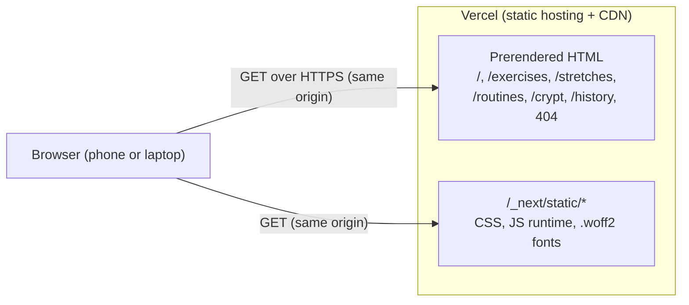
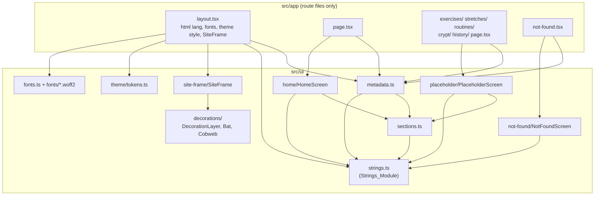
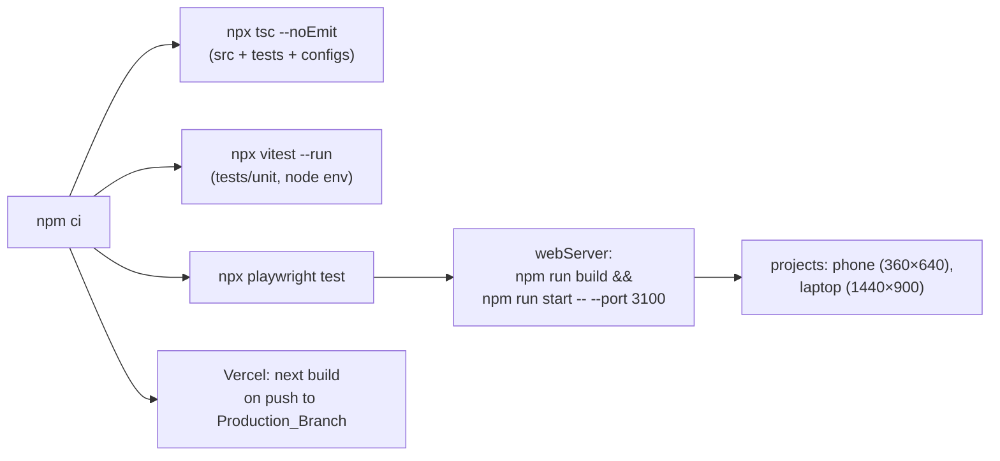

# Design Document: Spooky Site Skeleton

## Overview

This design covers ticket `01-spooky-site-skeleton`. It turns the empty repository into a statically prerendered Next.js website with a Halloween-styled Home_Screen, five Placeholder_Screens, a themed not-found screen, one central Strings_Module, and working Vitest and Playwright harnesses. Every later ticket builds on this foundation.

The Site has no client-side state and no interactivity beyond links. Every screen is a React Server Component rendered to static HTML at build time. The browser receives HTML, one CSS bundle, two self-hosted font families and the Next.js runtime. Nothing talks to a server other than the static file host.

### Design decisions at a glance

| Decision | Choice | Main reason |
|---|---|---|
| Scaffold method | Hand-written `package.json` and config files, then `npm install` with exact versions | `create-next-app` adds ESLint, Tailwind, sample assets and a README that this ticket does not want; a manual scaffold is non-interactive and reviewable |
| TypeScript major | **6.0.3**, not 7.0.2 | TypeScript 7 ships no JavaScript compiler API; Next.js 16's default build type-check calls that API and aborts with a misleading "packages not installed" error ([Next.js issue #95490](https://github.com/vercel/next.js/issues/95490), [discussion #95633](https://github.com/vercel/next.js/discussions/95633)). TypeScript 6 also keeps the API that the source-rule tests use |
| Fonts | `next/font/local` with committed `.woff2` files | Both `next/font/local` and `next/font/google` self-host, so both satisfy Requirement 4.5. `next/font/google` downloads at build time, so a build without network access to Google fails; local files make the Build deterministic |
| Styling | Global CSS plus CSS Modules, colour tokens defined once in TypeScript | Zero extra dependencies; tokens can be imported by unit tests to check contrast and hue |
| Routes | Five explicit route folders, not a `[section]` dynamic route | Later tickets replace each Placeholder_Screen with a different real screen; explicit folders keep that a one-folder change and stay static with no `generateStaticParams` |
| Not-found | Root `src/app/not-found.tsx` (stable) | Handles every unmatched URL; `global-not-found.js` is still experimental and bypasses the root layout ([Next.js docs](https://nextjs.org/docs/app/api-reference/file-conventions/not-found)) |
| Client Components | None | No interactivity is needed. No `"use client"` file exists in this ticket |
| Unit test environment | Vitest in the `node` environment | This ticket has no component tests; `jsdom` and React Testing Library are added by the first ticket that needs them |
| E2E browsers | Chromium only, two projects (Phone_Viewport, Laptop_Viewport) | Requirement 8.4 asks for two viewport projects, not two engines; one engine keeps install time and run time low |
| Property-based testing | `fast-check` for the pure helpers behind the Strings_Module and theme checks | See Correctness Properties |

### Research findings

Versions were checked with `npm view` on the build machine on the day of writing (Node 24.12.0, npm 11.6.2).

| Package | Pinned version | Notes |
|---|---|---|
| `next` | 16.4.5 | Current `latest`. Requires Node ≥ 20.9. Turbopack is the default bundler for `next dev` and `next build`. `next lint` is removed; `next build` no longer lints. `middleware.ts` is renamed `proxy.ts` (the old name is deprecated but still honoured) |
| `react`, `react-dom` | 19.3.1 | Satisfies Next's peer range `^19.0.0` |
| `typescript` | 6.0.3 | Last 6.x. TypeScript 6 changes defaults: `strict: true`, `types: []`, `moduleResolution: bundler`, `baseUrl` deprecated. The tsconfig sets every relied-on option explicitly so it does not depend on defaults |
| `@types/react`, `@types/react-dom` | 19.3.0 | |
| `@types/node` | 24.19.2 | Matches the Node 24 runtime. Needed explicitly because TypeScript 6 defaults `types` to `[]` |
| `vitest` | 5.1.0 | Requires Node `^22.12 \|\| ^24 \|\| >=26` and declares `vite` as a **peer** dependency, so `vite` is installed explicitly |
| `vite` | 8.3.6 | Vite 8 resolves tsconfig `paths` natively with `resolve.tsconfigPaths: true` ([Vite docs](https://vite.dev/config/shared-options)), so `vite-tsconfig-paths` is not needed |
| `@playwright/test` | 1.65.0 | Satisfies Next's optional peer `^1.51.1`. `webServer.reuseExistingServer: false` makes Playwright throw if the port is already taken ([Playwright docs](https://playwright.dev/docs/test-webserver)) |
| `fast-check` | 4.10.2 | Property-based testing library |

Node version: `package.json` declares `"engines": { "node": "24.x" }`. Vercel reads this field to choose the build runtime, and Node 24 satisfies Next, Vitest and Playwright.

Font findings ([Next.js font docs](https://nextjs.org/docs/app/getting-started/fonts)): `next/font` self-hosts every font as a static asset on the deployment's own domain, so the browser sends no request to Google with either loader. `next/font/local` resolves `src` relative to the calling file and accepts `display`, `fallback` and `variable` options.

Not-found findings: the root `app/not-found.tsx` handles every unmatched URL, renders inside the root layout, may export `metadata`, and gets `<meta name="robots" content="noindex">` injected automatically.

Content was rephrased for compliance with licensing restrictions.

### Open decisions (unchanged, still for the user)

The design works with either answer to the open decisions in the requirements. Nothing in the code, config or tests names a branch.

| Open decision | What the design does until the user answers | What changes per answer |
|---|---|---|
| 1. Production branch `main` or `master` | No file names a branch. Vercel's production branch is set in the Vercel dashboard. | **Option A:** the user renames `master` to `main` on GitHub and locally, then connects Vercel to `main`. No repository file changes. **Option B:** the user connects Vercel to `master`, and one task edits `.kiro/steering/tech.md` to say `master` (Requirement 9.10). |
| 2. Commit `CONTEXT.md` and `docs/` | Keeps today's behaviour: both stay gitignored. Committing to a public repository cannot be fully undone, so the safe default is to wait. | **Option A:** delete the `CONTEXT.md` and `docs/` lines from `.gitignore`, commit both, and enable the conditional repository-rule test for Requirement 9.5. **Option B:** no change. The `structure.md` "Current state" tree lists them only under Option A (Requirement 9.7 lists tracked paths only). |
| 3. GitHub About shows MIT | Nothing to build. `LICENSE` already holds the MIT text. | The user checks the About section after the default branch is settled. |

### Requirement gaps resolved

Four gaps found while writing this design have been folded into `requirements.md`, and the design below cites the updated criteria:

- Requirement 1.2 now forbids script files (`.js`, `.jsx`, `.mjs`, `.cjs`) under `src/` and `tests/` and allows CSS, font, SVG and licence files.
- Requirement 5.4 now sets the root (`html`) font size to 200 %, which the E2E test does with an injected style tag. New Requirement 5.9 forbids an absolute unit for the root font size, which keeps that test equivalent to a browser text-size setting.
- Requirement 8.7 now gives one 300-second budget from the start of the server command (Build, then `next start`) to the Site answering at `/`. Playwright's `webServer.timeout` covers the whole command, so the Build cannot have its own timer.
- Requirement 10.4 now applies to production builds (`next start` or a Vercel production deployment). New Requirement 10.9 is a human step: the user keeps the Vercel Toolbar, which loads from `vercel.live`, disabled for production.

## Architecture

### Runtime view



There is no API route, proxy (middleware), Server Action, database, cookie or third-party script (ADR 0002). The production build marks every route as static.

### Module view



Dependency rules:

- `src/app/` holds only Next.js route files (`layout.tsx`, `page.tsx`, `not-found.tsx`), `globals.css` and the static `icon.svg`. Route files are thin: they export `metadata` and render one screen component from `src/ui/`.
- `src/ui/strings.ts` imports nothing from the project. Every other module that needs text imports it.
- `src/ui/theme/tokens.ts` imports nothing. It is the only file in `src/` allowed to contain colour literals.

### Directory layout after this ticket

```
/
├── .kiro/                      # committed (steering, specs, skills, settings)
├── src/
│   ├── app/
│   │   ├── layout.tsx          # root layout
│   │   ├── globals.css         # reset + base element styles (uses token variables; never sets the html font size)
│   │   ├── icon.svg            # pumpkin favicon (avoids a /favicon.ico 404)
│   │   ├── page.tsx            # Home_Screen route
│   │   ├── not-found.tsx       # not-found screen
│   │   ├── exercises/page.tsx
│   │   ├── stretches/page.tsx
│   │   ├── routines/page.tsx
│   │   ├── crypt/page.tsx
│   │   └── history/page.tsx
│   ├── ui/
│   │   ├── strings.ts          # Strings_Module
│   │   ├── sections.ts         # Section list and routes
│   │   ├── metadata.ts         # builds Next.js Metadata from string ids
│   │   ├── fonts.ts            # next/font/local declarations
│   │   ├── fonts/              # .woff2 files + OFL licence texts
│   │   ├── theme/tokens.ts     # colour and size tokens, themeCss()
│   │   ├── site-frame/         # SiteFrame.tsx + SiteFrame.module.css
│   │   ├── decorations/        # DecorationLayer.tsx, Bat.tsx, Cobweb.tsx + CSS module
│   │   ├── home/               # HomeScreen.tsx + CSS module
│   │   ├── placeholder/        # PlaceholderScreen.tsx + CSS module
│   │   └── not-found/          # NotFoundScreen.tsx + CSS module
│   └── types/next.d.ts         # tracked copy of the Next.js type references
├── tests/
│   ├── unit/                   # Vitest: *.test.ts
│   │   └── support/            # test-only helpers (colour maths, scanners)
│   └── e2e/                    # Playwright: *.spec.ts
├── package.json, package-lock.json
├── tsconfig.json, next.config.ts, vitest.config.mts, playwright.config.ts
├── .gitignore, LICENSE, readme.md
```

`readme.md` stays as it is; its content belongs to ticket 16.

### Build and test pipeline



The agent runs `npx tsc --noEmit`, `npx vitest --run` and `npx playwright test`. Each exits on its own. The agent never runs `npm run dev`.

## Components and Interfaces

### Strings_Module (`src/ui/strings.ts`)

The single source of user-facing text. One file, grouped by Locale.

```ts
// Reference Locale. Its keys define the set of string identifiers.
const en = {
  'app.name': 'Spooky Coach',
  // ...every other entry (see Data Models)
} as const satisfies Record<string, string>;

export type StringId = keyof typeof en;
export type LocaleStrings = { readonly [K in StringId]: string };

/**
 * Registers a Locale. Fails the Type_Check if the Locale omits an identifier
 * the English Locale defines, or defines one it does not.
 */
export function defineLocale<const T extends LocaleStrings>(
  strings: T & { readonly [K in Exclude<keyof T, StringId>]: never },
): LocaleStrings {
  return strings;
}

export const locales = {
  en: defineLocale(en),
  // th: defineLocale({ ... }),  // added by a later ticket, inside this file only
} as const;

export type Locale = keyof typeof locales;

/** The Locale the Site shows. Also used for <html lang>. */
export const activeLocale: Locale = 'en';

/** Returns the active Locale's text for a string identifier. */
export function t(id: StringId): string {
  return locales[activeLocale][id];
}
```

How this meets the requirements:

- An unknown identifier in `t('…')` is a type error (Requirement 6.3) because `StringId` is a union of literal keys.
- `defineLocale` rejects missing identifiers through the `LocaleStrings` constraint and extra identifiers through the mapped `never` type. This works for non-literal arguments too, which plain `satisfies` does not (Requirement 6.4).
- Adding Thai means adding one object and one `locales` entry in this file. No component changes (Requirement 6.9). Switching the active Locale is also a change in this file only.
- No interpolation function exists yet. Every screen title is its own entry. A later ticket adds parameters when a string first needs one (YAGNI).

### Sections (`src/ui/sections.ts`)

```ts
export const sectionIds = ['exercises', 'stretches', 'routines', 'crypt', 'history'] as const;
export type SectionId = (typeof sectionIds)[number];

export function sectionPath(id: SectionId): `/${SectionId}` { return `/${id}`; }
export function sectionName(id: SectionId): string { return t(`section.${id}.name`); }
export function sectionMessage(id: SectionId): string { return t(`section.${id}.message`); }
export function sectionTitle(id: SectionId): string { return t(`section.${id}.title`); }
```

The order of `sectionIds` is the Home_Navigation order (Requirement 2.3). The template-literal keys must be valid `StringId` values, so a missing section string fails the Type_Check.

### Metadata helpers (`src/ui/metadata.ts`)

```ts
import type { Metadata, Viewport } from 'next';

export const siteViewport: Viewport;            // { width: 'device-width', initialScale: 1, themeColor: colors.bg }
export function homeMetadata(): Metadata;        // { title: t('home.title'), description: t('app.description') }
export function sectionMetadata(id: SectionId): Metadata; // { title: sectionTitle(id) }
export function notFoundMetadata(): Metadata;    // { title: t('notFound.title') }
```

`siteViewport` sets no `maximumScale` and no `userScalable`, so pinch-zoom stays on (Requirements 5.5, 5.6). Next.js renders it as `<meta name="viewport" content="width=device-width, initial-scale=1">`.

### Route files (`src/app/`)

| File | Exports | Renders |
|---|---|---|
| `layout.tsx` | `metadata = homeMetadata()`, `viewport = siteViewport`, default `RootLayout` | `<html lang={activeLocale} className={fontVariables}>`, `<head><style>{themeCss()}</style></head>`, `<body><SiteFrame>{children}</SiteFrame></body>` |
| `page.tsx` | `metadata = homeMetadata()` | `<HomeScreen />` |
| `<section>/page.tsx` (×5) | `metadata = sectionMetadata('<section>')` | `<PlaceholderScreen sectionId="<section>" />` |
| `not-found.tsx` | `metadata = notFoundMetadata()` | `<NotFoundScreen />` |

No route file uses `cookies()`, `headers()`, `searchParams`, `fetch` or any other dynamic API, so Next.js prerenders every route at build time (Requirement 10.5).

### Screen components (`src/ui/`)

All are Server Components with no props other than those listed, no state and no effects.

**`SiteFrame({ children })`** wraps every screen:

```tsx
<div className={styles.frame}>
  <DecorationLayer />
  <main className={styles.main}>{children}</main>
</div>
```

`.main` has `max-width: 48rem` (768 CSS px at the default root size), `margin-inline: auto` and equal inline padding, so the content is centred on the laptop (Requirement 5.2). The Halloween_Theme background sits on `html`, so it covers the whole viewport whatever the content height (Requirements 4.1, 5.2).

**`HomeScreen()`**:

```tsx
<>
  <h1 className={styles.title}>{t('app.name')}</h1>
  <p className={styles.tagline}>{t('home.tagline')}</p>
  <nav aria-label={t('home.nav.label')}>
    <ul className={styles.navList}>
      {sectionIds.map((id) => (
        <li key={id}><Link className={styles.navEntry} href={sectionPath(id)}>{sectionName(id)}</Link></li>
      ))}
    </ul>
  </nav>
</>
```

- The `<nav>` is the only navigation landmark on the page (Requirement 2.4). `SiteFrame` contains no other `<nav>`.
- Each Navigation_Entry is a `next/link` anchor. Its visible text is its accessible name (Requirement 2.3).
- `.navList` is a single-column flex list with `gap: 0.75rem` (12 px, more than the 8 px in Requirement 5.8). Each `.navEntry` is `display: flex`, `min-block-size: 3rem` (48 px) and full width, so the clickable area is well above 44 × 44 px (Requirement 5.3).
- Labels may wrap (`overflow-wrap: anywhere`, no `white-space: nowrap`, no `text-overflow: ellipsis`), so 200 % text never clips (Requirement 5.4).
- Focus uses `:focus-visible { outline: 3px solid var(--color-focus); outline-offset: 3px }` (Requirement 2.8).

**`PlaceholderScreen({ sectionId })`**: `<h1>{sectionName(sectionId)}</h1>`, `<p>{sectionMessage(sectionId)}</p>`, `<Link href="/">{t('common.backHome')}</Link>`. The link uses the same `.navEntry`-style target size class (Requirements 3.3, 3.4, 5.3).

**`NotFoundScreen()`**: `<h1>{t('notFound.heading')}</h1>`, `<p>{t('notFound.message')}</p>`, `<Link href="/">{t('common.backHome')}</Link>` (Requirement 3.6).

### Decorations (`src/ui/decorations/`)

**`DecorationLayer()`** renders one decorative band at the top of every screen:

```tsx
<div className={styles.layer} aria-hidden="true">
  <Cobweb className={styles.webLeft} />
  <Cobweb className={styles.webRight} />
  <Bat className={styles.batOne} />
  <Bat className={styles.batTwo} />
</div>
```

- Each SVG carries `data-decoration="bat"` or `data-decoration="cobweb"` so E2E tests can find it without accessible names. Data attributes are not user-facing text.
- `aria-hidden="true"` on the wrapper removes all Decorations from the accessibility tree. The SVGs have `focusable="false"` and no links, so nothing enters the focus order (Requirement 4.7).
- `.layer` is an in-flow block of fixed height (`block-size: 4.5rem`) placed **above** `<main>`, with `pointer-events: none`. Decorations are absolutely positioned inside this band, so they cannot cover the heading or any Navigation_Entry and cannot take taps (Requirement 4.12).
- **`Bat`** and **`Cobweb`** are inline SVG components with hand-drawn paths. They use `fill="currentColor"` or `stroke="currentColor"`; the CSS module sets `color: var(--color-bat)` and `color: var(--color-web)` (Requirement 4.3).
- Bats drift with a CSS `transform` keyframe animation of at least 4 s per cycle and no opacity changes, so nothing flashes (Requirement 4.13).
- `@media (prefers-reduced-motion: reduce) { .bat { animation: none; } }` and no transitions on any Decoration (Requirement 4.10).

### Fonts (`src/ui/fonts.ts`)

```ts
import localFont from 'next/font/local';

export const displayFont = localFont({
  src: './fonts/creepster-latin-400-normal.woff2',
  weight: '400',
  display: 'swap',
  variable: '--font-display',
  fallback: ['Impact', 'Haettenschweiler', 'Arial Narrow Bold', 'system-ui', 'sans-serif'],
});

export const bodyFont = localFont({
  src: [
    { path: './fonts/atkinson-hyperlegible-latin-400-normal.woff2', weight: '400', style: 'normal' },
    { path: './fonts/atkinson-hyperlegible-latin-700-normal.woff2', weight: '700', style: 'normal' },
  ],
  display: 'swap',
  variable: '--font-body',
  fallback: ['system-ui', '-apple-system', 'Segoe UI', 'Roboto', 'sans-serif'],
});

export const fontVariables = `${displayFont.variable} ${bodyFont.variable}`;
```

- **Display font: Creepster** (dripping horror lettering). **Body font: Atkinson Hyperlegible**, designed for low-vision readability. Both are under the SIL Open Font License 1.1, which allows redistribution in this MIT repository when the licence text travels with the files. The `.woff2` files come from the Fontsource packages (`@fontsource/creepster` 5.3.0, `@fontsource/atkinson-hyperlegible` 5.3.0), copied once into `src/ui/fonts/` with `OFL-Creepster.txt` and `OFL-AtkinsonHyperlegible.txt`. Fontsource is not a runtime dependency. The user judges by eye whether Creepster looks right; Nosifer, Eater and Butcherman are drop-in OFL alternatives.
- `display: 'swap'` plus the `fallback` stacks keep text visible in a system font if a font file fails (Requirement 4.11).
- Next.js emits the font files under `/_next/static/media/` on the Site's own origin (Requirement 4.5).
- Neither font covers Thai. When Thai is added, a Thai-capable body font joins the stack. That is out of scope here.

### Theme tokens (`src/ui/theme/tokens.ts`)

```ts
export const colors = {
  bg:        '#0b0710', // page background, near-black purple
  surface:   '#1c1027', // Navigation_Entry background
  text:      '#f5eeff', // body and heading text
  textMuted: '#cbbbe3', // tagline, messages
  orange:    '#ff8a1f', // accent: link text, entry borders
  purple:    '#a66dff', // accent: tagline highlight, bats
  focus:     '#ffb366', // focus indicator
  bat:       '#a66dff',
  web:       '#9a8bb3',
} as const;

export type ColorToken = keyof typeof colors;

/** Serialises the tokens as CSS custom properties on :root. */
export function themeCss(tokens: Readonly<Record<string, string>> = colors): string;
// → ":root{--color-bg:#0b0710;--color-surface:#1c1027;...}html{background:var(--color-bg);color:var(--color-text);}"
```

The root layout renders `themeCss()` in a `<style>` element inside `<head>`, so the background applies on first paint and with JavaScript disabled (Requirement 4.1). The values above are a starting palette; the unit tests decide whether they pass (see Testing Strategy).

Halloween_Theme rules for all CSS:

- Every colour value is `var(--color-…)`, `currentColor`, `transparent` or `inherit`. No hex, `rgb()`, `hsl()` or named colour outside `tokens.ts` (Requirement 4.3).
- Headings use `font-family: var(--font-display)`; everything else uses `var(--font-body)` (Requirement 4.4).
- Sizes use `rem`. No CSS sets the root (`html`) font size at all, which is the strictest form of Requirement 5.9 (unset, or relative units only). The browser's text-size setting, or the E2E test's injected `html { font-size: 200% }`, therefore scales the whole layout (Requirements 5.4, 5.9, 4.4).
- Body text is `1rem` (16 px) or larger (Requirement 4.4).
- No CSS hides horizontal overflow on `html` or `body` (no `overflow-x: hidden` or `clip`). The layout itself must fit, so the E2E check for horizontal scrolling stays meaningful (Requirement 5.7).

### Configuration files

**`package.json`** (shape; exact versions from the research table):

```json
{
  "name": "spooky-coach",
  "private": true,
  "license": "MIT",
  "engines": { "node": "24.x" },
  "scripts": {
    "dev": "next dev",
    "build": "next build",
    "start": "next start",
    "typecheck": "tsc --noEmit",
    "test": "vitest --run",
    "test:e2e": "playwright test"
  },
  "dependencies": { "next": "16.4.5", "react": "19.3.1", "react-dom": "19.3.1" },
  "devDependencies": {
    "@playwright/test": "1.65.0", "@types/node": "24.19.2", "@types/react": "19.3.0",
    "@types/react-dom": "19.3.0", "fast-check": "4.10.2", "typescript": "6.0.3",
    "vite": "8.3.6", "vitest": "5.1.0"
  }
}
```

The script strings contain no shell operators or environment-variable syntax, so they run unchanged in PowerShell and on Vercel's Linux image (Requirement 1.4). `"private": true` prevents an accidental `npm publish`.

**`tsconfig.json`**:

```json
{
  "compilerOptions": {
    "target": "ES2022",
    "lib": ["dom", "dom.iterable", "es2023"],
    "module": "esnext",
    "moduleResolution": "bundler",
    "jsx": "react-jsx",
    "strict": true,
    "noUncheckedIndexedAccess": true,
    "isolatedModules": true,
    "esModuleInterop": true,
    "resolveJsonModule": true,
    "skipLibCheck": true,
    "noEmit": true,
    "allowJs": false,
    "incremental": true,
    "types": ["node"],
    "plugins": [{ "name": "next" }],
    "paths": { "@/*": ["./src/*"] }
  },
  "include": [
    "next-env.d.ts", "src/**/*.ts", "src/**/*.tsx", "tests/**/*.ts", "tests/**/*.tsx",
    "next.config.ts", "playwright.config.ts", "vitest.config.mts", ".next/types/**/*.ts"
  ],
  "exclude": ["node_modules"]
}
```

- `paths` has no `baseUrl`; TypeScript 6 resolves it relative to the tsconfig.
- `next build` may rewrite `tsconfig.json` on its first run (for example to add `.next/dev/types/**/*.ts` to `include`). The implementation runs one Build and commits whatever Next writes, so later Builds and E2E runs leave `git status` clean (Requirement 8.6).
- `next-env.d.ts` is gitignored (Requirement 9.4) and only exists after `next dev`, `next build` or `next typegen`. A tracked `src/types/next.d.ts` holds the same two lines (`/// <reference types="next" />`, `/// <reference types="next/image-types/global" />`), so `npx tsc --noEmit` on a clean checkout still knows the `*.module.css` and `*.css` module types (Requirement 1.3). If this does not resolve the CSS module types in practice, the fallback is to make the `typecheck` script `next typegen && tsc --noEmit` and reword Requirement 1.3 to use it.

**`next.config.ts`**: an empty typed config (`const nextConfig: NextConfig = {}`). No `output`, no `experimental` flags, no `rewrites` or `headers`. Vercel uses its default Next.js settings, and there is no `vercel.json` (Requirement 11.2).

**`vitest.config.mts`**:

```ts
import { defineConfig } from 'vitest/config';

export default defineConfig({
  resolve: { tsconfigPaths: true },
  test: {
    include: ['tests/unit/**/*.test.{ts,tsx}'],
    environment: 'node',
    watch: false,
  },
});
```

`include` restricts collection to `tests/unit/` (Requirements 7.2, 7.3). `watch: false` keeps a plain `npx vitest` from entering watch mode too (Requirement 7.1).

**`playwright.config.ts`**:

```ts
import { defineConfig } from '@playwright/test';

const port = 3100;
const baseURL = `http://localhost:${port}`;

export default defineConfig({
  testDir: './tests/e2e',
  testMatch: '**/*.spec.ts',
  fullyParallel: true,
  forbidOnly: true,
  retries: 0,
  reporter: [['list']],
  use: { baseURL, trace: 'retain-on-failure' },
  projects: [
    { name: 'phone',  use: { browserName: 'chromium', viewport: { width: 360, height: 640 }, isMobile: true, hasTouch: true, deviceScaleFactor: 2 } },
    { name: 'laptop', use: { browserName: 'chromium', viewport: { width: 1440, height: 900 } } },
  ],
  webServer: {
    command: `npm run build && npm run start -- --port ${port}`,
    url: baseURL,
    reuseExistingServer: false,
    timeout: 300_000,
    stdout: 'pipe',
    stderr: 'pipe',
  },
});
```

- `command` runs the Build and then the Next.js production server, and Playwright stops that server when the run ends (Requirement 8.1).
- `timeout: 300_000` is the single 300-second budget from the start of `command` to the Site answering at `url`. It covers the Build and the server start together (Requirement 8.7).
- Port 3100 avoids clashing with a dev server the user runs by hand on 3000. If 3100 is busy, `reuseExistingServer: false` makes Playwright fail before running tests (Requirement 8.7).
- Playwright runs the `command` through the platform shell (`cmd.exe` on Windows, `sh` on Linux). Both support `&&`.
- `retries: 0` and the `list` reporter print each failing test with its project name and do not retry (Requirement 8.8).
- `isMobile: true` makes Chromium honour the viewport meta tag in the phone project.
- One-time setup on a new machine: `npx playwright install chromium`.

**`.gitignore`** (final content):

```gitignore
# dependencies and build output
node_modules/
.next/
out/
.vercel/
coverage/
*.tsbuildinfo
next-env.d.ts

# environment files (the Site uses none; ADR 0002)
.env*

# Playwright output
test-results/
playwright-report/
blob-report/
playwright/.cache/

# local-only planning and agent files
.scratch/
CLAUDE.md
skills-lock.json

# Open decision 2: remove these two lines only if the user picks Option A
CONTEXT.md
docs/
```

None of these patterns matches a path inside `/.kiro` (checked against the current `.kiro` tree: `settings`, `skills/*/agents`, `skills/diagnosing-bugs/scripts`, `specs`, `steering`). Requirement 9.3 is also guarded by a unit test.

### Steering update (`.kiro/steering/structure.md`)

After the scaffold is committed, the "Current state" section is rewritten to list the tracked top-level files and directories and the tracked directories directly under `src/` and `tests/` (Requirement 9.7). The tree depends on Open decision 2: `CONTEXT.md` and `docs/` appear only if they are tracked. The "Proposed app layout" section stays, marked as the target for later tickets. Under Option B of Open decision 1, `.kiro/steering/tech.md` is edited to name `master` (Requirement 9.10).

## Data Models

### English Locale entries

The full set of string identifiers for this ticket. The copy is a first draft; wording can change as long as the unit tests pass. No entry uses a glossary "Avoid" word.

| String identifier | English text | Used by |
|---|---|---|
| `app.name` | Spooky Coach | Home_Screen h1 |
| `app.description` | A skeleton Coach who shows you every Exercise from every angle. | `<meta name="description">` |
| `home.title` | Spooky Coach | Home_Screen document title |
| `home.tagline` | Rattle your bones with a skeleton Coach. | Home_Screen tagline (≤ 80 chars) |
| `home.nav.label` | Spooky Coach sections | Home_Navigation accessible name |
| `section.exercises.name` | Exercises | Navigation_Entry label, Placeholder_Screen h1 |
| `section.exercises.message` | Not built yet. The Coach is still rehearsing these Exercises. | Placeholder_Screen message |
| `section.exercises.title` | Exercises · Spooky Coach | Placeholder_Screen document title |
| `section.stretches.name` | Stretches | |
| `section.stretches.message` | Not built yet. These Stretches are still limbering up in the dark. | |
| `section.stretches.title` | Stretches · Spooky Coach | |
| `section.routines.name` | Routines | |
| `section.routines.message` | Not built yet. The Routines are still being dug up. | |
| `section.routines.title` | Routines · Spooky Coach | |
| `section.crypt.name` | Crypt | |
| `section.crypt.message` | Not built yet. The Crypt door is still sealed shut. | |
| `section.crypt.title` | Crypt · Spooky Coach | |
| `section.history.name` | History | |
| `section.history.message` | Not built yet. No ghosts of Workouts past have appeared. | |
| `section.history.title` | History · Spooky Coach | |
| `common.backHome` | Back to the home screen | Link on every Placeholder_Screen and the not-found screen |
| `notFound.heading` | Lost in the fog | not-found h1 |
| `notFound.message` | No page haunts this address. Head back to the home screen. | not-found message |
| `notFound.title` | Page not found · Spooky Coach | not-found document title |

Every message is under 160 characters (Requirement 3.3) and the tagline is under 80 (Requirement 2.7). Section names use the exact capitalisation from Requirement 6.6.

### Section model

| `SectionId` | Route | Name identifier |
|---|---|---|
| `exercises` | `/exercises` | `section.exercises.name` |
| `stretches` | `/stretches` | `section.stretches.name` |
| `routines` | `/routines` | `section.routines.name` |
| `crypt` | `/crypt` | `section.crypt.name` |
| `history` | `/history` | `section.history.name` |

Routes are the only URLs the Site serves besides `/`, the not-found fallback, `/icon.svg` and `/_next/static/*`.

### Colour tokens

| Token | CSS variable | Role | Check |
|---|---|---|---|
| `bg` | `--color-bg` | page background | relative luminance ≤ 0.05 |
| `surface` | `--color-surface` | Navigation_Entry fill | text on it ≥ 4.5:1 |
| `text` | `--color-text` | all body text and headings | ≥ 4.5:1 on `bg` and `surface` |
| `textMuted` | `--color-text-muted` | tagline, messages | ≥ 4.5:1 on `bg` and `surface` |
| `orange` | `--color-orange` | accent, link text, entry borders | hue 15°–45°; ≥ 4.5:1 on `bg` and `surface` |
| `purple` | `--color-purple` | accent, tagline highlight | hue 260°–300°; ≥ 4.5:1 on `bg` |
| `focus` | `--color-focus` | focus outline | ≥ 3:1 on `bg` and `surface` |
| `bat` | `--color-bat` | bat Decoration | none (decorative) |
| `web` | `--color-web` | cobweb Decoration | none (decorative) |

Camel-case token names become kebab-case CSS variables (`textMuted` → `--color-text-muted`).

### Persistent data

None. This ticket stores nothing in `localStorage`, cookies or anywhere else. The Progress store arrives in a later ticket.

## Correctness Properties

*A property is a characteristic or behavior that should hold true across all valid executions of a system-essentially, a formal statement about what the system should do. Properties serve as the bridge between human-readable specifications and machine-verifiable correctness guarantees.*

Most of this ticket is static content, layout and configuration, where property-based testing does not fit. Those criteria are covered by example tests, static guard tests and by-eye checks (see Testing Strategy). Property-based testing applies only to four small pure functions. The checks on the real English Locale and the real theme tokens rely on these functions, so a bug in one of them would let bad content pass silently.

The real Locale and token set are finite, so the tests check them exhaustively, not by sampling. Locale key-set equality (Requirement 6.4) is enforced by the type checker through `defineLocale`. It is verified with `@ts-expect-error` fixtures, not with a runtime property.

The four functions live in `tests/unit/support/`, except `themeCss`, which is part of `src/ui/theme/tokens.ts`:

| Function | Signature |
|---|---|
| `findBlankEntries` | `(strings: Readonly<Record<string, string>>) => string[]`: identifiers whose value has no non-whitespace character, in key order |
| `findAvoidWords` | `(text: string) => string[]`: the glossary Avoid words that occur in `text` as whole words, in any letter case, singular or plural |
| `contrastRatio` | `(a: string, b: string) => number`: WCAG 2.x contrast ratio of two `#rrggbb` colours |
| `themeCss` | `(tokens: Readonly<Record<string, string>>) => string`: CSS custom properties on `:root` |

### Property 1: Blank-entry finder names exactly the blank identifiers

*For any* map from string identifiers to string values, where each value is either made only of whitespace characters (including the empty string and Unicode whitespace such as U+00A0 and U+3000) or contains at least one non-whitespace character, `findBlankEntries` SHALL return exactly the identifiers whose value is whitespace-only, each once, in the map's key order.

**Validates: Requirements 6.2, 7.4, 7.7**

### Property 2: Avoid-word matcher finds whole words only

*For any* glossary Avoid word, written in any mix of upper and lower case, optionally followed by its plural suffix, and placed in arbitrary surrounding text: if the characters directly before and after it are non-letters or the text boundary, `findAvoidWords` SHALL report that Avoid word; and if a letter is joined directly before or after it (so it is part of a longer word, such as "planet" or "remove"), `findAvoidWords` SHALL NOT report it on account of that occurrence.

**Validates: Requirements 6.7**

### Property 3: Contrast ratio is symmetric and bounded

*For any* two colours `a` and `b` in `#rrggbb` form, `contrastRatio(a, b)` SHALL equal `contrastRatio(b, a)`, SHALL lie between 1 and 21 inclusive, and SHALL equal 1 when `a` equals `b`.

**Validates: Requirements 4.8, 4.9, 2.8**

### Property 4: Theme CSS round trip

*For any* map from token names (lower camel case identifiers) to colour values in `#rrggbb` form, parsing the custom-property declarations back out of `themeCss(tokens)` SHALL yield exactly one `--color-<kebab-case name>` declaration per token, carrying that token's value, and no other `--color-` declaration.

**Validates: Requirements 4.1, 4.3**

## Error Handling

The Site has no runtime input, no network calls of its own and no stored data, so runtime errors are limited to missing pages and failed asset loads. Most error handling here is about failing loudly at build and test time.

### Runtime (in the browser)

| Situation | Behaviour | Requirement |
|---|---|---|
| Unknown path, including nested paths such as `/exercises/unknown` | Next.js serves the prerendered root `not-found.tsx` with HTTP 404, inside the root layout, so it keeps the Halloween_Theme and offers the link home | 3.6 |
| Path with a trailing slash, such as `/exercises/` | Next.js answers with a 308 redirect to `/exercises` (default `trailingSlash: false`), then serves the Placeholder_Screen | 3.2 |
| Font file fails to load | `display: 'swap'` shows the fallback stack at once; `fallback` lists system fonts; text stays visible | 4.11 |
| JavaScript disabled or slow | Every screen is complete static HTML with the theme `<style>` in `<head>`. Links are plain `<a href>` and work without JavaScript | 4.1, 3.2 |
| Reduced-motion preference set | Bat animation is turned off in CSS; nothing else moves | 4.10 |
| Large text or zoom | `rem` sizing, no root font size set by the Site, and wrapping labels; pinch-zoom is never disabled | 5.4, 5.6, 5.9 |

There is no `error.tsx` boundary. With no data fetching and no client code, nothing can throw at render time after the Build has succeeded. A later ticket that adds client code (the Viewer) adds an error boundary with it.

### Build time and type-check time

| Situation | Behaviour | Requirement |
|---|---|---|
| Unknown string identifier passed to `t()` or built from a `SectionId` | Type_Check and `next build` fail with the file and line | 6.3, 1.7 |
| A Locale missing or adding an identifier | `defineLocale` call fails the Type_Check | 6.4 |
| Type error anywhere in `src/` or `tests/` | Type_Check exits non-zero | 1.7, 7.8 |
| A route accidentally becomes dynamic | The static-build E2E spec fails because the route is missing from the prerender manifest | 10.5 |
| `typescript@7` installed by mistake | `next build` aborts ("required packages not installed"). The exact pin `6.0.3` in `package.json` and the lockfile prevents this | 1.3 |

### Test time

| Situation | Behaviour | Requirement |
|---|---|---|
| A blank English entry | `expect(findBlankEntries(locales.en)).toEqual([])` fails, and Vitest prints the array of offending identifiers | 7.7 |
| An Avoid word in English copy | The test fails and prints `{ id, words }` pairs | 6.7 |
| Hardcoded text, colour literal or uncommented `any` | The source-rule test fails and prints `file:line` and the offending snippet | 6.5, 4.3, 1.8 |
| Build fails inside Playwright's `webServer` | Playwright reports that the web server process exited with a non-zero code and runs no tests | 8.7 |
| Port 3100 already in use | `reuseExistingServer: false` makes Playwright stop with "already used" before running tests | 8.7 |
| Site not answering at `/` within 300 s of the start of the server command (Build plus `next start`) | Playwright reports the `webServer` timeout and runs no tests | 8.7 |
| Any E2E test fails | The `list` reporter prints the test title with its project (`[phone]` or `[laptop]`); `retries: 0` | 8.8 |

### Deployment

| Situation | Behaviour |
|---|---|
| Vercel build fails | Vercel marks the deployment as Error and keeps serving the previous production deployment. The user sees the log in the Vercel dashboard. |
| Deployment Protection turned on for production | Visitors would see a Vercel login. The user keeps protection off for production (Requirement 11.5). Vercel's default "Standard Protection" covers preview deployments only. |
| Vercel Toolbar turned on for production | The Toolbar loads from `vercel.live`, so the Live_URL would make cross-origin requests and break Requirement 10.4. The user keeps the Toolbar disabled for production (Requirement 10.9); by default it appears on preview deployments only. |

## Testing Strategy

### Approach

Testing follows the steering: test behaviour through public interfaces, name tests after the rule they protect in glossary terms, and check visual quality by eye. The work splits into five layers.

| Layer | Tool | What it covers |
|---|---|---|
| Type-level checks | `npx tsc --noEmit` | Strict mode over `src/`, `tests/` and config files; `@ts-expect-error` fixtures for the Strings_Module type guarantees |
| Unit and property tests | Vitest + fast-check | The real English Locale, theme tokens, and the four pure helpers |
| Static guard tests | Vitest | Repository and source rules that have no runtime interface: no backend, central strings, colour tokens, `any` comments, gitignore, lockfile, licence |
| End-to-end tests | Playwright (Chromium, phone and laptop projects) | Every screen served by the production build: headings, navigation, links, landmarks, layout measurements, network and cookie behaviour |
| Human checks | Eye, real devices, GitHub, Vercel | Spooky look, font choice, live deployment, GitHub About licence |

Property-based testing is limited to the four helpers in Correctness Properties. It is not used for layout, routing or configuration: those either do not vary with input or are cheaper and clearer as fixed examples. For instance, Requirement 5.7 (no horizontal scroll from 320 to 1920 px) uses a fixed sample of widths (320, 360, 414, 768, 1024, 1440, 1920) that covers the layout's only two regimes, fluid below 768 px and centred above it.

### Property-based tests

- Library: `fast-check` 4.10.2, used directly inside Vitest tests with `fc.assert(fc.property(...), { numRuns: 200 })`. Every property test runs at least 100 iterations.
- One property-based test per correctness property. Properties 1–3 live in `tests/unit/support/*.test.ts` next to the helper they check (this also proves that Vitest collects nested folders, Requirement 7.2). Property 4 lives in `tests/unit/theme.test.ts`, because `themeCss` is part of `src/ui/theme/tokens.ts`.
- Each property test carries a tag comment in this format:
  `// Feature: spooky-site-skeleton, Property 2: Avoid-word matcher finds whole words only`
- Generators:
  - Property 1: `fc.dictionary` of identifier-like keys to values drawn from `fc.oneof(blankString, nonBlankString)`, where `blankString` samples from `['', ' ', '\t', '\n', '\u00a0', '\u2003', '\u3000']` repeated, and `nonBlankString` inserts at least one letter, digit or punctuation mark.
  - Property 2: pick an Avoid word with `fc.constantFrom(...avoidWords)`, randomise case per character, optionally append the plural suffix, and wrap it in either non-letter boundaries (spaces, punctuation, digits, text edges) or letter boundaries. Surrounding text is drawn from a letter-free alphabet when testing the "found" direction, so no second Avoid word appears by chance. The "not found" direction asserts that the result does not grow because of the embedded occurrence.
  - Property 3: two `#rrggbb` strings from `fc.tuple(fc.integer({min:0,max:255}) ×3)`.
  - Property 4: `fc.dictionary` of lower-camel-case names to `#rrggbb` strings; the test parses `--color-[a-z-]+:#[0-9a-f]{6}` declarations from the output.

### Unit tests (`tests/unit/`)

Test names use glossary terms and state the rule.

**`strings.test.ts`** (Strings_Module, through its public exports `locales`, `activeLocale`, `t`):

- "every English Locale entry has visible text" (6.2, 7.4, 7.7)
- "no English Locale entry uses a glossary Avoid word" (6.7)
- "the five Section names are Exercises, Stretches, Routines, Crypt and History" (6.6)
- "the tagline is one sentence of at most 80 characters" (2.7)
- "every Placeholder_Screen message is at most 160 characters" (3.3)
- "every registered Locale has exactly the English identifiers" (6.4, runtime complement)
- "the Site shows the English Locale" (6.8): `activeLocale` is `'en'` and `t(id)` equals `locales.en[id]` for every identifier

**`strings.type-check.ts`** (not a Vitest file; checked by `tsc` only):

```ts
import { defineLocale, locales, t } from '@/ui/strings';

// @ts-expect-error an unknown string identifier fails the Type_Check
t('home.noSuchString');

// @ts-expect-error a Locale missing an English identifier fails the Type_Check
defineLocale({ 'app.name': 'Spooky Coach' });

// @ts-expect-error a Locale with an identifier English does not define fails the Type_Check
defineLocale({ ...locales.en, 'extra.string': 'Boo' });
```

If any of these lines stops being an error, `@ts-expect-error` itself becomes an error, so the Type_Check fails (6.3, 6.4, 1.7, 7.8).

**`theme.test.ts`** (theme tokens, through `colors` and `themeCss`):

- "the Halloween_Theme background is dark" (4.1): luminance of `bg` ≤ 0.05
- "the orange and purple accents fall in their hue ranges" (4.2)
- "body text has at least 4.5:1 contrast on every background it sits on" (4.8): pairs `text`, `textMuted` and `orange` on `bg` and `surface`; `purple` on `bg`
- "headings have at least 3:1 contrast" (4.9): `text` on `bg`
- "the focus indicator has at least 3:1 contrast" (2.8): `focus` on `bg` and `surface`

**`source-rules.test.ts`** (static guard; uses the TypeScript 6 compiler API to parse `src/**/*.tsx` and `src/**/*.ts`):

- "components show no user-facing text outside the Strings_Module" (6.1, 6.5): flags JSX text containing a letter or digit, string-literal JSX children, string literals in `aria-label`, `aria-description`, `alt`, `title` and `placeholder` attributes, and string literals assigned to `title` or `description` in any `metadata` object. `src/ui/strings.ts` is exempt.
- "components take every colour from the Halloween_Theme tokens" (4.3): flags hex colours, colour functions (`rgb`, `hsl`, `oklch`, `lab`, `lch`, `color`) and CSS named colours in `src/**/*.css` and in string literals in `src/**/*.tsx`. `src/ui/theme/tokens.ts` is exempt.
- "`any` appears only with a comment explaining why" (1.8): flags every `any` keyword in `src/` and `tests/` without a comment on the same or preceding line.
- "the root font size is never set in an absolute unit" (5.9): flags any `font-size` (or `font` shorthand) declaration in a rule whose selector targets `html` or `:root`, in `src/**/*.css` and in the `themeCss()` output, whose value uses a unit other than `%`, `em` or `rem`.
- Each scanner also has two or three inline fixture snippets (one that must be flagged, one that must pass) so a broken scanner cannot pass vacuously.

**`repository-rules.test.ts`** (static guard; filesystem and `git`):

- "the Site uses only the App Router" (1.1): no `pages/` or `src/pages/`; `page`, `layout` and `not-found` files exist only under `src/app/`
- "TypeScript runs in strict mode" (1.2): `strict` is `true` and no strict-family option is `false`; no `.js`, `.jsx`, `.mjs` or `.cjs` under `src/` or `tests/`
- "components and the Strings_Module live under src/ui" (1.5)
- "npm scripts build and serve the Site with Next.js defaults" (1.4, 11.2): `dev`, `build`, `start` equal `next dev`, `next build`, `next start`; no `vercel.json`
- "the Repository has exactly one lockfile, package-lock.json" (1.6)
- "Playwright is a pinned development dependency" (8.9)
- "the Site has no backend" (10.1): no `route.ts`/`route.js` under `src/app/`, no `middleware.*` or `proxy.*` at the root or in `src/`, no `"use server"` in `src/`
- "the Site has no analytics or telemetry" (10.3): no dependency matching a deny list (`@vercel/analytics`, `@vercel/speed-insights`, `@next/third-parties`, `@sentry/*`, `posthog*`, `mixpanel*`, `@segment/*`, `@amplitude/*`, `@datadog/*`, `react-ga*`, `*plausible*`) and no import of one in `src/`
- "the Site reads no environment variable except NODE_ENV" (10.6)
- "the LICENSE is MIT, 2026, Newturno" (9.1)
- "nothing in /.kiro is gitignored" (9.3): `git check-ignore --no-index` matches no file under `.kiro/`
- "build output, environment files and Playwright output are gitignored" (9.4, 8.6): `git check-ignore --no-index` matches sample paths for each required pattern
- "local planning files stay out of the Repository" (9.6): `.scratch/`, `CLAUDE.md`, `skills-lock.json` are ignored and `git ls-files` returns none of them
- "tracked files contain no secrets" (9.9): `git ls-files` content contains none of a small set of token patterns (`AKIA…`, `ghp_…`, `github_pat_…`, `sk-…`, `-----BEGIN … PRIVATE KEY-----`, `xox[bap]-…`)
- Conditional, enabled only after the user chooses Option A of Open decision 2: "domain docs are committed" (9.5)

The `git`-based tests need `git` on the PATH, which every clone has. They run on the developer machine; Vercel does not run the Unit_Suite.

### End-to-end tests (`tests/e2e/`)

All specs run in both projects unless marked. Every spec reads expected text from `locales.en` (imported through the `@/` alias, which Playwright resolves from `tsconfig.json`) and finds elements by role and accessible name.

| Spec | Tests | Requirements |
|---|---|---|
| `home-screen.spec.ts` | "the Home_Screen shows the app name and the five Navigation_Entries in order"; "the Home_Screen has one navigation landmark, an English lang and the app name in its title"; "the tagline follows the heading"; "the visitor lands on the Home_Screen with no sign-up" (status 200, final URL `/`, no `dialog` role) | 8.3, 2.1–2.7 |
| `navigation.spec.ts` | "each Navigation_Entry opens its Placeholder_Screen"; "Tab moves through the Navigation_Entries in order and Enter opens one"; "every Section route serves its Placeholder_Screen directly"; "every Placeholder_Screen links back to the Home_Screen"; "every link leads to a served screen" | 2.8, 2.9, 3.1–3.4, 3.7, 3.8 |
| `not-found.spec.ts` | "an unknown path shows the themed not-found screen with HTTP 404" for `/no-such-page` and `/exercises/unknown` | 3.6 |
| `theme.spec.ts` | "every screen shares the Halloween_Theme background and display font"; "the background is dark with JavaScript disabled" (`javaScriptEnabled: false`); "headings use the display font and body text is at least 16 px"; "an orange and a purple element are visible on the Home_Screen"; "text stays visible when fonts fail to load" (abort `**/*.woff2`); "Decorations stay still with reduced motion" (`reducedMotion: 'reduce'`) | 3.5, 4.1, 4.2, 4.4, 4.10, 4.11 |
| `decorations.spec.ts` | "the Home_Screen shows a bat and a cobweb"; "Decorations are hidden from assistive technology and take no taps"; "Decorations cover no heading or Navigation_Entry" (bounding-box intersection on the 7 screens) | 4.6, 4.7, 4.12 |
| `layout.spec.ts` | "on a phone the heading and every Navigation_Entry fit without scrolling" (phone only); "on a laptop the content is at most 768 px wide and centred" (laptop only); "every link is at least 44 × 44 px"; "Navigation_Entries are at least 8 px apart"; "200 % text neither clips nor overlaps nor scrolls sideways" (phone only; injects `html { font-size: 200% }` with `page.addStyleTag`); "no screen scrolls sideways from 320 to 1920 px"; "every screen declares a responsive, zoomable viewport" | 5.1–5.8 |
| `no-backend.spec.ts` | "every request goes to the Site's own origin with GET or HEAD" (runs against the `next start` production build; records `page.on('request')` from navigation start until 5 s after `load`, and while clicking between screens); "the Site sets no cookies" | 4.5, 10.4, 10.7, 10.8 |
| `static-build.spec.ts` (laptop only) | "the Build prerenders every screen": reads `.next/prerender-manifest.json` and `.next/app-path-routes-manifest.json` after `webServer` built the Site; every page route (`/`, the five Section routes, `/_not-found`) is listed as prerendered and none is on-demand | 10.5 |

The static-build spec reads Next.js build manifests, which are framework output rather than a public API. If a future Next.js release changes their format, the spec is updated or replaced by a manual check of the `○ (Static)` markers in the `next build` output.

Only `home-screen.spec.ts` is required by the ticket ("one test that opens the home screen"). The other specs exist because they are the cheapest reliable check for the listed acceptance criteria.

### One-off verification steps (agent, PowerShell)

Run during implementation, not part of a suite:

1. `npm ci` then `npx tsc --noEmit` in a fresh clone with no `next-env.d.ts` and no `.next/` (1.3, 1.6, 11.1).
2. `npm run build` in that clone with no `.env*` files (10.2, 11.1), then `git status --short` shows no changes (tsconfig not rewritten).
3. `npx vitest --run` exits 0 (7.1–7.3, 7.5).
4. `npx playwright test` exits 0 with results for both projects (8.1, 8.2, 8.4, 8.5), then `git status --short` is empty (8.6).
5. With a process listening on port 3100, `npx playwright test` exits non-zero and runs no tests (8.7).
6. `git status --ignored --short .kiro` prints nothing after committing (9.2).

### Human checks

The user does these; the agent lists them in the final report.

- The Halloween look: palette, Creepster headings, bats and cobwebs feel spooky, on a real phone in portrait and on a laptop (4.4, 11.4).
- Bat animation does not flash (4.13).
- GitHub: Repository is public, Production_Branch is the default branch, About shows MIT (9.8).
- Vercel: Repository connected with the Next.js preset and no overrides; a push to the Production_Branch shows a Ready production deployment of that commit within 10 minutes (11.3).
- Vercel: the Vercel Toolbar is disabled for production deployments (10.9), so the Live_URL stays same-origin (10.4).
- The Live_URL opens in a private window with no Vercel login (11.5); `curl -I http://<Live_URL>` returns a redirect to HTTPS (11.6); `/exercises` etc. load directly and on reload (11.7).
- `.kiro/steering/structure.md` "Current state" matches `git ls-files` (9.7).

### Requirements coverage summary

| Requirement | Main mechanism | Verified by |
|---|---|---|
| 1 Project scaffold | `package.json`, `tsconfig.json`, `src/` layout | Type_Check, repository-rules tests, verification steps |
| 2 Home screen | `HomeScreen`, `sections.ts`, Strings_Module | `home-screen.spec.ts`, `navigation.spec.ts`, `strings.test.ts` |
| 3 Navigation placeholders | Five route folders, `PlaceholderScreen`, root `not-found.tsx` | `navigation.spec.ts`, `not-found.spec.ts` |
| 4 Halloween visual style | `tokens.ts`, `themeCss`, `fonts.ts`, `DecorationLayer` | `theme.test.ts`, Properties 3–4, source-rules test, `theme.spec.ts`, `decorations.spec.ts`, by eye |
| 5 Responsive layout | `SiteFrame`, `rem` sizing, unset root font size, `siteViewport` | `layout.spec.ts`, source-rules test (5.9) |
| 6 Strings_Module | `strings.ts` with `defineLocale` and `t` | `strings.test.ts`, `strings.type-check.ts`, Properties 1–2, source-rules test |
| 7 Unit test tooling | `vitest.config.mts` | Running the Unit_Suite; `strings.test.ts` |
| 8 E2E tooling | `playwright.config.ts` | Running the E2E_Suite; verification steps 4–5 |
| 9 Repository readiness | `.gitignore`, `LICENSE`, steering update | repository-rules tests, verification step 6, human checks |
| 10 No backend | Server Components only, no route handlers or env, Vercel Toolbar off in production | repository-rules tests, `no-backend.spec.ts`, `static-build.spec.ts`, human check (10.9) |
| 11 Build and deployment | Default Next.js build, no `vercel.json`, `engines.node` | Verification steps 1–2, human checks |
