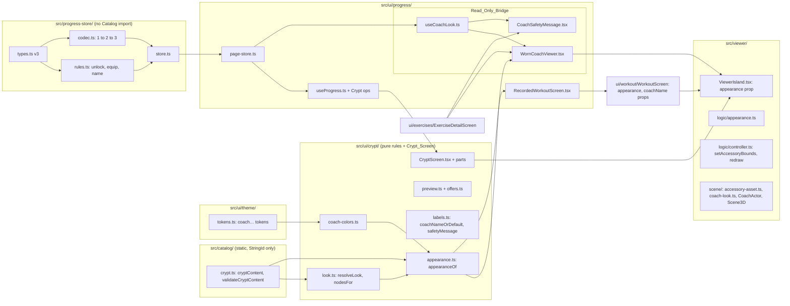

# Design Document: The Crypt

## Overview

This design covers ticket `11-the-crypt`. It adds Coach customisation end to end:

1. **Catalog** (static content): `src/catalog/crypt.ts` holds the Crypt_Content (six Coach colors, three Accessories, their Prices, the Accessory_Nodes, the Accessory_Asset path and the Crypt_Preview_Exercise) and `validateCryptContent`. The colour values live in `src/ui/theme/tokens.ts`.
2. **Progress_Store**: Schema_Version 3 with `unlocks` and `coach` members, a migration from versions 1 and 2 that keeps the Candy, the history, the Welcome gift flag and the Stored_Checkpoint, and four operations: `unlock`, `equipColor`, `setAccessoryEquipped` and `setCoachName`. The Candy invariant gains a spent term.
3. **Crypt rules** (pure UI logic, `src/ui/crypt/`): the Look_Rule, the Node_Rule, the Coach_Appearance builder, the Preview reducer and the option states (Free, Unlocked, Price, Shortfall).
4. **Viewer**: an optional `appearance` prop. The Viewer tints the `CoachBone` material, fetches the Accessory_Asset beside the Coach_Asset when needed, clones the Accessory_Nodes onto the `head` joint, widens the framing once to the Accessory_Envelope, and toggles node visibility for every look change with one frame drawn.
5. **Screens**: the Crypt_Screen at `/crypt` replaces the last Placeholder_Screen. Exercise and Stretch pages read the look through a Read_Only_Bridge. The Workout route passes the look from the Recording_Bridge. The Safety_Message takes the Coach name.

**ADR check.** No conflict with ADR 0001 (website, phone-first), ADR 0002 (all new data joins the one existing `localStorage` key; no server), ADR 0003 (tint only `CoachBone`; Accessories are separate meshes on the `head` bone; budget checked with every Accessory on; no shadows or post-processing) or ADR 0004 (the app reads the delivered GLBs and never edits them). The tech steering already says the Progress store "owns ... Unlocks, equipped Coach color and Accessories, Coach name" and "An Unlock with insufficient Candy fails with no change"; this design implements both.

**Earlier rules this ticket changes, stated openly:**

- **"Browsing never touches the Progress_Store"** (tickets 03, 05 and 08; `tests/unit/viewing-earns-nothing.test.ts` header; `candy-and-history` interpretations). The Exercise and Stretch pages must show the equipped look and the Coach name, so they now **read** the Progress_Snapshot. The new rule is "browsing reads through the Read_Only_Bridge and writes nothing". "Viewing earns nothing and stores nothing" still holds and is still proven: the E2E spec with empty storage passes unchanged, a new E2E check proves stored text stays byte-identical, and the unit scan gains a rule that the Read_Only_Bridge calls no write operation.
- **The Candy invariant** of tickets 08 and 09 (`balance = gift + earned`) becomes `balance = gift + earned − spent`. Total_Candy_Earned and the History total keep their meaning.
- **The Placeholder machinery** of ticket 01 is removed with its last user.
- **The Safety_Message** of ticket 03 becomes a template with `{coach}`.

### Design decisions at a glance

| Decision | Choice | Main reason |
|---|---|---|
| Where Prices live | `src/catalog/crypt.ts`, validated by `validateCryptContent` | Tunable static content with the same guard as the Exercises (Requirement 1) |
| Where colour values live | Six `coach…` tokens in `tokens.ts`; a typed map from Coach color id to token in `src/ui/crypt/coach-colors.ts` | Only `tokens.ts` may hold colour literals; the Catalog may import only `StringId` |
| Free Coach colors | Bone White (default, `#f5f0e3`), Grave Ash, Moonlight Blue | The ticket allows 2 or 3; the default equals the asset's own colour, so the default look is "no tint change" |
| Stored Unlock | `{ id, kind, candySpent }` | Spent Candy stays exact if a Price changes later |
| Who checks what | Store: Candy rules, permanence, "only an Unlocked Accessory is equipped". Look_Rule: free colors, unknown ids | The store must not import the Catalog |
| Unlock and equip | One write: spend, record, equip | The user just previewed it; atomic, no half state |
| Insufficient Candy | No change, no write, result carries the Shortfall | Product rule; the UI shows "N more Candy needed" |
| Confirmation before Unlock | None | The button names the Price; no real money; a later ticket can add one |
| Pumpkin head with the others | All three may be equipped; hat swaps to `accessory_witch_hat_on_pumpkin`; eyes not attached under the pumpkin | Asset contract; eyes would be hidden anyway and cost triangles |
| Preview | Page-memory reducer in the Crypt_Screen; never stored | Requirement 12; no screen but the Crypt sees it |
| Default Coach name | "Bones" (`coach.defaultName`), stored as `null` | Thai can translate it; no stored copy to migrate |
| Coach name limits | NFC, trim, collapse white space, 1 to 20 code points, letters, marks, digits, space, `-`, `'`, `’`, `.`, at least one letter or digit | Fits the Safety_Message on a 320 px phone; Thai-ready (marks); no markup characters |
| Name rendering | Text nodes only; `format()` replaces placeholders in one pass | No HTML path; a name holding `{x}` is never re-expanded |
| Browsing access | Read_Only_Bridge: `useCoachLook`, `WornCoachViewer`, `CoachSafetyMessage` over a shared page store | The look must show there; writes stay impossible and scanned |
| Workout access | Recording_Bridge passes `appearance` and `coachName` props | `src/ui/workout/` keeps importing no Progress code |
| Accessory loading | Fetched in parallel with the Coach_Asset only when an Accessory shows or on the Crypt; the Coach never waits for it | Smallest extra download; a failure never blocks the Coach |
| Camera framing | Widened once to the Accessory_Envelope (all four nodes) when the Accessory_Asset arrives; re-fit like a resize | The camera never enters an Accessory and never moves on equip or Preview |
| Look changes | Clones stay attached; only `visible` and the bone colour change; one frame drawn if visible | No reload, no camera move, Render_Loop rule kept |
| Still_Fallback | Unchanged pictures plus a Still_Look_Note | Stills are pre-rendered in the default look (accepted) |
| Placeholder | Deleted with its types and string; tests check every Section's real screen | No dead code and no test over an empty list |

### Research findings

- `assets/coach/README.md` (ticket 10 contract): the four Accessory_Nodes are direct children of `head` in `coach_accessories.glb` (rest pose, no animation); equip with `head.add(node.clone())`, keeping the node's own local transform; the `head` joint has the same rest transform in every GLB. Tint only `CoachBone` `material.color` (default `#F5F0E3`); never tint `CoachSocket`, `CoachGlow` or `CoachAccessory` (vertex colours, which GLTFLoader enables itself). With every Accessory on: 4 materials, about 4,800 triangles. The README also says to attach before measuring if the framing should include the Accessories.
- Three.js colour management: with `ColorManagement` enabled (the default since r152, and R3F's default), hex and CSS colours given to `Color.set` are read as sRGB and converted to the linear working space, so `material.color.set('#f5f0e3')` reproduces the asset's sRGB bone colour ([three.js Color docs](https://threejs.org/docs/pages/Color.html), [r152 colour management notes](https://discourse.threejs.org/t/updates-to-color-management-in-three-js-r152/50791?page=2)). Scene3D renders with `flat` (no tone mapping), so the token colour shows as written. Content was rephrased for compliance with licensing restrictions.
- `Object3D.clone()` copies the node and shares its geometry and material by default. The clones therefore share buffers with the parsed Accessory_Asset; the parsed asset and its clones are disposed together at the end of the load attempt, and a look change never disposes anything.
- `src/viewer/scene/coach-asset.ts` already measures motion bounds by sampling the Demo_Clip 30 times; the Accessory_Envelope reuses that function with the clones attached and visible.
- `src/viewer/logic/controller.ts`: `setAspect` recomputes framing, re-clamps the orbit and re-fits at a Camera_Preset; the frame hook is called only while visible, and once when the Viewer becomes visible again. `setAccessoryBounds` and `redraw` follow the same rules.
- `src/viewer/logic/framing.ts`: the minimum Camera_Distance is the farthest corner of the motion bounds plus 0.1 m clearance plus the near plane, from the Orbit_Target. Widening the motion bounds can only raise it (Property 11).
- `src/ui/strings.ts` `format()` replaces `{name}` placeholders with a single regex pass and a replacer function, so a Coach name containing `{coach}` or `$&` is inserted literally.
- `tests/unit/support/glb.ts` reads the GLB JSON chunk (`readGlb`, `parseJsonChunk`) and counts triangles; the Accessory_Asset contract test reuses it to walk the node tree.
- Earlier tests this ticket changes (Requirement 23.5): `tests/unit/progress-codec.test.ts` (version 2 as current, version 3 as newer), `tests/unit/progress-store.test.ts`, `progress-rules.test.ts`, `progress-modes.test.ts` and `tests/unit/support/progress.ts` (version 2 data, the invariant without a spent term); `tests/e2e/candy-and-history.spec.ts` (`expect(stored.schemaVersion).toBe(2)`, `progressText` writing version 2 or 3 without the new members); `tests/e2e/resume-after-refresh.spec.ts` (`toBe(2)` after the first change, a seeded version 2 text); `tests/e2e/support/progress.ts` (version 2 seeds); `tests/e2e/exercise-detail.spec.ts`, `viewer-fallback.spec.ts`, `workout.spec.ts` (exact Safety_Message text); `tests/unit/strings.test.ts` (`placeholderSectionIds`, the Safety_Message check); `tests/unit/sections.test.ts`; `tests/e2e/navigation.spec.ts` and `tests/e2e/support/screens.ts` (Placeholder Sections); `tests/e2e/static-build.spec.ts` and `theme.spec.ts` (comments and lists that name the Placeholder_Screens).

Not verified: how a real phone GPU renders the `CoachGlow` emissive with the pumpkin head under fog. This is an eye check (end of this document).

## Architecture

### Module view



Rules that hold unchanged: the Progress_Store imports no Catalog, UI, React or Three.js and only types from the Workout_Engine; only `src/ui/progress/` and `src/progress-store/` import `@/progress-store`; `src/ui/workout/` and the engine import no Progress code; only `src/viewer/scene/` imports Three.js; the UI reaches the Viewer only through `@/viewer/ViewerIsland`; the Viewer holds no asset path or node name. New: the Browsing_Screens import from `src/ui/progress/` only `WornCoachViewer` and `CoachSafetyMessage`, and the Read_Only_Bridge calls no write operation.

### Files after this ticket

```
src/catalog/
  crypt.ts            # NEW: coachColorIds, accessoryIds, cryptContent, validateCryptContent
  types.ts            # + CoachColorEntry, AccessoryEntry, CryptContent, CryptDraft, CryptRule, CryptViolation
  index.ts            # exports the above
src/ui/theme/tokens.ts  # + coachBone, coachAsh, coachMoonlight, coachEmber, coachSlime, coachWitch
src/progress-store/
  types.ts            # schemaVersion 3; UnlockRecord, CoachCustomisation, results; store ops
  rules.ts            # + normaliseCoachName, isOptionId, unlock, equipColor, setAccessoryEquipped, setCoachName, totalCandySpent
  coach-name.ts       # NEW: normaliseCoachName and its limits (pure; re-exported by rules)
  codec.ts            # version table 1 -> 2 -> 3; v3 shape; Coach_Customisation repair
  store.ts            # + unlock, equipColor, setAccessoryEquipped, setCoachName
  index.ts            # exports the new types and normaliseCoachName, coachNameMaxLength
src/ui/crypt/
  coach-colors.ts     # NEW: coachColorToken map, coachColorHex
  look.ts             # NEW: EquippedLook, resolveLook, nodesFor, defaultLook
  appearance.ts       # NEW: appearanceOf
  preview.ts          # NEW: Preview, previewReducer, shownLook
  offers.ts           # NEW: OptionState, optionStates
  labels.ts           # NEW: optionName, coachNameOrDefault, safetyMessage
  CryptScreen.tsx (+ .module.css)   # NEW: the Crypt_Screen
  CoachNameForm.tsx   # NEW
  OptionRow.tsx       # NEW
src/ui/progress/
  page-store.ts       # NEW: the page's lazy store, subscribe, snapshot (moved out of useProgress)
  useProgress.ts      # + unlock, equipColor, setAccessoryEquipped, setCoachName
  useCoachLook.ts     # NEW (Read_Only_Bridge)
  WornCoachViewer.tsx # NEW (Read_Only_Bridge)
  CoachSafetyMessage.tsx  # NEW (Read_Only_Bridge)
  RecordedWorkoutScreen.tsx  # + appearance and coachName for the Workout_Screen
src/ui/exercises/ExerciseDetailScreen.tsx  # WornCoachViewer and CoachSafetyMessage
src/ui/workout/
  WorkoutScreen.tsx   # + appearance, coachName props
  CoachViewer.tsx     # passes appearance
  PreparingPanel.tsx, SetPanel.tsx  # Safety_Message with coachName
src/viewer/
  ViewerIsland.tsx    # + appearance prop, Accessory fetch, data attributes, notes
  logic/appearance.ts # NEW: CoachAppearance, defaultAppearance, wantsAccessoryAsset, note rules
  logic/controller.ts # + setAccessoryBounds, redraw
  scene/accessory-asset.ts  # NEW: parseAccessoryAsset
  scene/coach-look.ts       # NEW: tint, attach, show, measure envelope
  scene/CoachActor.tsx, scene/Scene3D.tsx  # wire the look
src/ui/sections.ts     # placeholder exports removed
src/ui/placeholder/    # DELETED
src/app/crypt/page.tsx # renders CryptScreen
src/ui/strings.ts      # additions; section.crypt.message removed; safety.coachMessage templated
```

### Unlock, equip and Preview on the Crypt_Screen

```mermaid
sequenceDiagram
  participant U as User
  participant C as Crypt_Screen
  participant P as Preview (page memory)
  participant S as Progress_Store
  participant V as Viewer
  C->>S: grantWelcomeGift() on mount (useProgress)
  S-->>C: snapshot (balance, unlocks, coach)
  C->>V: appearance = appearanceOf(shownLook(resolveLook(snapshot), preview), fetch: true)
  U->>C: Preview Witch hat
  C->>P: toggleAccessory('witch-hat')
  C->>V: new appearance (hat shown); one frame drawn; nothing stored
  U->>C: Unlock Witch hat for 15 Candy
  C->>S: unlock({ id: 'witch-hat', kind: 'accessory', price: 15 })
  alt enough Candy
    S-->>C: { unlocked: true, candyBalance: 0 } (spend + record + equip in one setItem)
    C->>P: drop('witch-hat')
    C->>C: announce "Witch hat unlocked. Candy balance: 0."
  else too little Candy (another tab spent it)
    S-->>C: { unlocked: false, reason: 'insufficient', shortBy }
    C->>C: announce the Shortfall; nothing changed
  end
  U->>C: Equip Witch hat (toggle off)
  C->>S: setAccessoryEquipped('witch-hat', false)
```

### The look on the other screens

```mermaid
sequenceDiagram
  participant E as Exercise page (server HTML)
  participant B as Read_Only_Bridge (useCoachLook)
  participant S as page store (read only)
  participant V as Viewer
  E->>V: first render: defaultAppearance; Safety_Message with "Bones"
  B->>S: snapshot() after hydration (getItem only; no write on load)
  S-->>B: coach, unlocks
  B->>V: appearanceOf(resolveLook(...), fetch: false)
  V->>V: tint; fetch Accessory_Asset only if a node shows; attach; widen framing once
  Note over B,S: no grant, record, unlock, equip or name call is reachable
```

The Workout route takes the same `appearanceOf(resolveLook(snapshot))` from the Recording_Bridge, which already reads the snapshot, and passes it with the Coach name to `WorkoutScreen`.

## Components and Interfaces

### Catalog: Crypt_Content (`src/catalog/crypt.ts`, types in `types.ts`)

```ts
export const coachColorIds = ['bone', 'ash', 'moonlight', 'ember', 'slime', 'witch'] as const;
export type CoachColorId = (typeof coachColorIds)[number];
export const accessoryIds = ['glowing-eyes', 'witch-hat', 'pumpkin-head'] as const;
export type AccessoryId = (typeof accessoryIds)[number];
export type CryptOptionKind = 'color' | 'accessory';

export interface CoachColorEntry {
  readonly kind: 'color';
  readonly id: CoachColorId;
  readonly nameId: StringId;
  /** 0 for a Free_Coach_Color. */
  readonly price: number;
  /** Exactly one entry: the Default_Coach_Color. */
  readonly isDefault: boolean;
}

export interface AccessoryEntry {
  readonly kind: 'accessory';
  readonly id: AccessoryId;
  readonly nameId: StringId;
  readonly price: number;
  /** The Accessory_Node under `head`. */
  readonly node: string;
  /** While `accessoryId` is shown, use this node instead of `node`. */
  readonly swapWhen?: { readonly accessoryId: AccessoryId; readonly node: string };
  /** Not shown while this Accessory is shown. */
  readonly hiddenBy?: AccessoryId;
}

export type CryptOption = CoachColorEntry | AccessoryEntry;

export interface CryptContent {
  readonly coachColors: readonly CoachColorEntry[];
  readonly accessories: readonly AccessoryEntry[];
  readonly accessoryAsset: SameOriginAssetPath; // '/assets/coach/coach_accessories.glb'
  readonly previewExerciseId: string;            // 'grave-rise'
}

export type CryptRule =
  | 'free-color-count' | 'default-color-count' | 'default-color-price'
  | 'option-id-format' | 'option-id-duplicate' | 'color-price' | 'accessory-price'
  | 'node-format' | 'node-duplicate' | 'combination-unknown' | 'combination-self'
  | 'accessory-asset-path' | 'preview-exercise-unknown';
export interface CryptViolation { readonly subjectId: string; readonly rule: CryptRule }

/** Loose shape so tests can describe broken content without casts. */
export interface CryptDraft { /* every member optional, ids typed as string */ }

export function validateCryptContent(draft: CryptDraft, entries: readonly ExerciseDraft[]): readonly CryptViolation[];
export const cryptContent: CryptContent;
export function findCoachColor(id: string): CoachColorEntry | undefined;
export function findAccessory(id: string): AccessoryEntry | undefined;
```

Shipped content:

| Option_Id | Kind | Name string | Price | Notes |
|---|---|---|---|---|
| `bone` | color | `coachColor.bone.name` (Bone White) | 0 | Default_Coach_Color |
| `ash` | color | `coachColor.ash.name` (Grave Ash) | 0 | |
| `moonlight` | color | `coachColor.moonlight.name` (Moonlight Blue) | 0 | |
| `ember` | color | `coachColor.ember.name` (Ember Orange) | 5 | |
| `slime` | color | `coachColor.slime.name` (Slime Green) | 5 | |
| `witch` | color | `coachColor.witch.name` (Witch Purple) | 5 | |
| `glowing-eyes` | accessory | `accessory.glowingEyes.name` (Glowing eyes) | 10 | node `accessory_glowing_eyes`, `hiddenBy: 'pumpkin-head'` |
| `witch-hat` | accessory | `accessory.witchHat.name` (Witch hat) | 15 | node `accessory_witch_hat`, `swapWhen: { accessoryId: 'pumpkin-head', node: 'accessory_witch_hat_on_pumpkin' }` |
| `pumpkin-head` | accessory | `accessory.pumpkinHead.name` (Pumpkin head) | 40 | node `accessory_pumpkin_head` |

Validation follows the style of `validateCatalog`: each rule at most once per subject, subjects named by Option_Id or `#index`, the same `assetPathPattern` as Exercise assets (shared constant), Option_Id pattern `^[a-z][a-z0-9-]{0,39}$`, Price range 1 to 999, node pattern `^accessory_[a-z0-9_]+$`, swap nodes count toward `node-duplicate`. The Catalog keeps importing only its own files and `StringId`.

### Theme tokens

`colors` gains `coachBone: '#f5f0e3'`, `coachAsh: '#b9b2c4'`, `coachMoonlight: '#bcd6ff'`, `coachEmber: '#ff7a2e'`, `coachSlime: '#93e36c'`, `coachWitch: '#b484ff'`. `themeCss()` emits them as `--color-coach-…` custom properties, which the swatches use. Values are tunable; only `coachBone` is fixed by the asset.

`src/ui/crypt/coach-colors.ts`:

```ts
export const coachColorToken: { readonly [K in CoachColorId]: ColorToken } = {
  bone: 'coachBone', ash: 'coachAsh', moonlight: 'coachMoonlight',
  ember: 'coachEmber', slime: 'coachSlime', witch: 'coachWitch',
};
export function coachColorHex(id: CoachColorId): string;   // colors[coachColorToken[id]]
export function coachColorVar(id: CoachColorId): string;   // 'var(--color-coach-…)'
```

### Progress_Store (Schema_Version 3)

`types.ts`:

```ts
export const schemaVersion = 3;
export const maxUnlockPrice = 999;

export type UnlockKind = 'color' | 'accessory';
export interface UnlockRecord {
  readonly id: string;        // Option_Id
  readonly kind: UnlockKind;
  readonly candySpent: number; // the Price at Unlock time, 1..999
}
export interface CoachCustomisation {
  /** Normalised Coach name; null = Default_Coach_Name. */
  readonly name: string | null;
  /** Option_Id of the equipped Coach color; null = Default_Coach_Color. */
  readonly color: string | null;
  /** Equipped Accessories, each Unlocked, no repeats, in equip order. */
  readonly accessories: readonly string[];
}
export interface ProgressData {
  readonly schemaVersion: 3;
  readonly candy: number;
  readonly welcomeGiftGranted: boolean;
  readonly history: readonly WorkoutRecord[];
  readonly checkpoint: WorkoutCheckpoint | null;
  /** Oldest first; only ever grows. */
  readonly unlocks: readonly UnlockRecord[];
  readonly coach: CoachCustomisation;
}
export interface ProgressSnapshot {
  /* existing members, plus: */
  readonly totalCandySpent: number;
  readonly unlocks: readonly UnlockRecord[];   // copy
  readonly coach: CoachCustomisation;          // copy
}
export interface UnlockRequest { readonly id: string; readonly kind: UnlockKind; readonly price: number }
export type UnlockResult =
  | { readonly unlocked: true; readonly candyBalance: number }
  | { readonly unlocked: false; readonly reason: 'insufficient'; readonly shortBy: number }
  | { readonly unlocked: false; readonly reason: 'already' | 'invalid' };
export type EquipResult =
  | { readonly changed: true }
  | { readonly changed: false; readonly reason: 'unchanged' | 'invalid' | 'locked' };
export type CoachNameResult =
  | { readonly saved: true; readonly name: string | null }
  | { readonly saved: false; readonly reason: 'invalid' };

export interface ProgressStore {
  /* existing members unchanged, plus: */
  unlock(request: UnlockRequest): UnlockResult;
  equipColor(id: string | null): EquipResult;
  setAccessoryEquipped(id: string, equipped: boolean): EquipResult;
  setCoachName(text: string): CoachNameResult;
}
```

`coach-name.ts` (pure, no DOM):

```ts
export const coachNameMaxLength = 20; // Unicode code points
/** Normalised name, null when empty after normalisation, or 'invalid'. */
export function normaliseCoachName(text: string): string | null | 'invalid';
// 1. text.normalize('NFC')  2. replace(/\s+/gu, ' ')  3. trim()
// 4. '' -> null  5. [...name].length > 20 -> 'invalid'
// 6. /^[\p{L}\p{M}\p{N} '’.\-]+$/u fails -> 'invalid'  7. no /[\p{L}\p{N}]/u -> 'invalid'
```

Step 2 turns tabs, line breaks and every other Unicode white space into a plain space, so the result holds no control character a reader could miss. The character class excludes `<`, `>`, `&`, `"`, braces and every control or format character.

`rules.ts` additions (pure, new objects, mutate nothing):

```ts
export const defaultCoach: CoachCustomisation; // { name: null, color: null, accessories: [] }
export function isOptionId(value: unknown): value is string;            // /^[a-z][a-z0-9-]{0,39}$/
export function isUnlockRecord(value: unknown): value is UnlockRecord;
export function totalCandySpent(data: ProgressData): number;
export type UnlockOutcome =
  | { readonly kind: 'unlocked'; readonly data: ProgressData }
  | { readonly kind: 'insufficient'; readonly shortBy: number }
  | { readonly kind: 'already' } | { readonly kind: 'invalid' };
export function unlock(data: ProgressData, request: UnlockRequest): UnlockOutcome;
export function equipColor(data: ProgressData, id: string | null): ProgressData | 'unchanged' | 'invalid';
export function setAccessoryEquipped(data: ProgressData, id: string, equipped: boolean): ProgressData | 'unchanged' | 'invalid' | 'locked';
export function setCoachName(data: ProgressData, text: string): { data: ProgressData | null; name: string | null } | 'invalid'; // data null: unchanged
```

- `unlock` checks in this order: request shape (`isOptionId`, kind, Price a safe integer in 1..999) → `invalid`; an Unlock_Record with this id → `already`; `price > candy` → `insufficient` with `shortBy = price - candy`; otherwise `candy - price`, append `{ id, kind, candySpent: price }`, and equip (`coach.color = id` for `color`; append to `coach.accessories` if absent for `accessory`).
- `equipColor(null)` or an Option_Id not recorded as an Accessory; unchanged when equal.
- `setAccessoryEquipped(id, true)` needs an Unlock_Record of kind `accessory` (`locked` otherwise); `false` removes it; `invalid` for a malformed id.
- `grantWelcomeGift`, `recordWorkout`, `finishWorkout`, `withCheckpoint` and `withoutCheckpoint` spread `...data` and copy `unlocks` and `coach` unchanged.
- `snapshotOf` adds `totalCandySpent`, a copy of `unlocks` and a copy of `coach` (with a copied `accessories` array).

`codec.ts` version table (the header comment is updated to this table):

| Stored version | Result |
|---|---|
| not an integer, or `< 1` | none |
| `1` | core → v2 (`checkpoint: null`) → v3 |
| `2` | core + checkpoint rule of ticket 09 → v3 (`unlocks: []`, `coach: defaultCoach`) |
| `3` | core + checkpoint rule + `unlocks` (missing or invalid list or repeated id → none) + `coach` (missing → none; each member repaired on its own) |
| `> 3` | newer (decided before any shape check) |

`parseCoach(value, unlocks)`: not an object → `defaultCoach`; `name` kept only if a string with `normaliseCoachName(name) === name`, else null; `color` kept only if `isOptionId` and not recorded as an Accessory, else null; `accessories` kept only if an array, then filtered to Option_Ids with an Unlock_Record of kind `accessory`, first occurrence only.

`store.ts`: the four operations use the existing read, apply, write, notify path with one `setItem` per change; a no-op (`unchanged`, `already`, `insufficient`, `invalid`, `locked`) writes nothing and refreshes the view only if another tab changed storage. `sameView` also compares `JSON.stringify` of `unlocks` and `coach`. The `newer` and throwing-adapter rules apply unchanged.

`index.ts` exports `UnlockRecord`, `UnlockKind`, `UnlockRequest`, `UnlockResult`, `EquipResult`, `CoachCustomisation`, `CoachNameResult`, `normaliseCoachName`, `coachNameMaxLength` and `maxUnlockPrice`.

### Crypt rules (`src/ui/crypt/`, pure)

```ts
// look.ts
export interface EquippedLook {
  readonly color: CoachColorId;
  readonly accessories: readonly AccessoryId[]; // Crypt_Content order
}
/** The structural part of a Progress_Snapshot the Look_Rule reads. */
export interface StoredChoices {
  readonly coach: { readonly color: string | null; readonly accessories: readonly string[] };
  readonly unlocks: readonly { readonly id: string; readonly kind: 'color' | 'accessory' }[];
}
export const defaultLook: EquippedLook; // { color: 'bone', accessories: [] }
export function isOwned(option: CryptOption, unlocks: StoredChoices['unlocks']): boolean;
export function resolveLook(stored: StoredChoices | null, content?: CryptContent): EquippedLook;
/** Node_Rule. */
export function nodesFor(accessories: readonly AccessoryId[], content?: CryptContent): readonly string[];

// appearance.ts
export function appearanceOf(look: EquippedLook, options: { readonly fetchAccessories: boolean }, content?: CryptContent): CoachAppearance;
// boneColor: coachColorHex(look.color); accessoryAsset: content.accessoryAsset;
// shownNodes: nodesFor(look.accessories); framingNodes: every node and swap node of the content

// preview.ts
export interface Preview { readonly color: CoachColorId | null; readonly accessories: readonly AccessoryId[] }
export const emptyPreview: Preview;
export type PreviewAction =
  | { readonly type: 'toggleColor'; readonly id: CoachColorId }
  | { readonly type: 'toggleAccessory'; readonly id: AccessoryId }
  | { readonly type: 'drop'; readonly id: string }      // after an Unlock
  | { readonly type: 'clear' };
export function previewReducer(preview: Preview, action: PreviewAction): Preview;
/** Drops options that became Owned (another tab, or an Unlock). */
export function prunePreview(preview: Preview, stored: StoredChoices): Preview;
export function shownLook(look: EquippedLook, preview: Preview): EquippedLook;
// color: preview.color ?? look.color; accessories: union in Crypt_Content order

// offers.ts
export type UnlockButton =
  | { readonly enabled: true; readonly price: number }
  | { readonly enabled: false; readonly price: number; readonly shortBy: number };
export interface OptionState {
  readonly option: CryptOption;
  readonly ownership: 'free' | 'unlocked' | 'locked';
  readonly equipped: boolean;
  readonly previewed: boolean;
  /** null for an Owned_Option. */
  readonly unlock: UnlockButton | null;
  /** The Accessory that hides this one in the Shown_Look, if any. */
  readonly hiddenBy: AccessoryEntry | null;
}
export function optionStates(stored: StoredChoices, balance: number, preview: Preview, content?: CryptContent): {
  readonly colors: readonly OptionState[];
  readonly accessories: readonly OptionState[];
};

// labels.ts
export function optionName(option: CryptOption): string;
export function coachNameOrDefault(name: string | null): string;          // t('coach.defaultName') for null
export function safetyMessage(name: string | null): string;               // format('safety.coachMessage', { coach })
```

The Preview reducer ignores a toggle for an Owned_Option (Owned options use Equip), and toggling a second Coach color replaces the first.

### Viewer

`src/viewer/logic/appearance.ts` (pure):

```ts
export interface CoachAppearance {
  /** Bone_Material colour '#rrggbb'; null keeps the asset's own colour. */
  readonly boneColor: string | null;
  /** From the Crypt_Content; null when the caller has no Accessories to offer. */
  readonly accessoryAsset: SameOriginAssetPath | null;
  /** Accessory_Nodes to show, from the Node_Rule. */
  readonly shownNodes: readonly string[];
  /** Every Accessory_Node that may be shown; measured once for framing. */
  readonly framingNodes: readonly string[];
  /** Fetch the Accessory_Asset even when no node is shown (the Crypt). */
  readonly fetchAccessories: boolean;
}
export const defaultAppearance: CoachAppearance; // null, null, [], [], false
export type AccessoryState = 'none' | 'loading' | 'ready' | 'failed';
export function wantsAccessoryAsset(a: CoachAppearance): boolean; // asset !== null && (fetch || shown.length > 0)
export function isDefaultAppearance(a: CoachAppearance): boolean;
export function showsAccessoryNote(a: CoachAppearance, state: AccessoryState): boolean; // failed && shown.length > 0
export function appearanceKey(a: CoachAppearance): string; // stable text for effect dependencies
```

`ViewerIsland` exports the type `CoachAppearance` (re-exported, so the UI keeps reaching the Viewer only through the island) and takes `appearance?: CoachAppearance` (default `defaultAppearance`).

- **Accessory fetch.** A second effect, keyed on the attempt and `wantsAccessoryAsset`, calls the existing `fetchCoachAsset(path, signal)` once per attempt and stores `{ attempt, buffer }` or the state `failed`. It never dispatches into the load reducer, so the Coach's phases, Slow_Load_Notice and Retry behave as before. Retry starts a new attempt and therefore a new fetch.
- **Data attributes** on the Viewer_Area: `data-coach-color` (the applied hex, or `asset` for null), `data-coach-accessories` (space-separated nodes Scene3D reports as shown, empty when none), `data-accessories` (`none`, `loading`, `ready`, `failed`).
- **Notes.** Below the area, the Accessory_Note (`viewer.accessories.failed`) while `showsAccessoryNote`; inside the Still_Fallback block, the Still_Look_Note (`viewer.fallback.look`) when the appearance is not the default. Neither is a live region.

`src/viewer/logic/controller.ts` additions:

```ts
/** Union the Accessory_Envelope into the motion bounds, recompute framing, re-clamp, re-fit at a preset, request a frame. Ignored before setScene; applied once per scene (a second call unions again, harmless). */
setAccessoryBounds(box: Box3Value): void;
/** The picture changed (look or Accessories): call the frame hook once if visible, otherwise once when visible again. */
redraw(): void;
```

`keepDrawing` is unchanged, so after the one frame the Render_Loop stops again while paused, held, hidden or scrolled away.

`src/viewer/scene/accessory-asset.ts`:

```ts
export interface ParsedAccessories {
  readonly scene: Object3D;                        // disposed at the end of the attempt
  readonly nodes: ReadonlyMap<string, Object3D>;   // name -> node (not yet cloned)
  readonly missing: readonly string[];             // requested names the asset lacks
}
export function parseAccessoryAsset(buffer: ArrayBuffer, resourcePath: string, names: readonly string[]): Promise<ParsedAccessories>;
// GLTFLoader with no decoders; throws CoachAssetError('parse') on a loader failure
```

`src/viewer/scene/coach-look.ts` (Three.js, imperative, small):

```ts
export function boneMaterials(root: Object3D): readonly Material[];           // every material named 'CoachBone'
export function tintBones(materials, hex: string | null, original: Color): void;
export function attachAccessories(root: Object3D, parsed: ParsedAccessories): { readonly attached: ReadonlyMap<string, Object3D>; readonly headFound: boolean };
export function showNodes(attached: ReadonlyMap<string, Object3D>, names: readonly string[]): readonly string[]; // returns the names now visible
export function detachAccessories(attached: ReadonlyMap<string, Object3D>): void;
```

`CoachActor` gains `boneColor`, `accessories: ParsedAccessories | null`, `shownNodes`, `onEnvelope(box)`, `onApplied({ color, nodes })` and `onAccessoryProblem()`:

1. On mount, remember the original Bone_Material colour, tint, report `onApplied`.
2. When `accessories` arrives: `attachAccessories`, set every clone visible, measure the Accessory_Envelope with `measureMotionBounds` (exported from `coach-asset.ts`), report `onEnvelope(box)`, then `showNodes(shownNodes)`. A missing node or head reports `onAccessoryProblem()`.
3. On a change of `boneColor` or `shownNodes`: tint and `showNodes` only; report `onApplied`. Scene3D then calls `controller.redraw()`.
4. On unmount: `detachAccessories` before `disposeObject3D(root)`; Scene3D disposes `accessories.scene`.

`Scene3D` takes `accessoryBuffer: ArrayBuffer | null`, `appearance` and `onAccessories(state)`. It parses the Accessory buffer with `framingNodes` as the names, renders `CoachActor` with the parsed result, wires `onEnvelope` to `controller.setAccessoryBounds`, and reports `ready` or `failed` to the island.

### Read_Only_Bridge and the other screens (`src/ui/progress/`)

`page-store.ts` holds what `useProgress.ts` holds today: the lazy page store over `createLocalStorageAdapter()`, `subscribePageStore`, `readPageSnapshot` and `readServerSnapshot = () => null`. `useProgress` and the Read_Only_Bridge both use it, so one page has one store.

`useProgress()` gains `unlock(request)`, `equipColor(id)`, `setAccessoryEquipped(id, equipped)` and `setCoachName(text)`, each delegating to the page store. It re-exports the result types the Crypt_Screen needs.

Read_Only_Bridge:

```ts
// useCoachLook.ts
export interface CoachLookView {
  readonly read: boolean;              // false until the snapshot is read
  readonly look: EquippedLook;         // defaultLook until read
  readonly coachName: string | null;   // null until read or when none is stored
}
export function useCoachLook(): CoachLookView; // useSyncExternalStore(subscribePageStore, readPageSnapshot, readServerSnapshot)

// WornCoachViewer.tsx ('use client')
export function WornCoachViewer({ exercise }: { readonly exercise: ExerciseEntry }): JSX.Element;
// <ViewerIsland key={exercise.id} exercise={exercise} appearance={read ? appearanceOf(look, { fetchAccessories: false }) : defaultAppearance} />

// CoachSafetyMessage.tsx ('use client')
export function CoachSafetyMessage({ className }: { readonly className?: string }): JSX.Element;
// <p className={className}>{safetyMessage(coachName)}</p>
```

None of these files imports `useProgress` or names a write operation. `ExerciseDetailScreen` (still a server component) renders `<WornCoachViewer exercise={exercise} />` and `<CoachSafetyMessage className={styles.safetyMessage} />` in place of `ViewerIsland` and the static paragraph; the safety `section` and its heading stay server HTML.

`RecordedWorkoutScreen` computes, from its snapshot, `appearance = snapshot === null ? defaultAppearance : appearanceOf(resolveLook(snapshot), { fetchAccessories: false })` and `coachName = snapshot?.coach.name ?? null`, and passes both to every `WorkoutScreen` it renders. `WorkoutScreen` passes `appearance` to `CoachViewer` (and so to `ViewerIsland`) and `coachName` to `PreparingPanel` and `SetPanel`, which render `safetyMessage(coachName)`. Nothing in `src/ui/workout/` imports Progress code.

### The Crypt_Screen (`src/ui/crypt/CryptScreen.tsx`)

A client component rendered by `src/app/crypt/page.tsx` with `sectionMetadata('crypt')`.

- `useProgress()` (grants the Welcome gift on mount), `useReducer(previewReducer, emptyPreview)`, a `message` state for the live region, and the Coach name draft.
- **Loading** (snapshot null): `h1` (`sectionName('crypt')`), `crypt.loading`, the back-home link.
- **Loaded**, in DOM and reading order:
  1. `h1`, then `crypt.intro` with the Coach name (`coachNameOrDefault`).
  2. The Candy_Balance line `crypt.balance` in a `role="status"` element; `progress.unavailable` when the Persistent_Flag is false.
  3. The Viewer: `ViewerIsland` with the Crypt_Preview_Exercise and `appearanceOf(shownLook(resolveLook(snapshot), preview), { fetchAccessories: true })`. While the Preview is not empty: `crypt.preview.note` and a button `crypt.preview.stop`.
  4. `CoachNameForm`: a `section` labelled by `crypt.name.heading`, a `<form>` with `<label>` `crypt.name.label`, an `<input type="text" autocomplete="off" spellcheck="false">`, the hint `crypt.name.hint` (with `{count}` 20 and `{coach}` the Default_Coach_Name) linked by `aria-describedby`, a submit button `crypt.name.save`; on an `invalid` result the input gets `aria-invalid="true"` and `crypt.name.invalid` joins its description. The submit handler calls `setCoachName` once and `preventDefault()`.
  5. The Coach colors `section` (`crypt.colors.heading`) with a `ul` of `OptionRow`s, then the Accessories `section` (`crypt.accessories.heading`) likewise.
  6. One polite live region for results (`crypt.announce.*`), and the back-home link.
- `OptionRow` for an `OptionState`: a swatch (`coachColorVar`) for a color, the name, the state text (`crypt.option.free`, `crypt.option.unlocked`, or `crypt.option.price`), `crypt.option.equipped` when equipped, the hidden-by text `crypt.option.hiddenBy` when `hiddenBy` is set, and the buttons:
  - Owned: an Equip toggle (`crypt.equip`, `aria-pressed` = equipped). A color calls `equipColor(option.isDefault ? null : id)` unless already equipped; an Accessory calls `setAccessoryEquipped(id, !equipped)`.
  - Locked: a Preview toggle (`crypt.preview`, `aria-pressed` = previewed) and an Unlock button (`crypt.unlock`). When `unlock.enabled` is false the Unlock button is `disabled` and the visible text `crypt.needMore` (with the Shortfall) sits next to it, referenced by `aria-describedby`.
- Unlock handler: `unlock({ id, kind, price })` with the Price from the Crypt_Content; on success `dispatch({ type: 'drop', id })` and announce `crypt.announce.unlocked`; on `insufficient` announce `crypt.announce.short`; on `already` drop the Preview (another tab Unlocked it).
- An effect runs `prunePreview` whenever the snapshot changes.
- Styles: tokens only, buttons and the input `min-height: 3rem`, rows wrap (`flex-wrap`), no `transition` or `animation`.

### Sections and the Placeholder removal

`src/ui/sections.ts` keeps `sectionIds`, `SectionId`, `sectionPath`, `sectionName` and `sectionTitle`; `ListSectionId`, `PlaceholderSectionId`, `placeholderSectionIds` and `sectionMessage` are deleted. `src/ui/placeholder/` and `section.crypt.message` are deleted. Tests that imported `placeholderSectionIds` change as listed in the Testing Strategy.

### Strings_Module additions and changes

English first draft; wording may change as long as the string tests pass.

| Identifier | English text |
|---|---|
| `safety.coachMessage` (changed) | `{coach} here. I demonstrate every Exercise, but I can't see you and I can't check your form. Listen to your body and stop if anything hurts.` |
| `coach.defaultName` | Bones |
| `coachColor.bone.name` … `coachColor.witch.name` | Bone White, Grave Ash, Moonlight Blue, Ember Orange, Slime Green, Witch Purple |
| `accessory.glowingEyes.name`, `accessory.witchHat.name`, `accessory.pumpkinHead.name` | Glowing eyes, Witch hat, Pumpkin head |
| `crypt.loading` | Opening the Crypt… |
| `crypt.intro` | `{coach} rests here between Workouts. Equip a Coach color and Accessories, and preview anything before you Unlock it.` |
| `crypt.balance` | `Candy balance: {candy}` |
| `crypt.preview.note` | Previewing. Nothing is kept until you Unlock it. |
| `crypt.preview.stop` | Stop previewing |
| `crypt.name.heading` | Coach name |
| `crypt.name.label` | Your Coach's name |
| `crypt.name.hint` | `Free to change. Up to {count} letters, numbers, spaces, hyphens, apostrophes or full stops. Leave it empty to use {coach}.` |
| `crypt.name.save` | Save the Coach name |
| `crypt.name.invalid` | `Use 1 to {count} letters, numbers, spaces, hyphens, apostrophes or full stops.` |
| `crypt.colors.heading` | Coach colors |
| `crypt.accessories.heading` | Accessories |
| `crypt.option.free` | Free |
| `crypt.option.unlocked` | Unlocked |
| `crypt.option.price` | `{price} Candy` |
| `crypt.option.equipped` | Equipped |
| `crypt.option.hiddenBy` | `Hidden under the {accessory} while both are on.` |
| `crypt.equip` | `Equip {option}` |
| `crypt.preview` | `Preview {option}` |
| `crypt.unlock` | `Unlock {option} for {price} Candy` |
| `crypt.needMore` | `{count} more Candy needed` |
| `crypt.announce.unlocked` | `{option} unlocked. Candy balance: {candy}.` |
| `crypt.announce.short` | `Not enough Candy for {option} yet: {count} more needed.` |
| `crypt.announce.equipped` | `{option} equipped.` |
| `crypt.announce.unequipped` | `{option} taken off.` |
| `crypt.announce.named` | `Your Coach is now called {coach}.` |
| `viewer.accessories.failed` | The Accessories could not load, so the Coach is shown without them. |
| `viewer.fallback.look` | These pictures show the Coach without its Coach color and Accessories. |

Removed: `section.crypt.message`. New templates join `tests/unit/strings-format.test.ts`: `safety.coachMessage` (`coach`), `crypt.intro` (`coach`), `crypt.balance` (`candy`), `crypt.name.hint` (`count`, `coach`), `crypt.name.invalid` (`count`), `crypt.option.price` (`price`), `crypt.option.hiddenBy` (`accessory`), `crypt.equip` (`option`), `crypt.preview` (`option`), `crypt.unlock` (`option`, `price`), `crypt.needMore` (`count`), `crypt.announce.unlocked` (`option`, `candy`), `crypt.announce.short` (`option`, `count`), `crypt.announce.equipped` (`option`), `crypt.announce.unequipped` (`option`), `crypt.announce.named` (`coach`).

"Equip" is the product steering's word ("Equipping and unequipping are free"); CONTEXT.md has no entry for it or for "equipped look". This is a glossary gap to flag, not a new synonym.

## Data Models

The persisted value under `spooky-coach:progress`, Schema_Version 3:

```json
{
  "schemaVersion": 3,
  "candy": 5,
  "welcomeGiftGranted": true,
  "history": [
    { "id": "graveyard-shift:1795000000000", "routineId": "graveyard-shift", "finishedAt": 1795000000000, "outcome": "completed", "candyEarned": 20 }
  ],
  "checkpoint": null,
  "unlocks": [
    { "id": "witch-hat", "kind": "accessory", "candySpent": 15 },
    { "id": "ember", "kind": "color", "candySpent": 5 },
    { "id": "glowing-eyes", "kind": "accessory", "candySpent": 10 }
  ],
  "coach": { "name": "Count Rattle", "color": "ember", "accessories": ["witch-hat"] }
}
```

- Invariant: `candy` (5) = 15 (gift) + 20 (earned) − 30 (spent).
- `coach.color` null means Bone White; `coach.name` null means the Default_Coach_Name. A stored Free_Coach_Color id (`ash`) has no Unlock_Record.
- `unlocks` only grows. `coach.accessories` holds only Unlocked Accessory ids.
- Size: at most nine Unlock_Records (about 0.5 KB). The value holds no wall-clock time beyond the history's `finishedAt`, and no device id.
- Versions 1 and 2 are read as version 3 in memory and stay on disk unchanged until the first change (Requirement 2.4).

Runtime state, none persisted: the Crypt_Screen's Preview, message and name draft; the Viewer's Accessory fetch state, parsed Accessories and clones; the controller's widened framing.

## Correctness Properties

*A property is a characteristic or behavior that should hold true across all valid executions of a system-essentially, a formal statement about what the system should do. Properties serve as the bridge between human-readable specifications and machine-verifiable correctness guarantees.*

PBT applies to the codec and migration, the Progress_Store operations (pure rules over an in-memory adapter), the Coach_Name_Rule, the Look_Rule, the Node_Rule, the Preview reducer, the option states and the camera framing. These are pure functions over large input spaces (stored texts, operation sequences, arbitrary strings, id lists, bounding boxes). PBT does not apply to the Crypt_Content validation (configuration: one example per rule), the Three.js scene helpers, the screens, the fetches and the data attributes; those are example tests, Playwright checks and eye checks.

Consolidated during prework reflection: the migration clauses (2.2, 2.3, 2.9) are one property; the round-trip clauses (2.1, 2.10) are one; the repair clauses (2.7, 2.8) are one; the successful and invalid Unlock clauses (3.2, 3.5) are one; every clause about sequences of store operations (3.4, 3.6, 4.2 to 4.8, 5.3, 5.4, 6.1 to 6.6) is one model-based property; the memory-only clauses (2.5, 3.8) are one; the name clauses (5.6, 5.7) are one; the look clauses (7.1, 7.2, 7.5) and the node clauses (7.3, 7.6) are one each; the framing clauses (8.6, 8.12) are one. The insufficient-Candy rule (3.3, 6.7) stays its own property because the ticket names it as a Vitest rule.

Generators: valid Schema_Version 1, 2 and 3 Progress_Data (v3 with random Unlock_Records drawn from the shipped Option_Ids and random ids, a random Coach_Customisation, and a checkpoint that is null or engine-made, as in ticket 09); arbitrary JSON for damaged members; an Unlock request (shipped option with its Price, a random valid id and Price, or a malformed one); an operation `grant`, `record`, `finish`, `saveCheckpoint`, `clearCheckpoint`, `unlock(req)`, `equipColor(id | null)`, `setAccessoryEquipped(id, b)`, `setCoachName(text)` or `reload`; strings from `fc.string({ unit: 'grapheme' })`, `fc.fullUnicodeString()` and a pool of Thai, emoji, markup and white-space fragments; lists of Accessory ids with repeats; `Box3Value`s with `min <= max`, aspects from 0.5 to 3.

### Property 1: Migration keeps Candy, history, gift and checkpoint

*For any* valid Schema_Version 1 or 2 Progress_Data, parsing its serialised text gives Schema_Version 3 data with the same `candy`, `welcomeGiftGranted` and `history` (same order), the same `checkpoint` (null for version 1), `unlocks` of `[]` and the default Coach_Customisation; and a Progress_Store created over that text reports the same Candy_Balance, Welcome gift flag, History_Entries and Stored_Checkpoint and makes no `setItem` call.

**Validates: Requirements 2.2, 2.3, 2.4, 2.9**

### Property 2: Version 3 serialisation round trip

*For any* valid Schema_Version 3 Progress_Data, parsing the text that `serialiseProgress` produced gives data deep-equal to the original, and the text carries the Schema_Version 3.

**Validates: Requirements 2.1, 2.10**

### Property 3: A damaged Coach_Customisation never costs Candy or Unlocks

*For any* valid Schema_Version 3 data and *for any* JSON value put in place of the `coach` member or of one of its members (`name`, `color`, `accessories`), parsing keeps `candy`, `welcomeGiftGranted`, `history`, `checkpoint` and `unlocks` unchanged; each invalid member becomes its default; the Coach name, when kept, is already normalised; and the equipped Accessories are the stored Option_Ids that have an Unlock_Record of kind `accessory`, each once, in stored order.

**Validates: Requirements 2.7, 2.8**

### Property 4: An Unlock spends exactly its Price or nothing

*For any* Progress_Data and *for any* Unlock request, `unlock` either (a) for a valid request with a new Option_Id and a Price at most the Candy_Balance: lowers the Candy_Balance by the Price, adds one Unlock_Record with that Price as `candySpent`, equips the option for its kind, makes exactly one `setItem` call and reports the new Candy_Balance; or (b) otherwise: leaves the Progress_Snapshot equal to the one before, makes no `setItem` call and reports `already` for a recorded id, `invalid` for a malformed request, or `insufficient`.

**Validates: Requirements 3.2, 3.4, 3.5**

### Property 5: An Unlock with too little Candy changes nothing

*For any* Progress_Data and *for any* valid Unlock request with a new Option_Id whose Price is greater than the Candy_Balance, `unlock` reports `insufficient` with `shortBy` equal to the Price minus the Candy_Balance, the Progress_Snapshot after the call equals the one before (same object), the stored text is byte-identical and no `setItem` call was made.

**Validates: Requirements 3.3, 6.7**

### Property 6: Store operations keep the Candy invariant and persist

*For any* sequence of `grant`, `record`, `finish`, `saveCheckpoint`, `clearCheckpoint`, `unlock`, `equipColor`, `setAccessoryEquipped`, `setCoachName` and `reload` operations, after every step the Progress_Snapshot agrees with a model; the Candy_Balance equals 15 when the Welcome gift was granted and 0 otherwise, plus the Total_Candy_Earned, minus the Total_Candy_Spent, and is never below 0; the Total_Candy_Earned equals the sum over the history only; the Unlock_Records only grow and hold each Option_Id at most once; every equipped Accessory has an Unlock_Record of kind `accessory`; no equip, unequip or name operation changes the Candy_Balance or the Unlock_Records; no Workout or checkpoint operation changes the Unlock_Records or the Coach_Customisation; each changing operation makes exactly one `setItem` call and each unchanged operation makes none and returns the same snapshot object; and a new Progress_Store over the same Storage_Adapter reports the same Progress_Snapshot.

**Validates: Requirements 3.6, 4.2, 4.3, 4.4, 4.5, 4.6, 4.7, 4.8, 5.3, 5.4, 6.1, 6.2, 6.3, 6.4, 6.5, 6.6**

### Property 7: Memory-only modes keep the Crypt working

*For any* sequence of the operations of Property 6, with a Storage_Adapter that throws on write the Progress_Snapshot still agrees with the model and the Persistent_Flag is false; and with stored text of a Schema_Version greater than 3 the stored text is unchanged after the sequence, the snapshot agrees with the model and the Persistent_Flag is false.

**Validates: Requirements 2.5, 3.8**

### Property 8: The Coach_Name_Rule is idempotent and safe

*For any* string, `normaliseCoachName` never throws and returns `invalid`, null or a name; a returned name has 1 to 20 code points, is in NFC, has no leading, trailing or doubled space, contains at least one letter or digit, and contains no `<`, `>`, `&`, `"`, `{`, `}`, control character or line break; and applying `normaliseCoachName` to a returned name returns the same name.

**Validates: Requirements 5.1, 5.2, 5.6, 5.7**

### Property 9: The Look_Rule shows only known, owned options

*For any* stored Coach_Customisation (arbitrary strings as ids) and *for any* Unlock_Records, `resolveLook` returns a Coach color that names a Coach_Color_Entry that is a Free_Coach_Color or has an Unlock_Record of kind `color` (the Default_Coach_Color when the stored color is null, unknown or locked), and returns the stored Accessories that name an Accessory_Entry with an Unlock_Record of kind `accessory`, each once, in Crypt_Content order.

**Validates: Requirements 7.1, 7.2, 7.5**

### Property 10: The Node_Rule follows the asset contract

*For any* list of Accessory ids (with repeats, in any order), `nodesFor` returns no Accessory_Node twice; never both `accessory_witch_hat` and `accessory_witch_hat_on_pumpkin`; `accessory_witch_hat_on_pumpkin` exactly when the witch hat and the pumpkin head are both in the list; `accessory_glowing_eyes` exactly when the glowing eyes are in the list and the pumpkin head is not; and `accessory_pumpkin_head` exactly when the pumpkin head is in the list. `appearanceOf` uses exactly these nodes and lists every node of the Crypt_Content in `framingNodes`.

**Validates: Requirements 7.3, 7.4, 7.6**

### Property 11: The Accessory_Envelope only pushes the camera out

*For any* standing and motion bounds, *for any* Accessory_Envelope and *for any* aspect, the framing computed with the motion bounds unioned with the Accessory_Envelope has a minimum Camera_Distance at least the one without it; and after `setAccessoryBounds` on a controller in any orbit, every camera position the controller produces for any later sequence of rotate, tilt, zoom and preset commands lies outside the Accessory_Envelope enlarged by the clearance, and the orbit target is unchanged.

**Validates: Requirements 8.6, 8.12**

### Property 12: A Preview never changes the Equipped_Look

*For any* Equipped_Look and Unlock_Records and *for any* sequence of Preview actions, the Shown_Look equals the Equipped_Look when the Preview is empty; holds exactly one Coach color; differs from the Equipped_Look only by Locked_Options that are in the Preview; never contains an Owned_Option because of the Preview; and `prunePreview` after any Unlock removes that option from the Preview.

**Validates: Requirements 12.2, 12.3, 12.4, 12.8**

### Property 13: The Unlock button tells the truth about Candy

*For any* Candy_Balance, Unlock_Records, Preview and Crypt_Content prices, `optionStates` gives an Unlock button only to Locked_Options; the button is enabled exactly when the Price is at most the Candy_Balance; a disabled button's Shortfall equals the Price minus the Candy_Balance and is at least 1; and an Owned_Option has an Equip state that equals whether it is in the Equipped_Look.

**Validates: Requirements 13.2, 13.3, 13.7, 11.5**

## Error Handling

| Situation | Behaviour |
|---|---|
| Stored text not JSON, version not an integer or `< 1`, or a damaged core | No data, as in tickets 08 and 09 |
| Stored version 3 without `unlocks` or `coach`, or with an invalid `unlocks` list | No data (the Unlocks are part of the Candy accounting, like the history) |
| A damaged Coach name, color or Accessory list | That member resets to its default; Candy, history, checkpoint and Unlocks kept (Requirement 2.7) |
| A stored equipped Accessory without an Unlock_Record | Dropped at parse; the Look_Rule would drop it too |
| A stored Coach color the Catalog no longer has, or a locked one | The Look_Rule shows the Default_Coach_Color; the stored value stays until the next equip |
| A Price change in a later release | Past Unlock_Records keep their `candySpent`; the invariant holds; a removed option's Unlock_Record stays and shows nowhere |
| Stored version greater than 3 | Memory only; nothing written; Persistent_Flag false; the Crypt still works for the visit |
| Storage throws | Memory only for the rest of the page; `progress.unavailable` shows on the Crypt_Screen |
| Unlock with too little Candy (including after another tab spent it) | `insufficient` with the Shortfall, nothing changed, announced; the button then shows the Shortfall |
| Unlock pressed twice, or in two tabs | The second call finds the Unlock_Record and reports `already`; no Candy spent twice |
| Equip of a locked Accessory (stale UI) | `locked`, nothing changed |
| Invalid Coach name | `invalid`, the field is marked invalid with the rule; the stored name stays |
| Accessory_Asset 404, network error, parse error | The Coach shows tinted and without Accessories; `data-accessories="failed"`; the Accessory_Note shows if an Accessory should show; Retry refetches |
| Accessory_Asset lacks a node, or the Coach lacks `head` | Every node that can attach is shown; `failed`; the Accessory_Note shows |
| WebGL missing, Coach_Asset fails | The Still_Fallback as before, plus the Still_Look_Note when the look is not the default |
| A look change while the Viewer is hidden | No frame; one frame when visible again |
| The Read_Only_Bridge on a page with newer or unreadable storage | Reads what the store reports (defaults for none); writes nothing in any case |

## Testing Strategy

**Dual approach.** Property tests for the thirteen properties, example tests for the rest, Playwright for browser behaviour, eye checks for real devices. The agent never runs the dev server.

**Property tests** use `fast-check` with `numRuns: 200`, one `fc.assert` per property, and the tag comment `// Feature: the-crypt, Property N: …` plus `**Validates: Requirements …**`. Store properties use the in-memory adapter with the spy and throwing variants of `tests/unit/support/progress.ts`, extended with the Crypt operations, v3 data arbitraries and a model with a spent term. No property reads real time.

| File | Covers |
|---|---|
| `tests/unit/crypt-content.test.ts` (new) | Shipped content validates; one broken draft per `CryptRule`; ids, order and Prices of the shipped content; the Welcome gift covers the witch hat; every Coach color has a hex token and `coachBone` is `#f5f0e3`; every shipped Option_Id and Price passes the store's `isOptionId` and Price range |
| `tests/unit/progress-codec.test.ts` (changed) | Properties 1 to 3; examples: version 2 text parses as version 3 with defaults; version 1 chains to 3; a version 3 text without `unlocks` or `coach` is no data; a repeated Unlock id is no data; version 4 is newer; version 0 is no data; the stored text carries version 3 (replaces the version 2 assertions) |
| `tests/unit/progress-crypt.test.ts` (new) | Properties 4 and 5; examples named after the ticket: "an Unlock with too little Candy is rejected and the balance is unchanged", "Unlocks persist across a new store over the same storage", "equip and unequip persist across a reload", "an Unlock also equips", "an Unlock twice spends once", "a locked Accessory cannot be equipped", "two stores over one storage never spend the same Candy twice" |
| `tests/unit/progress-store.test.ts`, `progress-rules.test.ts`, `progress-modes.test.ts` (changed) | Properties 6 and 7 over the extended sequences; the ticket 08 and 09 properties keep their rules with the spent term added to the balance equation; the newer case uses versions from 4 up |
| `tests/unit/coach-name.test.ts` (new) | Property 8; examples: "Count Rattle" kept; "  Mr.   Bones " becomes "Mr. Bones"; a Thai name with combining marks kept; 21 code points rejected; `<b>Bones</b>` rejected; an emoji rejected; empty and white space give null; a name with `’` kept |
| `tests/unit/crypt-look.test.ts` (new) | Properties 9 and 10; examples: the default look gives `#f5f0e3` and no nodes; all three Accessories give pumpkin plus hat-on-pumpkin; a stored unknown color gives Bone White; `safetyMessage(null)` uses "Bones" and `safetyMessage('{coach} $&')` keeps the name literally |
| `tests/unit/crypt-preview.test.ts` (new) | Properties 12 and 13; examples: with 15 Candy the witch hat is enabled and the pumpkin head shows 25 more needed; after the hat Unlock (0 Candy) every Locked color shows 5 more needed; a Preview toggle of an Owned option is ignored; a second color Preview replaces the first |
| `tests/unit/viewer-accessories.test.ts` (new) | Property 11; examples: `redraw` calls the frame hook once while visible and paused, none while hidden, once on becoming visible; `keepDrawing` stays false after `redraw` while paused; `setAccessoryBounds` before `setScene` is ignored; at a Camera_Preset it re-fits; `wantsAccessoryAsset` and `showsAccessoryNote` tables |
| `tests/unit/coach-assets.test.ts` (changed) | The Accessory_Asset exists, is tracked, is glTF 2.0 with no decoder; the four nodes are mesh nodes and direct children of `head`; each Coach_Asset plus every Accessory node plus the Graveyard_Scene is at most 35,000 triangles; Coach_Asset materials plus Accessory node materials number at most 4 |
| `tests/unit/viewing-earns-nothing.test.ts` (changed) | Header states the new rule; still forbids `progress-store` and `workout-engine`; forbids any import into `src/ui/progress/` except `WornCoachViewer` and `CoachSafetyMessage`; fixtures flagged and passed |
| `tests/unit/progress-boundaries.test.ts` (changed) | New rule: the Read_Only_Bridge files (`useCoachLook.ts`, `WornCoachViewer.tsx`, `CoachSafetyMessage.tsx`) name no write operation (`grantWelcomeGift`, `recordWorkout`, `finishWorkout`, `saveCheckpoint`, `clearCheckpoint`, `unlock`, `equipColor`, `setAccessoryEquipped`, `setCoachName`, `ensureWelcomeGift`) and import no `useProgress`; fixtures flagged and passed; existing rules unchanged |
| `tests/unit/sections.test.ts`, `strings.test.ts`, `strings-format.test.ts` (changed) | Every Section has a name and a title and no message string exists; the Placeholder message test is removed; the Safety_Message check formats with the Default_Coach_Name and keeps its three phrases; new strings non-blank, free of Avoid words (now including avatar, item, cosmetic, skin, buy, purchase, coins), form claims and shaming words (`crypt.` joins the prefixes); `viewer.` and `safety.` strings still never mention Candy; the new templates and their placeholders |

**Playwright** (new `tests/e2e/the-crypt.spec.ts`, both projects, production build, `reducedMotion: 'reduce'`, software WebGL; one spec file and one project at a time with `--workers=1` while developing):

- First visit to `/crypt` on empty storage: the Welcome gift, balance 15; Bone White equipped; Grave Ash and Moonlight Blue equip with no Candy change; Ember Orange shows "5 Candy"; the pumpkin head's Unlock button is disabled with "25 more Candy needed".
- Preview Witch Purple and the witch hat: the Viewer's `data-coach-color` and `data-coach-accessories` change; the stored text is byte-identical; a reload shows the Equipped_Look only; an Exercise page opened in the same visit shows the Equipped_Look.
- Unlock the witch hat with the Unlock_Helper: balance 0, the hat equipped, every other Unlock button disabled with its Shortfall; after a reload the hat is still Unlocked and equipped; unequip and reload: still unequipped and still Unlocked.
- Seeded version 3 data with Unlocks: equip the pumpkin head and the witch hat: `data-coach-accessories` holds `accessory_pumpkin_head accessory_witch_hat_on_pumpkin`; with the glowing eyes too, the eyes node is absent and the hidden-under text shows.
- Coach name: save "Count Rattle"; the Exercise page, a Stretch page and the Workout's Preparing_Panel show the Safety_Message with it; an invalid name shows the rule and keeps the stored name; an empty name brings back "Bones"; a name with an apostrophe renders as text.
- The equipped look on an Exercise page, a Stretch page and a Workout (Set panel Viewer): data attributes match; with no Accessory equipped, no request for the Accessory_Asset is made on an Exercise page.
- A blocked Accessory_Asset (`page.route` abort) on the Crypt: the Coach is ready, `data-accessories="failed"`, the Accessory_Note shows, the controls work.
- Read-only browsing: with seeded data, opening every Exercise and Stretch page leaves the stored text byte-identical and grants nothing; `tests/e2e/viewing-earns-nothing.spec.ts` runs unchanged.
- Migration: a seeded version 2 text keeps its Candy, history and checkpoint offer, and is stored as version 3 after the first change.
- Footprint and static build: `localStorage` holds only the Storage_Key; `sessionStorage`, IndexedDB and cookies empty; the server HTML of `/crypt` holds the `h1` and `crypt.loading` and no balance; no console message matches `/hydrat/i` on `/crypt` and an Exercise page.
- Accessibility: the three sections are labelled regions; every button has a text name; buttons and the input are at least `3rem` tall; no horizontal scroll or clipped text at 320 CSS pixels and at 200% text size; computed `animation-name` none and `transition-duration` 0s on the Crypt controls; results are announced in the live region.
- Render loop (laptop project, as in `viewer-render-loop.spec.ts`): an equip while the Coach is paused draws a bounded number of frames, then no more.

**Earlier specs changed** (Requirement 23.5): `tests/e2e/candy-and-history.spec.ts` (`toBe(3)`; `progressText` writes full version 3 text; the newer seed is `schemaVersion + 1`, now 4); `tests/e2e/resume-after-refresh.spec.ts` (`toBe(3)` after the first change); `tests/e2e/support/progress.ts` (version 3 seeds with `unlocks: []` and `coach`); `tests/e2e/exercise-detail.spec.ts`, `viewer-fallback.spec.ts`, `workout.spec.ts` (Safety_Message text from `safetyMessage(null)`); `tests/e2e/navigation.spec.ts` (Crypt serves the Crypt_Screen: `h1`, title, back-home link; the "every Placeholder_Screen links back" test becomes "the Crypt_Screen links back to the Home_Screen"); `tests/e2e/support/screens.ts` (`placeholderScreens` removed; `sectionScreens` lists every Section; `screens` unchanged in coverage); `tests/e2e/static-build.spec.ts`, `theme.spec.ts`, `layout.spec.ts` (comments and lists that named the Placeholder_Screens).

**User tasks (eye checks on real devices, not automated):** on a real phone, check each Coach color under the moonlight and fog; check the witch hat, the pumpkin head with the hat on it, and the glowing eyes during every Exercise clip and from Front, Side and Back; check the camera never enters the hat when zoomed in and tilted up; check the Crypt at large text size; check that the Still_Look_Note reads well with WebGL turned off.
